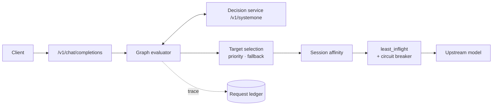

# RoutePilot

**Natural-language-driven intelligent routing for LLM traffic.**

English | [简体中文](README.zh-CN.md)

RoutePilot is an OpenAI-compatible routing proxy. Requests enter through `/v1/chat/completions`; a versioned decision graph selects the upstream model. Graphs are edited, validated, dry-run and published in the built-in console.


## Features

| Area | Capability |
|---|---|
| Entry point | `POST /v1/chat/completions`, JSON and SSE, `x-sr-model` / `x-sr-selection` / `x-sr-reasoning*` response headers |
| Routing policy | Visual decision graph: conditions, decision-service questions, logic gates, model targets |
| Decision service | `choice` / `noul` / `score` questions, batched per wave, sent to a `systemone`-compatible service |
| Target selection | Priority competition among activated targets; one fallback target `error_fallback` |
| Backend selection | Session affinity, `least_inflight` load balancing, per-model circuit breaker |
| Dry run | `/admin/try` executes the same graph and trace format without touching affinity, inflight counters or upstream models |
| Operations | Request ledger, decision replay, confidence distribution, model/provider catalog, JEV settings, time periods, audit history, role-based users |
| Console | Bilingual (zh/en) native ES Modules, no build step |

## Request pipeline



1. Load the immutable routing snapshot and evaluate request conditions (time period, text keywords).
2. Activate the first question wave; all questions in one wave are merged into one decision-service call.
3. Write numeric and `selected` ports, then re-evaluate downstream slot conditions and logic gates.
4. Repeat wave by wave until no further question is activated.
5. Select the highest-priority activated target; otherwise use `error_fallback`.
6. Apply session affinity, select a backend with `least_inflight`, proxy the request upstream.

`unknown` never activates a question or target. A numeric comparison against an unknown value stays unknown.

## Architecture

| Layer | Path | Responsibility |
|---|---|---|
| API | `router/api/` | DTO parsing, exception-to-HTTP mapping, upstream proxy, presenters |
| Control plane | `router/control/` | Write use cases for graphs and configuration, enable validation |
| Routing domain | `router/routing/` | Graph model, validation, compiled topology, evaluator, scheduler |
| Decision service | `router/jev/` | `systemone` client, settings, input window |
| Upstream | `router/upstream/` | Backend catalog, proxy transport, circuit breaker and sync worker |
| Storage | `router/store/` | SQLite schema/repositories, graph-file repository |
| Console | `router/console/` | Bilingual native ES Module UI |
| Runtime | `router/request_logging.py`, `router/maintenance.py` | Ledger queue/worker, session purge |

Boundaries:

- `router/routing/` and `router/upstream/` import neither FastAPI nor SQLite. `router/control/` and `router/store/` do not import `router.api`.
- The API layer parses DTOs and maps exceptions; it does not write control-plane state. Account and session routes (`/admin/login`, `/admin/logout`, `/admin/users`, `/admin/me`) call `UserRepo`/`SessionRepo`/`ChangeRepo` directly.
- `GraphService` validates, prepares a candidate snapshot, writes the graph file under the single-writer lock, re-checks the document hash, publishes the snapshot, then records the audit entry. A stale draft returns 409.
- `ConfigurationService` writes rows and the audit entry inside one transaction, re-checks the graph fingerprint inside that transaction, commits, then swaps the in-memory snapshot. An unstable fingerprint raises before COMMIT.
- `compile_graph()` runs once per published snapshot. The request path reads `snapshot.require_compiled()` and never rebuilds indexes or opens SQLite.
- The event loop only enqueues ledger rows into a bounded queue and a 20-entry ring; a 2-second flush projects whitelisted columns and writes them through `asyncio.to_thread`.
- The breaker worker loads shared quarantine state at startup and syncs local changes every 30 seconds on a worker thread.

## Console


One `<script type="module">` entry per page, no application globals, no CommonJS.

| Page | Content |
|---|---|
| Overview | Request volume, route distribution, JEV confidence, sticky hits, active decision group |
| Decision groups | Canvas editor, graph settings, inspector, validation, dry run, import/export |
| Calc Log | Recent decisions with model, target, candidates, waves, JEV probabilities, reasoning, upstream outcome, replayable trace |
| JEV Model | Endpoint, model, prompt/state template, connection test, context and input-token window |
| Models | Model registry, upstream model ids, providers, reasoning declarations, capability notes |
| Users | Admin/viewer accounts, passwords, roles, status |

### Editor and execution zone

The routing page is split into two zones.

**Editor zone** — canvas, node library, inspector, validation:

- Drag nodes from the library, pan/zoom, auto-layout, undo/redo.
- Typed wires; a numeric output dropped into a boolean slot creates a default condition.
- Each input slot is an OR input with its own edge condition.
- Dragging an output onto empty canvas quick-creates a compatible node.
- Save and enable are separate; dirty and layout-only states are shown in the toolbar.
- Target cards show display name, model list, fallback role and scheduling strategy.

**Execution zone** — docked below the canvas:

- Input field, sample prompts, run button.
- Result: final target, model, candidates with priorities, selection reason, waves and call count.
- Execution trace: one card per wave with hit conditions, plus the full request timeline.

Dry runs highlight the winning path wave by wave. Selecting a trace row pans the canvas to the corresponding edge or node; editing entry points are the canvas and inspector.


### Decision log


Expanded rows show the calculation stages in order: input preparation, initial computation, per-wave JEV, candidates and final pick, model scheduling, execution result. A `routing_error` keeps the partial process up to the failure point: a schedule-stage failure keeps the scheduling snapshot (configured, registered, available, unavailable reasons, pre-selection inflight), and a failed JEV wave voids that round's candidates and falls to `error_fallback`. Records without a scheduling snapshot and restored ledger rows report the missing detail explicitly.

SQLite stores ledger fields only — no request text, trace, per-wave answers or node labels. The page reads the last 20 live records from an in-process ring; calculation detail is replica-local and not persisted.

## Decision graph

### Nodes

| Type | Purpose | Inputs | Outputs |
|---|---|---|---|
| `start` | Request entry, always true | — | boolean |
| `question` | Decision-service question: `choice`, `noul`, `score` | Boolean slots `in_1..in_n` (OR) | choice: `prob.*`, `selected.*`, `p_top`, `margin`; noul: `yes`, `no`; score: `value` |
| `logic` | Three-valued gate: `and`, `or`, `not` | Boolean slots `in_1..in_n`, one edge and condition per slot | boolean |
| `condition` | Request condition: time period or text keywords | — | boolean |
| `target` | Model target: models, reasoning tiers, priority, strategy | Boolean slots `in_1..in_n` (OR) | — |

### Conditions

Conditions live on edges:

```json
{
  "id": "e-cap-strong-and-power",
  "source": "capability",
  "source_port": "prob.strong",
  "target": "and-power",
  "target_port": "in_1",
  "condition": { "op": "gt", "value": 0.65 }
}
```

| Upstream output | Condition | Evaluation |
|---|---|---|
| number | `gt` / `gte` / `lt` / `lte` / `eq` / `neq` + finite threshold | Value comparison; unknown propagates as unknown |
| boolean | `null` (equivalent to `= true`) or `{ "op": "is", "value": true \| false }` | Boolean expectation |

- One output can feed multiple slots; every slot keeps its own condition.
- Two slots of an AND gate can express a range, e.g. `> 0.3` and `< 0.8`.
- Each input slot accepts one edge. Slot numbers are stable; released slots are reusable.
- `not` has exactly one slot; `and` / `or` require at least two. Question and target slots are OR.

### Execution rules

- Questions execute in waves; one wave is one decision-service call.
- A failed wave voids the round: no ports are written and all candidates from that round are discarded.
- Target priorities are unique; the larger number wins.
- `error_fallback` handles a normal run with no activated target, and a decision call that fails, times out or returns an invalid answer.
- The fallback reference must point to an existing target.

### Limits

| Item | Limit |
|---|---:|
| Nodes | 200 |
| Edges | 400 |
| Question nodes | 32 |
| Question chain depth | 8 waves |
| Options per choice question | 255 |
| Score criteria | 2–10 finite values |

### Graph document

```json
{
  "kind": "sr-routing-graph",
  "version": 3,
  "name": "Default routing",
  "timezone": "Asia/Shanghai",
  "sticky": { "enabled": true, "ttl_seconds": 1800 },
  "root": {
    "id": "root",
    "type": "graph",
    "error_fallback": "safe-target",
    "nodes": [],
    "edges": []
  }
}
```

Only `sr-routing-graph` v3 is accepted. Version-2 documents, non-v3 `kind` values, unknown node types and unknown envelope/node/edge fields are rejected before they replace a draft or a published snapshot. Structural rejections surface as `graph_parse_error`; the console runs the same validation before applying an import.

`tree_revision` is the SHA-256 of canonical JSON over `{timezone, sticky, root}`, with nodes sorted by id and edges by `(target, slot, source, source_port)`. Python and the console produce the same canonical form; the console uses it to classify edits, and `tree_revision` is computed by the server. Title, capability, position, array order and edge-id changes do not affect it.

## Models and reasoning


A model slot used by the graph maps to an upstream model id and a provider. A target can hold several slots; `least_inflight` selects among them.

Providers define the OpenAI-compatible base URL, API-key environment variable and reasoning dialect. Model profiles declare:

- reasoning support and default level;
- level-to-wire mapping for `off`, `on`, `minimal`, `low`, `medium`, `high`, `xhigh`, `max`;
- capability notes and catalog metadata.

Reasoning dialects: OpenAI, DeepSeek, Qwen, Qwen chat template, OpenRouter, Z.ai, Together, string-thinking, Ant Ling. An unsupported requested level is forwarded without reasoning injection and the response carries `x-sr-reasoning-warning`.

`GET /admin/models` returns `profile` as a JSON object; the database stores it as JSON text.

## Decision service (JEV)


The decision service exposes `POST /v1/systemone`; typical deployments use NeoHorse or vLLM. Console settings:

- base URL, model, API key, timeout;
- default instructions and state template (must contain `{request}`);
- connection test with two fixed candidates;
- context budget and input truncation limit; oversized input is truncated head/tail.

Environment variables seed the decision-service configuration on first start only; the database is authoritative afterwards.

## Access and operations

- Email/password login, scrypt hashing, opaque bearer sessions.
- `admin` can edit graphs, models, JEV settings and users; `viewer` is read-only.
- The last active admin cannot be demoted, disabled or deleted.
- User and configuration changes are recorded in the audit log.
- Graph files are content-addressed by SHA-256 for save conflicts and reload checks; no graph history is retained.
- Control-plane state is SQLite (WAL); routing graphs are shared JSON files. Ledger writes run on a worker thread.
- Session affinity and inflight counters are process-local.

## Graph storage and replicas

Graphs are not stored in SQLite. Each decision group is one v3 document at `ROUTER_GRAPH_DIR/graphs/{tree_id}.json`; `ROUTER_GRAPH_DIR/current` contains the enabled group id.

- Single writer: the admin API. Other replicas run with `ROUTER_GRAPH_WRITER=false`, mount the directory read-only and reload every 2 seconds.
- A replica compiles a candidate snapshot before replacing the serving snapshot; an invalid file leaves the previous snapshot active and `/readyz` reports stale.
- Writes are atomic through temporary files with mode `0600`.
- Kubernetes: ReadWriteMany PVC for graph files; SQLite on local storage for the writer.
- Docker: mount the same NFS export into every container.
- All writer/reader containers must share the same numeric UID; mode `0600` files are not accessible through GID or `fsGroup` alone.
- A stale save returns 409 `graph_conflict`; imports only change the draft.
- `/healthz` is liveness. `/readyz` reports initial-snapshot readiness; 503 means not ready, and a later reload failure keeps the existing snapshot with `"stale": true`.
- Migration: `python scripts/export_sqlite_graphs.py --db router.db --out routing-graph`. The output directory must not exist; startup never deletes old SQLite graphs.

## Quick start

```bash
python3.11 -m venv .venv
.venv/bin/pip install -r requirements.txt

# Local development, authentication disabled
ROUTER_DB=/tmp/routepilot.db \
ROUTER_GRAPH_DIR=/tmp/routepilot-graph \
ROUTER_USER_AUTH=0 \
.venv/bin/python -m router
```

Console: `http://127.0.0.1:8400/console/`.

```bash
# Protected deployment
ROUTER_DB=/var/lib/routepilot/router.db \
ROUTER_GRAPH_DIR=/var/lib/routepilot/graph \
ROUTER_HOST=0.0.0.0 \
ROUTER_PORT=8400 \
ROUTER_ADMIN_EMAIL=admin@example.com \
ROUTER_ADMIN_PASSWORD='change-me-now' \
.venv/bin/python -m router
```

The first start against an empty users table seeds the admin account.

## Configuration

| Variable | Default | Purpose |
|---|---|---|
| `ROUTER_DB` | `router.db` | SQLite control-plane database |
| `ROUTER_GRAPH_DIR` | `./routing-graph` | Graph files and enabled pointer |
| `ROUTER_GRAPH_WRITER` | `true` | Allow graph writes; run exactly one writer |
| `ROUTER_HOST` | `127.0.0.1` | Listener host |
| `ROUTER_PORT` | `8400` | Listener port |
| `ROUTER_JEV_URL` | empty | Decision-service base URL |
| `ROUTER_JEV_MODEL` | empty | Decision-service model; paired with `ROUTER_JEV_URL` |
| `ROUTER_JEV_API_KEY` | empty | Decision-service key |
| `ROUTER_JEV_TIMEOUT` | `10` | Decision-service timeout, seconds |
| `ROUTER_SESSION_MAX_ENTRIES` | `10000` | Session-affinity LRU capacity |
| `ROUTER_USER_AUTH` | `true` | Console authentication |
| `ROUTER_ADMIN_EMAIL` | `admin@test.com` | First-run admin email |
| `ROUTER_ADMIN_PASSWORD` | seed value | First-run admin password |
| `ROUTER_SESSION_TTL_HOURS` | `168` | Console session lifetime |

## API

| Method and path | Purpose |
|---|---|
| `POST /v1/chat/completions` | Routing entry; JSON or SSE |
| `GET /healthz` | Liveness probe |
| `GET /readyz` | Snapshot readiness |
| `POST /admin/login` / `POST /admin/logout` | Console session |
| `GET /admin/me` / `POST /admin/me/password` | Current user, password change |
| `GET/POST /admin/trees`, `GET/PUT /admin/trees/{id}` | Decision groups |
| `POST /admin/trees/{id}/copy`, `/enable`, `/disable` | Group lifecycle |
| `POST /admin/try` | Dry run against a draft graph |
| `GET/POST /admin/models`, `GET/PUT/DELETE /admin/models/{id}` | Model registry |
| `GET /admin/model-catalog`, `POST /admin/fetch-models` | Provider presets, upstream model discovery |
| `GET /admin/providers`, `PUT/DELETE /admin/providers/{name}` | Providers |
| `GET/PUT /admin/jev`, `POST /admin/jev/test` | Decision-service settings |
| `GET/PUT /admin/jev/window` | JEV context and input-token window |
| `GET/PUT /admin/time-periods` | Time periods |
| `GET /admin/requests/recent`, `GET /admin/requests/stats` | Live request ring, logger stats |
| `GET /admin/overview`, `GET /admin/changes` | Overview, audit history |
| `GET/POST /admin/users`, `PUT/DELETE /admin/users/{id}`, `POST /admin/users/{id}/password` | Users |

### Errors

| Status | Error | Meaning |
|---|---|---|
| 400 | `invalid_json` / `body_must_be_object` / `messages_must_be_list` | Malformed body |
| 413 | `request_too_large` | Body exceeds 10 MiB |
| 502 | `upstream_error` | Upstream 5xx or network failure |
| 409 | `graph_conflict` | Graph changed after the draft was loaded |
| 409 | `graph_already_exists` | Duplicate graph id |
| 503 | `graph_read_only` | Reader replica |
| 503 | `graph_storage_error` | Shared graph storage unreadable |
| 503 | `no_valid_snapshot` | No initial snapshot |
| 503 | `no_active_tree` | No enabled decision group |
| 503 | `no_available_backend` | All backends of the selected target unavailable |
| 503 | `routing_failed` / `routing_invariant_violation` | Internal routing failure |

Upstream 4xx responses pass through with their status and body.

Configuration endpoints: `/admin/models`, `/admin/providers`, `/admin/jev`, `/admin/jev/window`, `/admin/time-periods`. There is no generic `/admin/settings` API.

## Tests

```bash
.venv/bin/python -m pytest -q
node --test scripts/console_graph_test.mjs scripts/console_draft_test.mjs scripts/graph_contract_test.mjs
npm install
npm run check:console
.venv/bin/python scripts/i18n_dead_keys.py
```

- `pytest` collects `tests/` only (`testpaths`), runs unit and FastAPI integration tests, starts no browser and does not collect `experiments/`.
- `node --test` runs the ES-module suites: graph/canonical behavior, draft state and cross-runtime contract fixtures (`tests/fixtures/graph_contracts.json`).
- `npm run check:console` runs the three Node suites and the Playwright acceptance matrix against a temporary database, mock decision service and mock upstream. Screenshots are off by default; `QA_SCREENSHOTS=1` regenerates them. `QA_ONLY=<regex>` selects cases; a page module runs standalone, e.g. `node scripts/console_qa/canvas.mjs`. Set `CHROME=/path/to/chrome` when Chromium is not in the default cache.
- `scripts/i18n_dead_keys.py` reports unreferenced dictionary keys.

Experiments are standalone and excluded from the default run:

```bash
.venv/bin/python -m pytest -q experiments/jev-batch/test_spike_jev_batch.py
.venv/bin/python experiments/jev-batch/spike_jev_batch.py --samples /path/to/samples.jsonl --scenario all --dry-run
```

## Project layout

```
router/
  api/                 FastAPI routes, DTOs, exception mapping, proxy wiring, presenters
  control/             control-plane write services and enable validation
  routing/
    graph/             graph model, validation, conditions, compiler, evaluator
    service.py         evaluate → schedule orchestration
    scheduling.py      sticky selection, lease acquisition, affinity writes
    affinity.py        session-affinity LRU
    scheduler.py       least_inflight balancer and leases
    snapshot.py        immutable snapshot assembly and compiled topology
    tree.py            tree envelope codec and revision
    codec.py           strict field parsing helpers
  request_logging.py   ledger queue/ring and worker-thread writes
  jev/                 decision-service client, settings, input window
  upstream/            catalog, proxy transport, circuit breaker + sync worker
  store/               SQLite schema/repositories, graph-file repository
  console/             bilingual native ES Module console
configs/               example decision groups
tests/                 pytest suite and contract fixtures
scripts/               Node contract tests, Playwright QA, deployment helpers
experiments/jev-batch/ standalone JEV batch spike
assets/routepilot/     README screenshots
```

---

© 2026 Sandlake. All rights reserved.
