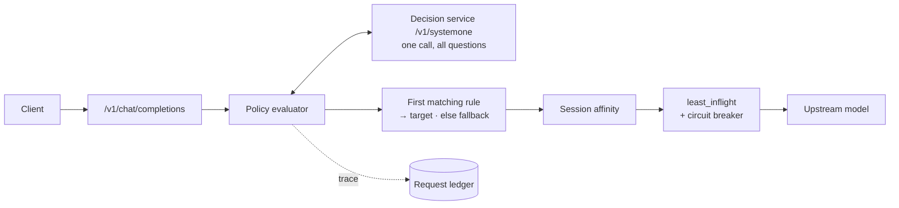
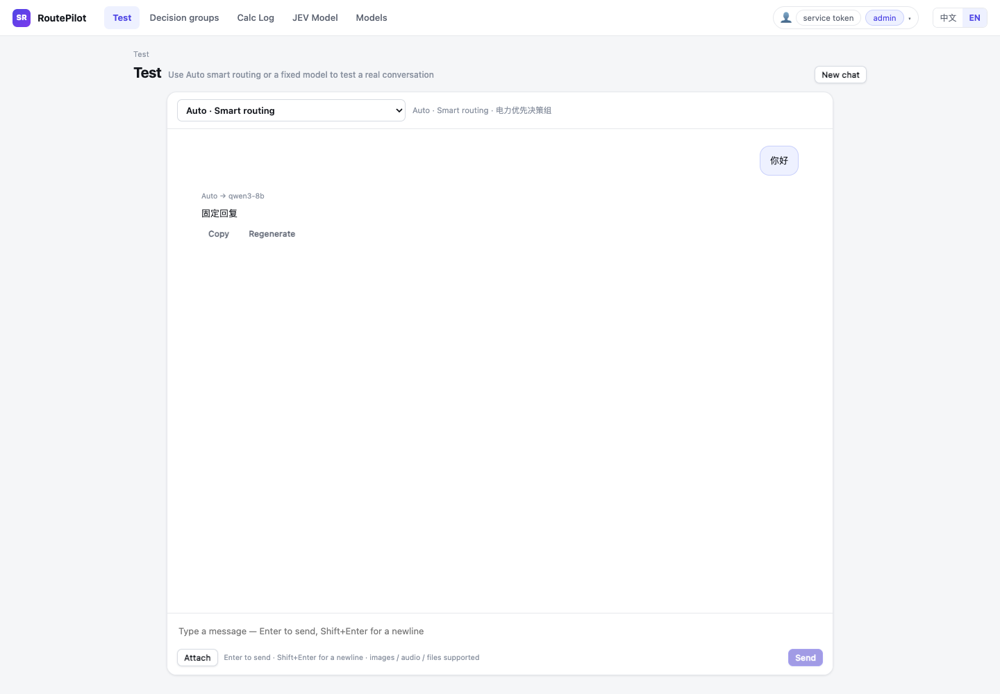
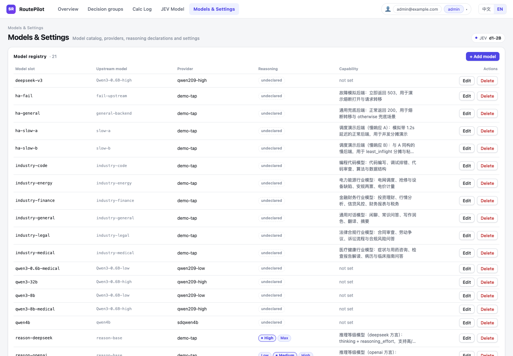

# RoutePilot

**Natural-language-driven intelligent routing for LLM traffic.**

English | [简体中文](README.zh-CN.md)

RoutePilot is an OpenAI-compatible routing proxy. Requests enter through `/v1/chat/completions`; a versioned routing policy selects the upstream model. Policies are edited, validated, dry-run and published in the built-in console.

## Features

| Area | Capability |
|---|---|
| Entry point | `POST /v1/chat/completions`, JSON and SSE, `x-sr-model` / `x-sr-selection` / `x-sr-reasoning*` response headers |
| Routing policy | Declarative document: decision-service questions, logic gates, model targets, ordered rules, one fallback target |
| Decision service | `choice` / `noul` / `score` questions, all sent in one `systemone`-compatible call per request |
| Target selection | First matching rule wins; the fallback target covers decision failure and no-match |
| Backend selection | Session affinity, `least_inflight` load balancing, per-model circuit breaker |
| Dry run | `/admin/try` executes the same evaluator with the same trace format without touching affinity, inflight counters or upstream models |
| Operations | Request ledger, decision replay, confidence distribution, model/provider catalog, JEV settings, time periods, audit history, role-based users |
| Console | Bilingual (zh/en) native ES Modules, no build step |

## Request pipeline



1. Load the immutable routing snapshot and compute the active time periods.
2. Build every question of the policy once and send them all in a single decision-service call.
3. Strictly validate the complete answer set; any missing, extra or invalid answer voids the round without using partial answers.
4. Evaluate the rules in order; the first match selects its target and evaluation stops.
5. If no rule matched — or the decision call failed — the policy's fallback target is used.
6. Apply session affinity, select a backend with `least_inflight`, proxy the request upstream.

## Architecture

| Layer | Path | Responsibility |
|---|---|---|
| API | `router/api/` | DTO parsing, exception-to-HTTP mapping, upstream proxy, presenters |
| Control plane | `router/control/` | Write use cases for policies and configuration, enable validation |
| Routing domain | `router/routing/` | Policy model, validation, evaluator, scheduler, snapshot |
| Decision service | `router/jev/` | `systemone` client, settings, input window |
| Upstream | `router/upstream/` | Backend catalog, proxy transport, circuit breaker and sync worker |
| Storage | `router/store/` | SQLite schema/repositories, policy-file repository |
| Console | `router/console/` | Bilingual native ES Module UI |
| Runtime | `router/request_logging.py`, `router/maintenance.py` | Ledger queue/worker, session purge |

Boundaries:

- `router/routing/` and `router/upstream/` import neither FastAPI nor SQLite. `router/control/` and `router/store/` do not import `router.api`.
- The API layer parses DTOs and maps exceptions; it does not write control-plane state. Account and session routes (`/admin/login`, `/admin/logout`, `/admin/users`, `/admin/me`) call `UserRepo`/`SessionRepo`/`ChangeRepo` directly.
- `PolicyService` validates, writes the policy document under the single-writer lock, re-checks the document hash, publishes the snapshot, then records the audit entry. A stale draft returns 409.
- `ConfigurationService` writes rows and the audit entry inside one transaction, re-checks the active policy fingerprint inside that transaction, commits, then swaps the in-memory snapshot. An unstable fingerprint raises before COMMIT.
- The enabled policy is parsed once per published snapshot; there is no compile step. The request path reads the immutable snapshot and never rebuilds indexes or opens SQLite.
- The event loop only enqueues ledger rows into a bounded queue and a 20-entry ring; a 2-second flush projects whitelisted columns and writes them through `asyncio.to_thread`.
- The breaker worker loads shared quarantine state at startup and syncs local changes every 30 seconds on a worker thread.

## Console



One `<script type="module">` entry per page, no application globals, no CommonJS.

| Page | Content |
|---|---|
| Test | Admin-only model test chat: Auto routing or a fixed model, SSE streaming, in-memory multi-turn history, image/text/audio/file attachments, safe multimodal rendering |
| Routing policy | Five-section editor (questions, targets, rules, settings, try), ordered rules, validation, dry run, import/export, independent layout |
| Calc Log | Recent decisions with model, target, matched rule, JEV answers, upstream outcome, replayable trace |
| JEV Model | Endpoint, model, prompt/state template, connection test, context and input-token window |
| Models | Model registry, upstream model ids, providers, reasoning declarations, capability notes |
| Users | Admin/viewer accounts, passwords, roles, status |

### Model test chat

The home page (`/console/index.html`) is an admin-only model test chat. It posts to `/admin/test/chat/completions` and shows the actual model in the message metadata (`Auto → <model>` for Auto, `<model> · fixed model` for a fixed model), using the `x-sr-model` response header.

- **Auto or fixed model** — Auto evaluates the current routing snapshot (policy, one JEV call, sticky and load-balanced backend selection) exactly like `/v1/chat/completions`. Choosing a configured model ID skips the policy and JEV and returns `x-sr-selection: direct`.
- **Streaming** — answers stream over SSE; Stop aborts the stream and keeps the partial answer, and Copy / Retry / Regenerate act on the message.
- **Multi-turn history** — the in-memory transcript is resent as wire-format `messages`; New Chat clears the conversation and rotates the session id.
- **Attachments** — image, text, audio and generic files are read to data URLs in the browser and sent as content parts. The whole JSON body, including history and Base64, must stay within the 10 MiB request limit.
- **Multimodal output** — text renders as safe Markdown; images, audio, video and files use native players or download links; unknown parts stay folded as inspectable JSON. Model-provided HTML is shown as text and active URL schemes are dropped, so nothing executes.
- **Memory only** — conversations and attachments live in the page; a refresh clears them, and the server stores neither chat history nor uploaded files.

### Policy editor

The routing page edits the policy document itself — no second behavior model.

**Editor sections:**

- Policy settings — name, timezone, sticky.
- Questions — `choice` / `noul` / `score` question cards; more than 8 choice options shows a non-blocking evaluation hint.
- Targets — model slots with optional reasoning levels; the fallback role is marked.
- Rules — ordered, editable rows; the list states that the first match wins and evaluation stops there.

**Try zone** — docked below the editor:

- Input field, run button.
- Result: matched rule, final target and models, fallback flag with its reason, JEV answers.
- Trace: one JEV block plus a verdict card for each evaluated rule in backend order, then the final target.

Dry runs never write disk, snapshot, sticky or inflight state and never call upstream models. The console only renders the backend's answers and rule verdicts — it implements no routing logic of its own.

Save and enable are separate; dirty and layout-only states are shown in the toolbar. A save conflict (409 `policy_conflict`) keeps the local draft instead of overwriting it. Layout (panel sizes and positions) is saved through its own API and never changes the behavior revision, document hash or enabled snapshot.

### Decision log

Expanded rows show the decision in order: input preparation, the single JEV call, per-rule verdicts, final target, model scheduling, execution result. Fallback rows name the reason: `jev_error` (the decision call failed, timed out or returned invalid answers) or `no_rule_matched` (answers were fine but no rule hit). A `routing_error` keeps the partial process up to the failure point: a schedule-stage failure keeps the scheduling snapshot (configured, registered, available, unavailable reasons, pre-selection inflight), and a failed decision call falls to the policy fallback. Direct model records show zero JEV calls. Records without a scheduling snapshot and restored ledger rows report the missing detail explicitly.

SQLite stores ledger fields only — no request text, trace, answers or rule names. The page reads the last 20 live records from an in-process ring; calculation detail is replica-local and not persisted.

## Routing policy

A policy is one versioned document with four parts:

- **questions** — the decision-service questions asked about each request: `choice` (pick one of the options), `noul` (a yes/no confidence), `score` (a numeric severity level).
- **targets** — named model groups; each target lists model slots with optional reasoning levels.
- **rules** — ordered conditions; the first matching rule routes the request to its target.
- **fallback** — the target used when no rule matched or the decision call failed.

### Answers and conditions

Each answer exposes typed paths:

| Question type | Answer paths |
|---|---|
| `choice` | `route.selected` (option key), probabilities per option, `p_top`, `margin` |
| `noul` | `risk.yes`, `risk.no` |
| `score` | `severity.value` (the numeric legend value) |

A condition compares one answer path against a finite threshold or option key:

```json
{"answer": "risk.yes", "gte": 0.8}
{"answer": "route.selected", "eq": "strong"}
{"answer": "severity.value", "gte": 5}
```

Number comparisons accept `gt` / `gte` / `lt` / `lte` / `eq` / `neq`; `eq` / `neq` also compare option keys. Logic gates compose conditions:

```json
{"any": [
  {"answer": "risk.yes", "gte": 0.65},
  {"answer": "route.selected", "eq": "power"}
]}
{"all": [
  {"answer": "route.selected", "eq": "strong"},
  {"answer": "severity.value", "gte": 5}
]}
{"not": {"answer": "risk.yes", "gte": 0.8}}
```

`all` requires every branch, `any` at least one, `not` negates its single branch. Empty gate arrays are rejected.

### Execution rules

- All questions of a policy are built once and sent in **one** decision-service call; the evaluator never retries and a request never triggers a second call.
- Answers must be complete and strictly valid. A response with missing answers, extra answers, non-finite numbers, illegal probabilities or a non-200 status voids the round: no partial answers are used and the fallback target serves the request with reason `jev_error`.
- Rules are evaluated in document order; the first match wins and later rules are not evaluated.
- When no rule matches, the fallback target serves the request with reason `no_rule_matched`.
- The fallback reference must point to an existing target; a target with no available backend is a 503, never a silent switch.

### Limits

| Item | Limit |
|---|---:|
| Questions | 32 |
| Rules | 200 |
| Conditions (all rules combined) | 400 |
| Condition nesting depth | 16 |
| Options per choice question | 255 |
| Score criteria | 2–10 finite values |

### Policy document

```json
{
  "kind": "sr-routing-policy",
  "version": 4,
  "name": "Default routing",
  "timezone": "Asia/Shanghai",
  "sticky": { "enabled": true, "ttl_seconds": 1800 },
  "questions": {},
  "targets": {},
  "rules": [],
  "fallback": "safe"
}
```

Only `sr-routing-policy` v4 is accepted. Unknown fields and mistyped values are rejected before a draft or a published snapshot is replaced; structural rejections surface as `policy_parse_error`, and enable-time checks (unknown models, unknown periods, missing JEV) surface as a machine-readable issue list. The console runs the same validation before applying an import.

`policy_revision` is the SHA-256 of canonical JSON over the document without `name`; object keys are sorted, so the order of `questions`/`targets` keys has no behavior meaning, while the `rules` array order is semantic and never reordered. The console uses the revision to classify edits, and the server computes it.

## Models and reasoning



A model slot used by a policy maps to an upstream model id and a provider. A target can hold several slots; `least_inflight` selects among them.

Providers define the OpenAI-compatible base URL, API-key environment variable and reasoning dialect. Model profiles declare:

- reasoning support and default level;
- level-to-wire mapping for `off`, `on`, `minimal`, `low`, `medium`, `high`, `xhigh`, `max`;
- capability notes and catalog metadata.

Reasoning dialects: OpenAI, DeepSeek, Qwen, Qwen chat template, OpenRouter, Z.ai, Together, string-thinking, Ant Ling. An unsupported requested level is forwarded without reasoning injection and the response carries `x-sr-reasoning-warning`.

`GET /admin/models` returns `profile` as a JSON object; the database stores it as JSON text.

## Decision service (JEV)


The decision service exposes `POST /v1/systemone`; typical deployments use NeoHorse or vLLM. Console settings:

- base URL, model, API key, timeout;
- default instructions and state template (must contain `{request}`);
- connection test with two fixed candidates;
- context budget and input truncation limit; oversized input is truncated head/tail.

Environment variables seed the decision-service configuration on first start only; the database is authoritative afterwards.

## Access and operations

- Email/password login, scrypt hashing, opaque bearer sessions.
- `admin` can edit policies, models, JEV settings and users; `viewer` is read-only.
- The last active admin cannot be demoted, disabled or deleted.
- User and configuration changes are recorded in the audit log.
- Policy files are content-addressed by SHA-256 for save conflicts and reload checks; no policy history is retained.
- Control-plane state is SQLite (WAL); routing policies are shared JSON files. Ledger writes run on a worker thread.
- Session affinity and inflight counters are process-local.

## Policy storage and replicas

Policies are not stored in SQLite. Each policy is one v4 document at `ROUTER_POLICY_DIR/policies/{policy_id}.json`; the front-end layout of each policy lives separately at `ROUTER_POLICY_DIR/layouts/{policy_id}.json`; `ROUTER_POLICY_DIR/current` holds the enabled policy id.

- Single writer: the admin API. Other replicas run with `ROUTER_POLICY_WRITER=false`, mount the directory read-only and reload every 2 seconds.
- A replica validates a candidate snapshot before replacing the serving snapshot; an invalid file leaves the previous snapshot active and `/readyz` reports stale.
- Writes are atomic through temporary files with mode `0600`.
- Kubernetes: ReadWriteMany PVC for policy files; SQLite on local storage for the writer.
- Docker: mount the same NFS export into every container.
- All writer/reader containers must share the same numeric UID; mode `0600` files are not accessible through GID or `fsGroup` alone.
- A stale save returns 409 `policy_conflict`; imports only change the draft.
- `/healthz` is liveness. `/readyz` reports initial-snapshot readiness; 503 means not ready, and a later reload failure keeps the existing snapshot with `"stale": true`.
- A database that still carries the legacy v3 tree table refuses to start; back it up and point the deployment at a fresh `ROUTER_DB`.

## Quick start

```bash
python3.11 -m venv .venv
.venv/bin/pip install -r requirements.txt

# Local development, authentication disabled
ROUTER_DB=/tmp/routepilot.db \
ROUTER_POLICY_DIR=/tmp/routepilot-policy \
ROUTER_USER_AUTH=0 \
.venv/bin/python -m router
```

Console: `http://127.0.0.1:8400/console/`.

```bash
# Protected deployment
ROUTER_DB=/var/lib/routepilot/router.db \
ROUTER_POLICY_DIR=/var/lib/routepilot/policy \
ROUTER_HOST=0.0.0.0 \
ROUTER_PORT=8400 \
ROUTER_ADMIN_EMAIL=admin@example.com \
ROUTER_ADMIN_PASSWORD='change-me-now' \
.venv/bin/python -m router
```

The first start against an empty users table seeds the admin account.

## Configuration

| Variable | Default | Purpose |
|---|---|---|
| `ROUTER_DB` | `router.db` | SQLite control-plane database |
| `ROUTER_POLICY_DIR` | `./routing-policy` | Policy files, layouts and enabled pointer |
| `ROUTER_POLICY_WRITER` | `true` | Allow policy writes; run exactly one writer |
| `ROUTER_HOST` | `127.0.0.1` | Listener host |
| `ROUTER_PORT` | `8400` | Listener port |
| `ROUTER_JEV_URL` | empty | Decision-service base URL |
| `ROUTER_JEV_MODEL` | empty | Decision-service model; paired with `ROUTER_JEV_URL` |
| `ROUTER_JEV_API_KEY` | empty | Decision-service key |
| `ROUTER_JEV_TIMEOUT` | `10` | Decision-service timeout, seconds |
| `ROUTER_SESSION_MAX_ENTRIES` | `10000` | Session-affinity LRU capacity |
| `ROUTER_USER_AUTH` | `true` | Console authentication |
| `ROUTER_ADMIN_EMAIL` | `admin@test.com` | First-run admin email |
| `ROUTER_ADMIN_PASSWORD` | seed value | First-run admin password |
| `ROUTER_SESSION_TTL_HOURS` | `168` | Console session lifetime |

## API

| Method and path | Purpose |
|---|---|
| `POST /v1/chat/completions` | Routing entry; JSON or SSE |
| `GET /healthz` | Liveness probe |
| `GET /readyz` | Snapshot readiness |
| `POST /admin/login` / `POST /admin/logout` | Console session |
| `GET /admin/me` / `POST /admin/me/password` | Current user, password change |
| `GET/POST /admin/policies`, `GET/PUT/DELETE /admin/policies/{id}` | Policy resources; PUT replaces the whole document and requires `If-Match` |
| `POST /admin/policies/{id}/enable`, `/disable` | Policy lifecycle |
| `GET/PUT /admin/policies/{id}/layout` | Front-end layout JSON; never changes behavior or snapshot |
| `POST /admin/try` | Dry run: exactly one of `policy_id` or an inline `policy` draft |
| `POST /admin/test/chat/completions` | Admin-only model test chat; JSON or SSE |
| `GET/POST /admin/models`, `GET/PUT/DELETE /admin/models/{id}` | Model registry |
| `GET /admin/model-catalog`, `POST /admin/fetch-models` | Provider presets, upstream model discovery |
| `GET /admin/providers`, `PUT/DELETE /admin/providers/{name}` | Providers |
| `GET/PUT /admin/jev`, `POST /admin/jev/test` | Decision-service settings |
| `GET/PUT /admin/jev/window` | JEV context and input-token window |
| `GET/PUT /admin/time-periods` | Time periods |
| `GET /admin/requests/recent`, `GET /admin/requests/stats` | Live request ring, logger stats |
| `GET /admin/overview`, `GET /admin/changes` | Overview, audit history |
| `GET/POST /admin/users`, `PUT/DELETE /admin/users/{id}`, `POST /admin/users/{id}/password` | Users |

### Errors

| Status | Error | Meaning |
|---|---|---|
| 400 | `invalid_json` / `body_must_be_object` / `messages_must_be_list` | Malformed body |
| 413 | `request_too_large` | Body exceeds 10 MiB |
| 422 | issue list | Document rejected: `policy_parse_error` or validation issues with machine-readable paths |
| 502 | `upstream_error` | Upstream 5xx or network failure |
| 409 | `policy_conflict` | Stored policy changed after the draft was loaded (If-Match mismatch) |
| 409 | message | Duplicate policy id, or deleting the enabled policy (`policy_is_active`) |
| 503 | `policy_read_only` | Reader replica |
| 503 | `policy_storage_error` | Shared policy storage unreadable |
| 503 | `no_valid_snapshot` | No initial snapshot |
| 503 | `no_active_policy` | No enabled policy |
| 503 | `no_available_backend` | All backends of the selected target unavailable |
| 503 | `routing_failed` / `routing_invariant_violation` | Internal routing failure |

Upstream 4xx responses pass through with their status and body.

Configuration endpoints: `/admin/models`, `/admin/providers`, `/admin/jev`, `/admin/jev/window`, `/admin/time-periods`. There is no generic `/admin/settings` API.

## Tests

```bash
.venv/bin/python -m pytest -q
npm install
npm run check:console
.venv/bin/python scripts/i18n_dead_keys.py
```

- `pytest` collects `tests/` only (`testpaths`), runs unit, FastAPI integration and end-to-end tests, starts no browser and does not collect `experiments/`.
- `npm run check:console` runs the Node suites (`console_chat_test`, `console_policy_test`, `console_draft_test`, `console_trace_test`, `policy_contract_test`) and the Playwright acceptance matrix against a temporary database, mock decision service and mock upstream. Screenshots are off by default; `QA_SCREENSHOTS=1` regenerates them. `QA_ONLY=<regex>` selects cases; a page module runs standalone, e.g. `node scripts/console_qa/policy.mjs`. Set `CHROME=/path/to/chrome` when Chromium is not in the default cache.
- `scripts/i18n_dead_keys.py` reports unreferenced dictionary keys.

The historical JEV batch-spike measurement reports remain under `docs/` as v3-era evidence; they do not describe v4 behavior.

## Project layout

```
router/
  api/                 FastAPI routes, DTOs, exception mapping, proxy wiring, presenters
  control/             control-plane write services and enable validation
  routing/
    policy/            v4 policy model, validation, single-JEV evaluator
    document.py         v4 document bytes codec (storage boundary)
    service.py          evaluate → schedule orchestration
    scheduling.py      sticky selection, lease acquisition, affinity writes
    affinity.py        session-affinity LRU
    scheduler.py       least_inflight balancer and leases
    snapshot.py         immutable snapshot assembly and publishing
    conditions.py      time-period matching
    codec.py           strict field parsing helpers
  request_logging.py   ledger queue/ring and worker-thread writes
  jev/                 decision-service client, settings, input window
  upstream/            catalog, proxy transport, circuit breaker + sync worker
  store/               SQLite schema/repositories, policy-file repository
  console/             bilingual native ES Module console
configs/               example routing policies (default and production)
tests/                 pytest suite, v4 fixtures, end-to-end harness
scripts/               Node contract tests, Playwright QA, deployment helpers
experiments/jev-batch/ historical spike README (executables removed with v3)
assets/routepilot/     README screenshots
```
