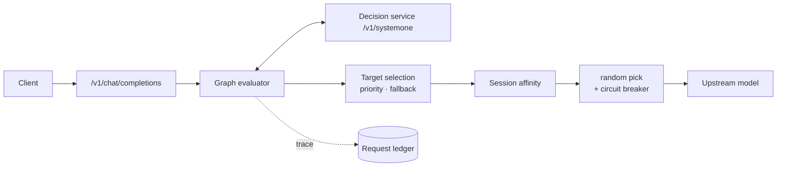
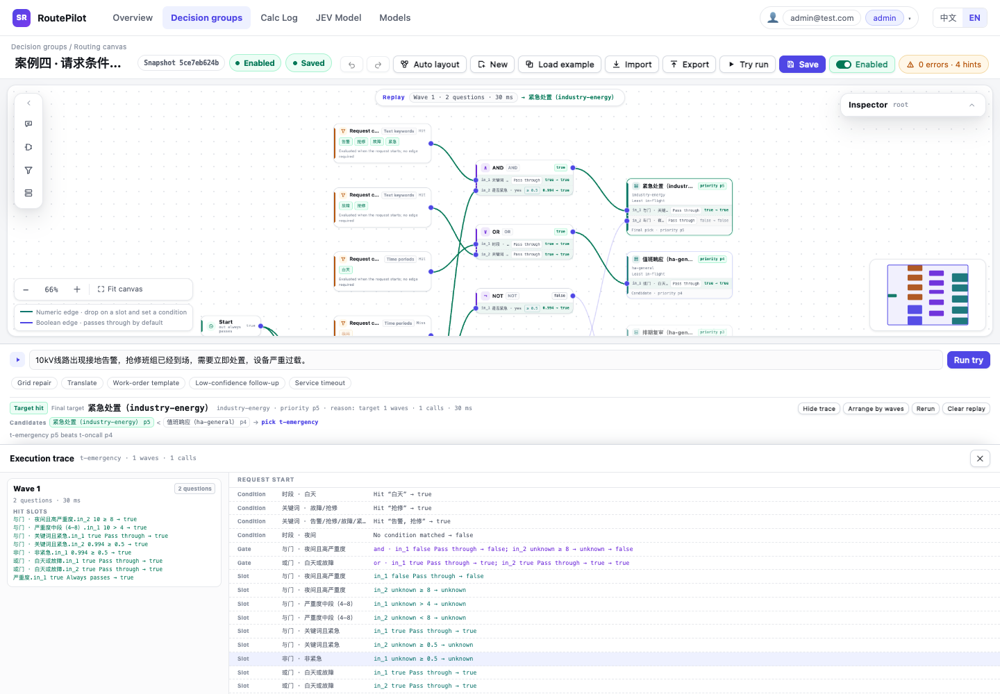
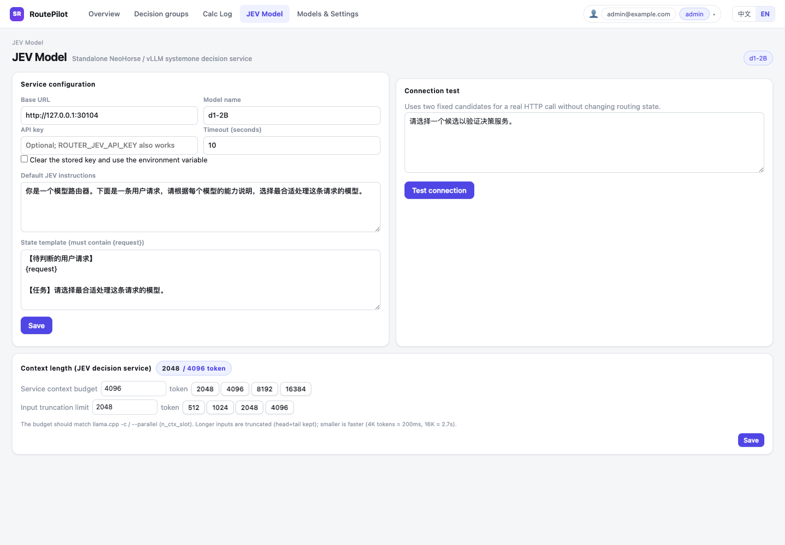

# RoutePilot

**Natural-language-driven intelligent routing for LLM traffic.**

English | [简体中文](README.zh-CN.md)

RoutePilot is an OpenAI-compatible routing proxy. Requests enter through `/v1/chat/completions`; a versioned decision graph selects the upstream model. Graphs are edited, validated, dry-run and published in the built-in console.


## Features

| Area | Capability |
|---|---|
| Entry point | `POST /v1/chat/completions`, JSON and SSE, `x-sr-model` / `x-sr-selection` / `x-sr-tree-id` / `x-sr-graph-selection` / `x-sr-reasoning*` response headers |
| Routing policy | Visual decision graph: conditions, decision-service questions, logic gates, model targets |
| Route set | Several decision graphs can be enabled at once; exactly one default graph serves public `/v1`, and department mappings let admin checks target a specific enabled graph |
| Decision service | `choice` / `noul` / `score` questions, batched per wave, sent to a `systemone`-compatible service; the canvas snapshot fixes which service profile a graph runs with |
| Target selection | Priority competition among activated targets; one fallback target `error_fallback` |
| Backend selection | Session affinity; random pick among a multi-model target's available models; Auto isolates circuit breaking and inflight per graph+model; fixed-model direct stays independent |
| Portable canvases | Every saved v4 canvas embeds its lifecycle markers, departments and complete non-secret run configuration, so one JSON file restores it on an empty database |
| Check routing | `/admin/try` executes the same graph and trace format without touching affinity, inflight counters or upstream models; it runs either the current draft or the published route set (optionally selected by department), and database drift is reported as hints only |
| Operations | Request ledger, decision replay, confidence distribution, model/provider catalog, multi-service JEV catalog, time periods, audit history, role-based users |
| Console | Bilingual (zh/en) native ES Modules, no build step |

## Request pipeline



1. Pick the graph from the published route set: public `/v1` always uses the default graph, while admin checks may select an enabled graph by department.
2. Load that graph's immutable snapshot and evaluate request conditions (time period, text keywords).
3. Activate the first question wave; all questions in one wave are merged into one decision-service call.
4. Write numeric and `selected` ports, then re-evaluate downstream slot conditions and logic gates.
5. Repeat wave by wave until no further question is activated.
6. Select the highest-priority activated target; otherwise use `error_fallback`.
7. Apply session affinity; on a miss, pick one of the target's available models at random, then proxy the request upstream.

`unknown` never activates a question or target. A numeric comparison against an unknown value stays unknown.

## Architecture

| Layer | Path | Responsibility |
|---|---|---|
| API | `router/api/` | DTO parsing, exception-to-HTTP mapping, upstream proxy, presenters |
| Control plane | `router/control/` | Write use cases for graphs and catalog entries, impact lists and confirmed canvas synchronization, enable validation |
| Routing domain | `router/routing/` | Graph model, validation, compiled topology, evaluator, scheduler, immutable route-set snapshots |
| Decision service | `router/jev/` | `systemone` client, service settings, input window |
| Upstream | `router/upstream/` | Fixed-model catalog (`model_id -> Backend`), proxy transport, circuit breaker and sync worker |
| Storage | `router/store/` | SQLite schema/repositories, graph-file repository |
| Console | `router/console/` | Bilingual native ES Module UI |
| Runtime | `router/request_logging.py`, `router/maintenance.py` | Ledger queue/worker, session purge |

Boundaries:

- `router/routing/` and `router/upstream/` import neither FastAPI nor SQLite. `router/control/` and `router/store/` do not import `router.api`.
- The API layer parses DTOs and maps exceptions; it does not write control-plane state. Account and session routes (`/admin/login`, `/admin/logout`, `/admin/users`, `/admin/me`) call `UserRepo`/`SessionRepo`/`ChangeRepo` directly.
- `GraphService` validates, prepares the candidate route set, writes lifecycle documents under the single-writer lock, re-checks the route fingerprint, publishes the complete enabled set, then records the audit entry. A stale draft returns 409.
- `ConfigurationService` commits a catalog write and the canvases confirmed to be affected inside one application transaction: re-check the impact list under the write lock, validate every candidate document, stage/replace graph files (non-default enabled graphs first, the default graph last), re-check the route-set fingerprint, record the audit entry, then commit. A write that synchronizes at least one enabled graph republishes the whole enabled set; a draft-only sync publishes nothing; a stale confirmation returns 409 `graph_conflict` before any write.
- A catalog write that nothing references writes rows and audit only. It never rewrites canvases and never republishes the snapshot.
- `compile_graph()` runs once per enabled graph in a published route set. The request path reads `snapshot.require_compiled()` and never rebuilds indexes or opens SQLite.
- The event loop only enqueues ledger rows into a bounded queue and a 20-entry ring; a 2-second flush projects whitelisted columns and writes them through `asyncio.to_thread`.
- The breaker worker loads shared quarantine state at startup and syncs local changes every 30 seconds on a worker thread.

## Console


One `<script type="module">` entry per page, no application globals, no CommonJS.

| Page | Content |
|---|---|
| Test | Admin-only model test chat: Auto-only smart routing through the published route set (default graph, or a trusted department header), SSE streaming, in-memory multi-turn history, image/text/audio/file attachments, safe multimodal rendering |
| Decision groups | Canvas editor, multi-graph lifecycle (enable/disable, set as default, default marker), departments in graph settings, layout and runtime settings (timezone/sticky/fallback, JEV selection, refresh runtime from the database catalog), inspector, validation, routing checks, import/export |
| Calc Log | Recent decisions with model, target, candidates, waves, JEV probabilities, reasoning, decision-only latency, replayable trace |
| Decision service | Multi-service JEV catalog: service list, create/edit/delete, per-service connection test, prompts, timeout and the per-service context/input window |
| Models | Model registry and provider catalog; Connect models onboards a catalog provider and its models in one save. Edits and deletes that affect saved canvases preview the impact list and synchronize only after confirmation. The preset dialog's Advanced holds only connection details and slot IDs; reasoning declarations, tiers, domains and provider protocol belong to the custom form |
| Users | Admin/viewer accounts, passwords, roles, status |

### Common paths

- The decision-group toolbar shows every editing action directly: undo/redo, auto-layout, **Save draft**, New, Import, Export and (for an enabled group) **Disable**, next to **Check routing**, the primary action and the issue counter. A new draft's primary reads **Save and enable**; an enabled group reads **Enabled** or, with pending edits, **Save and update**. Several groups can be enabled at once and the selector marks the default graph; an enabled non-default group also offers **Set as default**. **Disable** is blocked for the default graph while another enabled group remains — switch the default first. Departments are edited in graph settings. The inspector's **Apply** only updates the local draft and never writes to the server.
- Graph settings (inspector) select the JEV service from the database catalog and apply **JEV + its window** in one history step; **Refresh runtime config from database** rebuilds the draft's `backends`/`jev`/`jev_window`/`time_periods` from the catalog. Neither action writes the server.
- On the Models page, **Connect models** is the default entry and a preset catalog onboards the provider and its models in one save. Model IDs are generated automatically. The preset dialog's Advanced holds only connection details and slot IDs; manual IDs, reasoning declarations, tiers, domains and provider protocol settings live in the custom form's Advanced.
- The **Decision service** page is a catalog: the left side lists services, the right side edits the selected one (address, model, `key_env`, key, timeout, instructions, state template, input/context window) and tests it. The window belongs to the service, so a canvas always replaces JEV and window together. The environment can create a `default` service from `ROUTER_JEV_URL` / `ROUTER_JEV_MODEL` / `ROUTER_JEV_API_KEY`, but only once: it is seeded on a start where the catalog is empty, no environment seed has ever run, and the URL and model are both set. A first boot without them followed by a boot with them still seeds once; deleting every service and restarting never re-creates it.
- Editing or deleting a model, provider or JEV service that a canvas references raises a two-step confirmation; a resource that no canvas references is written immediately. The first write returns 409 with every affected canvas (name, id, enabled, current `document_sha256`, usage); confirming sends those exact hashes back and the server synchronizes only the affected canvases. Model/JEV deletes that are still referenced need a replacement; a provider that a database model or a canvas model still references cannot be deleted at all. After a confirmed sync, reload every already-open canvas (or use **Refresh runtime config from database**) — open drafts are not updated in place.

### Model test chat

The home page (`/console/index.html`) is an admin-only model test chat. Every request is Auto-routed to `/admin/test/chat/completions`, and the message metadata names the upstream model that actually served it (`Auto → <model>`) using the `x-sr-model` response header.

- **Auto smart routing** — evaluates the published route set exactly like `/v1/chat/completions`: the default graph, or an enabled graph selected by the optional **Department** field (`x-sr-department`, percent-encoded). The decision graph, JEV waves, sticky and random backend selection all apply. The page offers no fixed-model bypass, so test traffic always takes the real routing path; fixed-model direct calls remain available only through `POST /admin/test/chat/completions` (`x-sr-selection: direct`, resolved through the database catalog, no graph headers). The reply metadata rendered by the page comes from the `x-sr-model` header; the response headers also carry `x-sr-tree-id` / `x-sr-graph-selection` for the graph that served an Auto reply, but the page does not render those two headers.
- **Streaming** — answers stream over SSE; Stop aborts the stream and keeps the partial answer, and Copy / Retry / Regenerate act on the message. A stream counts as complete only when the upstream ends it cleanly — an early EOF is marked incomplete and a provider error is shown inline in the conversation, never silently passed off as a complete answer.
- **Multi-turn history** — the in-memory transcript is resent as wire-format `messages`, replayed losslessly from the raw assistant message (message-level media renders but never re-enters history); New Chat aborts any in-flight reply, clears the conversation and rotates the session id.
- **Attachments** — text files are read as text and sent as content parts; images, audio and other files are read to data URLs. A file whose estimated size would break the 10 MiB request limit is rejected inline before it is read, and the exact whole-body size (history + Base64) is checked again before sending.
- **Multimodal output** — text renders as safe Markdown; images, audio, video and files use native players or download links; unknown parts stay folded as inspectable JSON. Model-provided HTML is shown as text and active URL schemes are dropped, so nothing executes.
- **Memory only** — conversations and attachments live in the page; a refresh clears them, and the server stores neither chat history nor uploaded files.

### Editor and execution zone

The routing page is split into two zones.

**Editor zone** — canvas, node library, inspector, validation:

- Drag nodes from the library and pan/zoom; auto-layout and undo/redo sit directly in the toolbar.
- Typed wires; a numeric output dropped into an input slot creates a default condition.
- Each input slot is an OR input with its own edge condition.
- Dropping an output onto empty canvas opens a picker of compatible node types; choosing one creates the node there and connects it automatically (Esc cancels).
- Saving and publishing are merged into the toolbar primary; the toolbar's **Save draft** still saves without enabling. The lifecycle badge has exactly four states — Running, Unpublished changes, Disabled, Unsaved draft. A saved but disabled group reads Disabled even with local edits (disabled wins), and Unsaved draft is reserved for a group that was never saved. The primary button reads Save and enable, Save and update, Enabled, Enable or Saving… accordingly. The graph selector marks the default graph; an enabled non-default group shows **Set as default**, and **Disable** is refused for the default graph while other enabled graphs remain.
- Graph settings hold the **Departments** mapping (comma or newline separated). A department may belong to only one enabled graph; disabled drafts may overlap, and enabling a conflicting graph is rejected with a `department_conflict` issue. The inspector's **Apply** commits to the local draft only. Everything that writes to the server lives in the toolbar: the primary publishes (saves, and enabling republishes the complete enabled route set), **Save draft** saves without enabling, **Disable** flips the enabled state, and **Set as default** switches the default graph atomically.
- Target cards show display name, model list, fallback role and a random-pick hint for multi-model targets.

**Execution zone** — docked below the canvas:

- Input field, sample prompts, run button, and a **Check routing** scope selector: the current draft, or the published route set with an optional department. A route-set check renders only the selected graph's result and raw node/target IDs, and never replays, paints or lays out the current draft; a draft check keeps the canvas replay.
- Result: final target, model, candidates with priorities, selection reason, waves and call count. Route-set checks also report the selected `tree_id` and whether it was chosen by department or as the default.
- Execution trace: one card per wave with hit conditions, plus the full request timeline.

A draft routing check highlights the winning path wave by wave and can arrange the nodes by waves. A route-set check leaves the canvas untouched because its result describes the published route set, not the current draft — the result panel is the only evidence. Selecting a trace row pans the canvas to the corresponding edge or node; editing entry points are the canvas and inspector.



### Decision log


Expanded rows show the calculation stages in order: input preparation, initial computation, per-wave JEV, candidates and final pick, model scheduling, execution result. Latency is decision time only — entering the router to selecting the model — and never includes upstream generation; upstream status and end-to-end totals stay in the gateway data plane and out of the routing console. A `routing_error` keeps the partial process up to the failure point: a schedule-stage failure keeps the scheduling snapshot (configured, registered, available, unavailable reasons, pre-selection inflight), and a failed JEV wave voids that round's candidates and falls to `error_fallback`. Records without a scheduling snapshot and restored ledger rows report the missing detail explicitly.

SQLite stores ledger fields only — no request text, trace, per-wave answers or node labels. The page reads the last 20 live records from an in-process ring; calculation detail is replica-local and not persisted.

## Decision graph

### Nodes

| Type | Purpose | Inputs | Outputs |
|---|---|---|---|
| `start` | Request entry, always true | — | boolean |
| `question` | Decision-service question: `choice`, `noul`, `score` | Slots `in_1..in_n` (OR: any true slot activates; the type comes from the incoming edge's source port) | choice: `prob.*`, `selected.*`, `p_top`, `margin`; noul: `yes`, `no`; score: `value` |
| `logic` | Three-valued gate: `and`, `or` | Slots `in_1..in_n`, one edge condition per slot, at least two | boolean |
| `condition` | Request condition: time period or text keywords | — | boolean |
| `target` | Model target: models, reasoning tiers, priority (random across multiple models) | Slots `in_1..in_n` (OR) | — |

### Conditions

Conditions live on edges:

```json
{
  "id": "e-cap-strong-and-power",
  "source": "capability",
  "source_port": "prob.strong",
  "target": "and-power",
  "target_port": "in_1",
  "condition": { "op": "gt", "value": 0.65 }
}
```

| Upstream output | Condition | Evaluation |
|---|---|---|
| number | `gt` / `gte` / `lt` / `lte` / `eq` / `neq` + finite threshold | Value comparison; unknown propagates as unknown |
| boolean | `null` (equivalent to `= true`) or `{ "op": "is", "value": true \| false }` | Boolean expectation |

- Slots do not declare a type: validity depends only on the source port (number vs boolean). A numeric output can feed any slot as long as the edge carries a comparison.
- One output can feed multiple slots; every slot keeps its own condition.
- Two slots of an AND gate can express a range, e.g. `> 0.3` and `< 0.8`.
- Each input slot accepts one edge. Slot numbers are stable; released slots are reusable.
- `and` / `or` require at least two slots. Question and target slots are OR (true activates; unknown does not).
- Use boolean-output negation or the complementary numeric comparison for the opposite test; there is no standalone NOT node.

### Execution rules

- Questions execute in waves; one wave is one decision-service call. A question executes at most once per request.
- A failed wave writes no ports and discards **every** candidate accumulated by earlier waves, then falls back.
- Target priorities are unique; the larger number wins. Ties in candidate ordering break on target id.
- `error_fallback` handles a normal run with no activated target, and a decision call that fails, times out or returns an invalid answer.
- The fallback reference must point to an existing target.

### Limits

| Item | Limit |
|---|---:|
| Nodes | 200 |
| Edges | 400 |
| Question nodes | 32 |
| Question chain depth | 8 waves |
| Options per choice question | 255 |
| Score criteria | 2–10 finite values |

### Graph document

A v4 document is a complete, portable canvas: its lifecycle markers (`enabled`/`default`), its department mapping (`departments`), the graph and its four required run fields. Lifecycle is persisted inside every document — there is no `ROUTER_GRAPH_DIR/current` pointer any more. New and copied documents are always saved with `enabled: false, default: false`, and importing only replaces the draft (it never changes lifecycle): saved as a new group an imported document is stored closed, while saving it into an existing group inherits that group's lifecycle (an enabled group stays enabled). The first graph enabled through the lifecycle API automatically becomes the default graph.

```json
{
  "kind": "sr-routing-graph",
  "version": 4,
  "name": "Example canvas",
  "departments": [],
  "enabled": false,
  "default": false,
  "timezone": "Asia/Shanghai",
  "sticky": { "enabled": true, "ttl_seconds": 1800 },
  "root": {
    "id": "root",
    "type": "graph",
    "error_fallback": "safe-target",
    "nodes": [
      { "id": "start", "type": "start", "title": "Start" },
      { "id": "safe-target", "type": "target", "priority": 1,
        "models": [ { "model": "qwen3-8b", "reasoning": null } ] }
    ],
    "edges": [
      { "id": "e-start-safe", "source": "start", "source_port": "out",
        "target": "safe-target", "target_port": "in_1", "condition": null }
    ]
  },
  "backends": {
    "providers": [
      { "name": "local", "base_url": "http://127.0.0.1:8000/v1",
        "key_env": "LOCAL_API_KEY", "reasoning_format": "openai" }
    ],
    "models": [
      { "id": "qwen3-8b", "upstream": "qwen3-8b", "provider": "local", "profile": {} }
    ]
  },
  "jev": null,
  "jev_window": { "input_tokens": 1024, "context_tokens": 4096 },
  "time_periods": []
}
```

Only `sr-routing-graph` v4 is accepted. Version-3 and version-2 documents, non-v4 `kind` values, unknown node types and unknown envelope/node/edge fields are rejected before they replace a draft or a published snapshot; so is a document that carries only some (or none) of the four run fields, and so is `default: true` without `enabled: true`. `departments` is a hard string array: each entry is trimmed, 1–64 code points, free of control characters, unique within the document, and the server stores it sorted; a department may belong to only one **enabled** graph, while disabled drafts may overlap. Parse failures (unknown fields, wrong types, missing keys, invalid departments) surface as `graph_parse_error`; structural problems such as start count, ports/slots, cycles, reachability, priorities and the fallback carry their own Issue codes instead of being folded into a parse error. The console runs the same validation before applying an import. `jev: null` is always structurally legal; a canvas with question nodes is rejected at enable time with `decision_service_unavailable`.

Lifecycle rules live in [Multi-graph route sets](#multi-graph-route-sets): exactly one default graph while any graph is enabled, zero enabled graphs is a legal empty route set, disabling the default graph while others stay enabled returns `409 default_graph_required`, and departments are unique across enabled graphs only.

See the [decision-graph specification](docs/决策图规范.md) for the full field tables, issue codes and execution details (Chinese).

This experimental version does not accept legacy NOT graphs. Any `logic/operator=not` is rejected without migration, and historical NOT snapshots are not supported. Rewrite the condition manually: `> 0.65 → NOT` becomes `<= 0.65`, and `>= 0.5 → NOT` becomes `< 0.5`.

The four run fields are described in [Self-contained canvas JSON](#self-contained-canvas-json).

`tree_revision` is the SHA-256 of canonical JSON over `{departments, timezone, sticky, root}` plus the four run fields, with nodes sorted by id, edges by `(target, slot, source, source_port)` and departments by code point. Python and the console produce the same canonical form (departments are ordered by Unicode code point on both sides and numbers render as Python's float repr); the console uses it to classify edits, and `tree_revision` is computed by the server. Display-only changes and lifecycle changes do not affect it: node titles, positions, node/edge array order, edge ids, `id`, `name`, `enabled` and `default` are all excluded. Not every list is order-insensitive: departments are sorted and order-insensitive, but the order of question options, score criteria, `target.models`, catalog providers/models and time periods **does** participate. Question-option `capability` (choice questions) and the model-profile capability and declared reasoning also participate, because they change runtime behaviour.

## Multi-graph route sets

Every decision group is one v4 JSON file carrying `departments`, `enabled` and `default`; files on disk are the only lifecycle source (there is no `current` pointer). The **enabled** graphs form the published route set:

- **Snapshot set.** All enabled graphs are validated and compiled together on load. Any invalid enabled graph skips the whole publish: a previously published route set keeps serving and `/readyz` reports `stale: true` with `last_load_error`; if no publish ever succeeded, `/readyz` is not ready (503).
- **Unique default.** While any graph is enabled there is exactly one default graph. The first graph enabled through the API automatically becomes the default; later enables keep it. `POST /admin/trees/{id}/default` switches the default atomically (the old default stays enabled but stops being default). Disabling the default while another enabled graph remains returns `409 {"detail":{"code":"default_graph_required","tree_id":"…"}}`; disable the last enabled graph and the route set becomes empty — `/readyz` is still ready, and `/v1` answers `503 no_active_tree`.
- **Departments.** `departments` is a normalized, sorted string array per graph (trimmed, 1–64 code points, no control characters, unique within the file). A department may belong to only **one enabled** graph; disabled drafts may overlap and are only rejected when they would both be enabled (`422 department_conflict` with `department` and `tree_ids`). Department matching is exact and case-sensitive; a request whose department matches no enabled graph uses the default graph.
- **Default-only public data plane.** `POST /v1/chat/completions` always uses the default graph and rejects any `x-sr-department` header with `400 department_header_not_allowed`. Department selection is an admin verification surface: the test chat sends a trusted percent-encoded `x-sr-department` header, and the routing check has a **Published route set** scope with an optional department. Auto routing reports the chosen graph through `x-sr-tree-id` and `x-sr-graph-selection` (`department` / `default`); fixed-model direct calls keep `x-sr-selection: direct` and emit no graph headers.
- **Lifecycle is server state.** New and copied documents are always stored as `enabled: false, default: false`. Importing only replaces the draft: saving it into a new group stores it closed, while saving it into an existing group inherits that group's lifecycle. Only the dedicated endpoints change lifecycle; an ordinary save may change `departments` but can never write `enabled`/`default`.
- **Route-set revision.** `snapshot_revision` is the SHA-256 of the canonical `{default_tree_id, department_tree_ids, per-graph snapshot revisions}`; `route_fingerprint` covers the enabled ids, their default flags and their document hashes, so draft-only edits never reload anything. Both are exposed with `default_tree_id` and `enabled_tree_ids` in `graph_status` (the `/readyz` object and every tree-list response).

## Models and reasoning


A model slot used by the graph maps to an upstream model id and a provider. A target can hold several slots; when more than one is available, one is picked at random. The **catalog** (SQLite) is the management source for the console dropdowns and for fixed-model direct requests; each **enabled graph's canvas snapshot** is the only source for Auto routing.

Providers define the OpenAI-compatible base URL, API-key environment variable and reasoning dialect. Model profiles declare:

- reasoning support and default level;
- level-to-wire mapping for `off`, `on`, `minimal`, `low`, `medium`, `high`, `xhigh`, `max`;
- capability notes and catalog metadata.

Reasoning dialects: OpenAI, DeepSeek, Qwen, Qwen chat template, OpenRouter, Z.ai, Together, string-thinking, Ant Ling. An unsupported requested level is forwarded without reasoning injection and the response carries `x-sr-reasoning-warning`.

`GET /admin/models` returns `profile` as a JSON object; the database stores it as JSON text. The console and the admin catalog endpoints always read SQLite — they never project an enabled graph's canvas, and a catalog write never rewrites a canvas on its own. Saving a canvas **selects** models: the chosen model and its provider are added to the snapshot; a model with the same ID already in the snapshot is not overwritten by normal target editing (drift is reported by the check hints, and replaced only by an explicit refresh or a confirmed catalog sync).

Legacy database profiles are still read leniently as a sanitized projection: `api_key`, `authorization`, `key_present`, `key_source` and their case/separator variants are removed recursively from `profile`. This is read-only — legal metadata (`tier`, `domains`, `capability`, …) is preserved and the database row is never rewritten. Graph files and management writes still reject those fields rather than cleaning them.

Non-JSON-compatible numbers are the one exception: management writes reject `NaN` / `Infinity` with 422, and a legacy row that already stores one is **not** tolerated by the catalog response — `GET /admin/models` and every other model echo return 500, and a confirmed catalog sync that has to re-project that row returns 422. The `/admin/try` canvas-vs-catalog drift check is JSON-safe: it normalizes non-finite values inside its hint parameters and keeps answering, so routing checks are unaffected. Fix such rows before upgrading — see [Legacy profiles with non-finite numbers](#legacy-profiles-with-non-finite-numbers).

Deleting or updating a model or provider that a saved canvas references is a two-step operation: the first write returns 409 `impact_confirmation_required` with every affected canvas and its current `document_sha256`; the confirmed retry synchronizes only those canvases. Deleting a model still referenced by a target requires a replacement model; deleting a provider that a database model or a canvas model still references is always rejected (`provider_referenced`) — release the references first. See [Catalog impact confirmation](#catalog-impact-confirmation).

A provider API key never appears in a response: the projection exposes `key_present` and `key_source` (`stored` / `env` / `none`) only.

## Decision service (JEV)



The decision service exposes `POST /v1/systemone`; typical deployments use NeoHorse or vLLM. The console page manages a **catalog of services**, not a single global configuration:

- The list shows every service with its ID, model and endpoint. Create, edit and delete are per service; the window (`input_tokens` / `context_tokens`) belongs to the service together with its prompts, timeout, `key_env` and key.
- **Test** calls `POST /admin/jev/{id}/test` and uses the database service configuration, not any graph's canvas snapshot. Canvas execution is checked by the routing check, which reports drift as hints.
- A canvas selects one service (`jev.id` + `key_env`) and embeds its complete non-secret profile plus its window. JEV and window are replaced together whenever a canvas selects, refreshes or receives a server-side sync — mixing two services is not representable.
- Only `key_env` (an environment-variable name) and the service URL/model are portable. The real `api_key` lives only in SQLite and is reused when the service `id`, `base_url` and `model` all still match; otherwise the service's `key_env` environment variable is read when a snapshot is built. A global `ROUTER_JEV_API_KEY` fallback does not exist; the seeded `default` service happens to use that variable name as its `key_env`.
- Deleting a service that a canvas references requires a replacement service, and synchronizes the affected canvases (JEV profile + window) after confirmation. Updating a referenced service is also confirmed and synchronized the same way.

## Access and operations

- Email/password login, scrypt hashing, opaque bearer sessions.
- `admin` can edit graphs, models, providers, JEV services and users; `viewer` is read-only.
- The last active admin cannot be demoted, disabled or deleted.
- User and configuration changes are recorded in the audit log.
- Graph files are content-addressed by SHA-256 for save conflicts and reload checks; no graph history is retained.
- Control-plane state is SQLite (WAL); routing graphs are shared JSON files. Ledger writes run on a worker thread.
- Session affinity and inflight counters are process-local.

## Graph storage and replicas

Graphs are not stored in SQLite. Each decision group is one v4 document at `ROUTER_GRAPH_DIR/graphs/{tree_id}.json`; lifecycle comes from the document's own `enabled`/`default` fields — the old `ROUTER_GRAPH_DIR/current` pointer is neither read nor written. Every document **must** carry its own run configuration (`backends`, `jev`, `jev_window`, `time_periods`), because a saved canvas is the only runtime source for Auto routing. There is no `runtime:null` marker, no "save as legacy document" mode, and no server-side step that materializes configuration into an older file.

- Single writer: the admin API. Other replicas run with `ROUTER_GRAPH_WRITER=false`, mount the directory read-only and reload every 2 seconds when the route fingerprint changes.
- A replica validates and compiles **every** enabled graph before replacing the serving route set; any invalid enabled graph skips the publish, a previously published set keeps serving, and `/readyz` reports `stale: true` with `last_load_error` (not ready if no publish ever succeeded).
- Enable/disable and default switches are ordinary document writes: non-default enabled graphs are staged first and the default graph last, then the complete enabled set is republished.
- Writes are atomic through temporary files with mode `0600`.
- Kubernetes: ReadWriteMany PVC for graph files; SQLite on local storage for the writer.
- Docker: mount the same NFS export into every container.
- All writer/reader containers must share the same numeric UID; mode `0600` files are not accessible through GID or `fsGroup` alone.
- A stale save returns 409 `graph_conflict`; imports only change the draft.
- `/healthz` is liveness. `/readyz` reports route-set readiness and exposes `default_tree_id`, `enabled_tree_ids`, `snapshot_revision` and `route_fingerprint`; 503 means not ready, and a later reload failure keeps the existing route set with `"stale": true`.
- The schema upgrades itself (see [Upgrading from a pre-snapshot installation](#upgrading-from-a-pre-snapshot-installation)); there is no SQLite-to-graph export script any more — a canvas is moved by exporting/importing its JSON file.

## Upgrading from a pre-snapshot installation

Two things change for an existing deployment.

1. **The SQLite schema migrates automatically on first start.** Schema v5 upgrades to v6 inside one transaction: the old single-row `jev_config` becomes the `jev_services` service with id `default` (stored key, endpoint, model, prompts and timeout are preserved; the window is clamped to legal bounds), and the old table is dropped. Back up `router.db` (with `router.db-wal` / `router.db-shm`) before the upgrade; there is no path back to the old single-configuration layout. If the JEV catalog is empty and the environment seed has never run, `ROUTER_JEV_URL` + `ROUTER_JEV_MODEL` create that `default` service once, with `ROUTER_JEV_API_KEY` stored as its key; `settings.jev_catalog_seeded` records the seed, so a later restart never re-creates a `default` service — not even after every service was deleted.
2. **Every stored canvas must already be a full v4 snapshot.** The strict parser only accepts `sr-routing-graph` version 4 documents: in addition to the four run fields each file must carry `departments`, `enabled` and `default`. Before upgrading:

   - back up `ROUTER_GRAPH_DIR` (the `graphs/*.json` files; a legacy `current` pointer is no longer read, so record which graph was active and discard it);
   - on the **old** version, produce a full run snapshot for every group: open each decision group and save it once (or `PUT /admin/trees/{id}` with its document). The old version writes the effective run configuration into the file as a version-3 document;
   - convert each `graphs/*.json` to v4 by hand: bump `version` to `4`, add `"departments": []`, and set `enabled`/`default` from the old reality (the previously active graph is `true`/`true`; every other graph is `false`/`false`). If the old instance can no longer be operated, add the four run fields as described in [Self-contained canvas JSON](#self-contained-canvas-json) at the same time;
   - the resulting document must parse under the v4 rules in [Decision graph](#decision-graph) and the canvas's actual models, providers, JEV service and periods.

A missed file is not silently repaired: startup logs `initial graph snapshot is unavailable`, `/readyz` reports not ready (or `stale`), `GET /admin/trees` answers 503 `graph_storage_error`, and `/v1` Auto routing has no route set (`no_valid_snapshot`) until the file is fixed. After a successful start, a v3 file is still only an invalid file — it is never adopted or migrated implicitly.

### Legacy profiles with non-finite numbers

One pre-upgrade data check is separate from the migration itself. Python's JSON reader accepts `NaN`, `Infinity` and `-Infinity`, so an old row can store them inside `models.profile`; they are not valid JSON and the strict catalog response cannot serialize them.

Symptoms:

- `GET /admin/models` (and other responses that echo the model row) fail with **500** — the serializer raises `Out of range float values are not JSON compliant`;
- a **confirmed** catalog sync that has to re-project that row (for example a model update that leaves `profile` unchanged) answers **422** and names the offending path;
- `POST /admin/try` is unaffected: the canvas-vs-catalog drift check normalizes non-finite values in its hint `params`, so checks still answer 200 with `runtime_mismatch` hints.

Locate the candidate rows in SQLite:

```bash
sqlite3 router.db "SELECT id, profile FROM models WHERE json_valid(profile) = 0;"
```

`json_valid(profile) = 0` covers both rows whose text is malformed (read as `{}`, harmless but still worth rewriting) and rows holding a bare `NaN` / `Infinity` token (the breaking case). To spot the latter precisely, decode each hit with Python's `json.loads` (it accepts these tokens by default) and reject values where `math.isfinite` is false; strict JSON parsers such as `jq` reject them outright.

Repair the rows:

- preferred: `PUT /admin/models/{id}` with a corrected finite `profile` and, when a canvas references it, the confirmed 409 impact payload. The console model list may itself show an error until this row is fixed, so do not rely on it for the repair;
- last resort: back up `router.db`, then rewrite the JSON text directly, e.g. `UPDATE models SET profile = '{}' WHERE id = '<model>';`;
- verify that every row is valid again: `SELECT COUNT(*) FROM models WHERE json_valid(profile) = 0;` must return 0.

No restart is needed: the catalog is read from SQLite on every request.

## Self-contained canvas JSON

Every saved canvas is a portable, immutable run snapshot: one file restores a decision group on an empty database instance. A v4 file also carries its lifecycle markers and departments; four top-level fields are **required and must appear together**:

| Field | Content |
|---|---|
| `backends` | `providers` (name, base URL, API-key environment variable, reasoning dialect) and `models` (id, upstream id, provider, profile) |
| `jev` | the selected decision-service profile: `id`, `base_url`, `model`, `key_env`, timeout, instructions and state template; `null` only for a canvas without question nodes |
| `jev_window` | `input_tokens` / `context_tokens` **of that same service** |
| `time_periods` | Time period definitions referenced by `periods` conditions |

```json
{
  "kind": "sr-routing-graph",
  "version": 4,
  "name": "Example canvas",
  "departments": [],
  "enabled": false,
  "default": false,
  "timezone": "Asia/Shanghai",
  "sticky": { "enabled": true, "ttl_seconds": 1800 },
  "root": {
    "id": "root",
    "type": "graph",
    "error_fallback": "qwen3-target",
    "nodes": [
      { "id": "start", "type": "start", "title": "Start" },
      { "id": "qwen3-target", "type": "target", "priority": 1,
        "models": [ { "model": "qwen3-8b", "reasoning": null } ] }
    ],
    "edges": [
      { "id": "e-start-qwen3", "source": "start", "source_port": "out",
        "target": "qwen3-target", "target_port": "in_1", "condition": null }
    ]
  },
  "backends": {
    "providers": [
      {
        "name": "local",
        "base_url": "http://127.0.0.1:8000/v1",
        "key_env": "LOCAL_API_KEY",
        "reasoning_format": "openai"
      }
    ],
    "models": [
      {
        "id": "qwen3-8b",
        "upstream": "qwen3-8b",
        "provider": "local",
        "profile": {
          "capability": "Fast small model for simple requests.",
          "reasoning": { "format": "qwen-chat-template", "efforts": { "off": null, "on": null }, "default": "on" }
        }
      }
    ]
  },
  "jev": {
    "id": "default",
    "base_url": "http://127.0.0.1:8100",
    "model": "d1-2b",
    "key_env": "ROUTER_JEV_API_KEY",
    "timeout_seconds": 10.0,
    "instructions": "You are a model router.",
    "state_template": "【待判断的用户请求】\n{request}"
  },
  "jev_window": { "input_tokens": 1024, "context_tokens": 4096 },
  "time_periods": [
    { "name": "day", "days": [0, 1, 2, 3, 4], "start": "09:00", "end": "18:00" }
  ]
}
```

Rules:

- **All four fields, always.** A document carrying only some of them (or none) is rejected with `graph_parse_error` when parsing, importing, saving or checking; there is no database fallback that fills the missing fields and no `runtime:null` control field / materialization step. Old documents are rejected, not upgraded in place.
- **JEV and window are one unit.** `jev.id` selects the catalog service and `key_env` says how its key is resolved; `jev_window` belongs to that service. Selecting or synchronizing a JEV service replaces `jev` and `jev_window` together. When a raw `PUT /admin/trees/{id}` patch changes `jev.id`, it must also include the new service's `jev_window`; the request fails with 422 instead of inheriting the previous service's window.
- **No secrets, at any depth.** A provider carries `key_env` (an environment variable name) instead of a key, and `jev` never carries `api_key`. Secret and derived-key fields (`api_key`, `authorization`, `key_present`, `key_source`) are rejected wherever they appear inside the four fields, including nested objects and arrays below `backends.models[*].profile`. The match ignores case, `-` and `_` (`API-KEY` is the same as `api_key`) but only covers that fixed set, so ordinary metadata such as `monkey` or `keychain` is preserved. `profile` stays a free-form JSON metadata object otherwise: `capability`, `domains`, `tier` and later metadata are stored unchanged. A local server that needs no authentication may leave `key_env` empty.
- **Validated at the file boundary.** Provider and model ids, provider references, profiles, reasoning declarations, the JEV service profile, the window and the periods are all validated while parsing.
- **Lifecycle is required but not ordinary-save writable.** `enabled`/`default` are required document fields, but new/copied documents are always saved disabled and non-default, and importing only replaces the draft (a new group is stored closed, an existing group keeps its stored lifecycle); enable/disable/set-default go through the dedicated lifecycle endpoints, and an ordinary save can change `departments` but never lifecycle. `default: true` requires `enabled: true`.
- **Part of the behaviour version.** The four run fields plus `departments` join `tree_revision` (and the console dirty/undo baseline); `enabled`/`default` join the route-set fingerprint and `snapshot_revision` instead. Canvas coordinates still do not affect behaviour.

### Snapshot sources

Only these actions create or change a canvas run snapshot:

1. **New canvas** — the initial snapshot is built from the current database catalog.
2. **Import a complete JSON document** — the imported snapshot wins.
3. **Select a model or JEV in the canvas** — the selected non-secret catalog entry is added/replaced in the draft; a JEV selection replaces profile and window atomically.
4. **Refresh runtime from database** in graph settings.
5. **Confirm a catalog impact list** — the server synchronizes the affected canvases after the administrator confirms.

A catalog write by itself never rewrites a canvas and never republishes a snapshot. Editing a target with a model ID already present in the snapshot does not overwrite its snapshot entry; drift is reported by the check hints and replaced only by an explicit refresh or a confirmed sync. Copying a group keeps the source group's snapshot and departments but forces it closed, and `POST /admin/try` inherits a stored canvas's snapshot when it is given `tree_id` (a full draft must carry all four fields itself; without `tree_id` and `root` the check runs against the published route set instead).

### Keys

JSON never stores keys; the environment supplies them when a snapshot is built.

| Secret | Resolution order |
|---|---|
| Provider API key | The database provider's stored key **only when `name` and the normalized `base_url` both match**, otherwise none; then `os.environ[key_env]` |
| Decision-service key | The database service's stored key **only when `id`, `base_url` and `model` all match**, otherwise none; then `os.environ[service.key_env]`. There is no global JEV-key fallback; the seeded `default` service uses `ROUTER_JEV_API_KEY` as its `key_env`. |

An endpoint change therefore never forwards an old key to the new address, environment keys are never written to SQLite or the JSON, derived authorization headers exist only in the in-memory snapshot, and no JSON file, API envelope or graph response contains a real key.

### Catalog impact confirmation

Updating or deleting a model, provider or JEV service first scans every canvas. If anything references the resource, the first write returns **409** with `detail.code = "impact_confirmation_required"`:

- `resource`: the kind and id/name being changed;
- `affected_trees`: for every affected canvas its `id`, `name`, `enabled`, current `document_sha256` and `usage` (target node ids, runtime catalog, JEV id, provider models);
- `replacements` for deletes (non-secret candidate models or JEV services).

Nothing is written in that state — database, files, audit and snapshot are untouched. The console shows the list; confirming retries the same request with `impact_confirmation = {"trees":[{"id","document_sha256"}, …]}` built from exactly those hashes. If a canvas changed in between, the server answers 409 `graph_conflict` with the **current** hash, and the console asks for a reload instead of applying a stale confirmation.

After confirmation, one use case commits the catalog rows, all affected canvases and the audit row atomically: it re-checks the impact list under the single write lock, validates each candidate document, stages every file (non-default enabled graphs first, the default graph last), re-checks the route-set fingerprint and only then commits. A failure rolls the database back and restores every replaced file. The in-memory route set is republished only from a committed transaction and only when at least one synchronized canvas is an enabled graph; a draft-only sync publishes nothing.

Update/delete semantics:

- **Model update** — replaces the model entry (and its provider entry) in every canvas that declares it; target model IDs do not change.
- **Model delete** — a catalog-only entry is removed; a model referenced by a target requires a replacement model, which replaces the target references, de-duplicates model slots and embeds the replacement (and its provider) in the snapshot.
- **Provider update** — replaces the provider entry in every canvas that declares it; model references do not change. A model profile that becomes invalid under the new reasoning dialect rejects the whole write (422, nothing written).
- **JEV update** — synchronizes `jev` + `jev_window` in every canvas whose `runtime.jev.id` matches.
- **JEV delete** — any canvas referencing the service requires a replacement service; JEV and window are replaced together.
- **Provider delete** — never bypassable: it is rejected (`409 provider_referenced`) while any database model or canvas model still references the provider, and there is no implicit replacement. Release the references first.

### Canvas-vs-catalog drift

`POST /admin/try` compares the resources a canvas declares (providers, models, the JEV service and its window) with the database catalog and reports every difference or missing row as a hint (`code = "runtime_mismatch"`, `level = "hint"`, both canvas and database values in `params`). Hints never block the check and never change the execution configuration: the run still uses the canvas snapshot. Database resources the canvas does not declare are not conflicts and produce no hint. The console renders these hints under the routing-check result.

### Restoring from one file

1. Start an instance with an empty database and an empty graph directory.
2. Import the JSON into a decision group (Decision groups page, or `POST /admin/trees`). Importing only replaces the draft, and saving it as a new group stores it closed; enable it from the toolbar or `POST /admin/trees/{id}/enable` — the first enabled graph becomes the default graph. (Importing into an existing enabled group and saving keeps it enabled.) Add departments in graph settings if this graph should serve a department.
3. Run a routing check (`POST /admin/try`) against the draft to verify the graph, embedded model catalog, decision service, window and time periods. Run it with scope **Published route set** (and optionally a department) to verify which enabled graph is selected; `tree_id` / `graph_selection` report the evidence.
4. Call `POST /v1/chat/completions` for Auto routing through the default graph, or open the model test chat (Auto-only, with an optional Department field) to verify an end-to-end reply.
5. Provide keys through environment variables only: each provider's `key_env`, and the selected JEV service's `key_env` when its endpoint requires authentication.

`configs/default_routing_tree.json` is a minimal runnable example: one `local` provider, two models, the `default` decision-service profile and three time periods. It is a v4 document with `enabled: false, default: false, departments: []`: apply it through the admin API (for example `scripts/apply_default_routing_tree.py`), then enable it. The admin write path never accepts lifecycle from the payload: new and copied documents are always persisted as `enabled: false, default: false`, and importing only replaces the draft (saving into an existing group inherits that group's lifecycle). `configs/production_routing_tree.json` has the same shape with three models; replace the example base URLs and endpoints before deploying.

The five demo cases in `configs/cases/case-*.json` are complete v4 documents with `kind`/`version`, no external `id`, `enabled: false, default: false, departments: []`, provider `demo-tap`, JEV service `demo-jev` (window `2048 / 4096`) and every model their targets reference. `scripts/demo/apply_cases.py` is their deployment entry point: it merges the catalogs from the case files, seeds the multi-service JEV catalog and time periods, deploys the five canvases (without enabling them) and runs the dry-runs. It never bypasses impact confirmation — a 409 prints the affected canvases and stops by default; `--confirm-sync` explicitly retries the same requests with the previewed baseline hashes. A `graph_conflict` means a canvas changed after the preview: re-run the script.

## Quick start

```bash
python3.11 -m venv .venv
.venv/bin/pip install -r requirements.txt

# Local development, authentication disabled
ROUTER_DB=/tmp/routepilot.db \
ROUTER_GRAPH_DIR=/tmp/routepilot-graph \
ROUTER_USER_AUTH=0 \
.venv/bin/python -m router
```

Console: `http://127.0.0.1:8400/console/`.

```bash
# Protected deployment
ROUTER_DB=/var/lib/routepilot/router.db \
ROUTER_GRAPH_DIR=/var/lib/routepilot/graph \
ROUTER_HOST=0.0.0.0 \
ROUTER_PORT=8400 \
ROUTER_ADMIN_EMAIL=admin@example.com \
ROUTER_ADMIN_PASSWORD='change-me-now' \
.venv/bin/python -m router
```

The first start against an empty users table seeds the admin account. An empty graph directory is a legal empty route set: `/readyz` is ready but `/v1` answers 503 `no_active_tree`. Create or import a canvas, then enable it; the first enabled graph becomes the default graph that serves public `/v1`. Existing installations: read [Upgrading from a pre-snapshot installation](#upgrading-from-a-pre-snapshot-installation) first.

## Configuration

| Variable | Default | Purpose |
|---|---|---|
| `ROUTER_DB` | `router.db` | SQLite control-plane database |
| `ROUTER_GRAPH_DIR` | `./routing-graph` | Graph documents; lifecycle lives inside each document |
| `ROUTER_GRAPH_WRITER` | `true` | Allow graph writes; run exactly one writer |
| `ROUTER_HOST` | `127.0.0.1` | Listener host |
| `ROUTER_PORT` | `8400` | Listener port |
| `ROUTER_JEV_URL` | empty | One-time seed base URL for the `default` JEV service; used only on a start where the JEV catalog is empty and no environment seed has run yet, paired with `ROUTER_JEV_MODEL` |
| `ROUTER_JEV_MODEL` | empty | One-time seed model for the `default` JEV service; paired with `ROUTER_JEV_URL` |
| `ROUTER_JEV_API_KEY` | empty | Key stored for the one-time seeded `default` service (its `key_env` is `ROUTER_JEV_API_KEY`); not a global fallback |
| `ROUTER_JEV_TIMEOUT` | `10` | Decision-service timeout, seconds |
| `ROUTER_SESSION_MAX_ENTRIES` | `10000` | Session-affinity LRU capacity |
| `ROUTER_USER_AUTH` | `true` | Console authentication |
| `ROUTER_ADMIN_EMAIL` | `admin@test.com` | First-run admin email |
| `ROUTER_ADMIN_PASSWORD` | seed value | First-run admin password |
| `ROUTER_SESSION_TTL_HOURS` | `168` | Console session lifetime |

## API

Full field tables, request/response examples and the impact-confirmation flow live in the [backend API reference](docs/后端接口说明.md) (Chinese).

- `/v1/*`, `/healthz`, `/readyz` and `/console/*` need no auth; every other `/admin/*` route needs `Authorization: Bearer <token>`.
- `POST /admin/login` is the only public admin endpoint: email and password exchange for a token. Sessions default to 168 hours; logout, a password change or deleting the user revokes them.
- `viewer` can read only (`/admin/users*` is off-limits too); writes and user management need `admin`. With `ROUTER_USER_AUTH=0` everything is open and requests run as the service account.
- Data-plane errors are `{"error":{"message":"<machine code>"}}`; admin errors are `{"detail": ...}`, where graph/config validation failures carry an Issue array.
- `POST /v1/chat/completions` ignores the request `model` and always routes through the default graph of the enabled route set; the `x-sr-session-id` header drives stickiness, and an `x-sr-department` header is rejected with `400 department_header_not_allowed`. `x-sr-model` / `x-sr-selection` / `x-sr-tree-id` / `x-sr-graph-selection` / `x-sr-reasoning*` report what actually happened.
- `POST /admin/trees` must carry `backends`, `jev`, `jev_window` and `time_periods` together and accepts `departments`; new groups are always closed. `PUT` is a patch and must carry the current `base_document_sha256`, otherwise 409. Lifecycle is written only by `POST /admin/trees/{id}/enable`, `/disable` and `/default`; `departments` can also be written by `PUT /admin/trees/{id}/departments`.

| Method and path | Auth | Purpose |
|---|---|---|
| `POST /v1/chat/completions` | public | Routing entry; JSON or SSE |
| `GET /healthz` / `GET /readyz` | public | Liveness / route-set readiness (`graph_status`) |
| `POST /admin/login` / `POST /admin/logout` | public / signed in | Console session |
| `GET /admin/me`, `POST /admin/me/password` | signed in | Current user, password change |
| `GET/POST /admin/trees`, `GET/PUT /admin/trees/{id}` | read / admin | Decision groups; create is always closed |
| `PUT /admin/trees/{id}/departments` | admin | Department mapping for one group |
| `POST /admin/trees/{id}/copy`, `/enable`, `/disable`, `/default` | admin | Copy and multi-graph lifecycle (first enable becomes default; default switch) |
| `POST /admin/try` | admin | Routing check against a draft graph or the published route set (optional department) |
| `POST /admin/test/chat/completions` | admin | Test chat; `model=auto` routes, anything else is a fixed direct call |
| `GET/POST /admin/models`, `GET/PUT/DELETE /admin/models/{id}` | read / admin | Model registry; update/delete preview a 409 impact list and sync confirmed canvases |
| `GET /admin/model-catalog`, `POST /admin/fetch-models` | read / admin | Provider presets, upstream model discovery |
| `GET /admin/providers`, `PUT/DELETE /admin/providers/{name}` | read / admin | Providers; update previews a 409 impact list, delete is blocked while referenced |
| `GET/POST /admin/jev`, `GET/PUT/DELETE /admin/jev/{id}` | read / admin | Multi-service JEV catalog (window belongs to each service) |
| `POST /admin/jev/{id}/test` | admin | Test one catalog service with its database configuration |
| `GET/PUT /admin/time-periods` | read / admin | Time periods |
| `GET /admin/requests/recent`, `/requests/stats`, `/requests/{id}/snapshot` | viewer | Live request ring, logger stats, request snapshot |
| `GET /admin/overview`, `GET /admin/changes` | viewer | Overview, audit history |
| `GET/POST /admin/users`, `PUT/DELETE /admin/users/{id}`, `POST /admin/users/{id}/password` | admin | Users |

### Errors

Data-plane:

| Status | Error `message` | Meaning |
|---|---|---|
| 400 | `invalid_json` / `body_must_be_object` / `messages_must_be_list` / `invalid_session_id` | Malformed body or session header |
| 400 | `department_header_not_allowed` | Public `/v1` request carried `x-sr-department` |
| 413 | `request_too_large` | Body exceeds 10 MiB |
| 502 | `upstream_error` | Upstream 5xx or network failure |
| 503 | `no_valid_snapshot` | No route set has ever been assembled |
| 503 | `no_active_tree` | Empty route set: no enabled decision group |
| 503 | `no_default_tree` | Enabled graphs exist but none is the default graph |
| 503 | `no_available_backend` | All backends of the selected target unavailable |
| 503 | `routing_failed` / `routing_invariant_violation` | Internal routing failure |

Admin:

| Status | Error | Meaning |
|---|---|---|
| 401 / 403 | `unauthorized…` / `forbidden…` | Not signed in / viewer write |
| 409 | `default_graph_required` | Disabling the default graph while other graphs stay enabled |
| 409 | `graph_conflict` | Baseline or impact-list document hash is stale |
| 409 | `impact_confirmation_required` | Model/provider/JEV write affects canvases; confirm the listed document hashes |
| 409 | `provider_referenced` | Provider still used by a database model or a canvas model |
| 409 | string `tree <id> already exists` | Duplicate graph id (create/copy); plain string detail, no `code` |
| 422 | Issue array | Graph/config validation failed |
| 503 | `graph_read_only` / `graph_storage_error` | Reader replica / shared graph storage unreadable |
| 502 | string | JEV test or upstream model discovery failed |

Upstream 4xx responses pass through with their status and body; `/admin/test/chat/completions` additionally returns `404 unknown_model`, `422 invalid_model` and `400 invalid_department` (malformed trusted department header).

Configuration endpoints: `/admin/models`, `/admin/providers`, `/admin/jev`, `/admin/time-periods`. There is no generic `/admin/settings` API and no standalone JEV-window endpoint: the window lives on each JEV service.

## Tests

```bash
.venv/bin/python -m pytest -q
node --test scripts/console_chat_test.mjs
node --test scripts/console_graph_test.mjs scripts/console_draft_test.mjs \
    scripts/console_runtime_test.mjs scripts/graph_contract_test.mjs \
    scripts/console_impact_test.mjs
npm install
npm run check:console
.venv/bin/python scripts/i18n_dead_keys.py
.venv/bin/python scripts/standalone_v4_smoke.py
```

- `pytest` collects `tests/` only (`testpaths`), runs unit and FastAPI integration tests, starts no browser and does not collect `experiments/`.
- `node --test` runs the ES-module suites: graph/canonical behavior, draft state, the runtime helpers used by graph settings and impact confirmation, and the cross-runtime contract fixtures (`tests/fixtures/graph_contracts.json`).
- `npm run check:console` runs all Node test suites and the Playwright acceptance matrix against a temporary database, mock decision service and mock upstream. Screenshots are off by default; `QA_SCREENSHOTS=1` regenerates them. `QA_ONLY=<regex>` selects cases; a page module runs standalone, e.g. `node scripts/console_qa/canvas.mjs`. Set `CHROME=/path/to/chrome` when Chromium is not in the default cache.
- `scripts/i18n_dead_keys.py` reports unreferenced dictionary keys.
- `scripts/standalone_v4_smoke.py` is the real end-to-end acceptance run: mock model/JEV servers plus real writer and read-only `python -m router` processes on fixed local ports against a throwaway temp database/graph directory, then verifies the public default-graph JSON/SSE path, `/admin/try` department selection, cross-graph same-model breaker isolation, default switching, the 409/503 lifecycle edges, stale recovery and replica route-set parity; it exits non-zero on failure and removes its temp workspace.

Experiments are standalone and excluded from the default run:

```bash
.venv/bin/python -m pytest -q experiments/jev-batch/test_spike_jev_batch.py
.venv/bin/python experiments/jev-batch/spike_jev_batch.py --samples /path/to/samples.jsonl --scenario all --dry-run
```

## Project layout

```
router/
  api/                 FastAPI routes, DTOs, exception mapping, proxy wiring, presenters
  control/             catalog writes, impact lists, confirmed canvas sync and enable validation
  routing/
    graph/             graph model, validation, conditions, compiler, evaluator
    service.py         evaluate → schedule orchestration
    scheduling.py      sticky selection, lease acquisition, affinity writes
    affinity.py        session-affinity LRU
    scheduler.py       random model picker and leases
    snapshot.py        immutable route-set snapshot assembly and compiled topology
    route_set.py       route-set invariants: the default graph and department index
    tree.py            tree envelope codec and revision
    codec.py           strict field parsing helpers
  request_logging.py   ledger queue/ring and worker-thread writes
  jev/                 decision-service client, service catalog DTO, input window
  upstream/            fixed-model catalog, proxy transport, circuit breaker + sync worker
  store/               SQLite schema/repositories, graph-file repository
  console/             bilingual native ES Module console
configs/               example decision groups; configs/cases/ holds the five portable demo cases
docs/                  design and operations notes; 后端接口说明.md and 决策图规范.md are the reference docs
tests/                 pytest suite and contract fixtures
scripts/               Node contract tests, Playwright QA, deployment helpers
experiments/jev-batch/ standalone JEV batch spike
assets/routepilot/     README screenshots
```
