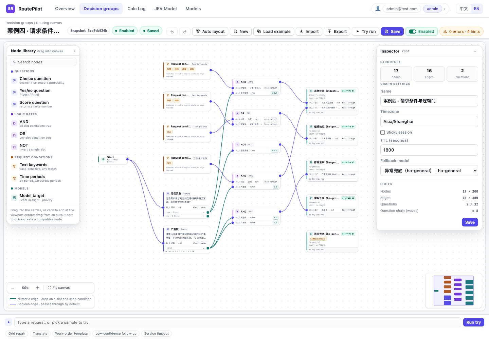

# RoutePilot

**Natural-language-driven intelligent routing for LLM traffic.**

English | [简体中文](README.zh-CN.md)

RoutePilot is an OpenAI-compatible routing proxy. Requests enter through `/v1/chat/completions`; a versioned decision graph selects the upstream model. Graphs are edited, validated, dry-run and published in the built-in console.



## Features

| Area | Capability |
|---|---|
| Entry point | `POST /v1/chat/completions`, JSON and SSE, `x-sr-model` / `x-sr-selection` / `x-sr-reasoning*` response headers |
| Routing policy | Visual decision graph: conditions, decision-service questions, logic gates, model targets |
| Decision service | `choice` / `noul` / `score` questions, batched per wave, sent to a `systemone`-compatible service; the canvas snapshot fixes which service profile a graph runs with |
| Target selection | Priority competition among activated targets; one fallback target `error_fallback` |
| Backend selection | Session affinity, `least_inflight` load balancing, per-model circuit breaker |
| Portable canvases | Every saved canvas embeds its complete non-secret run configuration, so one JSON file restores it on an empty database |
| Check routing | `/admin/try` executes the same graph and trace format without touching affinity, inflight counters or upstream models; database drift is reported as hints only |
| Operations | Request ledger, decision replay, confidence distribution, model/provider catalog, multi-service JEV catalog, time periods, audit history, role-based users |
| Console | Bilingual (zh/en) native ES Modules, no build step |

## Request pipeline


1. Load the immutable routing snapshot and evaluate request conditions (time period, text keywords).
2. Activate the first question wave; all questions in one wave are merged into one decision-service call.
3. Write numeric and `selected` ports, then re-evaluate downstream slot conditions and logic gates.
4. Repeat wave by wave until no further question is activated.
5. Select the highest-priority activated target; otherwise use `error_fallback`.
6. Apply session affinity, select a backend with `least_inflight`, proxy the request upstream.

`unknown` never activates a question or target. A numeric comparison against an unknown value stays unknown.

## Architecture

| Layer | Path | Responsibility |
|---|---|---|
| API | `router/api/` | DTO parsing, exception-to-HTTP mapping, upstream proxy, presenters |
| Control plane | `router/control/` | Write use cases for graphs and catalog entries, impact lists and confirmed canvas synchronization, enable validation |
| Routing domain | `router/routing/` | Graph model, validation, compiled topology, evaluator, scheduler, immutable canvas snapshots |
| Decision service | `router/jev/` | `systemone` client, service settings, input window |
| Upstream | `router/upstream/` | Fixed-model catalog (`model_id -> Backend`), proxy transport, circuit breaker and sync worker |
| Storage | `router/store/` | SQLite schema/repositories, graph-file repository |
| Console | `router/console/` | Bilingual native ES Module UI |
| Runtime | `router/request_logging.py`, `router/maintenance.py` | Ledger queue/worker, session purge |

Boundaries:

- `router/routing/` and `router/upstream/` import neither FastAPI nor SQLite. `router/control/` and `router/store/` do not import `router.api`.
- The API layer parses DTOs and maps exceptions; it does not write control-plane state. Account and session routes (`/admin/login`, `/admin/logout`, `/admin/users`, `/admin/me`) call `UserRepo`/`SessionRepo`/`ChangeRepo` directly.
- `GraphService` validates, prepares a candidate snapshot, writes the graph file under the single-writer lock, re-checks the document hash, publishes the snapshot, then records the audit entry. A stale draft returns 409.
- `ConfigurationService` commits a catalog write and the canvases confirmed to be affected inside one application transaction: re-check the impact list under the write lock, validate every candidate document, stage/replace graph files (non-active first, active last), re-check the graph fingerprint, record the audit entry, then commit. Only a write that changes the active canvas publishes a new in-memory snapshot; a stale confirmation returns 409 `graph_conflict` before any write.
- A catalog write that nothing references writes rows and audit only. It never rewrites canvases and never republishes the snapshot.
- `compile_graph()` runs once per published snapshot. The request path reads `snapshot.require_compiled()` and never rebuilds indexes or opens SQLite.
- The event loop only enqueues ledger rows into a bounded queue and a 20-entry ring; a 2-second flush projects whitelisted columns and writes them through `asyncio.to_thread`.
- The breaker worker loads shared quarantine state at startup and syncs local changes every 30 seconds on a worker thread.

## Console


One `<script type="module">` entry per page, no application globals, no CommonJS.

| Page | Content |
|---|---|
| Test | Admin-only model test chat: Auto routing (active canvas snapshot) or a fixed model (database catalog), SSE streaming, in-memory multi-turn history, image/text/audio/file attachments, safe multimodal rendering |
| Decision groups | Canvas editor, graph settings (timezone/sticky/fallback, JEV selection, refresh runtime from the database catalog), inspector, validation, routing checks, import/export |
| Calc Log | Recent decisions with model, target, candidates, waves, JEV probabilities, reasoning, upstream outcome, replayable trace |
| Decision service | Multi-service JEV catalog: service list, create/edit/delete, per-service connection test, prompts, timeout and the per-service context/input window |
| Models | Model registry and provider catalog; Connect models onboards a catalog provider and its models in one save. Edits and deletes that affect saved canvases preview the impact list and synchronize only after confirmation. The preset dialog's Advanced holds only connection details and slot IDs; reasoning declarations, tiers, domains and provider protocol belong to the custom form |
| Users | Admin/viewer accounts, passwords, roles, status |

### Common paths

- The decision-group toolbar shows only **Check routing**, the primary action and **More**. A new draft's primary reads **Save and enable**; an enabled group reads **Enabled** or, with pending edits, **Save and update**. **More** holds undo/redo, auto-layout, New, Import, Export, Save draft and Disable. The inspector's **Apply** only updates the local draft and never writes to the server.
- Graph settings (inspector) select the JEV service from the database catalog and apply **JEV + its window** in one history step; **Refresh runtime config from database** rebuilds the draft's `backends`/`jev`/`jev_window`/`time_periods` from the catalog. Neither action writes the server.
- On the Models page, **Connect models** is the default entry and a preset catalog onboards the provider and its models in one save. Model IDs are generated automatically. The preset dialog's Advanced holds only connection details and slot IDs; manual IDs, reasoning declarations, tiers, domains and provider protocol settings live in the custom form's Advanced.
- The **Decision service** page is a catalog: the left side lists services, the right side edits the selected one (address, model, `key_env`, key, timeout, instructions, state template, input/context window) and tests it. The window belongs to the service, so a canvas always replaces JEV and window together. The environment can create a `default` service from `ROUTER_JEV_URL` / `ROUTER_JEV_MODEL` / `ROUTER_JEV_API_KEY`, but only once: it is seeded on a start where the catalog is empty, no environment seed has ever run, and the URL and model are both set. A first boot without them followed by a boot with them still seeds once; deleting every service and restarting never re-creates it.
- Editing or deleting a model, provider or JEV service that a canvas references raises a two-step confirmation; a resource that no canvas references is written immediately. The first write returns 409 with every affected canvas (name, id, enabled, current `document_sha256`, usage); confirming sends those exact hashes back and the server synchronizes only the affected canvases. Model/JEV deletes that are still referenced need a replacement; a provider that a database model or a canvas model still references cannot be deleted at all. After a confirmed sync, reload every already-open canvas (or use **Refresh runtime config from database**) — open drafts are not updated in place.

### Model test chat

The home page (`/console/index.html`) is an admin-only model test chat. It posts to `/admin/test/chat/completions` and shows the actual model in the message metadata (`Auto → <model>` for Auto, `<model> · fixed model` for a fixed model), using the `x-sr-model` response header.

- **Auto or fixed model** — Auto evaluates the active canvas snapshot (decision graph, JEV waves, sticky and load-balanced backend selection) exactly like `/v1/chat/completions`. Choosing a configured model ID skips the graph and JEV, resolves the model through the **database catalog** (never through the active canvas), and returns `x-sr-selection: direct`.
- **Streaming** — answers stream over SSE; Stop aborts the stream and keeps the partial answer, and Copy / Retry / Regenerate act on the message. A stream counts as complete only when the upstream ends it cleanly — an early EOF is marked incomplete and a provider error is shown inline in the conversation, never silently passed off as a complete answer.
- **Multi-turn history** — the in-memory transcript is resent as wire-format `messages`, replayed losslessly from the raw assistant message (message-level media renders but never re-enters history); New Chat aborts any in-flight reply, clears the conversation and rotates the session id.
- **Attachments** — text files are read as text and sent as content parts; images, audio and other files are read to data URLs. A file whose estimated size would break the 10 MiB request limit is rejected inline before it is read, and the exact whole-body size (history + Base64) is checked again before sending.
- **Multimodal output** — text renders as safe Markdown; images, audio, video and files use native players or download links; unknown parts stay folded as inspectable JSON. Model-provided HTML is shown as text and active URL schemes are dropped, so nothing executes.
- **Memory only** — conversations and attachments live in the page; a refresh clears them, and the server stores neither chat history nor uploaded files.

### Editor and execution zone

The routing page is split into two zones.

**Editor zone** — canvas, node library, inspector, validation:

- Drag nodes from the library and pan/zoom; auto-layout and undo/redo live under **More**.
- Typed wires; a numeric output dropped into a boolean slot creates a default condition.
- Each input slot is an OR input with its own edge condition.
- Dragging an output onto empty canvas quick-creates a compatible node.
- Saving and publishing are merged into the toolbar primary; **Save draft** under **More** still saves without enabling. The lifecycle badge has exactly four states — Running, Unpublished changes, Disabled, Unsaved draft. A saved but disabled group reads Disabled even with local edits (disabled wins), and Unsaved draft is reserved for a group that was never saved. The primary button reads Save and enable, Save and update, Enabled, Enable or Saving… accordingly.
- The inspector's **Apply** commits to the local draft only. Everything that writes to the server lives in the toolbar: the primary publishes (saves and enables), **Save draft** saves without enabling, and **Disable** flips the enabled state.
- Target cards show display name, model list, fallback role and scheduling strategy.

**Execution zone** — docked below the canvas:

- Input field, sample prompts, run button.
- Result: final target, model, candidates with priorities, selection reason, waves and call count.
- Execution trace: one card per wave with hit conditions, plus the full request timeline.

A routing check highlights the winning path wave by wave. Selecting a trace row pans the canvas to the corresponding edge or node; editing entry points are the canvas and inspector.


### Decision log


Expanded rows show the calculation stages in order: input preparation, initial computation, per-wave JEV, candidates and final pick, model scheduling, execution result. A `routing_error` keeps the partial process up to the failure point: a schedule-stage failure keeps the scheduling snapshot (configured, registered, available, unavailable reasons, pre-selection inflight), and a failed JEV wave voids that round's candidates and falls to `error_fallback`. Records without a scheduling snapshot and restored ledger rows report the missing detail explicitly.

SQLite stores ledger fields only — no request text, trace, per-wave answers or node labels. The page reads the last 20 live records from an in-process ring; calculation detail is replica-local and not persisted.

## Decision graph

### Nodes

| Type | Purpose | Inputs | Outputs |
|---|---|---|---|
| `start` | Request entry, always true | — | boolean |
| `question` | Decision-service question: `choice`, `noul`, `score` | Boolean slots `in_1..in_n` (OR) | choice: `prob.*`, `selected.*`, `p_top`, `margin`; noul: `yes`, `no`; score: `value` |
| `logic` | Three-valued gate: `and`, `or` | Boolean slots `in_1..in_n`, one edge and condition per slot | boolean |
| `condition` | Request condition: time period or text keywords | — | boolean |
| `target` | Model target: models, reasoning tiers, priority, strategy | Boolean slots `in_1..in_n` (OR) | — |

### Conditions

Conditions live on edges:

```json
{
  "id": "e-cap-strong-and-power",
  "source": "capability",
  "source_port": "prob.strong",
  "target": "and-power",
  "target_port": "in_1",
  "condition": { "op": "gt", "value": 0.65 }
}
```

| Upstream output | Condition | Evaluation |
|---|---|---|
| number | `gt` / `gte` / `lt` / `lte` / `eq` / `neq` + finite threshold | Value comparison; unknown propagates as unknown |
| boolean | `null` (equivalent to `= true`) or `{ "op": "is", "value": true \| false }` | Boolean expectation |

- One output can feed multiple slots; every slot keeps its own condition.
- Two slots of an AND gate can express a range, e.g. `> 0.3` and `< 0.8`.
- Each input slot accepts one edge. Slot numbers are stable; released slots are reusable.
- `and` / `or` require at least two slots. Question and target slots are OR.
- Use boolean-slot negation or the complementary numeric comparison for the opposite test; there is no standalone NOT node.

### Execution rules

- Questions execute in waves; one wave is one decision-service call.
- A failed wave voids the round: no ports are written and all candidates from that round are discarded.
- Target priorities are unique; the larger number wins.
- `error_fallback` handles a normal run with no activated target, and a decision call that fails, times out or returns an invalid answer.
- The fallback reference must point to an existing target.

### Limits

| Item | Limit |
|---|---:|
| Nodes | 200 |
| Edges | 400 |
| Question nodes | 32 |
| Question chain depth | 8 waves |
| Options per choice question | 255 |
| Score criteria | 2–10 finite values |

### Graph document

A v3 document is a complete, portable canvas: the graph plus its four required run fields. A document without them is not a legacy document to adopt — it is rejected.

```json
{
  "kind": "sr-routing-graph",
  "version": 3,
  "name": "Default routing",
  "timezone": "Asia/Shanghai",
  "sticky": { "enabled": true, "ttl_seconds": 1800 },
  "root": {
    "id": "root",
    "type": "graph",
    "error_fallback": "safe-target",
    "nodes": [],
    "edges": []
  },
  "backends": { "providers": [], "models": [] },
  "jev": null,
  "jev_window": { "input_tokens": 1024, "context_tokens": 4096 },
  "time_periods": []
}
```

Only `sr-routing-graph` v3 is accepted. Version-2 documents, non-v3 `kind` values, unknown node types and unknown envelope/node/edge fields are rejected before they replace a draft or a published snapshot; so is a document that carries only some (or none) of the four run fields. Structural rejections surface as `graph_parse_error`; the console runs the same validation before applying an import. `jev: null` is legal only for a canvas without question nodes.

This experimental version does not accept legacy NOT graphs. Any `logic/operator=not` is rejected without migration, and historical NOT snapshots are not supported. Rewrite the condition manually: `> 0.65 → NOT` becomes `<= 0.65`, and `>= 0.5 → NOT` becomes `< 0.5`.

The four run fields are described in [Self-contained canvas JSON](#self-contained-canvas-json).

`tree_revision` is the SHA-256 of canonical JSON over `{timezone, sticky, root}` plus the four run fields, with nodes sorted by id and edges by `(target, slot, source, source_port)`. Python and the console produce the same canonical form; the console uses it to classify edits, and `tree_revision` is computed by the server. Display-only changes do not affect it: node titles, target `capability`, positions, array order and edge ids. Question-option `capability` (choice questions) and the model-profile capability and declared reasoning **do** participate, because they change runtime behaviour.

## Models and reasoning


A model slot used by the graph maps to an upstream model id and a provider. A target can hold several slots; `least_inflight` selects among them. The **catalog** (SQLite) is the management source for the console dropdowns and for fixed-model direct requests; a **canvas snapshot** is the only source for Auto routing.

Providers define the OpenAI-compatible base URL, API-key environment variable and reasoning dialect. Model profiles declare:

- reasoning support and default level;
- level-to-wire mapping for `off`, `on`, `minimal`, `low`, `medium`, `high`, `xhigh`, `max`;
- capability notes and catalog metadata.

Reasoning dialects: OpenAI, DeepSeek, Qwen, Qwen chat template, OpenRouter, Z.ai, Together, string-thinking, Ant Ling. An unsupported requested level is forwarded without reasoning injection and the response carries `x-sr-reasoning-warning`.

`GET /admin/models` returns `profile` as a JSON object; the database stores it as JSON text. The console and the admin catalog endpoints always read SQLite — they never project the active canvas, and a catalog write never rewrites a canvas on its own. Saving a canvas **selects** models: the chosen model and its provider are added to the snapshot; a model with the same ID already in the snapshot is not overwritten by normal target editing (drift is reported by the check hints, and replaced only by an explicit refresh or a confirmed catalog sync).

Legacy database profiles are still read leniently as a sanitized projection: `api_key`, `authorization`, `key_present`, `key_source` and their case/separator variants are removed recursively from `profile`. This is read-only — legal metadata (`tier`, `domains`, `capability`, …) is preserved and the database row is never rewritten. Graph files and management writes still reject those fields rather than cleaning them.

Non-JSON-compatible numbers are the one exception: management writes reject `NaN` / `Infinity` with 422, and a legacy row that already stores one is **not** tolerated by the catalog response — `GET /admin/models` and every other model echo return 500, and a confirmed catalog sync that has to re-project that row returns 422. The `/admin/try` canvas-vs-catalog drift check is JSON-safe: it normalizes non-finite values inside its hint parameters and keeps answering, so routing checks are unaffected. Fix such rows before upgrading — see [Legacy profiles with non-finite numbers](#legacy-profiles-with-non-finite-numbers).

Deleting or updating a model or provider that a saved canvas references is a two-step operation: the first write returns 409 `impact_confirmation_required` with every affected canvas and its current `document_sha256`; the confirmed retry synchronizes only those canvases. Deleting a model still referenced by a target requires a replacement model; deleting a provider that a database model or a canvas model still references is always rejected (`provider_referenced`) — release the references first. See [Catalog impact confirmation](#catalog-impact-confirmation).

A provider API key never appears in a response: the projection exposes `key_present` and `key_source` (`stored` / `env` / `none`) only.

## Decision service (JEV)


The decision service exposes `POST /v1/systemone`; typical deployments use NeoHorse or vLLM. The console page manages a **catalog of services**, not a single global configuration:

- The list shows every service with its ID, model and endpoint. Create, edit and delete are per service; the window (`input_tokens` / `context_tokens`) belongs to the service together with its prompts, timeout, `key_env` and key.
- **Test** calls `POST /admin/jev/{id}/test` and uses the database service configuration, not the active canvas snapshot. Canvas execution is checked by the routing check, which reports drift as hints.
- A canvas selects one service (`jev.id` + `key_env`) and embeds its complete non-secret profile plus its window. JEV and window are replaced together whenever a canvas selects, refreshes or receives a server-side sync — mixing two services is not representable.
- Only `key_env` (an environment-variable name) and the service URL/model are portable. The real `api_key` lives only in SQLite and is reused when the service `id`, `base_url` and `model` all still match; otherwise the service's `key_env` environment variable is read when a snapshot is built. A global `ROUTER_JEV_API_KEY` fallback does not exist; the seeded `default` service happens to use that variable name as its `key_env`.
- Deleting a service that a canvas references requires a replacement service, and synchronizes the affected canvases (JEV profile + window) after confirmation. Updating a referenced service is also confirmed and synchronized the same way.

## Access and operations

- Email/password login, scrypt hashing, opaque bearer sessions.
- `admin` can edit graphs, models, providers, JEV services and users; `viewer` is read-only.
- The last active admin cannot be demoted, disabled or deleted.
- User and configuration changes are recorded in the audit log.
- Graph files are content-addressed by SHA-256 for save conflicts and reload checks; no graph history is retained.
- Control-plane state is SQLite (WAL); routing graphs are shared JSON files. Ledger writes run on a worker thread.
- Session affinity and inflight counters are process-local.

## Graph storage and replicas

Graphs are not stored in SQLite. Each decision group is one v3 document at `ROUTER_GRAPH_DIR/graphs/{tree_id}.json`; `ROUTER_GRAPH_DIR/current` contains the enabled group id. Every document **must** carry its own run configuration (`backends`, `jev`, `jev_window`, `time_periods`), because a saved canvas is the only runtime source for Auto routing. There is no `runtime:null` marker, no "save as legacy document" mode, and no server-side step that materializes configuration into an older file.

- Single writer: the admin API. Other replicas run with `ROUTER_GRAPH_WRITER=false`, mount the directory read-only and reload every 2 seconds.
- A replica compiles a candidate snapshot before replacing the serving snapshot; an invalid file leaves the previous snapshot active and `/readyz` reports stale.
- Writes are atomic through temporary files with mode `0600`.
- Kubernetes: ReadWriteMany PVC for graph files; SQLite on local storage for the writer.
- Docker: mount the same NFS export into every container.
- All writer/reader containers must share the same numeric UID; mode `0600` files are not accessible through GID or `fsGroup` alone.
- A stale save returns 409 `graph_conflict`; imports only change the draft.
- `/healthz` is liveness. `/readyz` reports initial-snapshot readiness; 503 means not ready, and a later reload failure keeps the existing snapshot with `"stale": true`.
- The schema upgrades itself (see [Upgrading from a pre-snapshot installation](#upgrading-from-a-pre-snapshot-installation)); there is no SQLite-to-graph export script any more — a canvas is moved by exporting/importing its JSON file.

## Upgrading from a pre-snapshot installation

Two things change for an existing deployment.

1. **The SQLite schema migrates automatically on first start.** Schema v5 upgrades to v6 inside one transaction: the old single-row `jev_config` becomes the `jev_services` service with id `default` (stored key, endpoint, model, prompts and timeout are preserved; the window is clamped to legal bounds), and the old table is dropped. Back up `router.db` (with `router.db-wal` / `router.db-shm`) before the upgrade; there is no path back to the old single-configuration layout. If the JEV catalog is empty and the environment seed has never run, `ROUTER_JEV_URL` + `ROUTER_JEV_MODEL` create that `default` service once, with `ROUTER_JEV_API_KEY` stored as its key; `settings.jev_catalog_seeded` records the seed, so a later restart never re-creates a `default` service — not even after every service was deleted.
2. **Every stored canvas must already be a full snapshot.** The strict parser rejects a canvas that lacks any of the four run fields. Before upgrading:

   - back up `ROUTER_GRAPH_DIR` (the `graphs/*.json` files and `current`);
   - on the **old** version, produce a full document for every group: open each decision group and save it once (or `PUT /admin/trees/{id}` with its document). The old version writes the effective run configuration into the file;
   - if the old instance can no longer be operated, add the four fields to each `graphs/*.json` by hand, following the shape in [Self-contained canvas JSON](#self-contained-canvas-json) and the canvas's actual models, providers, JEV service and periods.

A missed file is not silently repaired: startup logs `initial graph snapshot is unavailable`, `/readyz` reports not ready, `GET /admin/trees` answers 503 `graph_storage_error`, and `/v1` Auto routing has no snapshot (`no_valid_snapshot`) until the file is fixed. After a successful start, an old-format file is still only an invalid file — it is never adopted or migrated implicitly.

### Legacy profiles with non-finite numbers

One pre-upgrade data check is separate from the migration itself. Python's JSON reader accepts `NaN`, `Infinity` and `-Infinity`, so an old row can store them inside `models.profile`; they are not valid JSON and the strict catalog response cannot serialize them.

Symptoms:

- `GET /admin/models` (and other responses that echo the model row) fail with **500** — the serializer raises `Out of range float values are not JSON compliant`;
- a **confirmed** catalog sync that has to re-project that row (for example a model update that leaves `profile` unchanged) answers **422** and names the offending path;
- `POST /admin/try` is unaffected: the canvas-vs-catalog drift check normalizes non-finite values in its hint `params`, so checks still answer 200 with `runtime_mismatch` hints.

Locate the candidate rows in SQLite:

```bash
sqlite3 router.db "SELECT id, profile FROM models WHERE json_valid(profile) = 0;"
```

`json_valid(profile) = 0` covers both rows whose text is malformed (read as `{}`, harmless but still worth rewriting) and rows holding a bare `NaN` / `Infinity` token (the breaking case). To spot the latter precisely, decode each hit with Python's `json.loads` and look for non-finite numbers — ordinary JSON parsers reject them.

Repair the rows:

- preferred: open the model in the console, or `PUT /admin/models/{id}` with a corrected finite `profile` and, when a canvas references it, the confirmed 409 impact payload;
- last resort: back up `router.db`, then rewrite the JSON text directly, e.g. `UPDATE models SET profile = '{}' WHERE id = '<model>';`;
- verify that every row is valid again: `SELECT COUNT(*) FROM models WHERE json_valid(profile) = 0;` must return 0.

No restart is needed: the catalog is read from SQLite on every request.

## Self-contained canvas JSON

Every saved canvas is a portable, immutable run snapshot: one file restores a decision group on an empty database instance. Four top-level fields are **required and must appear together**:

| Field | Content |
|---|---|
| `backends` | `providers` (name, base URL, API-key environment variable, reasoning dialect) and `models` (id, upstream id, provider, profile) |
| `jev` | the selected decision-service profile: `id`, `base_url`, `model`, `key_env`, timeout, instructions and state template; `null` only for a canvas without question nodes |
| `jev_window` | `input_tokens` / `context_tokens` **of that same service** |
| `time_periods` | Time period definitions referenced by `periods` conditions |

```json
{
  "kind": "sr-routing-graph",
  "version": 3,
  "name": "Default routing",
  "timezone": "Asia/Shanghai",
  "sticky": { "enabled": true, "ttl_seconds": 1800 },
  "root": { "id": "root", "type": "graph", "nodes": [], "edges": [], "error_fallback": null },
  "backends": {
    "providers": [
      {
        "name": "local",
        "base_url": "http://127.0.0.1:8000/v1",
        "key_env": "LOCAL_API_KEY",
        "reasoning_format": "openai"
      }
    ],
    "models": [
      {
        "id": "qwen3-8b",
        "upstream": "qwen3-8b",
        "provider": "local",
        "profile": {
          "capability": "Fast small model for simple requests.",
          "reasoning": { "format": "qwen-chat-template", "efforts": { "off": null, "on": null }, "default": "on" }
        }
      }
    ]
  },
  "jev": {
    "id": "default",
    "base_url": "http://127.0.0.1:8100",
    "model": "d1-2b",
    "key_env": "ROUTER_JEV_API_KEY",
    "timeout_seconds": 10.0,
    "instructions": "You are a model router.",
    "state_template": "【待判断的用户请求】\n{request}"
  },
  "jev_window": { "input_tokens": 1024, "context_tokens": 4096 },
  "time_periods": [
    { "name": "day", "days": [0, 1, 2, 3, 4], "start": "09:00", "end": "18:00" }
  ]
}
```

Rules:

- **All four fields, always.** A document carrying only some of them (or none) is rejected with `graph_parse_error` when parsing, importing, saving or checking; there is no database fallback that fills the missing fields and no `runtime:null` control field / materialization step. Old documents are rejected, not upgraded in place.
- **JEV and window are one unit.** `jev.id` selects the catalog service and `key_env` says how its key is resolved; `jev_window` belongs to that service. Selecting or synchronizing a JEV service replaces `jev` and `jev_window` together.
- **No secrets, at any depth.** A provider carries `key_env` (an environment variable name) instead of a key, and `jev` never carries `api_key`. Secret and derived-key fields (`api_key`, `authorization`, `key_present`, `key_source`) are rejected wherever they appear inside the four fields, including nested objects and arrays below `backends.models[*].profile`. The match ignores case, `-` and `_` (`API-KEY` is the same as `api_key`) but only covers that fixed set, so ordinary metadata such as `monkey` or `keychain` is preserved. `profile` stays a free-form JSON metadata object otherwise: `capability`, `domains`, `tier` and later metadata are stored unchanged. A local server that needs no authentication may leave `key_env` empty.
- **Validated at the file boundary.** Provider and model ids, provider references, profiles, reasoning declarations, the JEV service profile, the window and the periods are all validated while parsing.
- **Part of the behaviour version.** The four fields join `tree_revision` (and the console dirty/undo baseline); canvas coordinates still do not affect behaviour.

### Snapshot sources

Only these actions create or change a canvas run snapshot:

1. **New canvas** — the initial snapshot is built from the current database catalog.
2. **Import a complete JSON document** — the imported snapshot wins.
3. **Select a model or JEV in the canvas** — the selected non-secret catalog entry is added/replaced in the draft; a JEV selection replaces profile and window atomically.
4. **Refresh runtime from database** in graph settings.
5. **Confirm a catalog impact list** — the server synchronizes the affected canvases after the administrator confirms.

A catalog write by itself never rewrites a canvas and never republishes a snapshot. Editing a target with a model ID already present in the snapshot does not overwrite its snapshot entry; drift is reported by the check hints and replaced only by an explicit refresh or a confirmed sync. Copying a group keeps the source group's snapshot, and `POST /admin/try` inherits a stored canvas's snapshot when it is given `tree_id` (a full draft must carry all four fields itself; without either it is 422).

### Keys

JSON never stores keys; the environment supplies them when a snapshot is built.

| Secret | Resolution order |
|---|---|
| Provider API key | The database provider's stored key **only when `name` and the normalized `base_url` both match**, otherwise none; then `os.environ[key_env]` |
| Decision-service key | The database service's stored key **only when `id`, `base_url` and `model` all match**, otherwise none; then `os.environ[service.key_env]`. There is no global JEV-key fallback; the seeded `default` service uses `ROUTER_JEV_API_KEY` as its `key_env`. |

An endpoint change therefore never forwards an old key to the new address, environment keys are never written to SQLite or the JSON, derived authorization headers exist only in the in-memory snapshot, and no JSON file, API envelope or graph response contains a real key.

### Catalog impact confirmation

Updating or deleting a model, provider or JEV service first scans every canvas. If anything references the resource, the first write returns **409** with `detail.code = "impact_confirmation_required"`:

- `resource`: the kind and id/name being changed;
- `affected_trees`: for every affected canvas its `id`, `name`, `enabled`, current `document_sha256` and `usage` (target node ids, runtime catalog, JEV id, provider models);
- `replacements` for deletes (non-secret candidate models or JEV services).

Nothing is written in that state — database, files, audit and snapshot are untouched. The console shows the list; confirming retries the same request with `impact_confirmation = {"trees":[{"id","document_sha256"}, …]}` built from exactly those hashes. If a canvas changed in between, the server answers 409 `graph_conflict` with the **current** hash, and the console asks for a reload instead of applying a stale confirmation.

After confirmation, one use case commits the catalog rows, all affected canvases and the audit row atomically: it re-checks the impact list under the single write lock, validates each candidate document, stages every file (non-active canvases first, the active canvas last), re-checks the graph fingerprint and only then commits. A failure rolls the database back and restores every replaced file; the in-memory snapshot is published only from a committed transaction and only when the active canvas was among the synchronized ones.

Update/delete semantics:

- **Model update** — replaces the model entry (and its provider entry) in every canvas that declares it; target model IDs do not change.
- **Model delete** — a catalog-only entry is removed; a model referenced by a target requires a replacement model, which replaces the target references, de-duplicates model slots and embeds the replacement (and its provider) in the snapshot.
- **Provider update** — replaces the provider entry in every canvas that declares it; model references do not change. A model profile that becomes invalid under the new reasoning dialect rejects the whole write (422, nothing written).
- **JEV update** — synchronizes `jev` + `jev_window` in every canvas whose `runtime.jev.id` matches.
- **JEV delete** — any canvas referencing the service requires a replacement service; JEV and window are replaced together.
- **Provider delete** — never bypassable: it is rejected (`409 provider_referenced`) while any database model or canvas model still references the provider, and there is no implicit replacement. Release the references first.

### Canvas-vs-catalog drift

`POST /admin/try` compares the resources a canvas declares (providers, models, the JEV service and its window) with the database catalog and reports every difference or missing row as a hint (`code = "runtime_mismatch"`, `level = "hint"`, both canvas and database values in `params`). Hints never block the check and never change the execution configuration: the run still uses the canvas snapshot. Database resources the canvas does not declare are not conflicts and produce no hint. The console renders these hints under the routing-check result.

### Restoring from one file

1. Start an instance with an empty database and an empty graph directory.
2. Import the JSON into a decision group (Decision groups page, or `POST /admin/trees`), then save and enable it.
3. Run a routing check (`POST /admin/try`) to verify the graph, embedded model catalog, decision service, window and time periods.
4. Call `POST /v1/chat/completions` for Auto routing, or use the model test chat with a fixed model.
5. Provide keys through environment variables only: each provider's `key_env`, and the selected service's `key_env` when it requires authentication.

`configs/default_routing_tree.json` is a minimal runnable example: one `local` provider, two models, the `default` decision-service profile and three time periods. `configs/production_routing_tree.json` has the same shape with three models; replace the example base URLs and endpoints before deploying.

The five demo cases in `configs/cases/case-*.json` are complete v3 documents with `kind`/`version`, no external `id`/`enabled`, provider `demo-tap`, JEV service `demo-jev` (window `2048 / 4096`) and every model their targets reference. `scripts/demo/apply_cases.py` is their deployment entry point: it merges the catalogs from the case files, seeds the multi-service JEV catalog and time periods, deploys the five canvases (without enabling them) and runs the dry-runs. It never bypasses impact confirmation — a 409 prints the affected canvases and stops by default; `--confirm-sync` explicitly retries the same requests with the previewed baseline hashes. A `graph_conflict` means a canvas changed after the preview: re-run the script.

## Quick start

```bash
python3.11 -m venv .venv
.venv/bin/pip install -r requirements.txt

# Local development, authentication disabled
ROUTER_DB=/tmp/routepilot.db \
ROUTER_GRAPH_DIR=/tmp/routepilot-graph \
ROUTER_USER_AUTH=0 \
.venv/bin/python -m router
```

Console: `http://127.0.0.1:8400/console/`.

```bash
# Protected deployment
ROUTER_DB=/var/lib/routepilot/router.db \
ROUTER_GRAPH_DIR=/var/lib/routepilot/graph \
ROUTER_HOST=0.0.0.0 \
ROUTER_PORT=8400 \
ROUTER_ADMIN_EMAIL=admin@example.com \
ROUTER_ADMIN_PASSWORD='change-me-now' \
.venv/bin/python -m router
```

The first start against an empty users table seeds the admin account. An empty graph directory serves an empty Auto snapshot; create or import a canvas before routing. Existing installations: read [Upgrading from a pre-snapshot installation](#upgrading-from-a-pre-snapshot-installation) first.

## Configuration

| Variable | Default | Purpose |
|---|---|---|
| `ROUTER_DB` | `router.db` | SQLite control-plane database |
| `ROUTER_GRAPH_DIR` | `./routing-graph` | Graph files and enabled pointer |
| `ROUTER_GRAPH_WRITER` | `true` | Allow graph writes; run exactly one writer |
| `ROUTER_HOST` | `127.0.0.1` | Listener host |
| `ROUTER_PORT` | `8400` | Listener port |
| `ROUTER_JEV_URL` | empty | One-time seed base URL for the `default` JEV service; used only on a start where the JEV catalog is empty and no environment seed has run yet, paired with `ROUTER_JEV_MODEL` |
| `ROUTER_JEV_MODEL` | empty | One-time seed model for the `default` JEV service; paired with `ROUTER_JEV_URL` |
| `ROUTER_JEV_API_KEY` | empty | Key stored for the one-time seeded `default` service (its `key_env` is `ROUTER_JEV_API_KEY`); not a global fallback |
| `ROUTER_JEV_TIMEOUT` | `10` | Decision-service timeout, seconds |
| `ROUTER_SESSION_MAX_ENTRIES` | `10000` | Session-affinity LRU capacity |
| `ROUTER_USER_AUTH` | `true` | Console authentication |
| `ROUTER_ADMIN_EMAIL` | `admin@test.com` | First-run admin email |
| `ROUTER_ADMIN_PASSWORD` | seed value | First-run admin password |
| `ROUTER_SESSION_TTL_HOURS` | `168` | Console session lifetime |

## API

| Method and path | Purpose |
|---|---|
| `POST /v1/chat/completions` | Routing entry; JSON or SSE |
| `GET /healthz` | Liveness probe |
| `GET /readyz` | Snapshot readiness |
| `POST /admin/login` / `POST /admin/logout` | Console session |
| `GET /admin/me` / `POST /admin/me/password` | Current user, password change |
| `GET/POST /admin/trees`, `GET/PUT /admin/trees/{id}` | Decision groups |
| `POST /admin/trees/{id}/copy`, `/enable`, `/disable` | Group lifecycle |
| `POST /admin/try` | Routing check against a draft graph |
| `POST /admin/test/chat/completions` | Admin-only model test chat; JSON or SSE |
| `GET/POST /admin/models`, `GET/PUT/DELETE /admin/models/{id}` | Model registry; update/delete preview a 409 impact list and sync confirmed canvases |
| `GET /admin/model-catalog`, `POST /admin/fetch-models` | Provider presets, upstream model discovery |
| `GET /admin/providers`, `PUT/DELETE /admin/providers/{name}` | Providers; update previews a 409 impact list, delete is blocked while referenced |
| `GET/POST /admin/jev`, `GET/PUT/DELETE /admin/jev/{id}` | Multi-service JEV catalog (window belongs to each service) |
| `POST /admin/jev/{id}/test` | Test one catalog service with its database configuration |
| `GET/PUT /admin/time-periods` | Time periods |
| `GET /admin/requests/recent`, `GET /admin/requests/stats` | Live request ring, logger stats |
| `GET /admin/overview`, `GET /admin/changes` | Overview, audit history |
| `GET/POST /admin/users`, `PUT/DELETE /admin/users/{id}`, `POST /admin/users/{id}/password` | Users |

### Errors

| Status | Error | Meaning |
|---|---|---|
| 400 | `invalid_json` / `body_must_be_object` / `messages_must_be_list` | Malformed body |
| 413 | `request_too_large` | Body exceeds 10 MiB |
| 502 | `upstream_error` | Upstream 5xx or network failure |
| 409 | `graph_conflict` | Graph changed after the draft/impact list was loaded |
| 409 | `impact_confirmation_required` | Model/provider/JEV write affects canvases; confirm the listed document hashes |
| 409 | `provider_referenced` | Provider still used by a database model or a canvas model |
| 409 | `graph_already_exists` | Duplicate graph id |
| 503 | `graph_read_only` | Reader replica |
| 503 | `graph_storage_error` | Shared graph storage unreadable |
| 503 | `no_valid_snapshot` | No initial snapshot |
| 503 | `no_active_tree` | No enabled decision group |
| 503 | `no_available_backend` | All backends of the selected target unavailable |
| 503 | `routing_failed` / `routing_invariant_violation` | Internal routing failure |

Upstream 4xx responses pass through with their status and body.

Configuration endpoints: `/admin/models`, `/admin/providers`, `/admin/jev`, `/admin/time-periods`. There is no generic `/admin/settings` API and no standalone JEV-window endpoint: the window lives on each JEV service.

## Tests

```bash
.venv/bin/python -m pytest -q
node --test scripts/console_chat_test.mjs
node --test scripts/console_graph_test.mjs scripts/console_draft_test.mjs \
    scripts/console_runtime_test.mjs scripts/graph_contract_test.mjs \
    scripts/console_impact_test.mjs
npm install
npm run check:console
.venv/bin/python scripts/i18n_dead_keys.py
```

- `pytest` collects `tests/` only (`testpaths`), runs unit and FastAPI integration tests, starts no browser and does not collect `experiments/`.
- `node --test` runs the ES-module suites: graph/canonical behavior, draft state, the runtime helpers used by graph settings and impact confirmation, and the cross-runtime contract fixtures (`tests/fixtures/graph_contracts.json`).
- `npm run check:console` runs all Node test suites and the Playwright acceptance matrix against a temporary database, mock decision service and mock upstream. Screenshots are off by default; `QA_SCREENSHOTS=1` regenerates them. `QA_ONLY=<regex>` selects cases; a page module runs standalone, e.g. `node scripts/console_qa/canvas.mjs`. Set `CHROME=/path/to/chrome` when Chromium is not in the default cache.
- `scripts/i18n_dead_keys.py` reports unreferenced dictionary keys.

Experiments are standalone and excluded from the default run:

```bash
.venv/bin/python -m pytest -q experiments/jev-batch/test_spike_jev_batch.py
.venv/bin/python experiments/jev-batch/spike_jev_batch.py --samples /path/to/samples.jsonl --scenario all --dry-run
```

## Project layout

```
router/
  api/                 FastAPI routes, DTOs, exception mapping, proxy wiring, presenters
  control/             catalog writes, impact lists, confirmed canvas sync and enable validation
  routing/
    graph/             graph model, validation, conditions, compiler, evaluator
    service.py         evaluate → schedule orchestration
    scheduling.py      sticky selection, lease acquisition, affinity writes
    affinity.py        session-affinity LRU
    scheduler.py       least_inflight balancer and leases
    snapshot.py        immutable canvas snapshot assembly and compiled topology
    tree.py            tree envelope codec and revision
    codec.py           strict field parsing helpers
  request_logging.py   ledger queue/ring and worker-thread writes
  jev/                 decision-service client, service catalog DTO, input window
  upstream/            fixed-model catalog, proxy transport, circuit breaker + sync worker
  store/               SQLite schema/repositories, graph-file repository
  console/             bilingual native ES Module console
configs/               example decision groups; configs/cases/ holds the five portable demo cases
tests/                 pytest suite and contract fixtures
scripts/               Node contract tests, Playwright QA, deployment helpers
experiments/jev-batch/ standalone JEV batch spike
assets/routepilot/     README screenshots
```
