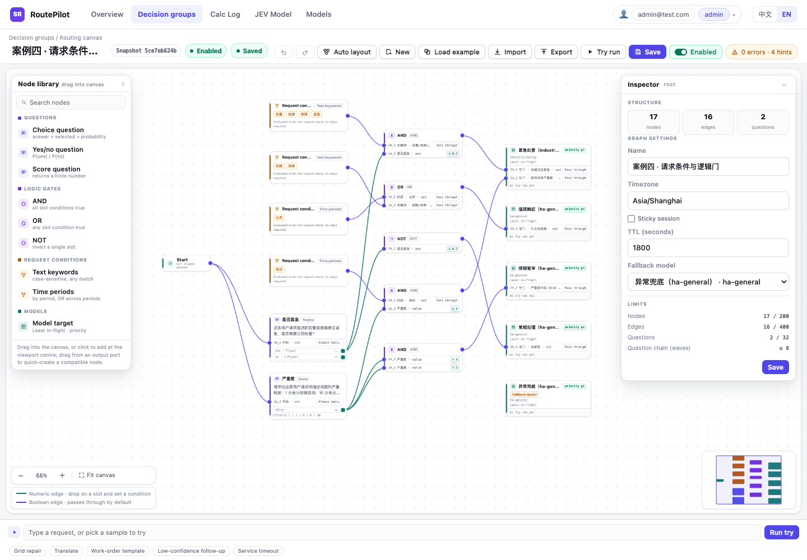
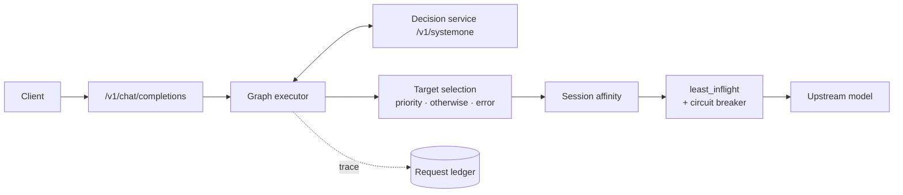
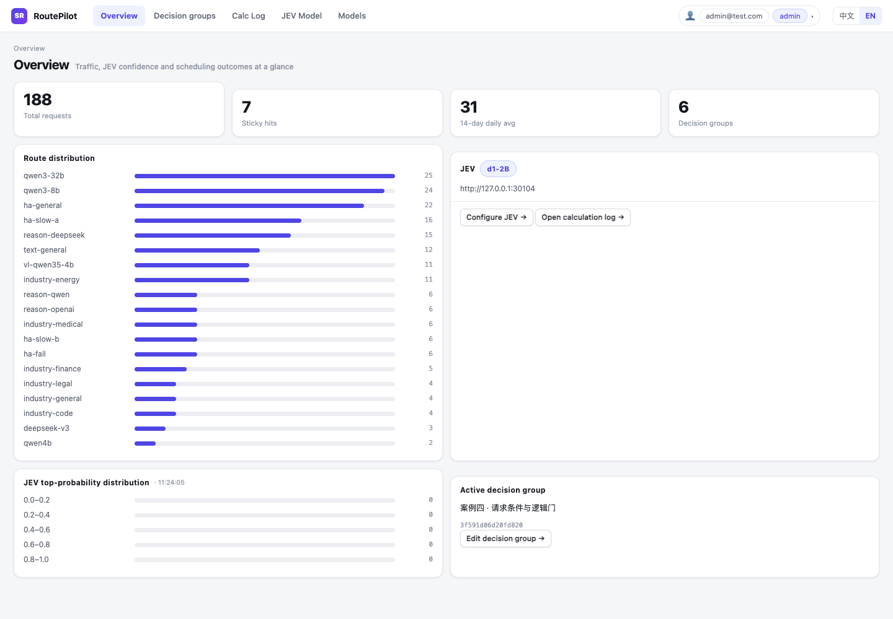
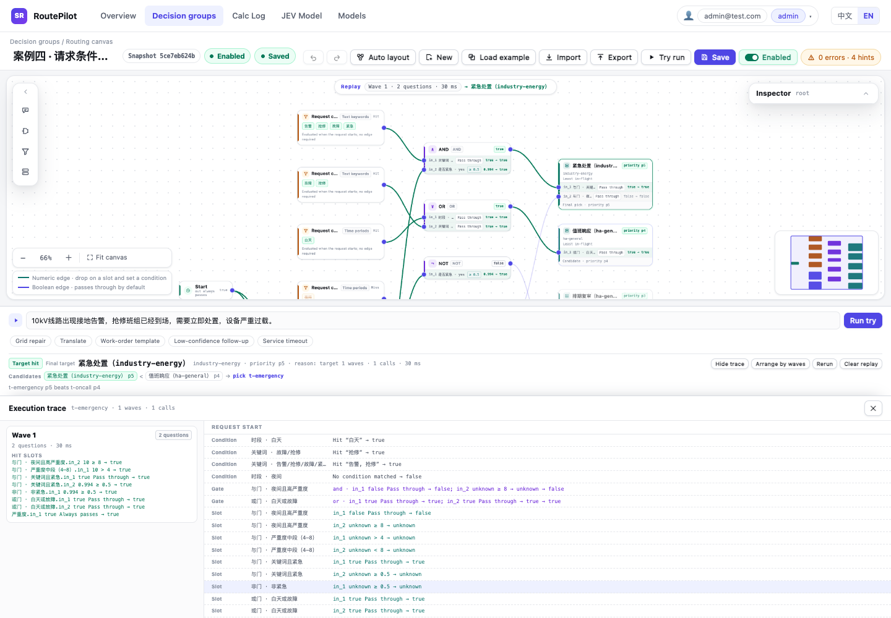
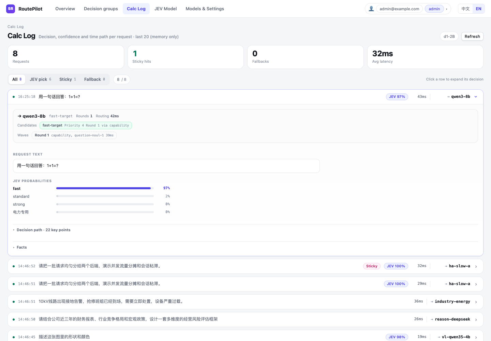
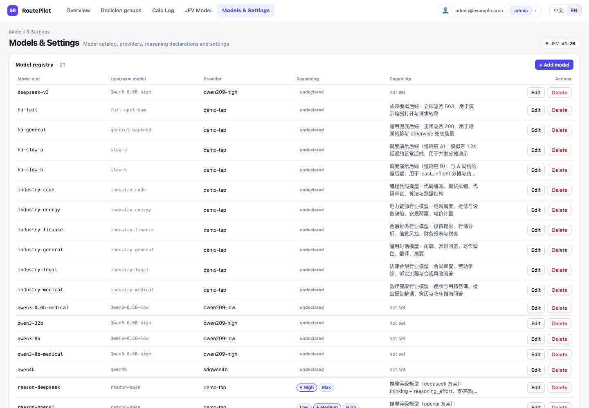
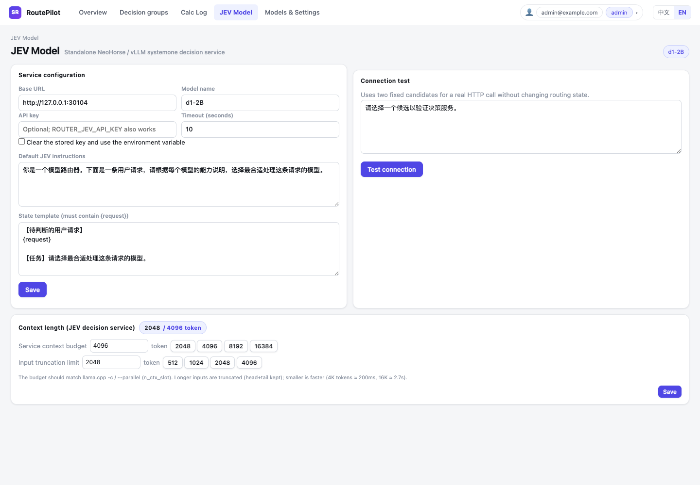

# RoutePilot

RoutePilot is an OpenAI-compatible routing proxy for LLM traffic. Every request runs through a versioned decision graph made of request conditions, decision-service questions, logic gates, and model targets. The same graph is edited, validated, dry-run, and published in the built-in console.

English | [简体中文](README.zh-CN.md)



## Highlights

- **Visual routing policy.** Build branching policies on a canvas instead of writing if/else chains. Nodes, wires, conditions, validation, layout, undo/redo, and graph import/export are all first-class.
- **OpenAI-compatible entry point.** `POST /v1/chat/completions` supports JSON and SSE streaming, with the selected model returned in response headers.
- **Decision-service driven.** Choice, yes/no, and score questions are batched per wave and sent to a `systemone`-compatible decision service. Answers activate downstream questions, gates, and targets.
- **Deterministic target selection.** Activated targets compete by priority; the largest number wins. A normal empty result uses `otherwise_target`, while a failed decision wave uses `error_fallback`.
- **Sticky sessions and load balancing.** Reuse a model per tree revision and target, then pick a backend with `least_inflight`. Failed backends are removed by a circuit breaker.
- **Dry-run before publishing.** `/admin/try` runs the same graph executor with the same trace format without touching affinity, in-flight counts, or upstream generation models.
- **Operations built in.** Request ledger, decision replay, confidence distribution, model/provider catalog, JEV settings, time periods, config revisions, audit history, and role-based users.
- **Bilingual console.** Chinese and English UI, with admin and viewer roles.

## How a request is routed



1. Load the immutable routing snapshot and evaluate request conditions (time period / text keywords).
2. Activate the first wave of questions. All questions in one wave are merged into one decision-service call.
3. Update numeric ports and `selected` ports, then re-evaluate every downstream slot condition and logic gate.
4. Repeat wave by wave until no new question is activated.
5. Choose the highest-priority active target. If none activated, use `otherwise_target`; if a decision call failed, use `error_fallback`.
6. Apply session affinity, select a backend with `least_inflight`, and proxy the request upstream. Failures open the circuit breaker for that model.

`unknown` never activates a question or target. Numeric comparisons with an unknown value stay unknown.

## Console



The console is the control plane for the router:

- **Overview** — request volume, route distribution, JEV confidence, sticky hits, active decision group.
- **Decision groups** — canvas editor, graph settings, node/edge inspector, validation, dry-run, import/export.
- **Calc Log** — recent decisions with model, target, candidates, waves, JEV probabilities, reasoning, upstream outcome, and a replayable trace.
- **JEV Model** — decision-service endpoint, model, prompt/state template, connection test, context and input-token window.
- **Models & Settings** — model registry, upstream model ids, providers, reasoning declarations, capability notes.
- **Users** — admin/viewer accounts, password changes, role and status management.

### Canvas


- Drag nodes from the library, pan/zoom, auto-layout, undo/redo.
- Draw typed wires; numeric outputs create a default condition when dropped into a boolean slot.
- Every input slot is an OR input with its own edge condition.
- Drag an output to empty canvas to quick-create a compatible node.
- Save and enable are separate; dirty and layout-only states are visible.
- Target cards show the target display name, model list, fallback roles, and scheduling strategy.

### Dry-run replay



Dry-run highlights the winning path wave by wave, shows candidates and priorities, and exposes the full trace. It uses the same executor as production routing but does not consume affinity, in-flight capacity, or an upstream model call.

### Decision log



Each row expands into a compact decision summary, candidate list, wave timing, request text, JEV probabilities, model reasoning, and the raw trace. The ledger is written asynchronously to SQLite; the page reads the latest 20 records from the in-process ring.

## Decision graph

### Nodes

| Type | Purpose | Inputs | Outputs |
|---|---|---|---|
| `start` | Request entry; always true | — | boolean |
| `question` | Decision-service question: `choice`, `noul`, or `score` | Boolean slots `in_1..in_n` (OR) | choice: `prob.*`, `selected.*`, `p_top`, `margin`; noul: `yes`, `no`; score: `value` |
| `logic` | Three-valued logic gate: `and`, `or`, `not` | Boolean slots `in_1..in_n`, one edge + condition per slot | boolean |
| `condition` | Request condition: time period or text keywords | — | boolean |
| `target` | Model target: models, reasoning tiers, priority, strategy | Boolean slots `in_1..in_n` (OR) | — |

### Conditions

Conditions live on edges, not on nodes:

```json
{
  "id": "e-cap-strong-and-power",
  "source": "capability",
  "source_port": "prob.strong",
  "target": "and-power",
  "target_port": "in_1",
  "condition": { "op": "gt", "value": 0.65 }
}
```

| Upstream output | Condition | Evaluation |
|---|---|---|
| number | `gt` / `gte` / `lt` / `lte` / `eq` / `neq` + finite threshold | Compare values; unknown propagates as unknown |
| boolean | `null` (same as `= true`) or `{ "op": "is", "value": true \| false }` | Boolean expectation |

- One output can feed multiple slots; each slot has its own condition.
- Two slots of an AND gate can express a range such as `> 0.3` and `< 0.8`.
- Each input slot accepts at most one edge. Slot numbers stay stable; deleted slots can be reused.
- `not` has exactly one slot. `and` / `or` require at least two. Question and target slots are OR.

### Execution rules

- Questions are executed in waves; one wave = one decision-service call.
- A failed wave voids the whole round: no ports are filled and all candidates from that round are discarded.
- Target priorities must be unique. **Larger number wins.**
- `otherwise_target` is used when execution completes normally with zero active targets.
- `error_fallback` is used when a decision call fails, times out, or returns an invalid answer.
- Both fallbacks must point to an existing target; they may point to the same target.

### Limits

| Item | Limit |
|---|---:|
| Nodes | 200 |
| Edges | 400 |
| Question nodes | 32 |
| Longest question chain | 8 waves |
| Options per choice question | 255 |
| Score criteria | 2–10 finite values |

### Graph document

The canvas imports and exports a single JSON envelope:

```json
{
  "kind": "sr-routing-graph",
  "version": 3,
  "name": "Default routing",
  "timezone": "Asia/Shanghai",
  "sticky": { "enabled": true, "ttl_seconds": 1800 },
  "root": {
    "id": "root",
    "type": "graph",
    "otherwise_target": "safe-target",
    "error_fallback": "safe-target",
    "nodes": [],
    "edges": []
  }
}
```

## Models and reasoning

The model registry maps a **model slot** used by the graph to an **upstream model id** and a provider. A target can hold several model slots; `least_inflight` picks among them.



Providers define the OpenAI-compatible base URL, API-key environment variable, and reasoning dialect. Model profiles can declare:

- reasoning support and a default level;
- a map from RoutePilot levels (`off`, `on`, `minimal`, `low`, `medium`, `high`, `xhigh`, `max`) to provider-specific wire values;
- capability notes and catalog metadata.

Supported reasoning dialects include OpenAI, DeepSeek, Qwen, Qwen chat template, OpenRouter, Z.ai, Together, string-thinking, and Ant Ling. If a requested level is not supported, the request is sent without reasoning injection and the response carries `x-sr-reasoning-warning`.

## Decision service (JEV)



The decision service exposes `POST /v1/systemone` and is typically served by NeoHorse / vLLM. Configure it in the console:

- base URL, model name, API key, timeout;
- default instructions and state template (must contain `{request}`);
- connection test with two fixed candidates;
- service context budget and input truncation limit. Oversized input is truncated head/tail instead of returning a 4xx/5xx.

Environment variables can seed the decision-service config on first start only; the database remains the source of truth afterward.

## Access and operations

- Email/password login with scrypt password hashing and opaque bearer sessions.
- `admin` can edit graphs, models, JEV settings, users, and settings. `viewer` is read-only and cannot manage users.
- The last active admin cannot be demoted, disabled, or deleted.
- Every user and configuration change is recorded in the audit log.
- Each graph file is content-addressed by SHA-256 for save conflicts and reload checks; graph history is not retained.
- Control-plane state (models, providers, users, logs, settings) is SQLite (WAL); routing graphs live in shared JSON files. Request logs are flushed asynchronously and also kept in a 20-entry in-memory ring for the live UI.
- Session affinity and in-flight counts remain process-local. Multiple router replicas can share graph files, but cross-replica session/in-flight consistency requires an external shared state layer.

## Shared graph storage and replicas

Decision graphs are not stored in SQLite. Each group is one v3 export document at
`ROUTER_GRAPH_DIR/graphs/{tree_id}.json`; `ROUTER_GRAPH_DIR/current` contains only the enabled group id.
The admin API has a single writer. Other replicas run with `ROUTER_GRAPH_WRITER=false`, mount the same
directory read-only, and poll every 2 seconds. A replica builds a candidate snapshot before replacing its
in-memory snapshot; if a file is invalid, the previous snapshot keeps serving and `/readyz` reports stale.

- Kubernetes: use a ReadWriteMany PVC; do not share SQLite on NFS/RWX.
- Docker: mount the same NFS export into every container. Keep SQLite on local storage for the writer.
- Graph files and `current` are created through atomic temporary files with mode `0600`. Every writer/reader container must use the same numeric UID (10001 is an example; deployments may use another shared UID). Matching only the GID or `fsGroup` cannot grant access to mode-`0600` files; replicas with different UIDs are unsupported.
- Set the same `runAsUser`/`runAsGroup` in both Kubernetes pod `securityContext`s and the same `--user UID:GID` for Docker containers. The shared directory and `graphs` subdirectory must be traversable by that UID; only the writer needs create/replace access, while readers mount the same directory read-only.
- Writes are atomic. A stale save returns 409 `graph_conflict`; imports only change the draft. There is no graph version history or rollback.
- `/healthz` is the liveness probe. `/readyz` reports whether this replica has an initial snapshot; 503 means not ready. After a later reload failure, an existing snapshot continues serving with `"stale": true`.
- Migration: back up first, then run `python scripts/export_sqlite_graphs.py --db router.db --out routing-graph`. The output directory must not exist. Normal startup never deletes old SQLite graphs; clean them only after explicit confirmation.

## Quick start

```bash
python3.11 -m venv .venv
.venv/bin/pip install -r requirements.txt

# Local development: authentication disabled
ROUTER_DB=/tmp/routepilot.db \
ROUTER_GRAPH_DIR=/tmp/routepilot-graph \
ROUTER_USER_AUTH=0 \
.venv/bin/python -m router
```

Open `http://127.0.0.1:8400/console/`. The API root redirects there.

For a protected deployment:

```bash
ROUTER_DB=/var/lib/routepilot/router.db \
ROUTER_GRAPH_DIR=/var/lib/routepilot/graph \
ROUTER_HOST=0.0.0.0 \
ROUTER_PORT=8400 \
ROUTER_ADMIN_EMAIL=admin@example.com \
ROUTER_ADMIN_PASSWORD='change-me-now' \
.venv/bin/python -m router
```

The first start against an empty users table seeds the admin account. Change the password after signing in.

## Configuration

| Variable | Default | Purpose |
|---|---|---|
| `ROUTER_DB` | `router.db` | SQLite control-plane database path |
| `ROUTER_GRAPH_DIR` | `./routing-graph` | Shared directory for graph files and the enabled pointer |
| `ROUTER_GRAPH_WRITER` | `true` | Allow this instance to write graph files; run exactly one writer |
| `ROUTER_HOST` | `127.0.0.1` | Listener host |
| `ROUTER_PORT` | `8400` | Listener port |
| `ROUTER_JEV_URL` | empty | Decision-service base URL; seeds the database on first start |
| `ROUTER_JEV_MODEL` | empty | Decision-service model; must be set with `ROUTER_JEV_URL` |
| `ROUTER_JEV_API_KEY` | empty | Optional decision-service key |
| `ROUTER_JEV_TIMEOUT` | `10` | Decision-service timeout, seconds |
| `ROUTER_SESSION_MAX_ENTRIES` | `10000` | Session-affinity LRU capacity |
| `ROUTER_USER_AUTH` | `true` | Enable console authentication |
| `ROUTER_ADMIN_EMAIL` | `admin@test.com` | First-run admin email |
| `ROUTER_ADMIN_PASSWORD` | seed value | First-run admin password; set this explicitly before the first start |
| `ROUTER_SESSION_TTL_HOURS` | `168` | Console session lifetime |

## API

| Method and path | Purpose |
|---|---|
| `POST /v1/chat/completions` | OpenAI-compatible routing entry; JSON or SSE |
| `GET /healthz` | Liveness probe |
| `GET /readyz` | Initial-snapshot readiness; 503 until this replica has one |
| `POST /admin/login` / `POST /admin/logout` | Console session |
| `GET /admin/me` / `POST /admin/me/password` | Current user and self-service password change |
| `GET/POST /admin/trees`, `GET/PUT/DELETE /admin/trees/{id}` | Decision-group CRUD |
| `POST /admin/trees/{id}/copy`, `/enable`, `/disable` | Decision-group lifecycle |
| `POST /admin/try` | Dry-run against a draft graph |
| `GET/POST /admin/models`, `GET/PUT/DELETE /admin/models/{id}` | Model registry |
| `GET /admin/model-catalog`, `POST /admin/fetch-models` | Provider presets and upstream model discovery |
| `GET /admin/providers`, `PUT/DELETE /admin/providers/{name}` | Provider configuration |
| `GET/PUT /admin/jev`, `POST /admin/jev/test` | Decision-service settings |
| `GET/PUT /admin/jev/window` | JEV context and input-token window |
| `GET/PUT /admin/time-periods` | Named time periods |
| `GET /admin/requests/recent`, `GET /admin/requests/stats` | Live request ring and logger stats |
| `GET /admin/overview`, `GET /admin/changes`, `GET/PUT /admin/settings` | Overview, audit history, settings |
| `GET/POST /admin/users`, `PUT/DELETE /admin/users/{id}`, `POST /admin/users/{id}/password` | User management |

### Errors

| Status | Error | Meaning |
|---|---|---|
| 400 | `invalid_json` / `body_must_be_object` / `messages_must_be_list` | Malformed request body |
| 413 | `request_too_large` | Body exceeds 10 MiB |
| 502 | `upstream_error` | Upstream 5xx or network failure |
| 409 | `graph_conflict` | The graph changed after this draft was loaded; reload and reconcile |
| 409 | `graph_already_exists` | A graph id is already in use |
| 503 | `graph_read_only` | This replica is a reader; enable writes on the single writer |
| 503 | `graph_storage_error` | Shared graph storage could not be read |
| 503 | `no_valid_snapshot` | This replica has no initial snapshot yet |
| 503 | `no_active_tree` | No enabled decision group |
| 503 | `no_available_backend` | All backends for the chosen target are unavailable |
| 503 | `routing_failed` / `routing_invariant_violation` | Internal routing failure |

Upstream 4xx responses are passed through with their status and body.

## Tests

```bash
.venv/bin/python -m pytest tests/ -q
```

```bash
npm install
npm run check:console
```

`check:console` runs the graph contract tests and the Playwright acceptance matrix against a temporary database, mock decision service, and mock upstream. It needs no running server and makes no external requests. Set `CHROME=/path/to/chrome` if Chromium is not found in the usual cache.

## Project layout

```
router/
  api/                 FastAPI app, admin/v1 routes, upstream proxy, request logger
  routing/
    graph/             graph model, validation, executor, ports
    affinity.py        session affinity
    scheduler.py       least_inflight load balancer and leases
    snapshot.py        immutable routing snapshots
  jev/                 decision-service client, config, input window
  store/               SQLite schema/repositories and the shared graph-file repository
  console/             static bilingual console
configs/               example decision groups and demo cases
tests/                 pytest suite
scripts/               graph contract tests and Playwright QA
assets/routepilot/     README screenshots
```

---

© 2026 Sandlake. All rights reserved.
