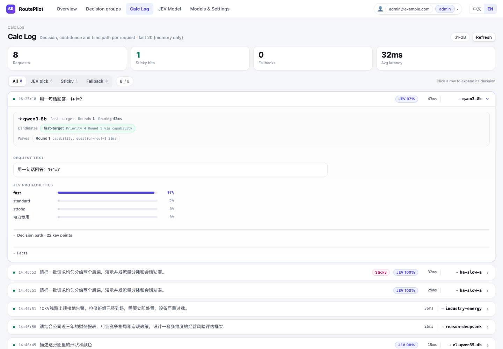

# RoutePilot

**Natural-language-driven intelligent routing for LLM traffic.**

English | [简体中文](README.zh-CN.md)

RoutePilot is an OpenAI-compatible routing proxy. Requests enter through `/v1/chat/completions`; a versioned decision graph selects the upstream model. Graphs are edited, validated, dry-run and published in the built-in console.


## Features

| Area | Capability |
|---|---|
| Entry point | `POST /v1/chat/completions`, JSON and SSE, `x-sr-model` / `x-sr-selection` / `x-sr-reasoning*` response headers |
| Routing policy | Visual decision graph: conditions, decision-service questions, logic gates, model targets |
| Decision service | `choice` / `noul` / `score` questions, batched per wave, sent to a `systemone`-compatible service |
| Target selection | Priority competition among activated targets; one fallback target `error_fallback` |
| Backend selection | Session affinity, `least_inflight` load balancing, per-model circuit breaker |
| Dry run | `/admin/try` executes the same graph and trace format without touching affinity, inflight counters or upstream models |
| Operations | Request ledger, decision replay, confidence distribution, model/provider catalog, JEV settings, time periods, audit history, role-based users |
| Console | Bilingual (zh/en) native ES Modules, no build step |

## Request pipeline


1. Load the immutable routing snapshot and evaluate request conditions (time period, text keywords).
2. Activate the first question wave; all questions in one wave are merged into one decision-service call.
3. Write numeric and `selected` ports, then re-evaluate downstream slot conditions and logic gates.
4. Repeat wave by wave until no further question is activated.
5. Select the highest-priority activated target; otherwise use `error_fallback`.
6. Apply session affinity, select a backend with `least_inflight`, proxy the request upstream.

`unknown` never activates a question or target. A numeric comparison against an unknown value stays unknown.

## Architecture

| Layer | Path | Responsibility |
|---|---|---|
| API | `router/api/` | DTO parsing, exception-to-HTTP mapping, upstream proxy, presenters |
| Control plane | `router/control/` | Write use cases for graphs and configuration, enable validation |
| Routing domain | `router/routing/` | Graph model, validation, compiled topology, evaluator, scheduler |
| Decision service | `router/jev/` | `systemone` client, settings, input window |
| Upstream | `router/upstream/` | Backend catalog, proxy transport, circuit breaker and sync worker |
| Storage | `router/store/` | SQLite schema/repositories, graph-file repository |
| Console | `router/console/` | Bilingual native ES Module UI |
| Runtime | `router/request_logging.py`, `router/maintenance.py` | Ledger queue/worker, session purge |

Boundaries:

- `router/routing/` and `router/upstream/` import neither FastAPI nor SQLite. `router/control/` and `router/store/` do not import `router.api`.
- The API layer parses DTOs and maps exceptions; it does not write control-plane state. Account and session routes (`/admin/login`, `/admin/logout`, `/admin/users`, `/admin/me`) call `UserRepo`/`SessionRepo`/`ChangeRepo` directly.
- `GraphService` validates, prepares a candidate snapshot, writes the graph file under the single-writer lock, re-checks the document hash, publishes the snapshot, then records the audit entry. A stale draft returns 409.
- `ConfigurationService` writes rows and the audit entry inside one transaction, re-checks the graph fingerprint inside that transaction, commits, then swaps the in-memory snapshot. An unstable fingerprint raises before COMMIT.
- `compile_graph()` runs once per published snapshot. The request path reads `snapshot.require_compiled()` and never rebuilds indexes or opens SQLite.
- The event loop only enqueues ledger rows into a bounded queue and a 20-entry ring; a 2-second flush projects whitelisted columns and writes them through `asyncio.to_thread`.
- The breaker worker loads shared quarantine state at startup and syncs local changes every 30 seconds on a worker thread.

## Console


One `<script type="module">` entry per page, no application globals, no CommonJS.

| Page | Content |
|---|---|
| Test | Admin-only model test chat: Auto routing or a fixed model, SSE streaming, in-memory multi-turn history, image/text/audio/file attachments, safe multimodal rendering |
| Decision groups | Canvas editor, graph settings, inspector, validation, dry run, import/export |
| Calc Log | Recent decisions with model, target, candidates, waves, JEV probabilities, reasoning, upstream outcome, replayable trace |
| Decision service | Read-only service profile (address, model, key status, test status) with Save and test; prompts, timeout and the context window live under Advanced |
| Models | Model registry; Connect models onboards a catalog provider and its models in one save. The preset dialog's Advanced holds only connection details and slot IDs; reasoning declarations, tiers, domains and provider protocol belong to the custom form |
| Users | Admin/viewer accounts, passwords, roles, status |

### Common paths

- The decision-group toolbar defaults to **Try run** and **Save and enable**; an enabled draft with pending edits reads **Save and update**. **Save draft** and Disable live under **More**. The inspector's **Apply** only updates the local draft and never writes to the server.
- On the Models page, **Connect models** is the default entry and a preset catalog onboards the provider and its models in one save. Model IDs are generated automatically. The preset dialog's Advanced holds only connection details and slot IDs; manual IDs, reasoning declarations, tiers, domains and provider protocol settings live in the custom form's Advanced.
- The **Decision service** page shows only connection details by default; **Save and test** saves the service configuration, then the context window, then tests the connection. Prompts, the state template, timeout and token window live under Advanced, and the raw test response expands on demand.

### Model test chat

The home page (`/console/index.html`) is an admin-only model test chat. It posts to `/admin/test/chat/completions` and shows the actual model in the message metadata (`Auto → <model>` for Auto, `<model> · fixed model` for a fixed model), using the `x-sr-model` response header.

- **Auto or fixed model** — Auto evaluates the current routing snapshot (decision graph, JEV waves, sticky and load-balanced backend selection) exactly like `/v1/chat/completions`. Choosing a configured model ID skips the graph and JEV and returns `x-sr-selection: direct`.
- **Streaming** — answers stream over SSE; Stop aborts the stream and keeps the partial answer, and Copy / Retry / Regenerate act on the message. A stream counts as complete only when the upstream ends it cleanly — an early EOF is marked incomplete and a provider error is shown inline in the conversation, never silently passed off as a complete answer.
- **Multi-turn history** — the in-memory transcript is resent as wire-format `messages`, replayed losslessly from the raw assistant message (message-level media renders but never re-enters history); New Chat aborts any in-flight reply, clears the conversation and rotates the session id.
- **Attachments** — text files are read as text and sent as content parts; images, audio and other files are read to data URLs. A file whose estimated size would break the 10 MiB request limit is rejected inline before it is read, and the exact whole-body size (history + Base64) is checked again before sending.
- **Multimodal output** — text renders as safe Markdown; images, audio, video and files use native players or download links; unknown parts stay folded as inspectable JSON. Model-provided HTML is shown as text and active URL schemes are dropped, so nothing executes.
- **Memory only** — conversations and attachments live in the page; a refresh clears them, and the server stores neither chat history nor uploaded files.

### Editor and execution zone

The routing page is split into two zones.

**Editor zone** — canvas, node library, inspector, validation:

- Drag nodes from the library, pan/zoom, auto-layout, undo/redo.
- Typed wires; a numeric output dropped into a boolean slot creates a default condition.
- Each input slot is an OR input with its own edge condition.
- Dragging an output onto empty canvas quick-creates a compatible node.
- Saving and publishing are merged into the toolbar primary; **Save draft** under **More** still saves without enabling. The lifecycle badge has exactly four states — Running, Unpublished changes, Disabled, Unsaved draft. A saved but disabled group reads Disabled even with local edits (disabled wins), and Unsaved draft is reserved for a group that was never saved. The primary button reads Save and enable, Save and update, Enabled, Enable or Saving… accordingly.
- The inspector's **Apply** commits to the local draft only. Everything that writes to the server lives in the toolbar: the primary publishes (saves and enables), **Save draft** saves without enabling, and **Disable** flips the enabled state.
- Target cards show display name, model list, fallback role and scheduling strategy.

**Execution zone** — docked below the canvas:

- Input field, sample prompts, run button.
- Result: final target, model, candidates with priorities, selection reason, waves and call count.
- Execution trace: one card per wave with hit conditions, plus the full request timeline.

Dry runs highlight the winning path wave by wave. Selecting a trace row pans the canvas to the corresponding edge or node; editing entry points are the canvas and inspector.


### Decision log



Expanded rows show the calculation stages in order: input preparation, initial computation, per-wave JEV, candidates and final pick, model scheduling, execution result. A `routing_error` keeps the partial process up to the failure point: a schedule-stage failure keeps the scheduling snapshot (configured, registered, available, unavailable reasons, pre-selection inflight), and a failed JEV wave voids that round's candidates and falls to `error_fallback`. Records without a scheduling snapshot and restored ledger rows report the missing detail explicitly.

SQLite stores ledger fields only — no request text, trace, per-wave answers or node labels. The page reads the last 20 live records from an in-process ring; calculation detail is replica-local and not persisted.

## Decision graph

### Nodes

| Type | Purpose | Inputs | Outputs |
|---|---|---|---|
| `start` | Request entry, always true | — | boolean |
| `question` | Decision-service question: `choice`, `noul`, `score` | Boolean slots `in_1..in_n` (OR) | choice: `prob.*`, `selected.*`, `p_top`, `margin`; noul: `yes`, `no`; score: `value` |
| `logic` | Three-valued gate: `and`, `or` | Boolean slots `in_1..in_n`, one edge and condition per slot | boolean |
| `condition` | Request condition: time period or text keywords | — | boolean |
| `target` | Model target: models, reasoning tiers, priority, strategy | Boolean slots `in_1..in_n` (OR) | — |

### Conditions

Conditions live on edges:

```json
{
  "id": "e-cap-strong-and-power",
  "source": "capability",
  "source_port": "prob.strong",
  "target": "and-power",
  "target_port": "in_1",
  "condition": { "op": "gt", "value": 0.65 }
}
```

| Upstream output | Condition | Evaluation |
|---|---|---|
| number | `gt` / `gte` / `lt` / `lte` / `eq` / `neq` + finite threshold | Value comparison; unknown propagates as unknown |
| boolean | `null` (equivalent to `= true`) or `{ "op": "is", "value": true \| false }` | Boolean expectation |

- One output can feed multiple slots; every slot keeps its own condition.
- Two slots of an AND gate can express a range, e.g. `> 0.3` and `< 0.8`.
- Each input slot accepts one edge. Slot numbers are stable; released slots are reusable.
- `and` / `or` require at least two slots. Question and target slots are OR.
- Use boolean-slot negation or the complementary numeric comparison for the opposite test; there is no standalone NOT node.

### Execution rules

- Questions execute in waves; one wave is one decision-service call.
- A failed wave voids the round: no ports are written and all candidates from that round are discarded.
- Target priorities are unique; the larger number wins.
- `error_fallback` handles a normal run with no activated target, and a decision call that fails, times out or returns an invalid answer.
- The fallback reference must point to an existing target.

### Limits

| Item | Limit |
|---|---:|
| Nodes | 200 |
| Edges | 400 |
| Question nodes | 32 |
| Question chain depth | 8 waves |
| Options per choice question | 255 |
| Score criteria | 2–10 finite values |

### Graph document

```json
{
  "kind": "sr-routing-graph",
  "version": 3,
  "name": "Default routing",
  "timezone": "Asia/Shanghai",
  "sticky": { "enabled": true, "ttl_seconds": 1800 },
  "root": {
    "id": "root",
    "type": "graph",
    "error_fallback": "safe-target",
    "nodes": [],
    "edges": []
  }
}
```

Only `sr-routing-graph` v3 is accepted. Version-2 documents, non-v3 `kind` values, unknown node types and unknown envelope/node/edge fields are rejected before they replace a draft or a published snapshot. Structural rejections surface as `graph_parse_error`; the console runs the same validation before applying an import.

This experimental version does not accept legacy NOT graphs. Any `logic/operator=not` is rejected without migration, and historical NOT snapshots are not supported. Rewrite the condition manually: `> 0.65 → NOT` becomes `<= 0.65`, and `>= 0.5 → NOT` becomes `< 0.5`.

A v3 document may also carry its run configuration in four optional top-level fields (`backends`, `jev`, `jev_window`, `time_periods`); see [Self-contained canvas JSON](#self-contained-canvas-json).

`tree_revision` is the SHA-256 of canonical JSON over `{timezone, sticky, root}`, plus the four embedded run fields when the document carries them, with nodes sorted by id and edges by `(target, slot, source, source_port)`. Python and the console produce the same canonical form; the console uses it to classify edits, and `tree_revision` is computed by the server. Title, capability, position, array order and edge-id changes do not affect it. Only documents that lack embedded run configuration and contain no removed capabilities keep their original behaviour hash. Legacy graphs containing NOT are rejected, so no revision migration occurs.

## Models and reasoning


A model slot used by the graph maps to an upstream model id and a provider. A target can hold several slots; `least_inflight` selects among them.

Providers define the OpenAI-compatible base URL, API-key environment variable and reasoning dialect. Model profiles declare:

- reasoning support and default level;
- level-to-wire mapping for `off`, `on`, `minimal`, `low`, `medium`, `high`, `xhigh`, `max`;
- capability notes and catalog metadata.

Reasoning dialects: OpenAI, DeepSeek, Qwen, Qwen chat template, OpenRouter, Z.ai, Together, string-thinking, Ant Ling. An unsupported requested level is forwarded without reasoning injection and the response carries `x-sr-reasoning-warning`.

`GET /admin/models` returns `profile` as a JSON object; the database stores it as JSON text. When the active decision group carries an embedded `backends` catalog, `GET /admin/models` and `GET /admin/providers` project that catalog; otherwise they fall back to the database. A configuration write synchronizes the management tables first, so both views converge.

Legacy database profiles are still read leniently, but the response is a sanitized projection: `api_key`, `authorization`, `key_present`, `key_source` and their case/separator variants are removed recursively from `profile`. This is read-only — legal metadata (`tier`, `domains`, `capability`, …) is preserved and the database row is never rewritten. Graph files and management writes still reject those fields rather than cleaning them.

A provider API key never appears in a response: the projection exposes `key_present` and `key_source` (`stored` / `env` / `none`) only.

## Decision service (JEV)


The decision service exposes `POST /v1/systemone`; typical deployments use NeoHorse or vLLM. The page opens on a read-only service profile — service address, model, key status and this session's test status — and only **Edit configuration** reveals the address, model and API key fields.

- **Save and test** is the only primary action. It runs `PUT /admin/jev` → `PUT /admin/jev/window` → `POST /admin/jev/test` in that fixed order; the context window is validated locally first, so a validation failure issues no write at all.
- Partial success names the exact stopping point: configuration not saved (window and test skipped), connection and prompts saved but window not saved (test skipped), configuration and window saved but the test failed, or everything succeeded. A failed test never leaves the previous result or raw response behind.
- Timeout, clear-key, default instructions, the state template, the context/input-token window and custom test text live under **Advanced settings**.
- After a passing test the raw JSON response is available on demand and collapsed by default; on failure it is hidden and cleared. Oversized input is truncated head/tail, and the context budget and input limit travel with the window configuration.

When the active decision group carries embedded `jev` / `jev_window` fields, that configuration is authoritative and the environment never overwrites it (an embedded `jev: null` also counts as decided). For legacy documents and instances without an active group, `ROUTER_JEV_URL` / `ROUTER_JEV_MODEL` seed the database on first start only and the database is authoritative afterwards. JSON never carries `api_key`: an endpoint-matching stored key is reused, otherwise `ROUTER_JEV_API_KEY` is read from the environment when the snapshot is built.

## Access and operations

- Email/password login, scrypt hashing, opaque bearer sessions.
- `admin` can edit graphs, models, JEV settings and users; `viewer` is read-only.
- The last active admin cannot be demoted, disabled or deleted.
- User and configuration changes are recorded in the audit log.
- Graph files are content-addressed by SHA-256 for save conflicts and reload checks; no graph history is retained.
- Control-plane state is SQLite (WAL); routing graphs are shared JSON files. Ledger writes run on a worker thread.
- Session affinity and inflight counters are process-local.

## Graph storage and replicas

Graphs are not stored in SQLite. Each decision group is one v3 document at `ROUTER_GRAPH_DIR/graphs/{tree_id}.json`; `ROUTER_GRAPH_DIR/current` contains the enabled group id. A document may embed its own run configuration (`backends`, `jev`, `jev_window`, `time_periods`) so it restores without the control-plane database; documents without those fields keep using the database catalog.

- Single writer: the admin API. Other replicas run with `ROUTER_GRAPH_WRITER=false`, mount the directory read-only and reload every 2 seconds.
- A replica compiles a candidate snapshot before replacing the serving snapshot; an invalid file leaves the previous snapshot active and `/readyz` reports stale.
- Writes are atomic through temporary files with mode `0600`.
- Kubernetes: ReadWriteMany PVC for graph files; SQLite on local storage for the writer.
- Docker: mount the same NFS export into every container.
- All writer/reader containers must share the same numeric UID; mode `0600` files are not accessible through GID or `fsGroup` alone.
- A stale save returns 409 `graph_conflict`; imports only change the draft.
- `/healthz` is liveness. `/readyz` reports initial-snapshot readiness; 503 means not ready, and a later reload failure keeps the existing snapshot with `"stale": true`.
- Migration: `python scripts/export_sqlite_graphs.py --db router.db --out routing-graph`. The output directory must not exist; startup never deletes old SQLite graphs.

## Self-contained canvas JSON

A v3 document can carry its own run configuration, so one file restores a decision group on an empty database instance. Four optional top-level fields are added to the envelope:

| Field | Content |
|---|---|
| `backends` | `providers` (name, base URL, API-key environment variable, reasoning dialect) and `models` (id, upstream id, provider, profile) |
| `jev` | Decision-service endpoint, model, timeout, instructions and state template, or `null` |
| `jev_window` | `input_tokens` / `context_tokens` for the decision-service input budget |
| `time_periods` | Time period definitions referenced by `periods` conditions |

```json
{
  "kind": "sr-routing-graph",
  "version": 3,
  "name": "Default routing",
  "timezone": "Asia/Shanghai",
  "sticky": { "enabled": true, "ttl_seconds": 1800 },
  "root": { "id": "root", "type": "graph", "nodes": [], "edges": [], "error_fallback": null },
  "backends": {
    "providers": [
      {
        "name": "local",
        "base_url": "http://127.0.0.1:8000/v1",
        "key_env": "LOCAL_API_KEY",
        "reasoning_format": "openai"
      }
    ],
    "models": [
      {
        "id": "qwen3-8b",
        "upstream": "qwen3-8b",
        "provider": "local",
        "profile": {
          "capability": "Fast small model for simple requests.",
          "reasoning": { "efforts": { "off": null, "on": null }, "default": "on" }
        }
      }
    ]
  },
  "jev": {
    "base_url": "http://127.0.0.1:8100",
    "model": "d1-2b",
    "timeout_seconds": 10.0,
    "instructions": "You are a model router.",
    "state_template": "【待判断的用户请求】\n{request}"
  },
  "jev_window": { "input_tokens": 1024, "context_tokens": 4096 },
  "time_periods": [
    { "name": "day", "days": [0, 1, 2, 3, 4], "start": "09:00", "end": "18:00" }
  ]
}
```

Four rules govern the fields:

- **All four or none.** A document carrying only some of the four fields is rejected with `graph_parse_error` before it can replace a draft or a published snapshot; all four absent means a legacy document.
- **No secrets, at any depth.** A provider carries `key_env` (an environment variable name) instead of a key, and `jev` never carries `api_key`. Secret and derived-key fields (`api_key`, `authorization`, `key_present`, `key_source`) are rejected wherever they appear inside the four fields, including nested objects and arrays below `backends.models[*].profile`. The match ignores case, `-` and `_` (`API-KEY` is the same as `api_key`) but only covers that fixed set, so ordinary metadata such as `monkey` or `keychain` is preserved. `profile` stays a free-form JSON metadata object otherwise: `capability`, `domains`, `tier` and later metadata are stored unchanged. A local server that needs no authentication may leave `key_env` empty.
- **Validated at the file boundary.** Provider and model ids, provider references, profiles, reasoning declarations, JEV settings, the window and the periods are all validated while parsing.
- **Part of the behaviour version.** When present, the fields join `tree_revision` (and the console dirty/undo baseline); canvas coordinates still do not affect behaviour. Only documents that lack embedded run configuration and contain no removed capabilities keep their original behaviour hash. Legacy graphs containing NOT are rejected, so no revision migration occurs.

### Legacy documents

A v3 document without the four fields is a legacy document: the runtime configuration is assembled from SQLite exactly as before, so reading an old file keeps working after an upgrade. An old document is materialized the first time it is written through the API:

- save (`POST` / `PUT /admin/trees`) and enable (`POST /admin/trees/{id}/enable`) write the current effective run configuration — the active group's embedded configuration when present, otherwise the database — into the saved file;
- copying a group keeps the source group's run configuration;
- `POST /admin/try` without run fields inherits the referenced group's configuration, then the active group's, then the database.

A draft that carries no runtime can also ask for explicit materialization: `POST`/`PUT /admin/trees` accept the control field `"runtime": null`, which discards the group's own embedded configuration *before* the normal materialization rule runs (active group first, database otherwise). It is not a file field, it never means "save as a legacy graph", and it cannot be combined with the four flat fields; any non-null value returns 422. Omitted `runtime` keeps the ordinary inheritance of the stored graph, and the console sends the explicit `null` whenever it saves a draft without a runtime.

### Keys

JSON never stores keys; the environment supplies them when a snapshot is built.

| Secret | Resolution order |
|---|---|
| Provider API key | The database provider's stored key **only when `name` and the normalized `base_url` both match**, otherwise none; then `os.environ[key_env]` |
| Decision-service key | The database JEV configuration's stored key **only when `base_url` and `model` both match**, otherwise none; then `ROUTER_JEV_API_KEY` |

An endpoint change therefore never forwards an old key to the new address, environment keys are never written to SQLite or the JSON, derived authorization headers exist only in the in-memory snapshot, and no JSON file, API envelope or graph response contains a real key.

### Configuration writes are global

The configuration pages keep their global semantics. A successful write to models, providers, JEV, the JEV window or time periods seeds the management tables from the active group's embedded configuration (keeping only endpoint-matched keys), applies the edit, validates the active graph against the result, records the audit entry, and finally writes the resulting run configuration back to **every** decision group JSON. That is why one save affects all groups even when only one group is enabled; no other write path rewrites other groups, and a failed write changes no file.

The cross-graph update is a batch, not a loop of independent writes. Every baseline SHA-256 is preflighted and every target document is staged in its own directory before the first real replacement; replacements then run non-active groups first and the active group last. A configuration write callback only validates, audits and stages the batch; the outer transaction skeleton commits the graph files and builds/re-checks the candidate snapshot. Any catchable failure — staged replacement, candidate snapshot, fingerprint re-check or the database transaction — first lets the database transaction exit (ROLLBACK) and only then restores the original bytes of every file this write replaced; the in-memory snapshot is published only after COMMIT, and refreshed after a failed restore using the already-rolled-back database and the actual active graph. That refresh must never move back inside the database transaction. Staging/rollback makes request-scoped failures whole; it is not a distributed transaction across SQLite and the JSON files, so a process crash between replacements is not rolled back (writing the active group last keeps the live configuration on the old graph until the very last step).

### Restoring from one file

1. Start an instance with an empty database and an empty graph directory.
2. Import the JSON into a decision group (Decision groups page, or `POST /admin/trees`), then save and enable it.
3. Run a dry run (`POST /admin/try`) to verify the graph, embedded model catalog, decision service, window and time periods.
4. Call `POST /v1/chat/completions` for Auto routing, or use the model test chat with a fixed model.
5. Provide keys through environment variables only: each provider's `key_env`, and `ROUTER_JEV_API_KEY` when the decision-service endpoint requires authentication.

`configs/default_routing_tree.json` is a minimal runnable example: one `local` provider, two models, a local decision-service endpoint and the three seeded time periods. `configs/production_routing_tree.json` has the same shape with three models; replace the example base URLs and endpoints before deploying.

## Quick start

```bash
python3.11 -m venv .venv
.venv/bin/pip install -r requirements.txt

# Local development, authentication disabled
ROUTER_DB=/tmp/routepilot.db \
ROUTER_GRAPH_DIR=/tmp/routepilot-graph \
ROUTER_USER_AUTH=0 \
.venv/bin/python -m router
```

Console: `http://127.0.0.1:8400/console/`.

```bash
# Protected deployment
ROUTER_DB=/var/lib/routepilot/router.db \
ROUTER_GRAPH_DIR=/var/lib/routepilot/graph \
ROUTER_HOST=0.0.0.0 \
ROUTER_PORT=8400 \
ROUTER_ADMIN_EMAIL=admin@example.com \
ROUTER_ADMIN_PASSWORD='change-me-now' \
.venv/bin/python -m router
```

The first start against an empty users table seeds the admin account.

## Configuration

| Variable | Default | Purpose |
|---|---|---|
| `ROUTER_DB` | `router.db` | SQLite control-plane database |
| `ROUTER_GRAPH_DIR` | `./routing-graph` | Graph files and enabled pointer |
| `ROUTER_GRAPH_WRITER` | `true` | Allow graph writes; run exactly one writer |
| `ROUTER_HOST` | `127.0.0.1` | Listener host |
| `ROUTER_PORT` | `8400` | Listener port |
| `ROUTER_JEV_URL` | empty | Decision-service base URL |
| `ROUTER_JEV_MODEL` | empty | Decision-service model; paired with `ROUTER_JEV_URL` |
| `ROUTER_JEV_API_KEY` | empty | Decision-service key |
| `ROUTER_JEV_TIMEOUT` | `10` | Decision-service timeout, seconds |
| `ROUTER_SESSION_MAX_ENTRIES` | `10000` | Session-affinity LRU capacity |
| `ROUTER_USER_AUTH` | `true` | Console authentication |
| `ROUTER_ADMIN_EMAIL` | `admin@test.com` | First-run admin email |
| `ROUTER_ADMIN_PASSWORD` | seed value | First-run admin password |
| `ROUTER_SESSION_TTL_HOURS` | `168` | Console session lifetime |

## API

| Method and path | Purpose |
|---|---|
| `POST /v1/chat/completions` | Routing entry; JSON or SSE |
| `GET /healthz` | Liveness probe |
| `GET /readyz` | Snapshot readiness |
| `POST /admin/login` / `POST /admin/logout` | Console session |
| `GET /admin/me` / `POST /admin/me/password` | Current user, password change |
| `GET/POST /admin/trees`, `GET/PUT /admin/trees/{id}` | Decision groups |
| `POST /admin/trees/{id}/copy`, `/enable`, `/disable` | Group lifecycle |
| `POST /admin/try` | Dry run against a draft graph |
| `POST /admin/test/chat/completions` | Admin-only model test chat; JSON or SSE |
| `GET/POST /admin/models`, `GET/PUT/DELETE /admin/models/{id}` | Model registry |
| `GET /admin/model-catalog`, `POST /admin/fetch-models` | Provider presets, upstream model discovery |
| `GET /admin/providers`, `PUT/DELETE /admin/providers/{name}` | Providers |
| `GET/PUT /admin/jev`, `POST /admin/jev/test` | Decision-service settings |
| `GET/PUT /admin/jev/window` | JEV context and input-token window |
| `GET/PUT /admin/time-periods` | Time periods |
| `GET /admin/requests/recent`, `GET /admin/requests/stats` | Live request ring, logger stats |
| `GET /admin/overview`, `GET /admin/changes` | Overview, audit history |
| `GET/POST /admin/users`, `PUT/DELETE /admin/users/{id}`, `POST /admin/users/{id}/password` | Users |

### Errors

| Status | Error | Meaning |
|---|---|---|
| 400 | `invalid_json` / `body_must_be_object` / `messages_must_be_list` | Malformed body |
| 413 | `request_too_large` | Body exceeds 10 MiB |
| 502 | `upstream_error` | Upstream 5xx or network failure |
| 409 | `graph_conflict` | Graph changed after the draft was loaded |
| 409 | `graph_already_exists` | Duplicate graph id |
| 503 | `graph_read_only` | Reader replica |
| 503 | `graph_storage_error` | Shared graph storage unreadable |
| 503 | `no_valid_snapshot` | No initial snapshot |
| 503 | `no_active_tree` | No enabled decision group |
| 503 | `no_available_backend` | All backends of the selected target unavailable |
| 503 | `routing_failed` / `routing_invariant_violation` | Internal routing failure |

Upstream 4xx responses pass through with their status and body.

Configuration endpoints: `/admin/models`, `/admin/providers`, `/admin/jev`, `/admin/jev/window`, `/admin/time-periods`. There is no generic `/admin/settings` API.

## Tests

```bash
.venv/bin/python -m pytest -q
node --test scripts/console_graph_test.mjs scripts/console_draft_test.mjs scripts/graph_contract_test.mjs
npm install
npm run check:console
.venv/bin/python scripts/i18n_dead_keys.py
```

- `pytest` collects `tests/` only (`testpaths`), runs unit and FastAPI integration tests, starts no browser and does not collect `experiments/`.
- `node --test` runs the ES-module suites: graph/canonical behavior, draft state and cross-runtime contract fixtures (`tests/fixtures/graph_contracts.json`).
- `npm run check:console` runs the three Node suites and the Playwright acceptance matrix against a temporary database, mock decision service and mock upstream. Screenshots are off by default; `QA_SCREENSHOTS=1` regenerates them. `QA_ONLY=<regex>` selects cases; a page module runs standalone, e.g. `node scripts/console_qa/canvas.mjs`. Set `CHROME=/path/to/chrome` when Chromium is not in the default cache.
- `scripts/i18n_dead_keys.py` reports unreferenced dictionary keys.

Experiments are standalone and excluded from the default run:

```bash
.venv/bin/python -m pytest -q experiments/jev-batch/test_spike_jev_batch.py
.venv/bin/python experiments/jev-batch/spike_jev_batch.py --samples /path/to/samples.jsonl --scenario all --dry-run
```

## Project layout

```
router/
  api/                 FastAPI routes, DTOs, exception mapping, proxy wiring, presenters
  control/             control-plane write services and enable validation
  routing/
    graph/             graph model, validation, conditions, compiler, evaluator
    service.py         evaluate → schedule orchestration
    scheduling.py      sticky selection, lease acquisition, affinity writes
    affinity.py        session-affinity LRU
    scheduler.py       least_inflight balancer and leases
    snapshot.py        immutable snapshot assembly and compiled topology
    tree.py            tree envelope codec and revision
    codec.py           strict field parsing helpers
  request_logging.py   ledger queue/ring and worker-thread writes
  jev/                 decision-service client, settings, input window
  upstream/            catalog, proxy transport, circuit breaker + sync worker
  store/               SQLite schema/repositories, graph-file repository
  console/             bilingual native ES Module console
configs/               example decision groups
tests/                 pytest suite and contract fixtures
scripts/               Node contract tests, Playwright QA, deployment helpers
experiments/jev-batch/ standalone JEV batch spike
assets/routepilot/     README screenshots
```
