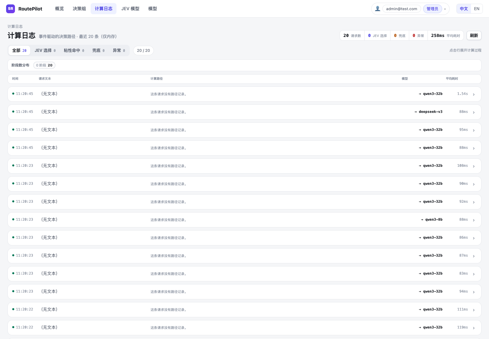

# RoutePilot

**自然语言驱动的智能路由。**

[English](README.md) | 简体中文

RoutePilot 由同一仓库构建、以**两个可独立部署的服务**交付：

- **`routepilot-core`（决策内核）** —— 持有带版本的决策图，完成每一次路由决策（图执行、决策服务/JEV、推理档位、会话粘性），并为每次真实决策产出一条自包含决策事件。它从不调用模型上游，也不持有 SQLite、控制台或人员数据。用 `python -m router core` 启动。
- **`routepilot-console`（外围服务）** —— 可选的面向前端服务：控制台、登录/人员、SQLite 配置目录、图管理到内核的代理、standalone 兼容 OpenAI 的 `/v1/chat/completions` 数据面，以及易失的 20 条决策日志。用 `python -m router peripheral` 启动。

两个服务一起部署即完整独立服务；只部署内核则作为 APISIX + newapi 之后的决策组件（163 形态）。决策图在内置控制台中编辑、校验、检查路由、保存与启用；所有图请求由外围鉴权后交给内核执行。


## 能力

| 分类 | 能力 |
|---|---|
| 服务形态 | 同一镜像提供内核（`python -m router core`）与可选外围（`python -m router peripheral`）；内核持有图 JSON 与全部决策，外围负责控制台/SQLite/执行 |
| 入口 | 外围 `POST /v1/chat/completions`（standalone 形态）与内核 `POST /internal/v1/route-decision`（APISIX 形态），支持 JSON 与 SSE；响应头 `x-sr-model` / `x-sr-selection` / `x-sr-tree-id` / `x-sr-graph-selection` / `x-sr-reasoning*` |
| 路由策略 | 可视化决策图：输入条件、决策服务问题、逻辑门、模型目标 |
| 路由集 | 可同时启用多张决策图；公开 `/v1` 只使用唯一默认图，部门映射让管理端检查命中指定的启用图 |
| 决策服务 | `choice` / `noul` / `score` 三类问题，按波次合并调用 `systemone` 兼容服务；画布快照固定该图使用的服务档案 |
| 目标选择 | 已激活目标按优先级竞争；统一兜底目标 `error_fallback` |
| 后端选择 | 会话粘性；多模型目标在可用模型中随机选择；Auto 按图与模型隔离熔断和 inflight；固定模型直连独立 |
| 可移植画布 | 每份已保存的 v4 画布自带生命周期标记、部门与完整非密钥运行配置，单份 JSON 即可在空数据库实例上恢复 |
| 检查路由 | 调用 `/admin/try`，复用同一图执行器与同一轨迹格式，不改变粘性、inflight 与上游模型；可检查当前草稿或当前生效路由集（可按部门选图），数据库差异只作为提示展示 |
| 运维 | 易失的 20 条决策日志（淘汰/回放）、置信度分布、模型/提供方目录、非密钥多服务 JEV 目录、时段、审计历史、角色化用户 |
| 控制台 | 中英双语原生 ES Modules，无构建步骤 |

## 请求链路

**独立形态（内核 + 外围）。** 外围对外提供兼容 OpenAI 的端点，并向内核索取唯一一次决策：

```text
客户端
  → 外围 POST /v1/chat/completions
  → 内核 POST /internal/v1/route-decision   （不携带用户 Authorization）
  → 外围把请求 model 改写为内核给出的真实模型
  → 外围从自己的 SQLite 目录解析 Provider Key
  → 模型上游
  → 外围透传 JSON / SSE

内核决策事件 → 外围 POST /internal/v1/decision-logs → 内存 deque(maxlen=20)
```

**内核接入 APISIX + newapi（163 形态）。** APISIX 保留原 newapi 链路，只向内核询问该跑哪个模型：

```text
客户端
  → APISIX Auto 路由（model == "auto"）
  → forward-auth：原始 Authorization 由 newapi 校验，并注入可信部门
  → sr-auto-router 不带 Authorization 调内核 POST /internal/v1/route-decision
  → APISIX 只改写 JSON 请求体 `model`（并更新 Content-Length）
  → 原 newapi upstream/插件/Authorization 执行该真实模型
  → APISIX 透传 JSON / SSE
```

固定模型请求完全绕过内核。没有有效决策时 APISIX 返回 503，绝不把 `auto` 发给 newapi；内核不会成为模型上游。

每次决策内部（两种形态都由内核执行）：

1. 选图：按可信部门命中某张启用图，否则使用默认图。
2. 载入该图的已编译快照，评估输入条件（时段、文本关键词）。
3. 激活第一波问题；同一波内的问题合并为一次决策服务调用。
4. 写入数值端口与 `selected` 端口，重新评估下游槽位条件与逻辑门。
5. 逐波重复，直到没有新问题被激活。
6. 选择优先级最高的已激活目标；否则使用 `error_fallback`。
7. 应用会话粘性；没有粘性命中时，在目标的可用模型中随机选一个。
8. best-effort 产出一条自包含决策事件（内嵌完整图与 trace）。

`unknown` 不会激活问题或目标；与 `unknown` 比较的数值条件保持 `unknown`。

## 架构

| 层 | 路径 | 职责 |
|---|---|---|
| 内核应用 | `router/api/core_app.py`、`router/api/routes_decision.py` | `create_core_app()`：图管理 `/internal/v1/trees*`、决策 `/internal/v1/route-decision`、原子批次 `/internal/v1/graph-batches`、`/healthz`、`/readyz`；无 SQLite/控制台/上游 |
| 外围应用 | `router/api/app.py`、`router/api/routes_core_proxy.py` | `create_app()`：控制台、登录/人员、目录 API、图管理代理、standalone `/v1` 数据面、决策事件接收口 |
| 跨服务客户端 | `router/core_client.py`、`router/api/routes_v1.py`、`router/upstream/execution.py` | 内核决策/管理 HTTP 客户端；外围执行目录 join（决策模型 + Provider Key） |
| 决策事件 | `router/decision_events.py`、`router/decision_log_sink.py`、`router/decision_log_store.py` | 自包含事件 schema/校验、内核 best-effort 异步 sink、外围 20 条内存日志与回放投影 |
| API | `router/api/` | DTO 解析、异常到 HTTP 映射、展示层 |
| 控制面 | `router/control/` | 内核侧图写用例；带跨服务原子图批次与反向补偿的目录写、影响清单、启用校验 |
| 路由领域 | `router/routing/` | 图模型、校验、编译后拓扑、求值器、调度、不可变路由集快照 |
| 决策服务 | `router/jev/` | `systemone` 客户端、非密钥服务档案、输入窗口 |
| 上游 | `router/upstream/` | 固定模型目录（`model_id -> Backend`）、外围代理传输与熔断器、执行目录解析 |
| 存储 | `router/store/` | 外围 SQLite schema/仓储、内核图文件仓储 |
| 控制台 | `router/console/` | 中英双语原生 ES Module 界面（仅外围） |
| 运行时入口 | `router/__main__.py` | `python -m router core|peripheral` |

边界约束：

- 内核是图 JSON 目录的唯一写者（全局设计约束）；外围从不挂载或写入该目录。外围是自己 SQLite 的唯一写者。
- `router/routing/` 与 `router/upstream/` 不导入 FastAPI，也不导入 SQLite；`router/control/` 与 `router/store/` 不导入 `router.api`；内核应用不导入 `router.store.db`。
- 内核应用把 `get_conn` 依赖覆盖成 `None`，同一批图路由在完全没有 SQLite 连接的情况下运行；审计行与目录差异提示是外围专属关注点，通过代理注入。
- 外围 API 层只做 DTO 解析与异常映射，不写图状态。账号与会话路由（`/admin/login`、`/admin/logout`、`/admin/users`、`/admin/me`）直接调用 `UserRepo`/`SessionRepo`/`ChangeRepo`。
- `GraphService`（内核）依次完成校验、构造候选路由集、在单写锁内写生命周期文档、复核路由集指纹、发布完整启用集合、记录审计；过期草稿返回 409。
- 可能触及图的目录写分两阶段提交：外围重算影响清单，要求内核用**一个条件批次**原子替换全部已确认画布（`POST /internal/v1/graph-batches`：基线校验 → 严格校验 → 路由集校验 → 一次提交/发布），然后提交自己的 SQLite 行。若内核已提交而 SQLite 提交失败，外围按新的基线哈希发反向批次补偿；补偿失败是显式 503 `catalog_sync_diverged`（绝不静默留下部分更新）。同步集合里含任一启用图时重发布完整启用集合；只同步禁用草稿时不发布；过期确认在任何写入之前返回 409 `graph_conflict`。
- 没有任何画布引用的目录写只写目录行与审计，不会重写画布，也不会重新发布路由集。
- `compile_graph()` 对每个已发布路由集里的每张启用图各执行一次；内核请求路径读取 `snapshot.require_compiled()`，不重建索引，不访问 SQLite。
- 每次真实决策构造一条自包含事件并交给有界异步队列（`Queue(1000)`）：短超时 best-effort HTTP 投递、丢弃计数只用于观测、不落盘重试、不影响决策响应。`logging.type=disabled` 时 sink 是 no-op。
- 会话粘性与内核调度/inflight 计数为进程内状态；外围另有自己的执行侧熔断器。

## 控制台


每个页面只有一个 `<script type="module">` 入口，无应用全局变量，无 CommonJS。控制台只由**外围**提供（`/console/`）；内核进程没有静态资源挂载。

| 页面 | 内容 |
|---|---|
| 测试 | 仅管理员可用的模型测试对话：Auto 智能路由（当前生效路由集：默认图，或可信部门头选中的启用图）、SSE 流式、内存内多轮历史、图片/文本/音频/文件附件、安全多模态渲染 |
| 决策组 | 画布编辑、多图生命周期（启用/停用、设为默认、默认标记）、图设置里的部门、图设置与运行配置（时区/粘性/兜底、JEV 选择、从数据库刷新运行配置）、检查器、校验、检查路由、导入导出 |
| 计算日志 | 最近决策的模型、目标、候选、波次、JEV 概率、推理档位、决策耗时与可回放轨迹 |
| 决策服务 | 多服务 JEV 目录：服务列表、新建/编辑/删除、逐服务连接测试、提示词、超时和该服务自己的上下文/输入窗口 |
| 模型 | 模型注册表与提供方目录；以“接入模型”从预置目录一次接入提供方与模型。影响已保存画布的编辑/删除会先展示影响清单，确认后才同步。预置弹窗的高级选项只有连接信息与模型位 ID，推理声明、档位、领域与提供方协议属于自定义表单 |
| 用户 | 管理员/只读账号、密码、角色、状态 |

### 常用路径

- 决策组顶栏把编辑动作全部平铺：撤销/重做、自动整理、“保存”、新建、导入、导出，已启用的组还有“停用”，与“检查路由”、主按钮和问题计数并排。保存由独立的“保存”按钮负责；主按钮只表达启用状态——新草稿或已保存的未启用组显示“启用”，已启用的组显示“已启用”且禁用，保存/启用请求在途显示“保存中…”。核心版本操作只有“保存”和“启用”：启用图保存后立即对后续请求生效，草稿保存不影响运行中的路由集，启用有未保存修改的图时先保存再启用。“停用”与“设为默认”是独立的生命周期操作。可以同时启用多张图，选择器会标出默认图；非默认的启用图还有“设为默认”。默认图在仍有其它启用图时不能直接“停用”——需先切换默认图。部门在图设置里编辑。检查器中的“应用”只更新本地草稿，不写服务端。
- 图设置（检查器）从数据库 JEV 目录选择服务，并在同一个历史项里应用 **JEV 与其窗口**；“从数据库刷新运行配置”按目录重建草稿的 `backends`/`jev`/`jev_window`/`time_periods`。两者都只改本地草稿，不写服务端。
- 模型页的“接入模型”是默认入口，可从预置目录一次完成提供方与模型接入；模型 ID 自动生成。预置弹窗的高级选项只放连接信息与模型位 ID，手工 ID、推理声明、档位、领域和提供方协议配置在自定义表单的高级选项里。
- “决策服务”页是目录：左侧列出服务，右侧编辑选中的服务（地址、模型、超时、指令、State 模板、输入/上下文窗口）并测试连接；页面**没有密钥输入**，JEV Key 只在内核环境里。窗口属于服务本身，因此画布总是成组替换 JEV 与窗口。环境可用 `ROUTER_JEV_URL` / `ROUTER_JEV_MODEL` 创建 `default` 服务（不产生密钥；JEV Key 由内核进程的 `ROUTER_JEV_API_KEY` 提供），但只发生一次：仅当目录为空、从未用过环境种子、且 URL 与模型都配置时，启动才会播种。首启没有环境、之后补上环境仍会播种一次；删光所有服务后重启绝不会复活。
- 编辑或删除仍被画布引用的模型、提供方或 JEV 服务会进入两步确认；没有被任何画布引用的资源会立即写入。第一次写入返回 409，列出每幅受影响画布（名称、id、启用状态、当前 `document_sha256`、使用位置）；确认后原样带回这些哈希，服务端只同步受影响的画布。仍被 target 引用的模型 / 仍被引用的 JEV 服务删除时必须提供替代项；仍被数据库模型或画布模型引用的提供方不能删除。确认同步成功后，已打开的画布需要重新加载（或使用“从数据库刷新运行配置”）——本地草稿不会被就地更新。

### 模型测试对话

首页（`/console/index.html`）是仅管理员可用的模型测试对话，请求固定走 Auto 并发送到 `/admin/test/chat/completions`；消息元信息根据响应头 `x-sr-model` 显示本次实际命中的模型（`Auto → <模型>`）。

- **Auto 智能路由**：与 `/v1/chat/completions` 一样评估当前生效路由集：默认图，或由可选**部门**输入（`x-sr-department`，百分号编码）选中的启用图；决策图、JEV 波次、粘性与随机后端选择全部生效。页面不提供固定模型旁路，测试流量始终经过真实路由；固定模型直连仍只通过 `POST /admin/test/chat/completions` 提供（`x-sr-selection: direct`，经数据库目录解析，没有图响应头）。页面用 `x-sr-model` 响应头显示回复元信息（`Auto → <模型>`）；Auto 回复的响应头还带实际选中的 `x-sr-tree-id` / `x-sr-graph-selection`，但页面不渲染这两个头。
- **流式回复**：回答通过 SSE 逐块返回；停止会中止流并保留已生成内容，复制 / 重试 / 重新生成作用于该条消息。只有上游正常收尾才算完成——提前断流会标记为未完成，提供方错误就地显示在对话里，不会冒充完整回答。
- **多轮历史**：内存中的对话以 wire-format `messages` 重发，并从原始 assistant 消息无损回放（消息级媒体只渲染、绝不回流进历史）；新建对话会中止在途回复、清空对话并轮换会话 id。
- **附件**：文本文件按原文读取并作为 content part 发送；图片、音频等其他文件在浏览器内读成 data URL。预估体积会超出 10 MiB 请求上限的文件在读取前就地拒绝，发送前还会对完整 JSON 请求体（含历史与 Base64）做精确复检。
- **多模态输出**：文本按安全 Markdown 渲染；图片、音频、视频与文件使用原生播放器或下载链接；未知 part 折叠为可检查的 JSON。模型提供的 HTML 只作为文本显示，活动 URL scheme 被丢弃，不会执行。
- **仅内存**：对话与附件只存在于页面中，刷新即清空，服务端不保存聊天历史与上传文件。

### 编辑区与执行区

路由页分为两个区域。

**编辑区** —— 画布、节点库、检查器、校验：

- 从节点库拖拽建节点、平移缩放；自动整理与撤销重做直接放在顶栏。
- 类型化连线；数值输出拖入输入槽位时生成默认条件。
- 每个输入槽位是一个 OR 输入，各自持有边条件。
- 输出拖到空白处会打开兼容节点选择器；点选后在该位置创建节点并自动连线（Esc 取消）。
- 核心版本操作只有“保存”和“启用”。“保存”只写草稿、不改变启用状态：启用图保存后保存版本立即用于后续请求，未启用草稿的保存不影响运行中的路由集，启用有未保存修改的图时先保存再启用。主按钮只表达启用状态——“启用”用于新草稿或已保存的未启用组，“已启用”（禁用）用于已启用的组，保存/启用在途显示“保存中…”。生命周期徽标只显示四种状态：运行中、有未保存修改、未启用、草稿未保存。已保存但未启用的组即使有本地改动也显示“未启用”（未启用优先），“草稿未保存”只用于从未保存的新草稿。决策组选择器会标出默认图；非默认的启用图显示“设为默认”，默认图在仍有其它启用图时不允许“停用”。
- 图设置里有**部门**映射（逗号或换行分隔）。一个部门只能归属一张启用图；禁用草稿之间允许重复，启用冲突的图会以 `department_conflict` 问题被拒绝。检查器的“应用”只提交到本地草稿；写服务端的动作都在顶栏——“保存”写草稿（启用图的保存会重发布完整启用集合），“启用”在保存完待提交改动后把图加入当前路由集，“停用”切换启用状态，“设为默认”原子切换默认图。用户侧的版本词汇只有“保存”和“启用”，没有额外的版本动作概念。
- 目标卡片显示展示名、模型列表、兜底角色与随机调度提示（多模型目标）。

**执行区** —— 停靠在画布下方：

- 输入框、样例提示词、运行按钮，以及**检查路由**的范围选择：当前草稿，或当前生效路由集（可填部门）。路由集试算只显示所选图的结果和原始节点/目标 ID，绝不在当前草稿上回放、涂色或布局；草稿试算保留画布回放。
- 结论：最终目标、模型、候选与优先级、选择原因、波次与调用次数。路由集检查还会报告选中的 `tree_id` 以及选图依据是部门还是默认图。
- 执行轨迹：每波一张命中条件卡片，以及完整请求时间线。

草稿试算按波次高亮命中路径，并可“按波次整理”节点。路由集试算不触碰画布——它描述的是当前生效路由集，而不是当前草稿，只以结果面板作为证据。点击轨迹行会把画布定位到对应连线或节点；编辑入口位于画布与检查器。


### 计算日志



计算日志是外围的**易失内存环**：内核每次真实决策都产出一条完整的 `routepilot.decision` 事件（best-effort），外围校验后只保留最新 20 条（`deque(maxlen=20)`）。不写 SQLite、重启不恢复、淘汰即终结——第 21 条挤掉最旧一条，被挤掉的事件回放返回 404。图快照表与账本写入器都已不存在。

每条事件都是自包含的：`schema_version`（`1`）、`event_type`（`routepilot.decision`）、`id` / `ts`、请求事实（文本、请求模型、可信部门、会话哈希）、**本次实际使用的完整图文档**（含非密钥运行配置）、决策值（状态、逻辑/真实模型、目标、选图与选路原因、兜底、粘性、策略路径、推理、耗时）、JEV 事实与答案、完整回放 trace 与节点标签。事件不含 Provider Key、JEV Key、`Authorization`，也不含图快照 ID；`key_env` 只是环境变量名，允许保留。事件只记录决策本身——绝不记录 newapi 渠道/计费、模型上游状态或 Token 用量。

展开行按阶段呈现计算过程：输入准备、初始计算、逐轮 JEV、候选与最终选择、模型调度。耗时只统计决策阶段（进入内核到选出模型），不含上游生成；上游状态与端到端总耗时留在网关数据面，不进入智能路由的展示口径。`routing_error` 事件保留失败前的部分过程，并仍内嵌已选中的图；选图之前因参数非法被拒绝、或根本没有当前图的请求不会产生可回放事件。

回放页面与以前完全一致：`routing.html?request=<决策 id>` 通过既有 `controller.loadTree()` / `rebuildTryRun()` 路径读取该事件自己的 `graph` 与 `trace`。由于图内嵌在事件里，事后修改或删除当前图不会改变仍保留在内存中的回放。页面列表请求走 `GET /admin/requests/recent`（只返回摘要——20 条列表不下发 20 份完整图），单条回放走 `GET /admin/requests/{id}/replay`。

### 决策事件与日志配置

内核通过 `config.json` 决定事件去向：

- `logging.type = "routepilot"`（standalone 形态的默认值）：异步把事件发到 `logging.url`，例如 `http://console:8400/internal/v1/decision-logs`，`timeout_ms` 默认 1000。投递是 best-effort：有界队列、短超时、丢弃计数只用于观测，失败绝不影响决策响应。
- `logging.type = "disabled"`：显式不输出事件（163 内核-only 部署使用）。决策照常工作，内核不保留任何事件副本。
- 本期**未实现** VictoriaLogs；事件结构已固定，后续 `logging.type=victorialogs` 适配器可直接把同一对象序列化为 JSON Lines。

## 决策图

### 节点

| 类型 | 用途 | 输入 | 输出 |
|---|---|---|---|
| `start` | 请求入口，恒为真 | — | 布尔 |
| `question` | 决策服务问题：`choice`、`noul`、`score` | 槽位 `in_1..in_n`（OR，任一为 true 即激活；类型由入边源端口决定） | choice：`prob.*`、`selected.*`、`p_top`、`margin`；noul：`yes`、`no`；score：`value` |
| `logic` | 三值逻辑门：`and`、`or` | 槽位 `in_1..in_n`，每槽一条边条件，至少两条 | 布尔 |
| `condition` | 输入条件：时段或文本关键词 | — | 布尔 |
| `target` | 模型目标：模型、推理档位、优先级（多模型随机选择） | 槽位 `in_1..in_n`（OR） | — |

### 条件

条件挂在边上：

```json
{
  "id": "e-cap-strong-and-power",
  "source": "capability",
  "source_port": "prob.strong",
  "target": "and-power",
  "target_port": "in_1",
  "condition": { "op": "gt", "value": 0.65 }
}
```

| 上游输出 | 条件 | 求值 |
|---|---|---|
| 数值 | `gt` / `gte` / `lt` / `lte` / `eq` / `neq` + 有限阈值 | 数值比较；unknown 按 unknown 传播 |
| 布尔 | `null`（等价 `= true`）或 `{ "op": "is", "value": true \| false }` | 布尔期望 |

- 槽位本身不声明类型：合法性只看源端口是数值还是布尔；数值输出可接任意槽位，只要该边带比较条件。
- 一个输出可接入多个槽位，每个槽位保留各自条件。
- AND 门的两个槽位可表达区间，例如 `> 0.3` 与 `< 0.8`。
- 每个输入槽位只接一条边；槽位编号稳定，释放后可复用。
- `and` / `or` 至少两个槽位。问题与目标的槽位为 OR（true 才激活，unknown 不激活）。
- 反向判断使用布尔输出取反，或使用数值比较的反向算子；不提供独立 NOT 节点。

### 执行规则

- 问题按波次执行，一波即一次决策服务调用；同一问题在一次请求里最多执行一次。
- 失败波次不写入任何端口，并清空此前所有波次累积的全部候选，然后进入兜底。
- 目标优先级唯一，数值大者胜出；候选排序的次键是 target id 字典序。
- `error_fallback` 同时处理「正常运行但无激活目标」与「决策调用失败、超时或返回非法答案」。
- 兜底引用必须指向存在的目标。

### 限额

| 项目 | 上限 |
|---|---:|
| 节点 | 200 |
| 连线 | 400 |
| 问题节点 | 32 |
| 问题链深度 | 8 波 |
| 单选问题选项 | 255 |
| 打分条件 | 2–10 个有限数值 |

### 图文档

v4 文档就是完整、可移植的画布：生命周期标记（`enabled`/`default`）、部门映射（`departments`）、图结构加四个必填运行字段。生命周期持久化在每份文档里——不再有 `current` 指针。新建与复制的文档一律以 `enabled: false, default: false` 保存；导入只替换草稿内容、不改生命周期——作为新组保存时是关闭态，保存到已有组则继承该组已存的生命周期（已启用的组保持启用）。通过生命周期 API 启用的第一张图会自动成为默认图。

```json
{
  "kind": "sr-routing-graph",
  "version": 4,
  "name": "示例画布",
  "departments": [],
  "enabled": false,
  "default": false,
  "timezone": "Asia/Shanghai",
  "sticky": { "enabled": true, "ttl_seconds": 1800 },
  "root": {
    "id": "root",
    "type": "graph",
    "error_fallback": "safe-target",
    "nodes": [
      { "id": "start", "type": "start", "title": "开始" },
      { "id": "safe-target", "type": "target", "priority": 1,
        "models": [ { "model": "qwen3-8b", "reasoning": null } ] }
    ],
    "edges": [
      { "id": "e-start-safe", "source": "start", "source_port": "out",
        "target": "safe-target", "target_port": "in_1", "condition": null }
    ]
  },
  "backends": {
    "providers": [
      { "name": "local", "base_url": "http://127.0.0.1:8000/v1",
        "key_env": "LOCAL_API_KEY", "reasoning_format": "openai" }
    ],
    "models": [
      { "id": "qwen3-8b", "upstream": "qwen3-8b", "provider": "local", "profile": {} }
    ]
  },
  "jev": null,
  "jev_window": { "input_tokens": 1024, "context_tokens": 4096 },
  "time_periods": []
}
```

只接受 `sr-routing-graph` v4。v3/v2 文档、非 v4 的 `kind`、未知节点类型，以及未知的 envelope/节点/边字段，都会在覆盖草稿或已发布快照之前被拒绝；只带部分（或完全不带）四个运行字段的文档同样被拒绝，`default: true` 而 `enabled: false` 也拒绝。`departments` 是硬约束字符串数组：每项去空白后 1–64 码点、不含控制字符、文档内唯一，服务端按码点排序保存；一个部门只能归属一张**启用**图，禁用草稿之间允许重复。解析失败（未知字段、类型错误、缺字段、部门非法）以 `graph_parse_error` 返回；start 数量、端口/槽位、环、可达性、优先级与兜底等结构问题返回各自的 Issue code，不再折叠成解析错误。控制台在导入时执行同一套校验。`jev: null` 在结构上始终合法；含问题节点的图在启用校验时会因 `decision_service_unavailable` 被拒绝。

生命周期规则见[多图路由集](#多图路由集)：有启用图时恰好一张默认图；零启用图为合法空路由集；停用默认图而仍有其它启用图返回 `409 default_graph_required`；部门只在启用图之间唯一。

完整字段表、问题码与执行细节见[决策图规范](docs/决策图规范.md)。

实验版本不提供旧 NOT 图兼容：任何 `logic/operator=not` 都直接拒绝，不自动迁移，也不保证历史 NOT 快照可展示。需要反向判断时，手工改用布尔输出取反或数值补比较，例如 `> 0.65 → NOT` 改为 `<= 0.65`，`>= 0.5 → NOT` 改为 `< 0.5`。

四个运行字段的语义见[自包含画布 JSON](#自包含画布-json)。

`tree_revision` 是 `{departments, timezone, sticky, root}` 加四个运行字段的 canonical JSON 的 SHA-256：节点按 id 排序，边按 `(target, slot, source, source_port)` 排序，部门按码点排序。Python 与控制台产生同一 canonical 形式（部门在两侧都按 Unicode 码点排序，数值都按 Python 的浮点 repr 输出）；控制台用它判定编辑类型，`tree_revision` 由服务端计算。展示变化与生命周期都不影响该值：节点标题、坐标、节点/边数组顺序、边 id，以及 `id`、`name`、`enabled`、`default` 都被排除。列表**顺序**并非全都无关：部门排序后与顺序无关，但问题选项、评分档位、`target.models`、提供方/模型目录与时段数组的顺序都参与该值。会参与该值的还有问题选项的能力说明（choice 问题），以及模型 profile 的能力说明与已声明推理档位——它们改变运行行为。

## 多图路由集

每个决策组都是带 `departments`、`enabled`、`default` 的一份 v4 JSON 文件；磁盘文件是生命周期的唯一来源（没有 `current` 指针）。所有**启用图**组成已发布路由集：

- **快照集**：载入时所有启用图一起校验并编译。任一启用图不可用就跳过整个发布：已有一份成功发布的路由集时它继续服务，`/readyz` 报告 `stale: true` 并给出 `last_load_error`；从未成功发布过则 `/readyz` 未就绪（503）。
- **唯一默认图**：有启用图时恰好一张默认图。通过 API 启用的第一张图自动成为默认图；之后再启用别的图不改变默认图。`POST /admin/trees/{id}/default` 原子切换默认图（旧默认图保持启用但不再是默认）。默认图之外仍有启用图时停用默认图返回 `409 {"detail":{"code":"default_graph_required","tree_id":"…"}}`；停用最后一张启用图后路由集为空——`/readyz` 仍就绪，`/v1` 返回 `503 no_active_tree`。
- **部门**：`departments` 是规范化、排序后的字符串数组（去空白、1–64 码点、无控制字符、文档内唯一）。一个部门只能归属**一张启用图**；禁用草稿之间允许重复，只有真正同时启用时才会以 `422 department_conflict`（带 `department` 与 `tree_ids`）拒绝。部门匹配是精确、大小写敏感的；请求的部门没有命中任何启用图时使用默认图。
- **公开数据面只用默认图**：`POST /v1/chat/completions` 永远使用默认图，出现 `x-sr-department` 头一律 `400 department_header_not_allowed`。部门选图是管理端验证能力：测试对话发送可信的百分号编码 `x-sr-department` 头，检查路由有**当前生效路由集**范围并可选部门。Auto 路由用 `x-sr-tree-id` 与 `x-sr-graph-selection`（`department` / `default`）报告选中的图；固定模型直连保持 `x-sr-selection: direct` 且没有图响应头。
- **生命周期是服务端状态**：新建与复制的文档一律保存为 `enabled: false, default: false`。导入只替换草稿：作为新组保存是关闭态，保存到已有组则继承该组已存的生命周期。只有专用端点能改生命周期；普通保存可以改 `departments`，但永远写不了 `enabled`/`default`。
- **路由集 revision**：`snapshot_revision` 是 canonical `{default_tree_id, department_tree_ids, 每图 snapshot_revision}` 的 SHA-256；`route_fingerprint` 覆盖启用图 id、默认标记与文档哈希，所以只改草稿永远不会触发重载。两者与 `default_tree_id`、`enabled_tree_ids` 一起暴露在 `graph_status`（`/readyz` 对象与每个决策组列表响应）。

## 模型与推理


决策图引用的模型槽位映射到上游模型 id 与提供方。一个目标可包含多个槽位；有多个可用模型时随机选择一个。**数据库目录**（外围 SQLite）是控制台下拉框与固定模型直连的管理事实源；**每张启用图内嵌的画布运行配置**是内核决策的唯一事实源。APISIX 形态下内核只返回真实模型名，由 newapi 执行；standalone 形态下外围通过 `router/upstream/execution.py` 把内核决策与自己目录里的 Provider Key 组合——执行目录里缺少该逻辑模型、或目录提供方/base_url 与内核决策不一致时返回 503 `execution_catalog_mismatch`，不调用任何上游。

提供方定义 OpenAI 兼容 base URL、API Key 环境变量与推理方言。模型 profile 声明：

- 是否支持推理及默认档位；
- `off`、`on`、`minimal`、`low`、`medium`、`high`、`xhigh`、`max` 的档位到协议拼写映射；
- 能力说明与目录元数据。

推理方言：OpenAI、DeepSeek、Qwen、Qwen chat template、OpenRouter、Z.ai、Together、string-thinking、Ant Ling。请求了不支持的档位时不注入推理，响应头携带 `x-sr-reasoning-warning`。

`GET /admin/models` 返回的 `profile` 为 JSON 对象；数据库以 JSON 文本存储。控制台与管理目录接口永远只读 SQLite——不会投影任何启用图的画布，目录写也不会自行重写任何画布。保存画布时才**选择**模型：所选模型及其提供方被加入快照；快照里已有同 ID 模型时，普通 target 编辑不会覆盖它（差异由检查提示报告，只有显式刷新或确认后的目录同步才会替换）。

旧数据库 profile 仍按兼容规则宽松读取，但响应是脱敏投影：`api_key`、`authorization`、`key_present`、`key_source` 及其大小写/分隔符变体会从 `profile` 中递归剔除。这只是只读投影——合法元数据（`tier`、`domains`、`capability` 等）保留，数据库原行不被改写；图文件与管理写入仍严格拒绝这些字段，而不是清洗后保存。

非 JSON 兼容数值是唯一的例外：管理写入会以 422 拒绝 `NaN` / `Infinity`；若旧行里已经存了这类值，目录读取**不再**容忍——`GET /admin/models` 以及其他回显模型行的响应会 500，需要重新投影该行的确认后目录同步会返回 422。`/admin/try` 的画布与目录差异检查是 JSON 安全的：它在提示参数里把非有限值归一化，检查照常返回，所以检查路由不受影响。升级前请先修好这些行——见[旧 profile 中的非 JSON 兼容数值](#旧-profile-中的非-json-兼容数值)。

删除或更新仍被已保存画布引用的模型/提供方是两步操作：第一次写入返回 409 `impact_confirmation_required`，携带每幅受影响画布与其当前 `document_sha256`；确认后的重试只同步这些画布。被 target 引用的模型删除时必须提供替代模型；被数据库模型或画布模型引用的提供方删除永远被拒绝（`provider_referenced`）——先解除引用。详见[目录影响确认](#目录影响确认)。

提供方 API Key 从不出现在响应中：投影只暴露 `key_present` 与 `key_source`（`stored` / `env` / `none`）。

## 决策服务（JEV）


决策服务提供 `POST /v1/systemone`，常见部署为 NeoHorse 或 vLLM。内核调用所选图配置的服务；控制台页面管理的是**非密钥服务目录**，不是单一全局配置：

- 列表展示每个服务的 ID、模型与地址；新建、编辑、删除都按服务进行；窗口（`input_tokens` / `context_tokens`）与提示词、超时一样属于该服务。目录**不存任何密钥材料**——`api_key` 是未知字段（422），旧的 `key_present`/`key_source` 状态已随 v7 迁移删除。
- **JEV Key 属于内核。** 内核只从 `config.json` `jev.api_key_env` 指定的环境变量（默认 `ROUTER_JEV_API_KEY`）读取，并直接发给 JEV 端点。外围及其 SQLite 永远看不到它，控制台也没有密钥输入。
- **测试**调用 `POST /admin/jev/{id}/test`：外围把目录里的**非密钥**服务配置代理到内核的 `POST /internal/v1/jev-test`，由内核带着自己的 Key 调用 JEV 并原样返回同一份连接测试结果。因此分裂部署下测试按钮同样可用，真实连通性由内核验证，密钥从不进入外围进程或 SQLite。
- 画布选择一个服务（`jev.id` + `key_env`）并内嵌其完整非密钥档案与窗口；`key_env` 作为图文档 schema 兼容的环境变量名保留，目录投影固定为 `ROUTER_JEV_API_KEY`。画布在选择、刷新或服务端确认同步时总是成组替换 JEV 与窗口——不存在「两个服务混用」的形态。
- 删除仍被画布引用的服务必须提供替代服务，确认后同步受影响画布的 JEV 档案与窗口；更新被引用的服务同样需要确认并同步。

## 账号与运维

- 邮箱口令登录，scrypt 哈希，不透明 bearer 会话——全部在外围。内核没有登录、人员、会话或 `/admin/*` API。
- `admin` 可编辑图（经内核代理）、模型、提供方、JEV 服务目录与用户；`viewer` 只读。
- 最后一个启用的管理员不能被降级、停用或删除。
- 用户与配置变更写入外围审计日志。
- 图文件以 SHA-256 内容寻址，用于保存冲突与重载校验；图存储不保留版本历史——替换内存路由集不是持久化发布历史。历史回放改用每条保留决策事件内嵌的图。
- 外围控制面状态存于 SQLite（WAL），只含人员、会话、提供方、模型目录、非密钥 JEV 目录、时段与变更记录；路由图是内核持有的 JSON 文件。
- 会话粘性与内核调度/inflight 计数为进程内状态；外围执行侧熔断器同样是进程内状态。

## 图存储（内核独占）

图**只**以 JSON 文件存储，永不进 SQLite，且只由内核写入。每个决策组是 `<graphs.directory>/graphs/{tree_id}.json` 下的一份 v4 文档；生命周期来自文档自己的 `enabled`/`default` 字段——旧的 `current` 指针既不读取也不写入，也没有数据库回退。每份文档**必须**自带运行配置（`backends`、`jev`、`jev_window`、`time_periods`），因为已保存画布是决策唯一的运行时来源。目录来自 `config.json` 的 `graphs.directory`（standalone compose 用 `/data/graphs`，163 PVC 沿用既有的 `/data/graph`）。

- **唯一写者：内核。** 外围从不挂载或写入该目录；所有图变更都经 HTTP 代理到 `/internal/v1/trees*`。进程管理必须保证同一图目录只有一个内核写者（163 Deployment 使用 `Recreate`，并在内核启动前退役旧单服务工作负载）。
- 内核在载入或发布路由集时校验并编译**每一张**启用图；任一启用图非法时跳过发布，旧的已发布路由集继续服务，`/readyz` 报告 `stale: true` 与 `last_load_error`（若从未成功发布则未就绪）。
- 启停、默认切换与目录驱动的多图更新都是原子的：条件批次暂存全部候选文件、校验结果启用集合，然后一次提交并重发布完整启用集合；失败回滚整批。
- 写入通过临时文件原子替换，权限 `0600`；内核进程（镜像内 uid 10001）必须拥有该目录。
- Kubernetes：内核图目录使用一个 ReadWriteOnce/ReadWriteMany PVC（163 为 `/data/graph`），`Recreate` 策略，不部署 console。
- Docker standalone：内核使用 named volume `core-graphs`，外围 SQLite 使用独立的 `console-data` 卷。
- 过期保存返回 409 `graph_conflict`；导入只改草稿。
- 内核 `/healthz` 为存活探针；`/readyz` 报告路由集就绪状态并暴露 `default_tree_id`、`enabled_tree_ids`、`snapshot_revision` 与 `route_fingerprint`；503 表示未就绪，后续重载失败会保留现有路由集并标记 `"stale": true`。外围 `/readyz` 只报告自己的 SQLite 状态——内核不可达是数据面错误而不是就绪失败，运维仍能打开控制台检查配置。
- 外围 SQLite schema 会自行升级（见[从旧版单服务安装升级](#从旧版单服务安装升级)）；不再提供 SQLite→图文件的导出脚本——迁移画布靠导出/导入 JSON 文件。

## 从旧版单服务安装升级

内核/外围拆分改变了每个进程拥有的东西。请按顺序执行：

1. **先全部备份。** 复制 SQLite 数据库（`router.db` 连同 `router.db-wal` / `router.db-shm`）与内核图目录（`graphs.directory` 下的 `graphs/*.json`）。图 JSON 仍是内核事实源；切换部署就是把该目录挂载给内核，并确保只有内核一个写者。
2. **SQLite schema 会在外围首次启动时自动迁移。** 任何受支持的历史 schema（v1–v6）都会在一次启动内按步骤依次升级到 v7，每一步一个事务；最后的 v6→v7 步骤是破坏性的：**删除** `request_logs`、`graph_snapshots`、`request_snapshots` 及其索引（决策日志/快照与已存 JEV Key 一并丢弃，见设计 §9），同时按显式非密钥列重建 `jev_services`（JEV `api_key` 列消失）。历史决策日志**不会**迁移到内存环或 VictoriaLogs——旧记录不再可回放。只有过新的 schema，或内容未知/损坏的数据库会被拒绝；不存在回到单服务布局的路径。v7 步骤会销毁数据，第 1 步的备份因此仍然必要。
3. **把 JEV Key 移出 SQLite。** 内核只从自己的环境变量读取（`ROUTER_JEV_API_KEY`，或 `config.json` `jev.api_key_env` 指定的名字）。在内核容器/进程里设置它；已存密钥不会迁移，旧的 `ROUTER_JEV_*` 播种变量也不会创建密钥。
4. **部署两个服务**（或只部署内核接 APISIX）：内核需要 `config.json` + 图目录 + JEV Key；外围需要 `ROUTER_CORE_URL`、自己的 SQLite 路径与常规控制台配置。见[快速开始](#快速开始)与[配置项](#配置项)。
5. **若内核无法载入既有目录，就通过内核 API 重新发布图**：启动日志会记录 `initial graph snapshot is unavailable`，内核 `/readyz` 报告未就绪（或 `stale`），`/internal/v1/trees` 在文件修好前返回 `graph_storage_error`。每份已存画布必须已经是完整 v4 文档（四个运行字段 + `departments` + `enabled`/`default`）；v3 文件会被拒绝，永远不会被隐式接管或迁移。
6. **在内核启动前退役旧单服务工作负载**，保证只有一个进程写图目录（`scripts/docker/deploy-163.sh` 会先删除 `deployment/routepilot` 与 `service/routepilot`）。已退役的网关共享凭据与静态 RoutePilot 上游服务 Key 已从代码、部署环境与文档中移除；APISIX 侧残留由 `scripts/apisix/patch_apisix_deployment.py` 清理。

### 旧 profile 中的非 JSON 兼容数值

还有一项独立于迁移本身的升级前数据检查。Python 的 JSON 读取器接受 `NaN`、`Infinity` 与 `-Infinity`，因此旧行可能在 `models.profile` 里保存这些值；它们不是合法 JSON，严格的目录响应无法序列化。

症状：

- `GET /admin/models`（以及其他回显模型行的响应）返回 **500** —— 序列化器抛出 `Out of range float values are not JSON compliant`；
- 需要重新投影该行的**确认后**目录同步（例如不改 `profile` 的模型更新）返回 **422**，并点名出问题的路径；
- `POST /admin/try` 不受影响：画布与目录差异检查会在提示 `params` 里归一化非有限值，检查仍返回 200 并给出 `runtime_mismatch` 提示。

在 SQLite 里定位候选行：

```bash
sqlite3 router.db "SELECT id, profile FROM models WHERE json_valid(profile) = 0;"
```

`json_valid(profile) = 0` 同时覆盖文本本身损坏的行（读取时按 `{}` 处理，无害但仍值得重写）与包含裸 `NaN` / `Infinity` 字面量的行（真正会打挂响应的那种）。要精确区分后者，用 Python 的 `json.loads` 解码每个命中行（它默认接受这些字面量），并筛出 `math.isfinite` 为假的值；`jq` 等严格 JSON 解析器则会直接拒绝。

修复这些行：

- 首选：`PUT /admin/models/{id}` 提交修正后的有限 `profile`；若画布引用它，还要带上确认后的 409 影响载荷。该行修好前控制台的模型列表本身也可能报错，不要依赖它来完成修复；
- 最后手段：备份 `router.db` 后直接重写 JSON 文本，例如 `UPDATE models SET profile = '{}' WHERE id = '<model>';`；
- 复核：`SELECT COUNT(*) FROM models WHERE json_valid(profile) = 0;` 必须返回 0。

无需重启：目录在每次请求时都从 SQLite 读取。

## 自包含画布 JSON

每份已保存画布都是可移植、不可变的运行快照：单份文件即可在空数据库实例上恢复一个决策组。v4 文件还自带生命周期标记与部门；四个顶层字段**必填且必须成组出现**：

| 字段 | 内容 |
|---|---|
| `backends` | `providers`（名称、base URL、密钥环境变量名、推理方言）与 `models`（模型 id、上游 id、提供方、profile） |
| `jev` | 所选决策服务档案：`id`、`base_url`、`model`、`key_env`、超时、提示词与状态模板；只有没有问题节点的画布才为 `null` |
| `jev_window` | **同一服务**的 `input_tokens` / `context_tokens` |
| `time_periods` | `periods` 条件引用的时段定义 |

```json
{
  "kind": "sr-routing-graph",
  "version": 4,
  "name": "示例画布",
  "departments": [],
  "enabled": false,
  "default": false,
  "timezone": "Asia/Shanghai",
  "sticky": { "enabled": true, "ttl_seconds": 1800 },
  "root": {
    "id": "root",
    "type": "graph",
    "error_fallback": "qwen3-target",
    "nodes": [
      { "id": "start", "type": "start", "title": "开始" },
      { "id": "qwen3-target", "type": "target", "priority": 1,
        "models": [ { "model": "qwen3-8b", "reasoning": null } ] }
    ],
    "edges": [
      { "id": "e-start-qwen3", "source": "start", "source_port": "out",
        "target": "qwen3-target", "target_port": "in_1", "condition": null }
    ]
  },
  "backends": {
    "providers": [
      {
        "name": "local",
        "base_url": "http://127.0.0.1:8000/v1",
        "key_env": "LOCAL_API_KEY",
        "reasoning_format": "openai"
      }
    ],
    "models": [
      {
        "id": "qwen3-8b",
        "upstream": "qwen3-8b",
        "provider": "local",
        "profile": {
          "capability": "适合简单请求的本地轻量模型。",
          "reasoning": { "format": "qwen-chat-template", "efforts": { "off": null, "on": null }, "default": "on" }
        }
      }
    ]
  },
  "jev": {
    "id": "default",
    "base_url": "http://127.0.0.1:8100",
    "model": "d1-2b",
    "key_env": "ROUTER_JEV_API_KEY",
    "timeout_seconds": 10.0,
    "instructions": "你是一个模型路由器。",
    "state_template": "【待判断的用户请求】\n{request}"
  },
  "jev_window": { "input_tokens": 1024, "context_tokens": 4096 },
  "time_periods": [
    { "name": "白天", "days": [0, 1, 2, 3, 4], "start": "09:00", "end": "18:00" }
  ]
}
```

规则：

- **四个字段永远齐全。** 只带部分字段（或完全不带）的文档在解析、导入、保存、检查时都以 `graph_parse_error` 拒绝；不存在从数据库补齐缺字段的回退，也不存在 `runtime:null` 控制字段或物化步骤。旧文档被拒绝，不会被就地升级。
- **JEV 与窗口是一个整体。** `jev.id` 选择目录服务；`key_env` 是内核读取密钥的环境变量名，固定为 `ROUTER_JEV_API_KEY`；`jev_window` 属于该服务。选择或同步 JEV 服务时，`jev` 与 `jev_window` 一起替换。原始 `PUT /admin/trees/{id}` 补丁若改变 `jev.id`，必须同时携带新服务的 `jev_window`；否则返回 422，不继承旧服务窗口。
- **不含密钥，且任意层级都拒绝。** 提供方只写 `key_env`（环境变量名），不写 Key；`jev` 不含 `api_key`。密钥与派生的密钥字段（`api_key`、`authorization`、`key_present`、`key_source`）出现在四个字段内部任意位置——包括 `backends.models[*].profile` 下的嵌套对象和数组——都会被拒绝。键名比较忽略大小写与 `-`/`_`（`API-KEY` 等同 `api_key`），但只覆盖这个固定集合，`monkey`、`keychain` 之类正常元数据照旧保留。除此之外 `profile` 仍是自由 JSON 元数据对象：`capability`、`domains`、`tier` 以及后续元数据原样保存。无需鉴权的本地服务可以把 `key_env` 留空。
- **在文件边界校验。** 提供方与模型 id、提供方引用、profile、推理档位声明、JEV 服务档案、窗口与时段都在解析时校验。
- **生命周期必填但普通保存不可写。** `enabled`/`default` 是必填文档字段，但新建/复制一律保存为关闭且非默认，导入只替换草稿（新组保存为关闭态，已有组保持已存生命周期）；启停与设为默认都走专用生命周期端点，普通保存可以改 `departments`，但永远不能改生命周期。`default: true` 必须同时 `enabled: true`。
- **参与行为版本。** 四个运行字段加 `departments` 进入 `tree_revision`（以及控制台 dirty/undo 基线）；`enabled`/`default` 进入路由集指纹与 `snapshot_revision`。画布坐标仍不影响行为。

### 运行配置快照来源

这里的「快照」指画布内嵌的**运行配置**——图编辑器一直就有、本次继续保留的概念，与已删除的决策日志 `graph_snapshots` 表无关。

只有以下操作会生成或修改画布运行快照：

1. **新建画布** —— 初始快照从当前数据库目录生成。
2. **导入完整 JSON 文档** —— 以文件内快照为准。
3. **在画布中选择模型或 JEV** —— 把所选目录项（非密钥）加入/替换当前草稿；选择 JEV 时档案与窗口原子替换。
4. **图设置里的「从数据库刷新运行配置」**。
5. **确认目录影响清单后** —— 外围要求内核同步受影响的画布。

目录写入本身不会重写画布，也不会重新发布路由集。target 编辑遇到快照已有的同 ID 模型不会覆盖其快照项；差异由检查提示报告，只有显式刷新或确认同步才替换。复制决策组保留源组快照与部门，但强制关闭；`POST /admin/try` 携带 `tree_id` 时继承已存画布快照（完整草稿必须自带四字段；既没有 `tree_id` 也没有 `root` 时改为检查当前生效路由集）。

### 密钥

JSON 从不保存密钥，每种密钥只有一个归属：

| 密钥 | 归属与解析顺序 |
|---|---|
| 提供方 API Key | **只属于外围。** 执行目录为 standalone `/v1` 数据面解析它：仅当 SQLite 提供方的 `name` 与规范化 `base_url` **都匹配**内核决策时复用其已存密钥，否则为空；再取外围进程的 `os.environ[key_env]`。它绝不进入内核请求、决策事件或任何图响应。 |
| 决策服务（JEV）Key | **只属于内核。** 从 `config.json` `jev.api_key_env` 指定的环境变量（默认 `ROUTER_JEV_API_KEY`）读取，只发给 JEV 端点。没有 SQLite 存储、没有控制台输入、外围也没有副本。 |

因此端点变化不会把旧密钥静默发往新地址；密钥不会被写进 SQLite、JSON 文件或任何 API 信封；派生鉴权头只存在于拥有该密钥的进程；决策事件里最多出现 `key_env` 名字，绝不包含密钥值。APISIX 形态完全不需要 Provider Key——newapi 用用户原始凭据执行选中的模型。

### 目录影响确认

更新或删除模型、提供方、JEV 服务前先扫描全部画布。若仍有引用，第一次写入返回 **409**，`detail.code = "impact_confirmation_required"`：

- `resource`：正在变更的 kind 与 id/name；
- `affected_trees`：每幅受影响画布的 `id`、`name`、`enabled`、当前 `document_sha256` 与 `usage`（target 节点 id、运行时目录、JEV id、提供方模型）；
- 删除时的 `replacements`（非密钥的替代模型/服务候选）。

此状态下不写任何东西——数据库、文件、审计与快照都不变。控制台展示清单；确认后用这些哈希原样构造 `impact_confirmation = {"trees":[{"id","document_sha256"}, …]}` 重试同一请求。若期间画布已变化，服务端返回 409 `graph_conflict` 并报告**当前**哈希，控制台要求重新读取而不是应用过期确认。

确认后的写入横跨两个存储。外围先重算影响清单，再要求内核用**一个条件批次**替换全部已确认画布（`POST /internal/v1/graph-batches`）：校验全部基线 `document_sha256`、严格校验每份候选、校验结果启用集合、提交一个批次并发布。之后外围才提交自己的 SQLite 行与审计。若该 SQLite 提交失败，外围按新的基线哈希发反向批次补偿；补偿失败返回 503 `catalog_sync_diverged` 并记录严重错误，绝不静默留下部分状态。同步集合里含任一启用图时才重发布路由集；只同步禁用草稿时不发布。

更新/删除语义：

- **模型更新** —— 在每幅声明该模型的画布里替换模型项（连同其提供方项）；target 的模型 ID 不变。
- **模型删除** —— 仅存在于运行时目录的模型可直接移除；被 target 引用的模型必须提供替代模型，服务端替换 target 引用、去重模型槽位，并把替代模型（及其提供方）补进快照。
- **提供方更新** —— 在每幅声明该提供方的画布里替换提供方项；模型引用不变。若新推理方言让某模型 profile 非法，整个写入 422 拒绝（零写入）。
- **JEV 更新** —— 同步所有 `runtime.jev.id` 匹配画布的 `jev` + `jev_window`。
- **JEV 删除** —— 凡有画布引用都必须提供替代服务；JEV 与窗口一起替换。
- **提供方删除** —— 永不可绕过：只要还有数据库模型或画布模型引用它，就以 409 `provider_referenced` 拒绝，也不提供隐式替换。需先解除引用。

### 画布与目录差异

`POST /admin/try` 会把画布声明的资源（provider、模型、JEV 服务及其窗口）与数据库目录逐字段比较，把差异或缺失行报告为提示（`code = "runtime_mismatch"`、`level = "hint"`，`params` 同时给出画布值与数据库值）。提示不阻止检查，也不改变执行配置：运行仍严格使用画布快照。数据库里存在但画布未声明的资源不算冲突，也不会产生提示。检查由内核执行（内核没有 SQLite），外围把目录提示重新挂到内核响应上——这是拆分后唯一能跑该比较的位置。控制台在检查结果下方渲染这些提示。

### 用一份 JSON 恢复

1. 启动空的外围数据库与空的内核图目录（APISIX 形态只需内部署内核）。
2. 把 JSON 导入决策组（控制台「决策组」页，或 `POST /admin/trees`）。导入只替换草稿，作为新组保存时一定是关闭态；从顶栏或 `POST /admin/trees/{id}/enable` 启用它——第一张启用的图成为默认图。（导入到已有启用组再保存则保持启用。）若这张图要服务某个部门，在图设置里补部门。
3. 对草稿执行检查路由（`POST /admin/try`），验证图、内嵌模型目录、决策服务、窗口与时段。把检查范围切到**当前生效路由集**（可填部门）验证选中的是哪张启用图；响应里的 `tree_id` / `graph_selection` 给出证据。
4. 调用 `POST /v1/chat/completions` 走默认图的 Auto 路由，或打开模型测试对话（同样只走 Auto，可填部门）验证端到端回复。
5. 只需为密钥配置环境变量：内核的 JEV Key（`ROUTER_JEV_API_KEY`）；standalone 执行时各提供方的 `key_env` 配置在外围环境（或存于外围 SQLite）。

`configs/default_routing_tree.json` 是最小可运行示例：一个 `local` 提供方、两个模型、`default` 决策服务档案与三个时段。它是一份 `enabled: false, default: false, departments: []` 的 v4 文档：通过管理 API（例如 `scripts/apply_default_routing_tree.py`）应用后再启用。管理写路径从不接受载荷里的生命周期：新建与复制的文档一律以 `enabled: false, default: false` 落盘，导入只替换草稿（保存到已有组则继承其已存生命周期）。`configs/production_routing_tree.json` 形状相同、含三个模型；部署前替换示例 base URL 与端点。

`configs/cases/case-*.json` 里的五个演示案例都是完整 v4 文档：带 `kind`/`version`，不含外部 `id`，`enabled: false, default: false, departments: []`，provider 为 `demo-tap`，JEV 服务为 `demo-jev`（窗口 `2048 / 4096`），并内嵌其 target 实际引用的全部模型。`scripts/demo/apply_cases.py` 是它们的部署入口：合并案例文件里的目录、播种多服务 JEV 目录与时段、部署五棵画布（不启用）并跑 dry-run。它绝不绕过影响确认——遇到 409 默认打印受影响画布并停止；`--confirm-sync` 才会用预览里的基线哈希显式重试同一批请求。`graph_conflict` 表示画布在预览后变化，重跑脚本即可。

## 部署在 APISIX + newapi 之后（163 部门路由）

163 上只运行**决策内核**：`sandlake` 命名空间里的 `routepilot-core`，仅 ClusterIP。APISIX 保留原 newapi upstream，内核只回答「该跑哪个真实模型」。

```text
客户端（带部门的 API Key）
  → APISIX Auto 路由        vars: post_arg.model == "auto"   priority 1001/101
  → forward-auth           GET http://sandlake-api…:8888/v1/models，携带原始 Authorization
  → X-SR-Department        由 newapi 用已校验的 token.Department 注入
  → sr-auto-router         priority 2001：清掉客户端伪造的决策响应头、
                           不带用户凭据调内核、只改写 JSON 请求体 `model`
                           并刷新 Content-Length
  → 内核                   POST /internal/v1/route-decision（按部门选图）
  → 原 newapi upstream     用用户原始 Authorization 执行选中的真实模型
  → 透传 JSON / SSE
```

同一路径上的其他模型由 fixed 路由（priority 1000/100）处理：它从既有 `/apiuser/*` 路由深拷贝而来，直接打到 newapi，不经过内核，因此固定模型保持原链路、不会再次进入路由形成循环。决策调用失败时 APISIX 返回 503，绝不把 `auto` 发给 newapi。内核收不到 `Authorization`，也从不调用模型上游。已退役的网关共享凭据与静态 RoutePilot 上游服务 Key 不再存在，边界改由网络策略与可信部门头承担。决策契约见[后端接口说明](docs/后端接口说明.md) §3.4。

| 组成 | 位置 |
|---|---|
| 内核-only 集群清单（Deployment、ClusterIP Service、NFS PVC、NetworkPolicy、config ConfigMap） | `scripts/docker/k8s-163/*.yaml` |
| 构建与部署脚本（只有内核 JEV Secret 来自环境变量） | `scripts/docker/deploy-163.sh` |
| 图配置（main/finance/legal/jev-smoke，经内核 API） | `scripts/configure_163_routepilot.py` |
| APISIX 插件 | `scripts/apisix/sr-auto-router.lua` |
| 插件注册（幂等；APISIX 3.15 通过 `apisix.plugins` 列表注册） | `scripts/apisix/patch_apisix_deployment.py` |
| Route 发布（先影子、后生产） | `scripts/apisix/configure_routepilot_routes.py` |
| APISIX 验收矩阵与故障演练 | `scripts/apisix/verify_routepilot_e2e.py` |
| 手工本机联调栈（APISIX + 内核，不依赖 newapi） | [APISIX 本机联调部署指南](docs/APISIX-本机联调部署.md) |
| 双服务 standalone 部署 | `scripts/docker/compose.yml`、`scripts/docker/core-config.json` |

按「已验证」与「未执行」分开记录：

- **拆分已完成的离线验证**：全量 `pytest`（含真实双 app 的 `tests/test_service_split_e2e.py`）、`npm run check:console`、`ROUTER_ADMIN_EMAIL=x ROUTER_ADMIN_PASSWORD=y docker compose -f scripts/docker/compose.yml config`，以及覆盖内核-only 163 清单与构建脚本的部署静态测试。内核-only 形态已被静态证明：无 SQLite、无控制台、`logging.type=disabled`、`/data/graph` 单写者 PVC、只有 JEV 一个 Secret。
- **本次未执行（需要共享 163/APISIX 维护窗口）**：把 `routepilot-core` 部署到 163、带 `X-SR-Department` 的 newapi 发布、共享 APISIX 变更（插件注册 + Lua 挂载 + 旧 env 清理）、shadow Route 发布，以及带故障/回滚演练的完整 APISIX 验收矩阵。本工作不声称任何生产发布。
- **本机 APISIX 链路**：旧单服务链路曾在拆分前于 76 上验证；[本机联调指南](docs/APISIX-本机联调部署.md) 已按「先决策、再回 newapi」链路重写，但本次未重新执行（本工作不安装任何环境）。

窗口批准后的顺序：应用内核-only 清单（`deploy-163.sh`）→ 经内核 API 发布图（`configure_163_routepilot.py`）→ `patch_apisix_deployment.py --dry-run` 后正式执行 → `configure_routepilot_routes.py --mode shadow --dry-run` 后发布 → shadow 完整门禁：

```bash
python3 scripts/apisix/verify_routepilot_e2e.py \
  --base-path /routepilot-smoke/chat/completions \
  --ssh-target root@192.168.95.163 \
  --complete-shadow --include-disruptive
```

完整门禁要求精确 shadow 路径、Pod 内内核决策证据所需的 SSH 目标、必填模型变量，以及显式传入破坏性演练；`COMPLETE_REQUIRED` 全部通过才输出 `ok: true`，诊断运行（`profile: diagnostic`）不能被表述为完整验收。上游中途断流演练目前因缺少可控故障上游而明确失败，门禁因此保持红色而不是跳过。只有完整 shadow 报告全绿后才另行制定 production 计划；本次工作明确不包含生产发布。

### APISIX 发布残留（拆分）

- 分裂前 APISIX 配置里的 `routepilot-decision` upstream 对象可能仍以惰性形式留在现网 etcd；它已无引用，可后续手工删除。
- 本期 163 不部署外围控制台服务。

## 已知限制（拆分）

- **跨服务目录提交的崩溃窗口。** 目录写先提交内核图批次、再提交外围 SQLite 行。若在两次提交之间被 SIGKILL，内核图会领先 SQLite，直到下一次目录写才对齐；内核图是下一批次的基线，而对齐前 standalone 执行会以 503 `execution_catalog_mismatch` 失败关闭。本迭代不做崩溃恢复——这是有意的非目标。
- **决策日志接收口只靠网络边界保护，但已独立监听。** `POST /internal/v1/decision-logs` 没有共享 Token，但它只由外围的独立内部监听提供（`ROUTER_INTERNAL_HOST`/`ROUTER_INTERNAL_PORT`，默认 `127.0.0.1:8402`；compose 中为容器端口 8400，永不发布），公开控制台端口对该路径返回 404。非 compose 部署必须用防火墙限制该内部端口的来源。接收口单条事件上限 10 MiB，只在内存保留 20 条（第 21 条淘汰最旧一条，重启即清空）。
- **JEV「测试连接」由内核执行。** 控制台点击后外围只把非密钥服务配置代理到内核 `POST /internal/v1/jev-test`，内核用自己环境变量里的 Key 真实调用 JEV；外围进程与 SQLite 不持有任何 JEV Key（I6）。
- **内核调度熔断不再感知上游执行失败。** 它只观察决策：设计上内核不做执行结果回写。standalone 外围保留自己的执行侧熔断；APISIX 形态由 newapi 负责重试与渠道健康。
- **VictoriaLogs 输出适配器未实现。** `logging.type` 只支持 `routepilot` 与 `disabled`；事件结构已固定，供将来 `logging.type=victorialogs` 适配器序列化同一批对象。
- **过期控制台会话不再自动清理。** 外围应用已不再接入旧的 `MaintenanceWorker`（计划 Task 8），过期 `user_sessions` 行会留在 SQLite，直到人工清理。
- **APISIX 插件契约只由静态测试保证。** Lua 源码契约与 Route/ConfigMap 结构由静态测试（`scripts/apisix/test_sr_auto_router.py`）检查，本迭代未在真实 APISIX/OpenResty 运行时验证；真实链路验收留给部署窗口（design §11 非目标）。

## 快速开始

```bash
python3.11 -m venv .venv
.venv/bin/pip install -r requirements.txt
```

**独立形态：内核 + 外围。** 内核通过 `ROUTER_CONFIG` 读取 `config.json`（可从 `configs/core.example.json` 起步，但要把 `graphs.directory` 指向本机可写目录，并且在没有外围接收口时使用 `logging.type=disabled`）；外围需要 `ROUTER_CORE_URL` 与自己的 SQLite 路径：

```bash
# 终端 1 —— 决策内核（默认端口 8400）
cat > /tmp/routepilot-core.json <<'EOF'
{"server": {"host": "127.0.0.1", "port": 8400},
 "graphs": {"directory": "/tmp/routepilot-graphs"},
 "jev": {"api_key_env": "ROUTER_JEV_API_KEY"},
 "logging": {"type": "disabled"}}
EOF
ROUTER_CONFIG=/tmp/routepilot-core.json \
ROUTER_JEV_API_KEY='<jev-key>' \
.venv/bin/python -m router core

# 终端 2 —— 外围：公开控制台 8401 + 内部事件监听 8402
ROUTER_CORE_URL=http://127.0.0.1:8400 \
ROUTER_DB=/tmp/routepilot.db \
ROUTER_HOST=127.0.0.1 ROUTER_PORT=8401 \
ROUTER_INTERNAL_HOST=127.0.0.1 ROUTER_INTERNAL_PORT=8402 \
ROUTER_ADMIN_EMAIL='admin@example.com' ROUTER_ADMIN_PASSWORD='<strong-password>' \
.venv/bin/python -m router peripheral
```

控制台：`http://127.0.0.1:8401/console/`。完整 standalone 形态由 `scripts/docker/compose.yml` 组装（内核 8400 仅内部、console 公开端口只发布到 `127.0.0.1:8401`、状态卷分离）。

外围进程运行**两个监听**：公开的控制台/`/admin`/`/v1` 监听（`ROUTER_HOST`/`ROUTER_PORT`），以及独立的内部监听（`ROUTER_INTERNAL_HOST`/`ROUTER_INTERNAL_PORT`，默认 `127.0.0.1:8402`），后者只提供内核事件通道的 `POST /internal/v1/decision-logs` 与 `/healthz`。compose 中内部监听是容器端口 8400，**不发布到主机**；内核应指向 `http://console:8400/internal/v1/decision-logs`。本机形态则把内核 `logging` 块设为 `{"type": "routepilot", "url": "http://127.0.0.1:8402/internal/v1/decision-logs", "timeout_ms": 1000}`。非 compose 部署必须用防火墙把内部端口限定为只允许内核主机访问。

**管理员凭据是必填项，部署形态没有默认值。** compose 在未显式导出 `ROUTER_ADMIN_EMAIL` 与 `ROUTER_ADMIN_PASSWORD` 时拒绝启动。非 loopback 绑定下，`ROUTER_ADMIN_PASSWORD` 为空、纯空白、短于 8 个字符或等于内置种子口令时，外围同样拒绝启动（最短长度与用户 API 一致）；内置种子值只用于像上面这样的纯本机 loopback 运行，任何实际部署都必须显式设置凭据。若已有数据库仍接受内置默认管理员口令（或空口令），启动也会被拒绝：操作员必须先以 `ROUTER_HOST=127.0.0.1` 启动一次并通过控制台/用户 API 修改这些口令，或显式授权 `ROUTER_ADMIN_FORCE_RESET=1`——该模式会把这些账号的口令重置为 `ROUTER_ADMIN_PASSWORD` 并吊销它们的全部会话。

**只部署内核（接 APISIX + newapi）。** 即 163 形态：无 SQLite、无控制台、无模型上游、无决策日志接收端。使用 `logging.type=disabled` 的 `config.json`，图目录挂持久卷：

```bash
ROUTER_CONFIG=/etc/routepilot/config.json \
ROUTER_JEV_API_KEY='<jev-key>' \
.venv/bin/python -m router core
```

外围首次对空用户表启动时写入管理员账号。空图目录是合法的空路由集：内核 `/readyz` 就绪，但在启用图之前决策会返回 503 `no_default_tree`/`no_active_tree`。通过控制台新建或导入画布后再启用；第一张启用的图成为默认图。既有部署请先读[从旧版单服务安装升级](#从旧版单服务安装升级)。

## 配置项

**内核**由 `config.json` 配置（路径经 `ROUTER_CONFIG`，默认 `config.json`）。配置不含任何密钥值；JEV Key 的**环境变量名**由 `jev.api_key_env` 指定，值通过环境变量提供：

```json
{
  "server": {"host": "0.0.0.0", "port": 8400},
  "graphs": {"directory": "/data/graphs"},
  "jev": {"api_key_env": "ROUTER_JEV_API_KEY"},
  "logging": {
    "type": "routepilot",
    "url": "http://console:8400/internal/v1/decision-logs",
    "timeout_ms": 1000
  }
}
```

示例地址指向 compose 中 peripheral 服务的**内部**监听（`console:8400`），与 `configs/core.example.json`、`scripts/docker/core-config.json` 一致；该容器端口永不发布。本机快速开始形态下外围内部监听默认为 `127.0.0.1:8402`，应使用 `http://127.0.0.1:8402/internal/v1/decision-logs`；公开的 8401 控制台端口对该路径返回 404。没有可达接收口时保持 `logging.type=disabled`。

| 内核 `config.json` 字段 | 默认值 | 说明 |
|---|---|---|
| `server.host` / `server.port` | `0.0.0.0` / `8400` | 内核监听地址/端口 |
| `graphs.directory` | `./routing-graph` | **唯一**图 JSON 目录；内核是其单写者（compose 为 `/data/graphs`，163 为 `/data/graph`） |
| `jev.api_key_env` | `ROUTER_JEV_API_KEY` | 存放 JEV Key 的**环境变量名**，不是密钥值 |
| `logging.type` | `disabled` | `routepilot`（发往外围接收口）或 `disabled`；本期未实现 `victorialogs` |
| `logging.url` | — | 事件接收地址；`logging.type=routepilot` 时必填（http/https） |
| `logging.timeout_ms` | `1000` | 单条事件 HTTP 超时，范围 1–10000 |

内核环境变量只有 `ROUTER_CONFIG`（配置路径）与 `jev.api_key_env` 指定的 JEV Key。内核不识别 `ROUTER_HOST/PORT/DB/GRAPH_DIR`，也不打开 SQLite。

**外围**使用环境变量：

| 环境变量 | 默认值 | 说明 |
|---|---|---|
| `ROUTER_CORE_URL` | `http://127.0.0.1:8400` | 内核地址（图管理与决策） |
| `ROUTER_CORE_TIMEOUT_SECONDS` | `60` | 内核 HTTP 超时 |
| `ROUTER_DB` | `router.db` | 外围 SQLite：人员、会话、提供方、模型目录、非密钥 JEV 目录、时段、变更记录 |
| `ROUTER_HOST` / `ROUTER_PORT` | `127.0.0.1` / `8400` | 外围公开监听：控制台、`/admin`、`/v1`（compose 只发布 `127.0.0.1:8401`） |
| `ROUTER_INTERNAL_HOST` / `ROUTER_INTERNAL_PORT` | `127.0.0.1` / `8402` | 内核事件接收专用内部监听：只有 `/internal/v1/decision-logs` 与 `/healthz`，永不发布（compose：容器端口 8400） |
| `ROUTER_JEV_TIMEOUT` | `10` | 环境播种 `default` 非密钥 JEV 目录项时使用的决策服务超时 |
| `ROUTER_JEV_URL` / `ROUTER_JEV_MODEL` | 空 | 一次性播种 `default` 非密钥 JEV 目录项；必须成对、仅在目录为空且从未播种时生效 |
| `ROUTER_SESSION_MAX_ENTRIES` | `10000` | 会话粘性 LRU 容量（外围进程） |
| `ROUTER_USER_AUTH` | `true` | 控制台登录开关 |
| `ROUTER_ADMIN_EMAIL` / `ROUTER_ADMIN_PASSWORD` | 种子值（仅 loopback） | 首次启动的管理员账号；**compose 部署必须显式提供（没有默认值）；非 loopback 绑定下口令至少 8 个字符且不得是内置默认值** |
| `ROUTER_ADMIN_FORCE_RESET` | `false` | 显式授权一次性重置仍接受内置默认口令或空口令的既有 active 账号（改为 `ROUTER_ADMIN_PASSWORD` 并吊销其会话）；仅非 loopback 绑定生效 |
| `ROUTER_SESSION_TTL_HOURS` | `168` | 控制台会话有效期 |

外围进程**不读取** `ROUTER_JEV_API_KEY`：该变量只属于内核进程（见内核配置），控制台「测试连接」由内核带 Key 执行（I6）。

## API

完整字段、请求/响应示例与影响确认流程见[后端接口说明](docs/后端接口说明.md)。

- **内核：** `POST /internal/v1/route-decision`、`/internal/v1/trees*`、`/internal/v1/try`、`POST /internal/v1/graph-batches`、`/healthz`、`/readyz`。没有鉴权中间件，也没有控制台；用网络边界保护它。163 形态下它是唯一的对外决策组件。
- **外围：** 控制台与 `/admin/*` API、`POST /internal/v1/decision-logs`（内核事件接收口，无需管理面登录）、`GET /admin/requests/recent`、`GET /admin/requests/{id}/replay`、standalone `POST /v1/chat/completions` 与 `/admin/test/chat/completions`。
- `/v1/*`、`/healthz`、`/readyz` 与 `/console/*` 不需要鉴权；其余 `/admin/*` 需要 `Authorization: Bearer <token>`。
- `POST /admin/login` 是唯一公开的管理面端点：用邮箱与口令换 token；会话默认 168 小时，登出、改密或删用户会吊销会话。
- `viewer` 只能读（`/admin/users*` 也不行）；所有写操作与用户管理需要 `admin`。`ROUTER_USER_AUTH=0` 时完全开放，按服务账号处理。
- 数据面错误是 `{"error":{"message":"<机器码>"}}`；管理面错误是 `{"detail": ...}`，其中图/配置校验失败为 Issue 数组。
- `POST /v1/chat/completions` 先向内核索取决策，始终按内核启用路由集的默认图路由；请求头 `x-sr-session-id` 参与粘性，出现 `x-sr-department` 头会以 `400 department_header_not_allowed` 拒绝。响应头 `x-sr-model` / `x-sr-selection` / `x-sr-tree-id` / `x-sr-graph-selection` / `x-sr-reasoning*` 说明内核决策。若内核决策的模型/提供方在外围目录中无法执行，返回 503 `execution_catalog_mismatch`，不调用任何上游。
- `POST /admin/trees` 必须同时携带 `backends`、`jev`、`jev_window`、`time_periods`，并接受 `departments`；新建的组一律是关闭态。`PUT` 是补丁，且必须带当前 `base_document_sha256`，否则 409。生命周期只能由 `POST /admin/trees/{id}/enable`、`/disable`、`/default` 写入；`departments` 还可以走 `PUT /admin/trees/{id}/departments`。以上全部由外围代理到内核。

| 方法与路径 | 服务 | 权限 | 用途 |
|---|---|---|---|
| `POST /internal/v1/route-decision` | 内核 | 网络边界 | 一次路由决策：真实模型、逻辑模型、非密钥提供方信息、图/推理元数据 |
| `POST /internal/v1/graph-batches` | 内核 | 网络边界 | 外围目录写使用的原子条件多图替换 |
| `/internal/v1/trees*`、`/internal/v1/try` | 内核 | 网络边界 | 图管理与 dry-run（外围把自己的 `/admin/trees*`、`/admin/try` 代理到这里） |
| `GET /healthz` / `GET /readyz` | 两者 | 公开 | 存活 / 就绪（内核：路由集 + `stale`；外围：SQLite） |
| `POST /v1/chat/completions` | 外围 | 公开 | standalone 兼容 OpenAI 数据面：内核决策 → 外围 Provider Key → 模型上游；JSON 或 SSE |
| `POST /internal/v1/decision-logs` | 外围 | 网络边界 | 内核决策事件接收口（校验后进内存，最多 20 条） |
| `GET /admin/requests/recent`、`/requests/{id}/replay` | 外围 | viewer | 内存决策日志列表与单条事件回放 |
| `POST /admin/login` / `POST /admin/logout` | 外围 | 公开 / 登录用户 | 控制台会话 |
| `GET /admin/me`、`POST /admin/me/password` | 外围 | 登录用户 | 当前用户、修改口令 |
| `GET/POST /admin/trees`、`GET/PUT /admin/trees/{id}` | 外围代理 | 读 / admin | 决策组；新建一律关闭 |
| `PUT /admin/trees/{id}/departments` | 外围代理 | admin | 单张图的部门映射 |
| `POST /admin/trees/{id}/copy`、`/enable`、`/disable`、`/default` | 外围代理 | admin | 复制与多图生命周期（第一张启用图自动默认；默认图切换） |
| `POST /admin/try` | 外围代理 | admin | 针对草稿图或当前生效路由集的检查路由（可选部门） |
| `POST /admin/test/chat/completions` | 外围 | admin | 模型测试对话；`model=auto` 问内核，其他值经外围目录固定直连 |
| `GET/POST /admin/models`、`GET/PUT/DELETE /admin/models/{id}` | 外围 | 读 / admin | 模型注册表；更新/删除先返回 409 影响清单，确认后同步画布 |
| `GET /admin/model-catalog`、`POST /admin/fetch-models` | 外围 | 读 / admin | 提供方预设、上游模型发现 |
| `GET /admin/providers`、`PUT/DELETE /admin/providers/{name}` | 外围 | 读 / admin | 提供方；更新先返回 409 影响清单，仍被引用时不可删除 |
| `GET/POST /admin/jev`、`GET/PUT/DELETE /admin/jev/{id}` | 外围 | 读 / admin | 非密钥多服务 JEV 目录（窗口属于各服务） |
| `POST /admin/jev/{id}/test` | 外围 | admin | 测试单个目录服务（外围代理，内核带 Key 执行） |
| `GET/PUT /admin/time-periods` | 外围 | 读 / admin | 时段 |
| `GET /admin/requests/stats`、`GET /admin/overview`、`GET /admin/changes` | 外围 | viewer | 内存日志统计/概览、审计历史 |
| `GET/POST /admin/users`、`PUT/DELETE /admin/users/{id}`、`POST /admin/users/{id}/password` | 外围 | admin | 用户 |

### 错误

数据面（外围 `/v1`）：

| 状态 | 错误 `message` | 含义 |
|---|---|---|
| 400 | `invalid_json` / `body_must_be_object` / `messages_must_be_list` / `invalid_session_id` | 请求体或会话头格式错误 |
| 400 | `department_header_not_allowed` | 公开 `/v1` 请求带了 `x-sr-department` |
| 413 | `request_too_large` | 请求体超过 10 MiB |
| 502 | `upstream_error` | 上游 5xx 或网络失败 |
| 503 | `execution_catalog_mismatch` | 内核决策的模型/提供方无法用外围目录执行；不调用上游 |
| 503 | `no_valid_snapshot` | 内核从未成功装配过路由集 |
| 503 | `no_active_tree` | 空路由集：没有已启用决策组 |
| 503 | `no_default_tree` | 有启用图但缺少默认图 |
| 503 | `no_available_backend` | 所选目标的全部后端不可用 |
| 503 | `routing_failed` / `routing_invariant_violation` | 路由内部失败（内核） |
| 503 | `core_unavailable` | 外围无法连接内核 |

管理面：

| 状态 | 错误 | 含义 |
|---|---|---|
| 401 / 403 | `unauthorized…` / `forbidden…` | 未登录 / viewer 写操作 |
| 404 | `unknown request` | 决策事件已被 20 条内存环淘汰或随重启丢失 |
| 404 | `unknown tree <id>` | 内核里不存在该图 id |
| 409 | `default_graph_required` | 仍有其它启用图时停用默认图 |
| 409 | `graph_conflict` | 基线或影响清单的文档哈希已过期 |
| 409 | `impact_confirmation_required` | 模型/提供方/JEV 写入影响画布，需确认清单里的文档哈希 |
| 409 | `provider_referenced` | 提供方仍被数据库模型或画布模型引用 |
| 409 | 字符串 `tree <id> already exists` | 图 id 重复（新建/复制）；`detail` 为纯字符串，无 `code` |
| 422 | Issue 数组 | 图/配置校验失败 |
| 503 | `graph_storage_error` | 内核图存储不可读/写入失败，或载入的路由集违反不变量 |
| 503 | `core_unavailable` | 代理图管理时内核不可达 |
| 503 | `catalog_sync_diverged` | 内核图批次已提交，但外围 SQLite 提交**及其**反向补偿批次都失败；需人工核对 |
| 502 | 字符串 | JEV 测试或上游模型发现失败 |

上游 4xx 响应按原状态码与响应体透传；`/admin/test/chat/completions` 另有 `404 unknown_model`、`422 invalid_model` 与 `400 invalid_department`（可信部门头解码失败）。

配置接口：`/admin/models`、`/admin/providers`、`/admin/jev`、`/admin/time-periods`。不存在通用 `/admin/settings` 接口，也不存在独立的 JEV 窗口端点：窗口属于每个 JEV 服务。

## 测试

```bash
.venv/bin/python -m pytest -q
node --test scripts/console_chat_test.mjs
node --test scripts/console_graph_test.mjs scripts/console_draft_test.mjs \
    scripts/console_runtime_test.mjs scripts/graph_contract_test.mjs \
    scripts/console_impact_test.mjs
npm install
npm run check:console
.venv/bin/python scripts/i18n_dead_keys.py
.venv/bin/python -m pytest -q tests/test_service_split_e2e.py -v
ROUTER_ADMIN_EMAIL=x ROUTER_ADMIN_PASSWORD=y \
  docker compose -f scripts/docker/compose.yml config
```

- `pytest` 收集 `tests/`、`scripts/apisix/` 与 `scripts/docker/`（`pyproject.toml` 的 `testpaths`），运行单元、服务拆分与部署静态测试，不启动浏览器，也不收集 `experiments/`。`tests/test_service_split_e2e.py` 是真实双 app 验收：进程内内核 + 外围走真实 HTTP，经外围代理建图/启用 → `auto` 决策 → 外围执行模型 → JSON/SSE → 内核事件写入外围内存日志 → recent/replay → 第 21 条淘汰 → 改当前图不影响旧回放 → 外围重启日志消失 → 日志 sink 故障不阻断决策。
- `node --test` 运行 ES Module 套件：图与 canonical 行为、草稿状态、图设置与影响确认用到的运行配置纯函数、跨运行时契约 fixture（`tests/fixtures/graph_contracts.json`）。
- `npm run check:console` 运行全部 Node 测试套件，并在临时数据库、模拟决策服务与模拟上游上运行 Playwright 验收矩阵。截图默认关闭，`QA_SCREENSHOTS=1` 重新生成。`QA_ONLY=<正则>` 选择用例；单个页面模块可独立运行，例如 `node scripts/console_qa/canvas.mjs`。Chromium 不在默认缓存时设置 `CHROME=/path/to/chrome`。
- `.venv/bin/python scripts/i18n_dead_keys.py` 列出控制台词典中已无页面引用的 key（存在死 key 时 exit 1），用于删除无用翻译；它是 CI lint，不属于 Playwright 矩阵。
- `docker compose -f scripts/docker/compose.yml config` 静态校验双服务 standalone 部署（两个服务、状态卷分离、健康检查、不输出密钥值）。它要求环境里有 `ROUTER_ADMIN_EMAIL`/`ROUTER_ADMIN_PASSWORD`：缺失时 compose 拒绝渲染，这正是默认凭据护栏的预期行为。
- `scripts/standalone_v4_smoke.py` 是**拆分前的 legacy** 验收脚本（单服务写者/只读副本假设），仅作历史留存，不能用于验证拆分。拆分门禁是 `tests/test_service_split_e2e.py`、`scripts/docker/test_deploy_163.py` 与针对真实部署的 `scripts/apisix/verify_routepilot_e2e.py`。

实验代码独立运行，不进入默认套件：

```bash
.venv/bin/python -m pytest -q experiments/jev-batch/test_spike_jev_batch.py
.venv/bin/python experiments/jev-batch/spike_jev_batch.py --samples /path/to/samples.jsonl --scenario all --dry-run
```

## 项目结构

```
router/
  api/                 FastAPI 应用（core_app/create_app）、路由、DTO、异常映射、代理装配、展示层
  control/             内核图写、跨服务目录提交/补偿、影响清单、启用校验
  routing/
    graph/             图模型、校验、条件、编译器、求值器
    service.py         求值 → 调度编排
    scheduling.py      粘性选择、租约获取、粘性写入
    affinity.py        会话粘性 LRU
    scheduler.py       随机模型选择与租约
    snapshot.py        不可变路由集快照装配与编译后拓扑
    route_set.py       路由集不变量：默认图与部门索引
    tree.py            树 envelope 编解码与 revision
    codec.py           严格字段解析助手
  decision_events.py   自包含决策事件 schema、校验与投影
  decision_log_sink.py 内核 best-effort 异步事件 sink（routepilot / disabled）
  decision_log_store.py 外围 deque(maxlen=20) 事件存储
  core_client.py       外围 → 内核 HTTP 客户端（决策与管理）
  core_config.py       内核 config.json 加载器
  jev/                 决策服务客户端、非密钥服务目录 DTO、输入窗口
  upstream/            执行目录 join、代理传输、熔断器、提供方目录
  store/               外围 SQLite schema/仓储、内核图文件仓储
  console/             中英双语原生 ES Module 控制台（仅外围）
configs/               示例决策组 + core.example.json；configs/cases/ 为五份可移植演示案例
docs/                  设计与运维记录；后端接口说明.md、决策图规范.md 为对外参考
tests/                 pytest 套件与契约 fixture
scripts/               Node 契约测试、Playwright QA、部署脚本
experiments/jev-batch/ 独立 JEV 批量 spike
assets/routepilot/     README 截图
```
