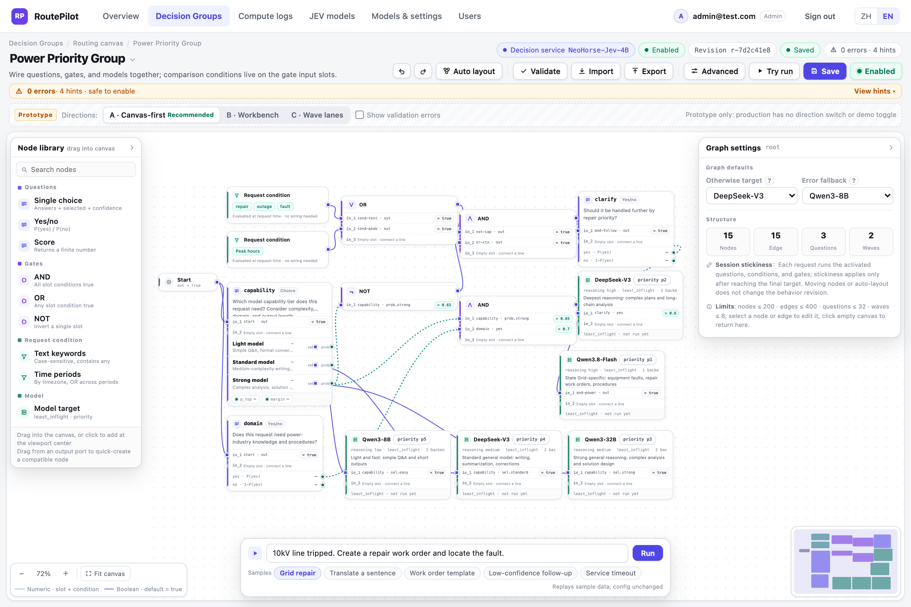
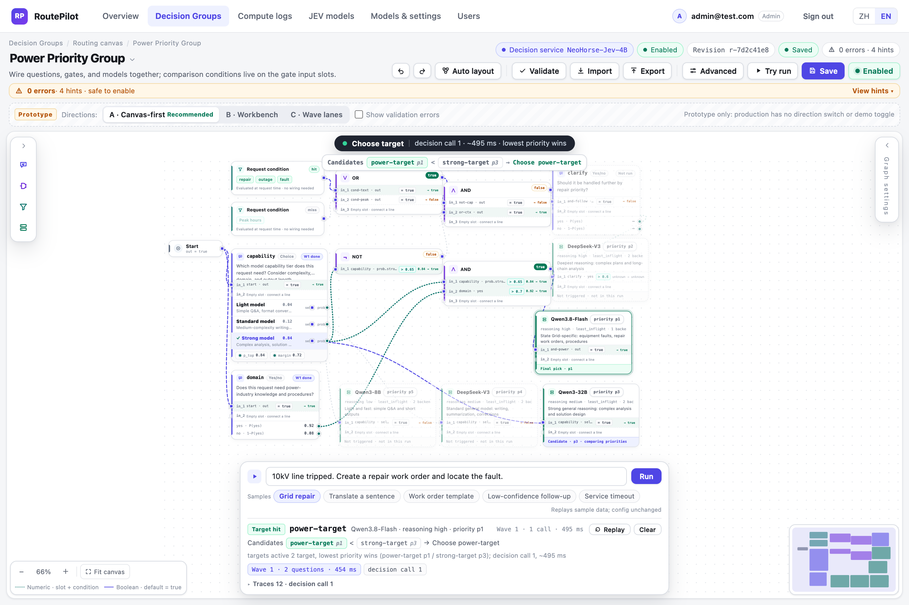
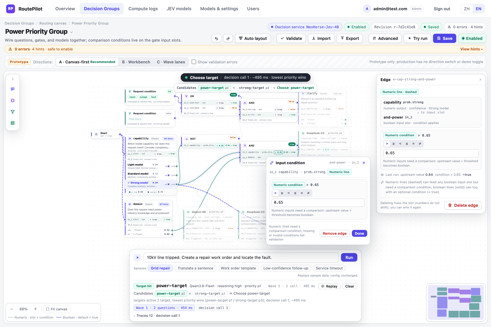
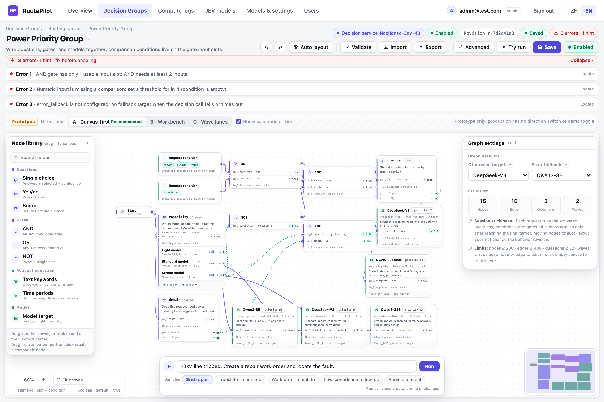

# RoutePilot

> Sandlake 出品 · 版权归 Sandlake 所有

[English](README.md) | 简体中文

RoutePilot 是 OpenAI 兼容的模型路由代理。路由策略由一张通用决策图画布配置：问题、判断门、请求条件、模型目标都是节点，比较条件直接写在判断门的输入槽位上。

| | |
|---|---|
| 项目状态 | graph v3 运行时已交付（M1–M3，2026-11-02）；画布、`/v1` 真链路、`/admin/try` 试算与请求日志均已按 graph v3 工作 |
| 设计文档 | `docs/superpowers/specs/2026-11-02-generic-decision-tree-design.md`（随仓库入库） |
| 控制台原型 | `docs/od-design/routing-canvas-2026-11-02/index.html`（方向 A · 画布优先；设计原型，仅本地保留） |
| 配置格式 | `sr-routing-graph` v3；旧版路由树不自动转换，见[从旧数据库升级](#从旧数据库升级) |

## 决策画布

以下截图来自实际运行的控制台（`1440×960`，由 `scripts/console_qa.mjs` 采集）：


### 节点

| 类型 | 作用 | 输入 | 输出 |
|---|---|---|---|
| `start` | 请求入口，恒为 true | — | boolean |
| `question` | 调用决策服务的一步提问；`choice` / `noul` / `score` | 布尔槽位 `in_1..in_n`（OR） | choice：`prob.*` / `selected.*` / `p_top` / `margin`；noul：`yes` / `no`；score：`value` |
| `logic` | 判断门，`and` / `or` / `not` | 布尔槽位 `in_1..in_n`，每槽位一条入边 + 条件 | boolean（三值） |
| `condition` | 请求条件：时间段 / 文本关键词 | — | boolean |
| `target` | 模型目标（模型、推理档位、priority、least_inflight） | 布尔槽位 `in_1..in_n`（OR） | — |

### 输入条件

所有输入端口都是布尔输入槽位。条件随边保存：

```json
{
  "id": "e-cap-strong-and-power",
  "source": "capability",
  "source_port": "prob.strong",
  "target": "and-power",
  "target_port": "in_1",
  "condition": { "op": "gt", "value": 0.65 }
}
```

| 上游输出 | 条件 | 求值 |
|---|---|---|
| number | 必填：`gt` / `gte` / `lt` / `lte` / `eq` / `neq` + 有限阈值 | 上游值与阈值比较；unknown 传播为 unknown |
| boolean | 可选：`null`（等价 `= true`）或 `{ "op": "is", "value": true\|false }` | 布尔期望值 |

- 一个输出可连多个槽位，每个槽位各自写条件；同一 AND 门的两个槽位写 `> 0.3` / `< 0.8` 即区间判断。
- 每个输入槽位最多一条入边；槽位号 `in_1..in_N` 不重排，删除连线后空槽位可复用。
- NOT 恰好 1 个槽位；AND / OR 至少 2 个；question / target 的多个槽位为 OR。

### 执行

1. 读取不可变 RoutingSnapshot，计算请求条件，截断一次请求文本。
2. 开始节点激活第一批问题；同一波问题合并为一次 `/v1/systemone` 调用。
3. 波次返回后更新数值端口与 `selected`，求值所有下游槽位条件与判断门。
4. true 信号激活后续问题与 target；重复直到没有新问题。
5. 多个 target 同时激活时取 priority 最大者（数字越大越优先）；无候选用 `otherwise_target`，决策失败用 `error_fallback`。
6. 到达 target 后应用会话粘性；target 内按 `least_inflight` 选择后端。

unknown 不触发任何问题或 target；比较条件遇 unknown 结果为 unknown。启用限制：节点 ≤ 200、边 ≤ 400、问题 ≤ 32、最长问题链 ≤ 8 波。

### 试算回放

以下截图来自实际运行的控制台：


## 条件编辑

以下截图来自实际运行的控制台：


- 数值线拖入任意布尔槽位：自动生成默认条件 `> 0.5` 并打开条件编辑。
- 点槽位条件 chip：修改算子与阈值（数值线）或 `= true / = false`（布尔线）。
- 条件随边保存；修改条件计入行为 revision，移动节点不计入。
- 选中边或槽位，右侧检查器同步显示来源、目标、线型与条件。

## 控制台

控制台（`/console/routing.html`，入口 `/console/`）是真正的画布优先编辑器：加载已启用决策图、编辑草稿、
通过 `/admin/trees` 保存/启用，并在发布前用 `/admin/try` 试算当前草稿。

- 节点库拖入 / 点击创建；画布平移缩放；节点拖动；端口连线与类型校验；
- 快速创建：输出端口拖到空白处按来源类型创建兼容节点；
- 判断门 / 问题 / 目标的输入槽位行：来源、条件、试算实际值；
- 保存 / 启用、未保存与「仅布局」徽标、撤销重做、删除确认、自动整理；
- 试算 5 个样例（电网抢修 / 翻译 / 工单 / 低置信度追问 / 服务超时），按波次回放、轨迹抽屉与按波次整理；
- 校验错误定位、导入导出 v3（旧格式按固定文案拒绝）。

### 设计原型

方向 A「画布优先」已确认；以下文件是本地设计原型（不是线上控制台），可直接用 `file://` 打开：

- 画廊：`docs/od-design/routing-canvas-2026-11-02/index.html`
- 方向 A：`docs/od-design/routing-canvas-2026-11-02/drafts/index-a.html`
- 方向 B / C：同目录 `drafts/index-b.html`、`drafts/index-c.html`

下面这些图是设计原型渲染（带原型专用 chrome 与 Prototype 标识），不是线上控制台；
上方产品章节的截图由 `scripts/console_qa.mjs` 从实际运行的控制台采集。









## 运行时职责

| 组件 | 职责 |
|---|---|
| Graph Executor | 按波次执行图：问题、条件、判断门、target 激活；维护三值状态与 trace |
| DecisionService 客户端 | 调用 NeoHorse `/v1/systemone`，返回概率/数值并做严格校验 |
| SessionAffinity | 到达 target 后按 tree revision + target 复用模型；可 TTL/LRU 配置 |
| LoadBalancer | target 内按 `least_inflight` 选择后端，计数覆盖完整上游生命周期 |
| CircuitBreaker | 剔除熔断后端；全部不可用返回 503 `no_available_backend` |

dry-run 使用同一执行器，不写粘性、不增加在途、不调用上游生成模型。当前运行模式为单 uvicorn worker，粘性与在途计数为进程内状态。

## 快速开始

```bash
python3.11 -m venv .venv
.venv/bin/pip install -r requirements.txt

ROUTER_DB=/tmp/routepilot.db .venv/bin/python -m router
```

默认监听 `127.0.0.1:8400`，控制台 `http://127.0.0.1:8400/console/`。生产环境首次启动向空 users 表写入默认管理员账号；上线后立即修改密码。本地开发可设 `ROUTER_USER_AUTH=0` 关闭 `/admin` 鉴权。

## 从旧数据库升级

graph 运行时把完整决策图持久化在 `routing_trees.root`。如果库里的路由树仍是旧版载荷（例如 `root.type = "jev"`），新版**不会自动转换**：启动会拒绝并停留在 v1，同时报出：

```
legacy routing trees require explicit reset; ... DELETE FROM routing_trees ...: <tree ids>
```

1. 停止旧服务。
2. 备份数据库：

   ```bash
   sqlite3 router.db ".backup 'router.db-pre-graph-v3'"
   ```

3. 启动一次新版：新版会在修改 schema 之前退出，并列出旧树 id。
4. 仅在管理员确认旧路由配置已不再需要后，删除旧树：

   ```bash
   sqlite3 router.db "DELETE FROM routing_trees"
   ```

5. 再次启动新版：迁移新增 `request_logs.waves`、写入 schema 版本 2；已有请求日志保留，`waves` 为 NULL。

该重置只删除旧的路由配置；模型、提供方、用户、会话、决策服务配置和请求日志都会保留。旧树不会被自动转换，仍需要的策略请在画布上重建后重新启用。

- 本版本随附的生产 graph 配置（`configs/production_routing_tree.json`）替换旧生产策略时，下线了旧的 `power`、`image` 选项（两者原本都是 `qwen3-32b` 占位）。仍需要这两个类别的运维方，升级后需在画布上重新添加为问题选项与目标节点。
- target priority 语义为**数字越大越优先**。按旧规则（越小越优先）保存的图需要反转各 target 的 priority 才能保持原有胜出结果；随附配置与示例图已按新规则更新。

## 决策服务

决策服务提供 `POST /v1/systemone`。配置方式：控制台「JEV 模型」页，或首次启动时通过环境变量播种。

```bash
ROUTER_DB=/tmp/routepilot.db \
ROUTER_JEV_URL=http://127.0.0.1:30104 \
ROUTER_JEV_MODEL=d1-2B \
ROUTER_JEV_API_KEY= \
.venv/bin/python -m router
```

- `ROUTER_JEV_URL` 与 `ROUTER_JEV_MODEL` 必须同时提供；数据库已有配置时不被环境变量覆盖。
- 输入窗口：服务上下文预算（`-c / --parallel`）与输入截断上限可配置；超限按首尾保留截断，不返回 4xx/5xx。
- 连接测试会真实调用决策服务，但不改变分流状态。

## 接口

| 路径 | 用途 |
|---|---|
| `POST /v1/chat/completions` | OpenAI 兼容路由入口（非流式 / SSE） |
| `GET/POST/PUT/DELETE /admin/trees` | 决策组 CRUD、启用、复制 |
| `POST /admin/try` | dry-run 试算（同一执行器） |
| `GET/POST /admin/models` | 模型目录与提供方 |
| `GET/PUT /admin/jev`、`/admin/jev/window` | 决策服务配置与上下文窗口 |
| `GET /admin/time-periods` | 命名时间段（请求条件节点引用） |

错误语义：

- 无启用树：503 `no_active_tree`；
- target 后端全不可用：503 `no_available_backend`；
- 决策失败 / 超时 / 非法响应：走 `error_fallback`；
- 上游 4xx：状态码与错误体透传；上游 5xx / 网络错误：502 并计熔断失败；
- 流式终态：`completed / upstream_error / client_disconnected / cancelled / incomplete`。

## 环境变量

| 变量 | 默认 | 用途 |
|---|---|---|
| `ROUTER_DB` | `router.db` | SQLite 路径 |
| `ROUTER_HOST` / `ROUTER_PORT` | `127.0.0.1` / `8400` | 监听地址 |
| `ROUTER_JEV_URL` / `ROUTER_JEV_MODEL` | 空 | 首次启动播种决策服务 |
| `ROUTER_JEV_API_KEY` | 空 | 可选决策服务密钥 |
| `ROUTER_JEV_TIMEOUT` | `10` | 决策服务请求超时（秒） |
| `ROUTER_SESSION_MAX_ENTRIES` | `10000` | 粘性 LRU 上限 |
| `ROUTER_USER_AUTH` | 生产 `1` | 控制台账号鉴权 |
| `ROUTER_ADMIN_EMAIL` / `ROUTER_ADMIN_PASSWORD` | 首次启动 seed | 管理员账号 |
| `ROUTER_SESSION_TTL_HOURS` | `168` | 控制台登录会话 TTL |

## 测试

```bash
.venv/bin/python -m pytest tests/ -q
```

控制台 QA（标准命令；自带临时数据库、mock 服务与 Chromium，不需要预启服务、不访问外网）：

```bash
npm install
npm run check:console
```

依次运行纯函数 Node 测试（`scripts/console_graph_test.mjs`）与 Playwright 验收矩阵
（`scripts/console_qa.mjs`，末行输出 `ALL PASS (<n>)`）。Chromium 从本地 Playwright 缓存解析，
可用 `CHROME=/path/to/chrome` 覆盖。

截图写入是可选步骤，普通运行不会改动仓库里的证据图。需要重新生成时：

```bash
QA_SCREENSHOTS=1 npm run check:console
```

不带该变量时运行会输出 `screenshots: skipped (set QA_SCREENSHOTS=1)`，且不会写入
`docs/od-design/routing-canvas-2026-11-02/implementation-qa/*.png`。

设计原型 QA（本地，不属于线上控制台）：

```bash
cd docs/od-design/routing-canvas-2026-11-02 && node qa.js
```

## 目录

```
router/                  服务端（FastAPI、路由执行、管理接口）
router/console/          控制台静态页
configs/                 示例决策组
scripts/                 控制台 QA（按约定入库）与本地运维脚本
tests/                   测试
docs/                    设计文档、QA 截图与本地原型（文档与 QA 截图已入库）
assets/routepilot/       README 截图
```

---

© 2026 Sandlake. All rights reserved. 版权归 Sandlake 所有。
