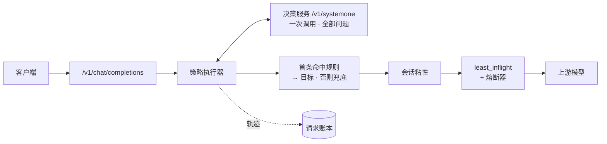

# RoutePilot

**自然语言驱动的智能路由。**

[English](README.md) | 简体中文

RoutePilot 是兼容 OpenAI 协议的路由代理。请求从 `/v1/chat/completions` 进入，由带版本的路由策略选择上游模型。策略在内置控制台中编辑、校验、试算与发布。

## 能力

| 分类 | 能力 |
|---|---|
| 入口 | `POST /v1/chat/completions`，支持 JSON 与 SSE；响应头 `x-sr-model` / `x-sr-selection` / `x-sr-reasoning*` |
| 路由策略 | 声明式文档：决策服务问题、逻辑门、模型目标、有序规则与统一兜底目标 |
| 决策服务 | `choice` / `noul` / `score` 三类问题，每次请求合并为一次 `systemone` 兼容调用 |
| 目标选择 | 首条命中规则生效；兜底目标覆盖决策失败与无命中 |
| 后端选择 | 会话粘性、`least_inflight` 负载均衡、按模型熔断 |
| 试算 | `/admin/try` 复用同一执行器与同一轨迹格式，不改变粘性、inflight 与上游模型 |
| 运维 | 请求账本、决策回放、置信度分布、模型/提供方目录、JEV 配置、时段、审计历史、角色化用户 |
| 控制台 | 中英双语原生 ES Modules，无构建步骤 |

## 请求路由流程



1. 载入不可变路由快照，计算当前活跃时段。
2. 一次性构造策略的全部问题，合并为一次决策服务调用。
3. 严格校验完整答案；缺失、多余或非法答案作废本轮，绝不使用部分答案。
4. 按序求值规则；首条命中即选定其目标并停止求值。
5. 无规则命中——或决策调用失败——时使用策略的兜底目标。
6. 应用会话粘性，以 `least_inflight` 选择后端，向上游转发请求。

## 架构

| 层 | 路径 | 职责 |
|---|---|---|
| API | `router/api/` | DTO 解析、异常到 HTTP 映射、上游代理、展示层 |
| 控制面 | `router/control/` | 策略与配置的写用例、启用校验 |
| 路由领域 | `router/routing/` | 策略模型、校验、执行器、调度、快照 |
| 决策服务 | `router/jev/` | `systemone` 客户端、配置、输入窗口 |
| 上游 | `router/upstream/` | 后端目录、代理传输、熔断器与同步 worker |
| 存储 | `router/store/` | SQLite schema/仓储、策略文件仓储 |
| 控制台 | `router/console/` | 中英双语原生 ES Module 界面 |
| 运行时 | `router/request_logging.py`、`router/maintenance.py` | 账本队列/worker、会话清理 |

边界约束：

- `router/routing/` 与 `router/upstream/` 不导入 FastAPI，也不导入 SQLite；`router/control/` 与 `router/store/` 不导入 `router.api`。
- API 层只做 DTO 解析与异常映射，不直接写控制面状态。账号与会话路由（`/admin/login`、`/admin/logout`、`/admin/users`、`/admin/me`）直接调用 `UserRepo`/`SessionRepo`/`ChangeRepo`。
- `PolicyService` 依次完成校验、在单写锁内写策略文档、复核文档哈希、发布快照、记录审计；过期草稿返回 409。
- `ConfigurationService` 在同一事务内写数据与审计、在事务内复核活动策略指纹，提交后才替换内存快照；指纹不稳定会在 COMMIT 前抛出。
- 已启用策略在每个发布快照解析一次，没有编译步骤；请求路径读取不可变快照，不重建索引，不访问 SQLite。
- 事件循环只把账本行写入有界队列与 20 条环形缓冲；每 2 秒 flush 一次，投影白名单列后经 `asyncio.to_thread` 落库。
- 熔断 worker 启动时载入共享隔离状态，之后每 30 秒在工作线程同步本地变更。

## 控制台


每个页面只有一个 `<script type="module">` 入口，无应用全局变量，无 CommonJS。

| 页面 | 内容 |
|---|---|
| 测试 | 仅管理员可用的模型测试对话：Auto 路由或固定模型、SSE 流式、内存内多轮历史、图片/文本/音频/文件附件、安全多模态渲染 |
| 路由策略 | 五段编辑器（问题、目标、规则、设置、试算）、有序规则、校验、试算、导入导出、独立布局 |
| 计算日志 | 最近决策的模型、目标、命中规则、JEV 答案、上游结果与可回放轨迹 |
| JEV 模型 | 端点、模型、提示词与状态模板、连通性测试、上下文与输入 token 窗口 |
| 模型 | 模型注册表、上游模型 id、提供方、推理声明、能力说明 |
| 用户 | 管理员/只读账号、密码、角色、状态 |

### 模型测试对话

首页（`/console/index.html`）是仅管理员可用的模型测试对话，请求发往 `/admin/test/chat/completions`，并根据响应头 `x-sr-model` 在消息元信息中显示实际命中的模型（Auto 为 `Auto → <模型>`，固定模型为 `<模型> · 固定模型`）。

- **Auto 与固定模型**：Auto 与 `/v1/chat/completions` 一样评估当前路由快照（策略、一次 JEV 调用、粘性与负载均衡后端选择）；选择已配置的模型 ID 时跳过策略与 JEV，返回 `x-sr-selection: direct`。
- **流式回复**：回答通过 SSE 逐块返回；停止会中止流并保留已生成内容，复制 / 重试 / 重新生成作用于该条消息。只有上游正常收尾才算完成——提前断流会标记为未完成，提供方错误就地显示在对话里，不会冒充完整回答。
- **多轮历史**：内存中的对话以 wire-format `messages` 重发，并从原始 assistant 消息无损回放（消息级媒体只渲染、绝不回流进历史）；新建对话会中止在途回复、清空对话并轮换会话 id。
- **附件**：文本文件按原文读取并作为 content part 发送；图片、音频等其他文件在浏览器内读成 data URL。预估体积会超出 10 MiB 请求上限的文件在读取前就地拒绝，发送前还会对完整 JSON 请求体（含历史与 Base64）做精确复检。
- **多模态输出**：文本按安全 Markdown 渲染；图片、音频、视频与文件使用原生播放器或下载链接；未知 part 折叠为可检查的 JSON。模型提供的 HTML 只作为文本显示，活动 URL scheme 被丢弃，不会执行。
- **仅内存**：对话与附件只存在于页面中，刷新即清空，服务端不保存聊天历史与上传文件。

### 策略编辑器

路由页直接编辑策略文档本身——不存在第二套行为模型。

**编辑区**：

- 策略设置：名称、时区、粘性。
- 问题：`choice` / `noul` / `score` 问题卡片；choice 选项超过 8 个时显示非阻塞评测提示。
- 目标：模型槽位与可选推理档位；兜底角色有标记。
- 规则：有序可编辑；列表明确「首条命中生效」，命中后停止求值。

**试算区** —— 停靠在编辑器下方：

- 输入框、运行按钮。
- 结论：命中规则、最终目标与模型、兜底标记及原因、JEV 答案。
- 轨迹：一个 JEV 块，加上按后端顺序的每条已求值规则判定，最后是最终目标。

试算不写磁盘、快照、粘性或 inflight 状态，也不调用上游模型。控制台只展示后端返回的答案与规则判定，自身不实现任何路由逻辑。

保存与启用分离；工具栏显示 dirty 与 layout-only 状态。保存冲突（409 `policy_conflict`）保留本地草稿而不是覆盖它。布局（面板尺寸与位置）走独立 API 保存，绝不改变行为版本、文档哈希或已启用快照。

### 计算日志

展开行按阶段呈现决策过程：输入准备、唯一一次 JEV 调用、逐条规则判定、最终目标、模型调度、执行结果。兜底行标明原因：`jev_error`（决策调用失败、超时或返回非法答案）或 `no_rule_matched`（答案正常但没有规则命中）。`routing_error` 保留失败前的部分过程：调度阶段失败保留调度现场（配置、注册、可用、不可用原因、调度时 inflight）；决策调用失败落入策略兜底。固定模型记录显示 0 次 JEV 调用。缺少调度快照的记录与重启回填的账本行会明确说明缺失项。

SQLite 只保存账本字段，不含请求文本、轨迹、答案与规则名称。页面从进程内环形缓冲读取最近 20 条实时记录；计算详情为副本本地，不持久化。

## 路由策略

一份策略即一个带版本文档，包含四个部分：

- **questions**：针对每条请求向决策服务提出的问题：`choice`（在选项中择一）、`noul`（是/否置信度）、`score`（数值严重度档位）。
- **targets**：命名的模型组；每个目标列出模型槽位与可选推理档位。
- **rules**：有序条件；首条命中的规则把请求送往其目标。
- **fallback**：无规则命中或决策调用失败时使用的目标。

### 答案与条件

每类答案暴露类型化路径：

| 问题类型 | 答案路径 |
|---|---|
| `choice` | `route.selected`（选项 key）、各选项概率、`p_top`、`margin` |
| `noul` | `risk.yes`、`risk.no` |
| `score` | `severity.value`（legend 数值） |

条件将一个答案路径与有限阈值或选项 key 比较：

```json
{"answer": "risk.yes", "gte": 0.8}
{"answer": "route.selected", "eq": "strong"}
{"answer": "severity.value", "gte": 5}
```

数值比较支持 `gt` / `gte` / `lt` / `lte` / `eq` / `neq`；`eq` / `neq` 也可比较选项 key。逻辑门组合条件：

```json
{"any": [
  {"answer": "risk.yes", "gte": 0.65},
  {"answer": "route.selected", "eq": "power"}
]}
{"all": [
  {"answer": "route.selected", "eq": "strong"},
  {"answer": "severity.value", "gte": 5}
]}
{"not": {"answer": "risk.yes", "gte": 0.8}}
```

`all` 要求全部分支成立，`any` 至少一支成立，`not` 取反其唯一分支。空逻辑数组被拒绝。

### 执行规则

- 策略的全部问题一次构造、一次决策服务调用发出；执行器绝不重试，单次请求绝不触发第二次调用。
- 答案必须完整且严格合法。缺失答案、多余答案、非有限数值、非法概率或非 200 状态都会作废本轮：不使用部分答案，由兜底目标以 `jev_error` 原因接管。
- 规则按文档顺序求值；首条命中即停止，后续规则不求值。
- 无规则命中时，兜底目标以 `no_rule_matched` 原因接管。
- 兜底引用必须指向存在的目标；目标无可用后端是 503，绝不静默换目标。

### 限额

| 项目 | 上限 |
|---|---:|
| 问题 | 32 |
| 规则 | 200 |
| 条件（全部规则合计） | 400 |
| 条件嵌套深度 | 16 |
| 单选问题选项 | 255 |
| 打分条件 | 2–10 个有限数值 |

### 策略文档

```json
{
  "kind": "sr-routing-policy",
  "version": 4,
  "name": "默认路由",
  "timezone": "Asia/Shanghai",
  "sticky": { "enabled": true, "ttl_seconds": 1800 },
  "questions": {},
  "targets": {},
  "rules": [],
  "fallback": "safe"
}
```

只接受 `sr-routing-policy` v4。未知字段与类型错误在覆盖草稿或已发布快照之前被拒绝；结构性拒绝以 `policy_parse_error` 返回，启用级检查（未知模型、未知时段、缺 JEV）返回机器可读的 issue 列表。控制台在导入时执行同一套校验。

`policy_revision` 是去掉 `name` 后 canonical JSON 的 SHA-256；对象 key 排序，因此 `questions`/`targets` 的 key 顺序无行为意义，而 `rules` 数组顺序具有语义、绝不重排。控制台用该版本判定编辑类型，由服务端计算。

## 模型与推理


策略引用的模型槽位映射到上游模型 id 与提供方。一个目标可包含多个槽位，由 `least_inflight` 在其中选择。

提供方定义 OpenAI 兼容 base URL、API Key 环境变量与推理方言。模型 profile 声明：

- 是否支持推理及默认档位；
- `off`、`on`、`minimal`、`low`、`medium`、`high`、`xhigh`、`max` 的档位到协议拼写映射；
- 能力说明与目录元数据。

推理方言：OpenAI、DeepSeek、Qwen、Qwen chat template、OpenRouter、Z.ai、Together、string-thinking、Ant Ling。请求了不支持的档位时不注入推理，响应头携带 `x-sr-reasoning-warning`。

`GET /admin/models` 返回的 `profile` 为 JSON 对象；数据库以 JSON 文本存储。

## 决策服务（JEV）


决策服务提供 `POST /v1/systemone`，常见部署为 NeoHorse 或 vLLM。控制台配置项：

- base URL、模型、API Key、超时；
- 默认指令与状态模板（模板必须包含 `{request}`）；
- 使用两个固定候选的连通性测试；
- 上下文预算与输入截断上限；超长输入按头尾截断。

环境变量只在首次启动时写入决策服务配置，之后以数据库为准。

## 账号与运维

- 邮箱口令登录，scrypt 哈希，不透明 bearer 会话。
- `admin` 可编辑策略、模型、JEV 配置与用户；`viewer` 只读。
- 最后一个启用的管理员不能被降级、停用或删除。
- 用户与配置变更写入审计日志。
- 策略文件以 SHA-256 内容寻址，用于保存冲突与重载校验；不保留策略历史。
- 控制面状态存于 SQLite（WAL）；路由策略是共享 JSON 文件；账本写入在工作线程执行。
- 会话粘性与 inflight 计数为进程内状态。

## 策略存储与多副本

策略不存于 SQLite。每个策略是 `ROUTER_POLICY_DIR/policies/{policy_id}.json` 下的一份 v4 文档；前端的独立布局存于 `ROUTER_POLICY_DIR/layouts/{policy_id}.json`；`ROUTER_POLICY_DIR/current` 保存已启用策略 id。

- 单写者：管理面 API。其他副本设置 `ROUTER_POLICY_WRITER=false`，只读挂载目录并每 2 秒重载。
- 副本在替换服务快照前校验候选快照；文件非法时保留旧快照，`/readyz` 报告 stale。
- 写入通过临时文件原子替换，权限 `0600`。
- Kubernetes：策略文件使用 ReadWriteMany PVC；写者的 SQLite 使用本地存储。
- Docker：把同一 NFS 导出挂载进所有容器。
- 所有读写容器必须使用同一数值 UID；`0600` 文件无法仅靠 GID 或 `fsGroup` 访问。
- 过期保存返回 409 `policy_conflict`；导入只改草稿。
- `/healthz` 为存活探针；`/readyz` 报告初始快照就绪状态，503 表示未就绪，后续重载失败会保留现有快照并标记 `"stale": true`。
- 旧 v3 路由树不会迁移成 v4 策略。v1/v2 数据库在 `routing_trees` 表缺失、或表内留有早于 graph 格式的行时拒绝启动：先备份数据库，再执行 `DELETE FROM routing_trees` 后重试。graph 格式的行会被忽略——留有这类行的 v3 时期数据库可正常启动，遗留表不再使用。

## 快速开始

```bash
python3.11 -m venv .venv
.venv/bin/pip install -r requirements.txt

# 本地开发：关闭登录
ROUTER_DB=/tmp/routepilot.db \
ROUTER_POLICY_DIR=/tmp/routepilot-policy \
ROUTER_USER_AUTH=0 \
.venv/bin/python -m router
```

控制台：`http://127.0.0.1:8400/console/`。

```bash
# 带鉴权部署
ROUTER_DB=/var/lib/routepilot/router.db \
ROUTER_POLICY_DIR=/var/lib/routepilot/policy \
ROUTER_HOST=0.0.0.0 \
ROUTER_PORT=8400 \
ROUTER_ADMIN_EMAIL=admin@example.com \
ROUTER_ADMIN_PASSWORD='change-me-now' \
.venv/bin/python -m router
```

首次对空用户表启动时写入管理员账号。

## 配置项

| 环境变量 | 默认值 | 说明 |
|---|---|---|
| `ROUTER_DB` | `router.db` | SQLite 控制面数据库 |
| `ROUTER_POLICY_DIR` | `./routing-policy` | 策略文件、布局与启用指针 |
| `ROUTER_POLICY_WRITER` | `true` | 是否允许写策略；只应有一个写者 |
| `ROUTER_HOST` | `127.0.0.1` | 监听地址 |
| `ROUTER_PORT` | `8400` | 监听端口 |
| `ROUTER_JEV_URL` | 空 | 决策服务 base URL |
| `ROUTER_JEV_MODEL` | 空 | 决策服务模型，与 `ROUTER_JEV_URL` 配对 |
| `ROUTER_JEV_API_KEY` | 空 | 决策服务 Key |
| `ROUTER_JEV_TIMEOUT` | `10` | 决策服务超时（秒） |
| `ROUTER_SESSION_MAX_ENTRIES` | `10000` | 会话粘性 LRU 容量 |
| `ROUTER_USER_AUTH` | `true` | 控制台登录开关 |
| `ROUTER_ADMIN_EMAIL` | `admin@test.com` | 首次启动的管理员邮箱 |
| `ROUTER_ADMIN_PASSWORD` | 种子口令 | 首次启动的管理员口令 |
| `ROUTER_SESSION_TTL_HOURS` | `168` | 控制台会话有效期 |

## API

| 方法与路径 | 用途 |
|---|---|
| `POST /v1/chat/completions` | 路由入口；JSON 或 SSE |
| `GET /healthz` | 存活探针 |
| `GET /readyz` | 快照就绪状态 |
| `POST /admin/login` / `POST /admin/logout` | 控制台会话 |
| `GET /admin/me` / `POST /admin/me/password` | 当前用户、修改口令 |
| `GET/POST /admin/policies`、`GET/PUT/DELETE /admin/policies/{id}` | 策略资源；PUT 整份替换并要求 `If-Match` |
| `POST /admin/policies/{id}/enable`、`/disable` | 策略生命周期 |
| `GET/PUT /admin/policies/{id}/layout` | 前端布局 JSON；绝不改变行为或快照 |
| `POST /admin/try` | 试算：`policy_id` 或内联 `policy` 草稿二选一 |
| `POST /admin/test/chat/completions` | 仅管理员的模型测试对话；JSON 或 SSE |
| `GET/POST /admin/models`、`GET/PUT/DELETE /admin/models/{id}` | 模型注册表 |
| `GET /admin/model-catalog`、`POST /admin/fetch-models` | 提供方预设、上游模型发现 |
| `GET /admin/providers`、`PUT/DELETE /admin/providers/{name}` | 提供方 |
| `GET/PUT /admin/jev`、`POST /admin/jev/test` | 决策服务配置 |
| `GET/PUT /admin/jev/window` | JEV 上下文与输入 token 窗口 |
| `GET/PUT /admin/time-periods` | 时段 |
| `GET /admin/requests/recent`、`GET /admin/requests/stats` | 实时请求环形缓冲、logger 统计 |
| `GET /admin/overview`、`GET /admin/changes` | 概览、审计历史 |
| `GET/POST /admin/users`、`PUT/DELETE /admin/users/{id}`、`POST /admin/users/{id}/password` | 用户 |

### 错误

| 状态 | 错误 | 含义 |
|---|---|---|
| 400 | `invalid_json` / `body_must_be_object` / `messages_must_be_list` | 请求体格式错误 |
| 413 | `request_too_large` | 请求体超过 10 MiB |
| 422 | issue 列表 | 文档被拒绝：`policy_parse_error` 或带机器可读路径的校验 issue |
| 502 | `upstream_error` | 上游 5xx 或网络失败 |
| 409 | `policy_conflict` | 草稿加载后存量策略已变化（If-Match 不匹配） |
| 409 | 消息 | 策略 id 重复，或删除启用中的策略（`policy_is_active`） |
| 503 | `policy_read_only` | 只读副本 |
| 503 | `policy_storage_error` | 共享策略存储不可读 |
| 503 | `no_valid_snapshot` | 无初始快照 |
| 503 | `no_active_policy` | 无已启用策略 |
| 503 | `no_available_backend` | 所选目标的全部后端不可用 |
| 503 | `routing_failed` / `routing_invariant_violation` | 路由内部失败 |

上游 4xx 响应按原状态码与响应体透传。

配置接口：`/admin/models`、`/admin/providers`、`/admin/jev`、`/admin/jev/window`、`/admin/time-periods`。不存在通用 `/admin/settings` 接口。

## 测试

```bash
.venv/bin/python -m pytest -q
npm install
npm run check:console
.venv/bin/python scripts/i18n_dead_keys.py
```

- `pytest` 只收集 `tests/`（`testpaths`），运行为单元、FastAPI 集成与端到端测试，不启动浏览器，也不收集 `experiments/`。
- `npm run check:console` 运行 Node 套件（`console_chat_test`、`console_policy_test`、`console_draft_test`、`console_trace_test`、`policy_contract_test`），并在临时数据库、模拟决策服务与模拟上游上运行 Playwright 验收矩阵。截图默认关闭，`QA_SCREENSHOTS=1` 重新生成。`QA_ONLY=<正则>` 选择用例；单个页面模块可独立运行，例如 `node scripts/console_qa/policy.mjs`。Chromium 不在默认缓存时设置 `CHROME=/path/to/chrome`。
- `scripts/i18n_dead_keys.py` 报告未被引用的词典键。

JEV 批量 spike 的历史测量报告保留在 `docs/` 下，作为 v3 时代的证据；它们不描述 v4 行为。

## 项目结构

```
router/
  api/                 FastAPI 路由、DTO、异常映射、代理装配、展示层
  control/             控制面写服务与启用校验
  routing/
    policy/            v4 策略模型、校验、单次 JEV 执行器
    document.py         v4 文档 bytes 编解码（存储边界）
    service.py         求值 → 调度编排
    scheduling.py      粘性选择、租约获取、粘性写入
    affinity.py        会话粘性 LRU
    scheduler.py       least_inflight 均衡器与租约
    snapshot.py         不可变快照装配与发布
    conditions.py      时段匹配
    codec.py           严格字段解析助手
  request_logging.py   账本队列/环形缓冲与工作线程写入
  jev/                 决策服务客户端、配置、输入窗口
  upstream/            目录、代理传输、熔断器 + 同步 worker
  store/               SQLite schema/仓储、策略文件仓储
  console/             中英双语原生 ES Module 控制台
configs/               示例路由策略（默认与生产）
tests/                 pytest 套件、v4 fixture、端到端 harness
scripts/               Node 契约测试、Playwright QA、部署脚本
experiments/jev-batch/ 历史 spike README（可执行文件随 v3 一并移除）
assets/routepilot/     README 截图
```
