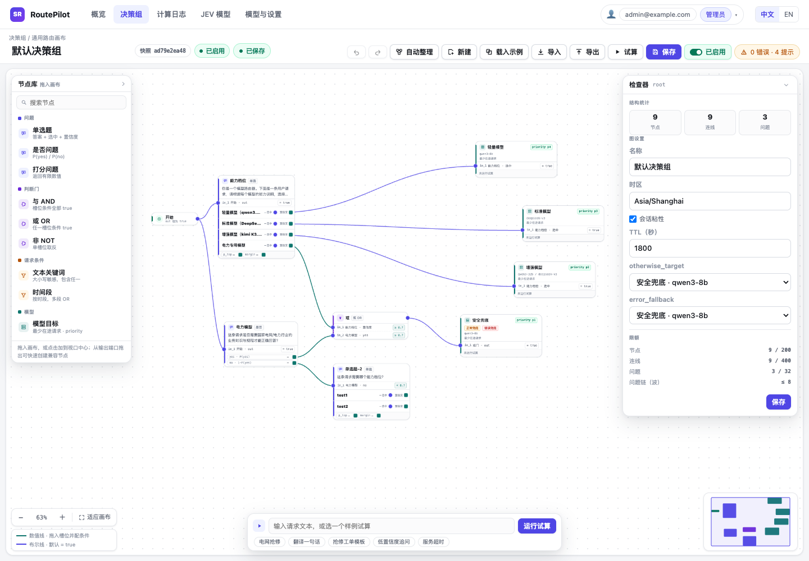
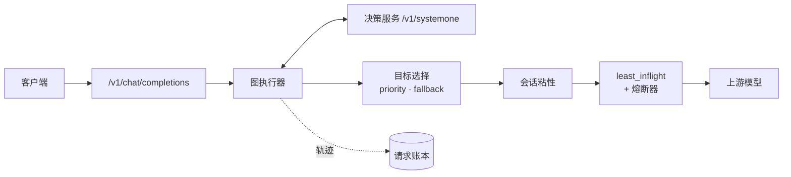
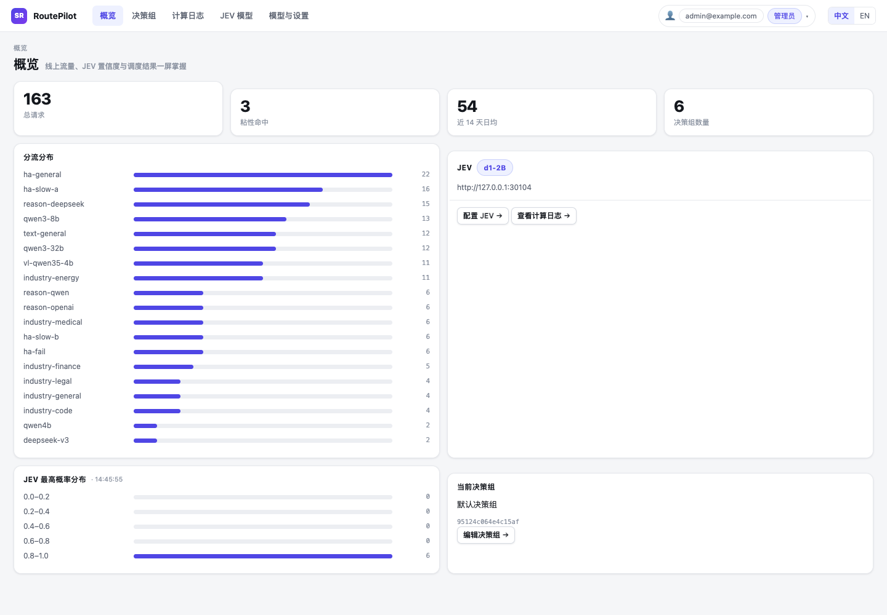
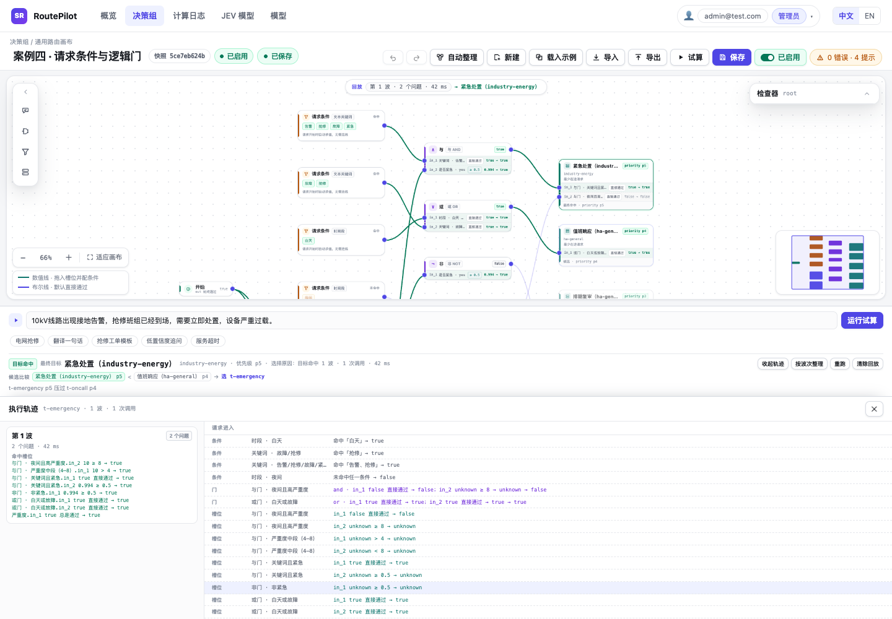
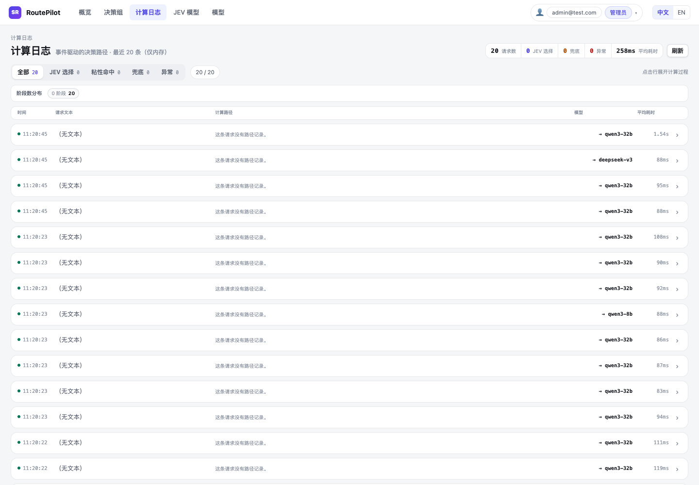
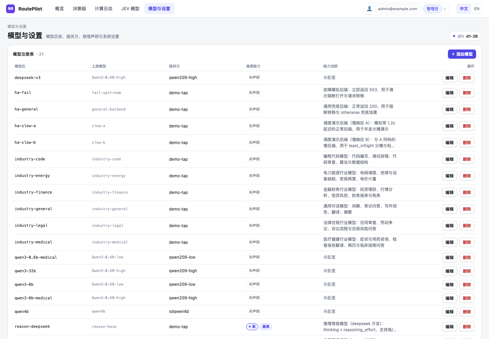
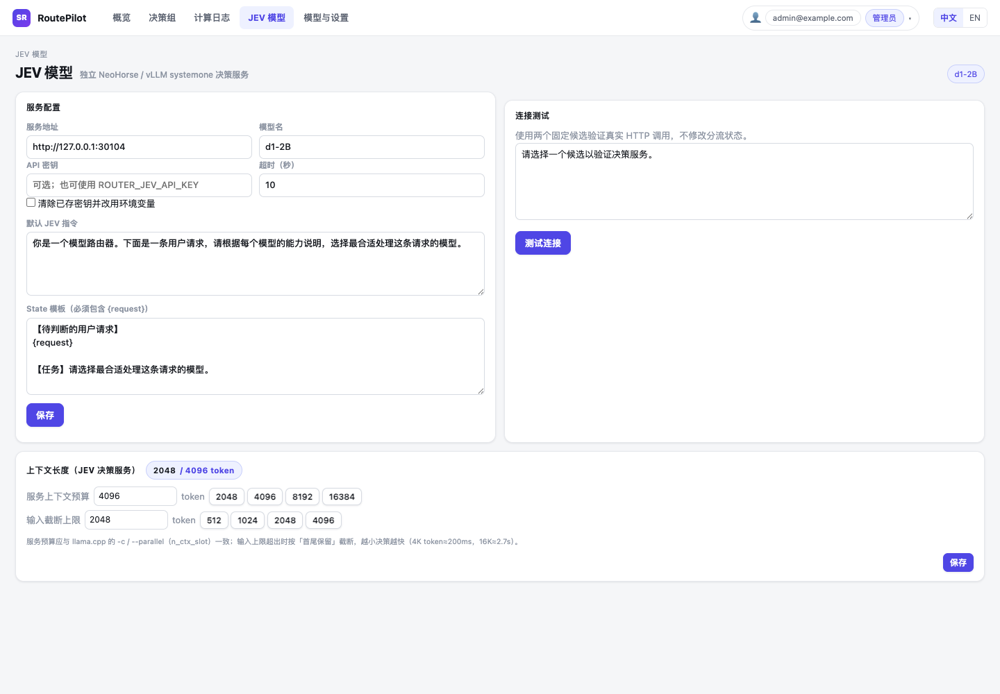

# RoutePilot

RoutePilot 是面向 LLM 流量的 OpenAI 兼容路由代理。每条请求都会经过一张带版本的决策图：请求条件、决策服务问题、判断门和模型目标都是节点。决策图在控制台里完成编辑、校验、试算和发布。

[English](README.md) | 简体中文



## 核心能力

- **可视化路由策略。** 用画布搭建分支策略，不写 if/else。节点、连线、条件、校验、自动布局、撤销/重做、导入/导出都在控制台完成。
- **OpenAI 兼容入口。** `POST /v1/chat/completions` 支持普通 JSON 和 SSE 流式响应，选中的模型通过响应头返回。
- **决策服务驱动。** 单选、是否、打分三类问题按波次批量调用 `systemone` 兼容决策服务，答案继续激活下游问题、判断门和目标。
- **确定性的目标选择。** 被激活的模型目标按 priority 竞争，数字越大越优先；正常执行但没有目标激活，或决策调用失败时，都走统一的兜底模型 `error_fallback`。
- **会话粘性与负载均衡。** 同一决策图版本和同一目标内复用模型；目标内按 `least_inflight` 选择后端，连续失败的后端由熔断器摘除。
- **发布前试算。** `/admin/try` 使用与线上相同的图执行器和轨迹格式，但不写入粘性、不占用在途计数、不调用上游生成模型。
- **运维能力内置。** 请求账本、决策回放、置信度分布、模型与提供方目录、JEV 配置、时段、配置修订、审计历史和角色用户。
- **中英双语控制台。** 支持管理员和只读用户两种角色。

## 请求如何被路由



1. 读取不可变的路由快照，计算请求条件（时段 / 文本关键词）。
2. 激活第一波问题；同一波的问题合并成一次决策服务调用。
3. 回填数值端口和 `selected` 端口，重新求值所有下游槽位条件和判断门。
4. 按波次重复，直到没有新的问题被激活。
5. 在已激活的目标中选择 priority 最大者。没有目标激活或决策调用失败时，都走兜底模型 `error_fallback`。
6. 应用会话粘性，按 `least_inflight` 选择后端并转发请求；失败会打开该模型的熔断器。

`unknown` 不会激活任何问题或目标；数值比较遇到 unknown 时结果保持 unknown。

## 控制台



控制台是路由器的操作面：

- **概览** — 请求量、分流分布、JEV 置信度、粘性命中、当前决策组。
- **决策组** — 画布编辑、图设置、节点/连线检查器、校验、试算、导入导出。
- **计算日志** — 最近决策的模型、目标、候选、波次、JEV 概率、推理、上游结果和可回放轨迹。
- **JEV 模型** — 决策服务地址、模型、指令/State 模板、连接测试、上下文与输入 token 窗口。
- **模型与设置** — 模型注册表、上游模型 id、提供方、推理声明、能力说明。
- **用户管理** — 管理员/只读账号、改密、角色与状态管理。

### 决策画布


- 从节点库拖入节点，支持平移缩放、自动布局、撤销/重做。
- 连线有类型校验；数值输出拖入布尔槽位时会自动创建默认条件。
- 每个输入槽位都是 OR 输入，条件保存在对应的边上。
- 从输出端口拖到空白画布可快速创建兼容节点。
- 保存和启用分离；未保存改动、仅布局变化都有明确状态。
- 目标卡展示目标显示名、模型列表、兜底角色和调度策略。

### 试算回放



试算会按波次点亮命中路径，展示候选、优先级和完整轨迹。它复用线上执行器，但不消耗粘性、在途容量，也不调用上游生成模型。

### 计算日志



每条记录展开后先给出紧凑的决策摘要、候选列表和波次耗时，再展示请求文本、JEV 概率、模型推理和原始轨迹。请求账本异步写入 SQLite；页面读取进程内最近 20 条环形缓冲，服务重启时从 SQLite 回填最近 20 条账本字段。请求文本和原始轨迹只保留在实时记录中。

## 决策图

### 节点

| 类型 | 作用 | 输入 | 输出 |
|---|---|---|---|
| `start` | 请求入口，恒为 true | — | boolean |
| `question` | 决策服务问题：`choice` / `noul` / `score` | 布尔槽位 `in_1..in_n`（OR） | choice：`prob.*`、`selected.*`、`p_top`、`margin`；noul：`yes`、`no`；score：`value` |
| `logic` | 三值逻辑门：`and` / `or` / `not` | 布尔槽位 `in_1..in_n`，每槽位一条入边 + 条件 | boolean |
| `condition` | 请求条件：时间段或文本关键词 | — | boolean |
| `target` | 模型目标：模型、推理档位、priority、调度策略 | 布尔槽位 `in_1..in_n`（OR） | — |

### 输入条件

条件随边保存，不挂在节点上：

```json
{
  "id": "e-cap-strong-and-power",
  "source": "capability",
  "source_port": "prob.strong",
  "target": "and-power",
  "target_port": "in_1",
  "condition": { "op": "gt", "value": 0.65 }
}
```

| 上游输出 | 条件 | 求值 |
|---|---|---|
| 数值 | `gt` / `gte` / `lt` / `lte` / `eq` / `neq` + 有限阈值 | 比较上游值与阈值；unknown 传播为 unknown |
| 布尔 | `null`（等价 `= true`）或 `{ "op": "is", "value": true \| false }` | 布尔期望值 |

- 一个输出可以连多个槽位，每个槽位各自写条件。
- 同一 AND 门的两个槽位可以用 `> 0.3` 和 `< 0.8` 表达区间。
- 每个输入槽位最多一条入边；槽位号不重排，删除后可复用。
- `not` 恰好一个槽位；`and` / `or` 至少两个；问题和目标的多个槽位按 OR 处理。

### 执行规则

- 问题按波次执行；一波对应一次决策服务调用。
- 某一波失败会作废整轮：不写入端口，本轮候选全部丢弃。
- 目标 priority 必须唯一，**数字越大越优先**。
- 正常执行结束且没有目标激活时，使用兜底模型 `error_fallback`。
- 决策调用失败、超时或返回非法答案时，同样使用兜底模型 `error_fallback`。
- 兜底模型必须指向已存在的目标。

### 限额

| 项目 | 上限 |
|---|---:|
| 节点 | 200 |
| 边 | 400 |
| 问题节点 | 32 |
| 最长问题链 | 8 波 |
| 单个选择题选项 | 255 |
| 评分档位 | 2–10 个有限数值 |

### 图文档

画布导入/导出使用一个 JSON 信封：

```json
{
  "kind": "sr-routing-graph",
  "version": 3,
  "name": "默认路由",
  "timezone": "Asia/Shanghai",
  "sticky": { "enabled": true, "ttl_seconds": 1800 },
  "root": {
    "id": "root",
    "type": "graph",
    "error_fallback": "safe-target",
    "nodes": [],
    "edges": []
  }
}
```

## 模型与推理

模型注册表把决策图使用的**模型位**映射到**上游模型 id** 和提供方。一个目标可以配置多个模型位，由 `least_inflight` 选择。



提供方配置 OpenAI 兼容 base URL、API key 环境变量和推理方言。模型 profile 可以声明：

- 是否支持推理以及默认档位；
- RoutePilot 档位（`off`、`on`、`minimal`、`low`、`medium`、`high`、`xhigh`、`max`）到提供方协议值的映射；
- 能力说明和目录元数据。

支持的推理方言包括 OpenAI、DeepSeek、Qwen、Qwen chat template、OpenRouter、Z.ai、Together、string-thinking 和 Ant Ling。请求的档位不受支持时，请求会不带推理注入直接发送，并在响应头返回 `x-sr-reasoning-warning`。

## 决策服务（JEV）



决策服务暴露 `POST /v1/systemone`，通常由 NeoHorse / vLLM 提供。在控制台可以配置：

- 服务地址、模型名、API key、超时；
- 默认指令和 State 模板（必须包含 `{request}`）；
- 使用两个固定候选进行连接测试；
- 服务上下文预算和输入截断上限。超长输入按首尾保留截断，不会返回 4xx/5xx。

环境变量只在首次启动时用于种子配置；之后数据库是唯一配置来源。

## 账号与运维

- 邮箱 + 口令登录，口令使用 scrypt 哈希，会话使用不透明 bearer token。
- `admin` 可编辑决策图、模型、JEV、用户和设置；`viewer` 只读，不能管理用户。
- 最后一个有效管理员不能被降级、禁用或删除。
- 用户和配置变更写入审计历史。
- 每个图文件用 SHA-256 内容哈希做保存冲突和重载判断；不保留图历史版本。
- 控制面状态（模型、提供方、用户、日志、设置）保存在 SQLite（WAL）；决策图保存在共享 JSON 文件。请求日志异步落库，同时保留 20 条进程内环形缓冲供页面实时读取；进程重启时从 SQLite 回填最近 20 条。旧图文件中的 `otherwise_target` 只做读取兼容，保存后统一写为 `error_fallback`。
- 会话粘性和在途计数仍在进程内。多个 Router 副本可以共享图文件，但跨副本的会话/在途一致性需要额外的共享状态层。

## 共享图存储与多副本

决策图不再保存在 SQLite。每个决策组是一个 v3 导出文档，位于
`ROUTER_GRAPH_DIR/graphs/{tree_id}.json`；`ROUTER_GRAPH_DIR/current` 只保存启用组 ID。
管理 API 只有一个写入者。其余副本使用 `ROUTER_GRAPH_WRITER=false`，只读挂载同一目录，并每 2 秒轮询。
副本先构建候选快照，成功后才替换内存快照；文件非法时旧快照继续服务，`/readyz` 报告 stale。

- Kubernetes 需要 ReadWriteMany PVC；RWX/NFS 上不要共享 SQLite。
- Docker 需要把同一个 NFS 导出目录挂载到每个容器；写入者的 SQLite 留在本地存储。
- 图文件和 `current` 由原子临时文件生成，权限为 `0600`。所有 writer/reader 容器必须使用相同数值 UID（示例 10001，可使用部署实际的同一 UID）；仅相同 GID 或 `fsGroup` 不能读取 `0600` 文件，不同 UID 的副本不受支持。
- Kubernetes 两个 Deployment 的 Pod `securityContext` 均设置相同的 `runAsUser`/`runAsGroup`；Docker 容器使用相同的 `--user UID:GID`。共享目录及其 `graphs` 子目录必须允许该 UID 遍历，writer 可创建和替换文件，reader 以只读挂载使用同一目录。
- 写入是原子的。过期保存返回 409 `graph_conflict`；导入只修改草稿。没有图历史版本和回滚。
- `/healthz` 是存活检查。`/readyz` 表示该副本是否已有初始快照；503 表示未就绪。后续加载失败时，已有快照继续服务并返回 `"stale": true`。
- 迁移：先备份，再运行 `python scripts/export_sqlite_graphs.py --db router.db --out routing-graph`。输出目录必须不存在。普通启动不会删除旧 SQLite 图；确认不再需要后再单独清理。

## 快速开始

```bash
python3.11 -m venv .venv
.venv/bin/pip install -r requirements.txt

# 本地开发：关闭登录
ROUTER_DB=/tmp/routepilot.db \
ROUTER_GRAPH_DIR=/tmp/routepilot-graph \
ROUTER_USER_AUTH=0 \
.venv/bin/python -m router
```

打开 `http://127.0.0.1:8400/console/`。API 根路径会跳转到控制台。

受保护的部署方式：

```bash
ROUTER_DB=/var/lib/routepilot/router.db \
ROUTER_GRAPH_DIR=/var/lib/routepilot/graph \
ROUTER_HOST=0.0.0.0 \
ROUTER_PORT=8400 \
ROUTER_ADMIN_EMAIL=admin@example.com \
ROUTER_ADMIN_PASSWORD='change-me-now' \
.venv/bin/python -m router
```

首次在空用户表上启动时会创建管理员账号。登录后请立即修改口令。

## 配置项

| 环境变量 | 默认值 | 作用 |
|---|---|---|
| `ROUTER_DB` | `router.db` | SQLite 控制面数据库路径 |
| `ROUTER_GRAPH_DIR` | `./routing-graph` | 图文件和启用指针的共享目录 |
| `ROUTER_GRAPH_WRITER` | `true` | 是否允许本实例写图文件；只能有一个写入者 |
| `ROUTER_HOST` | `127.0.0.1` | 监听地址 |
| `ROUTER_PORT` | `8400` | 监听端口 |
| `ROUTER_JEV_URL` | 空 | 决策服务 base URL；首次启动时写入数据库 |
| `ROUTER_JEV_MODEL` | 空 | 决策服务模型；必须与 `ROUTER_JEV_URL` 同时设置 |
| `ROUTER_JEV_API_KEY` | 空 | 可选的决策服务密钥 |
| `ROUTER_JEV_TIMEOUT` | `10` | 决策服务超时（秒） |
| `ROUTER_SESSION_MAX_ENTRIES` | `10000` | 会话粘性 LRU 容量 |
| `ROUTER_USER_AUTH` | `true` | 是否启用控制台登录 |
| `ROUTER_ADMIN_EMAIL` | `admin@test.com` | 首次启动的管理员邮箱 |
| `ROUTER_ADMIN_PASSWORD` | 种子值 | 首次启动的管理员口令；请在首次启动前显式设置 |
| `ROUTER_SESSION_TTL_HOURS` | `168` | 控制台会话有效期 |

## API

| 方法与路径 | 作用 |
|---|---|
| `POST /v1/chat/completions` | OpenAI 兼容路由入口；JSON 或 SSE |
| `GET /healthz` | 存活检查 |
| `GET /readyz` | 初始快照就绪检查；该副本没有快照时返回 503 |
| `POST /admin/login` / `POST /admin/logout` | 控制台会话 |
| `GET /admin/me` / `POST /admin/me/password` | 当前用户与自助改密 |
| `GET/POST /admin/trees`、`GET/PUT/DELETE /admin/trees/{id}` | 决策组 CRUD |
| `POST /admin/trees/{id}/copy`、`/enable`、`/disable` | 决策组生命周期 |
| `POST /admin/try` | 对草稿图执行试算 |
| `GET/POST /admin/models`、`GET/PUT/DELETE /admin/models/{id}` | 模型注册表 |
| `GET /admin/model-catalog`、`POST /admin/fetch-models` | 提供方预设与上游模型发现 |
| `GET /admin/providers`、`PUT/DELETE /admin/providers/{name}` | 提供方配置 |
| `GET/PUT /admin/jev`、`POST /admin/jev/test` | 决策服务配置与连接测试 |
| `GET/PUT /admin/jev/window` | JEV 上下文与输入 token 窗口 |
| `GET/PUT /admin/time-periods` | 命名时段 |
| `GET /admin/requests/recent`、`GET /admin/requests/stats` | 实时请求环形缓冲与日志统计 |
| `GET /admin/overview`、`GET /admin/changes`、`GET/PUT /admin/settings` | 概览、审计历史、设置 |
| `GET/POST /admin/users`、`PUT/DELETE /admin/users/{id}`、`POST /admin/users/{id}/password` | 用户管理 |

### 错误

| 状态码 | 错误 | 含义 |
|---|---|---|
| 400 | `invalid_json` / `body_must_be_object` / `messages_must_be_list` | 请求体格式非法 |
| 413 | `request_too_large` | 请求体超过 10 MiB |
| 502 | `upstream_error` | 上游 5xx 或网络失败 |
| 409 | `graph_conflict` | 草稿加载后图已被修改；需重新加载并对齐修改 |
| 409 | `graph_already_exists` | 决策组 ID 已被占用 |
| 503 | `graph_read_only` | 本副本是只读副本；请在唯一写入者上操作 |
| 503 | `graph_storage_error` | 共享图存储读取失败 |
| 503 | `no_valid_snapshot` | 该副本还没有初始快照 |
| 503 | `no_active_tree` | 没有启用的决策组 |
| 503 | `no_available_backend` | 目标下所有后端都不可用 |
| 503 | `routing_failed` / `routing_invariant_violation` | 内部路由失败 |

上游 4xx 会原样透传状态码和响应体。

## 测试

```bash
.venv/bin/python -m pytest tests/ -q
```

```bash
npm install
npm run check:console
```

`check:console` 会在临时数据库、模拟决策服务和模拟上游上运行图契约测试与 Playwright 验收矩阵，不需要已启动的服务，也不会访问外部网络。如果找不到 Chromium，可设置 `CHROME=/path/to/chrome`。

## 项目结构

```
router/
  api/                 FastAPI 应用、admin/v1 路由、上游代理、请求日志
  routing/
    graph/             图模型、校验、执行器、端口
    affinity.py        会话粘性
    scheduler.py       least_inflight 负载均衡与租约
    snapshot.py        不可变路由快照
  jev/                 决策服务客户端、配置、输入窗口
  store/               SQLite schema/仓储与共享图文件仓储
  console/             双语静态控制台
configs/               示例决策组与演示用例
tests/                 pytest 测试
scripts/               图契约测试与 Playwright QA
assets/routepilot/     README 截图
```

---

© 2026 Sandlake. All rights reserved.
