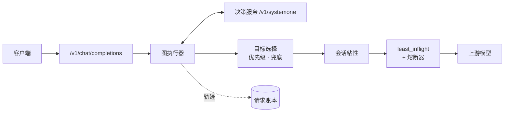

# RoutePilot

**自然语言驱动的智能路由。**

[English](README.md) | 简体中文

RoutePilot 是兼容 OpenAI 协议的路由代理。请求从 `/v1/chat/completions` 进入，由带版本的决策图选择上游模型。决策图在内置控制台中编辑、校验、试算与发布。


## 能力

| 分类 | 能力 |
|---|---|
| 入口 | `POST /v1/chat/completions`，支持 JSON 与 SSE；响应头 `x-sr-model` / `x-sr-selection` / `x-sr-reasoning*` |
| 路由策略 | 可视化决策图：输入条件、决策服务问题、逻辑门、模型目标 |
| 决策服务 | `choice` / `noul` / `score` 三类问题，按波次合并调用 `systemone` 兼容服务 |
| 目标选择 | 已激活目标按优先级竞争；统一兜底目标 `error_fallback` |
| 后端选择 | 会话粘性、`least_inflight` 负载均衡、按模型熔断 |
| 试算 | `/admin/try` 复用同一图执行器与同一轨迹格式，不改变粘性、inflight 与上游模型 |
| 运维 | 请求账本、决策回放、置信度分布、模型/提供方目录、JEV 配置、时段、审计历史、角色化用户 |
| 控制台 | 中英双语原生 ES Modules，无构建步骤 |

## 请求路由流程



1. 载入不可变路由快照，评估输入条件（时段、文本关键词）。
2. 激活第一波问题；同一波内的问题合并为一次决策服务调用。
3. 写入数值端口与 `selected` 端口，重新评估下游槽位条件与逻辑门。
4. 逐波重复，直到没有新问题被激活。
5. 选择优先级最高的已激活目标；否则使用 `error_fallback`。
6. 应用会话粘性，以 `least_inflight` 选择后端，向上游转发请求。

`unknown` 不会激活问题或目标；与 `unknown` 比较的数值条件保持 `unknown`。

## 架构

| 层 | 路径 | 职责 |
|---|---|---|
| API | `router/api/` | DTO 解析、异常到 HTTP 映射、上游代理、展示层 |
| 控制面 | `router/control/` | 图与配置的写用例、启用校验 |
| 路由领域 | `router/routing/` | 图模型、校验、编译后拓扑、求值器、调度 |
| 决策服务 | `router/jev/` | `systemone` 客户端、配置、输入窗口 |
| 上游 | `router/upstream/` | 后端目录、代理传输、熔断器与同步 worker |
| 存储 | `router/store/` | SQLite schema/仓储、共享图文件仓储 |
| 控制台 | `router/console/` | 中英双语原生 ES Module 界面 |
| 运行时 | `router/request_logging.py`、`router/maintenance.py` | 账本队列/worker、会话清理 |

边界约束：

- `router/routing/` 与 `router/upstream/` 不导入 FastAPI，也不导入 SQLite；`router/control/` 与 `router/store/` 不导入 `router.api`。
- API 层只做 DTO 解析与异常映射，不直接写控制面状态。账号与会话路由（`/admin/login`、`/admin/logout`、`/admin/users`、`/admin/me`）直接调用 `UserRepo`/`SessionRepo`/`ChangeRepo`。
- `GraphService` 依次完成校验、构造候选快照、在单写锁内写图文件、复核文档哈希、发布快照、记录审计；过期草稿返回 409。
- `ConfigurationService` 在同一事务内写数据与审计、在事务内复核图指纹，提交后才替换内存快照；指纹不稳定会在 COMMIT 前抛出。
- `compile_graph()` 对每个已发布快照只执行一次；请求路径读取 `snapshot.require_compiled()`，不重建索引，不访问 SQLite。
- 事件循环只把账本行写入有界队列与 20 条环形缓冲；每 2 秒 flush 一次，投影白名单列后经 `asyncio.to_thread` 落库。
- 熔断 worker 启动时载入共享隔离状态，之后每 30 秒在工作线程同步本地变更。

## 控制台


每个页面只有一个 `<script type="module">` 入口，无应用全局变量，无 CommonJS。

| 页面 | 内容 |
|---|---|
| 概览 | 请求量、路由分布、JEV 置信度、粘性命中、当前启用决策组 |
| 决策组 | 画布编辑、图设置、检查器、校验、试算、导入导出 |
| 计算日志 | 最近决策的模型、目标、候选、波次、JEV 概率、推理档位、上游结果与可回放轨迹 |
| JEV 模型 | 端点、模型、提示词与状态模板、连通性测试、上下文与输入 token 窗口 |
| 模型 | 模型注册表、上游模型 id、提供方、推理声明、能力说明 |
| 用户 | 管理员/只读账号、密码、角色、状态 |

### 编辑区与执行区

路由页分为两个区域。

**编辑区** —— 画布、节点库、检查器、校验：

- 从节点库拖拽建节点，支持平移缩放、自动整理、撤销重做。
- 类型化连线；数值输出拖入布尔槽位时生成默认条件。
- 每个输入槽位是一个 OR 输入，各自持有边条件。
- 输出拖到空白处按兼容关系快速创建节点。
- 保存与启用分离；工具栏显示 dirty 与 layout-only 状态。
- 目标卡片显示展示名、模型列表、兜底角色与调度策略。

**执行区** —— 停靠在画布下方：

- 输入框、样例提示词、运行按钮。
- 结论：最终目标、模型、候选与优先级、选择原因、波次与调用次数。
- 执行轨迹：每波一张命中条件卡片，以及完整请求时间线。

试算按波次高亮命中路径。点击轨迹行会把画布定位到对应连线或节点；编辑入口位于画布与检查器。


### 计算日志


展开行按阶段呈现计算过程：输入准备、初始计算、逐轮 JEV、候选与最终选择、模型调度、执行结果。`routing_error` 保留失败前的部分过程：调度阶段失败保留调度现场（配置、注册、可用、不可用原因、调度时 inflight）；JEV 波次失败则作废该轮候选并落入 `error_fallback`。缺少调度快照的记录与重启回填的账本行会明确说明缺失项。

SQLite 只保存账本字段，不含请求文本、轨迹、逐轮答案与节点标签。页面从进程内环形缓冲读取最近 20 条实时记录；计算详情为副本本地，不持久化。

## 决策图

### 节点

| 类型 | 用途 | 输入 | 输出 |
|---|---|---|---|
| `start` | 请求入口，恒为真 | — | 布尔 |
| `question` | 决策服务问题：`choice`、`noul`、`score` | 布尔槽位 `in_1..in_n`（OR） | choice：`prob.*`、`selected.*`、`p_top`、`margin`；noul：`yes`、`no`；score：`value` |
| `logic` | 三值逻辑门：`and`、`or`、`not` | 布尔槽位 `in_1..in_n`，每槽一条边条件 | 布尔 |
| `condition` | 输入条件：时段或文本关键词 | — | 布尔 |
| `target` | 模型目标：模型、推理档位、优先级、策略 | 布尔槽位 `in_1..in_n`（OR） | — |

### 条件

条件挂在边上：

```json
{
  "id": "e-cap-strong-and-power",
  "source": "capability",
  "source_port": "prob.strong",
  "target": "and-power",
  "target_port": "in_1",
  "condition": { "op": "gt", "value": 0.65 }
}
```

| 上游输出 | 条件 | 求值 |
|---|---|---|
| 数值 | `gt` / `gte` / `lt` / `lte` / `eq` / `neq` + 有限阈值 | 数值比较；unknown 按 unknown 传播 |
| 布尔 | `null`（等价 `= true`）或 `{ "op": "is", "value": true \| false }` | 布尔期望 |

- 一个输出可接入多个槽位，每个槽位保留各自条件。
- AND 门的两个槽位可表达区间，例如 `> 0.3` 与 `< 0.8`。
- 每个输入槽位只接一条边；槽位编号稳定，释放后可复用。
- `not` 恰好一个槽位；`and` / `or` 至少两个。问题与目标的槽位为 OR。

### 执行规则

- 问题按波次执行，一波即一次决策服务调用。
- 失败波次作废本轮：不写入端口，本轮候选全部丢弃。
- 目标优先级唯一，数值大者胜出。
- `error_fallback` 同时处理「正常运行但无激活目标」与「决策调用失败、超时或返回非法答案」。
- 兜底引用必须指向存在的目标。

### 限额

| 项目 | 上限 |
|---|---:|
| 节点 | 200 |
| 连线 | 400 |
| 问题节点 | 32 |
| 问题链深度 | 8 波 |
| 单选问题选项 | 255 |
| 打分条件 | 2–10 个有限数值 |

### 图文档

```json
{
  "kind": "sr-routing-graph",
  "version": 3,
  "name": "默认路由",
  "timezone": "Asia/Shanghai",
  "sticky": { "enabled": true, "ttl_seconds": 1800 },
  "root": {
    "id": "root",
    "type": "graph",
    "error_fallback": "safe-target",
    "nodes": [],
    "edges": []
  }
}
```

只接受 `sr-routing-graph` v3。v2 文档、非 v3 的 `kind`、未知节点类型，以及未知的 envelope/节点/边字段，都会在覆盖草稿或已发布快照之前被拒绝。结构性拒绝以 `graph_parse_error` 返回；控制台在导入时执行同一套校验。

`tree_revision` 是 `{timezone, sticky, root}` canonical JSON 的 SHA-256：节点按 id 排序，边按 `(target, slot, source, source_port)` 排序。Python 与控制台产生同一 canonical 形式；控制台用它判定编辑类型，`tree_revision` 由服务端计算。标题、能力说明、坐标、数组顺序与边 id 变化不影响该值。

## 模型与推理


决策图引用的模型槽位映射到上游模型 id 与提供方。一个目标可包含多个槽位，由 `least_inflight` 在其中选择。

提供方定义 OpenAI 兼容 base URL、API Key 环境变量与推理方言。模型 profile 声明：

- 是否支持推理及默认档位；
- `off`、`on`、`minimal`、`low`、`medium`、`high`、`xhigh`、`max` 的档位到协议拼写映射；
- 能力说明与目录元数据。

推理方言：OpenAI、DeepSeek、Qwen、Qwen chat template、OpenRouter、Z.ai、Together、string-thinking、Ant Ling。请求了不支持的档位时不注入推理，响应头携带 `x-sr-reasoning-warning`。

`GET /admin/models` 返回的 `profile` 为 JSON 对象；数据库以 JSON 文本存储。

## 决策服务（JEV）


决策服务提供 `POST /v1/systemone`，常见部署为 NeoHorse 或 vLLM。控制台配置项：

- base URL、模型、API Key、超时；
- 默认指令与状态模板（模板必须包含 `{request}`）；
- 使用两个固定候选的连通性测试；
- 上下文预算与输入截断上限；超长输入按头尾截断。

环境变量只在首次启动时写入决策服务配置，之后以数据库为准。

## 账号与运维

- 邮箱口令登录，scrypt 哈希，不透明 bearer 会话。
- `admin` 可编辑图、模型、JEV 配置与用户；`viewer` 只读。
- 最后一个启用的管理员不能被降级、停用或删除。
- 用户与配置变更写入审计日志。
- 图文件以 SHA-256 内容寻址，用于保存冲突与重载校验；不保留图历史。
- 控制面状态存于 SQLite（WAL）；路由图是共享 JSON 文件；账本写入在工作线程执行。
- 会话粘性与 inflight 计数为进程内状态。

## 图存储与多副本

图不存于 SQLite。每个决策组是 `ROUTER_GRAPH_DIR/graphs/{tree_id}.json` 下的一份 v3 文档；`ROUTER_GRAPH_DIR/current` 保存已启用组的 id。

- 单写者：管理面 API。其他副本设置 `ROUTER_GRAPH_WRITER=false`，只读挂载目录并每 2 秒重载。
- 副本在替换服务快照前编译候选快照；文件非法时保留旧快照，`/readyz` 报告 stale。
- 写入通过临时文件原子替换，权限 `0600`。
- Kubernetes：图文件使用 ReadWriteMany PVC；写者的 SQLite 使用本地存储。
- Docker：把同一 NFS 导出挂载进所有容器。
- 所有读写容器必须使用同一数值 UID；`0600` 文件无法仅靠 GID 或 `fsGroup` 访问。
- 过期保存返回 409 `graph_conflict`；导入只改草稿。
- `/healthz` 为存活探针；`/readyz` 报告初始快照就绪状态，503 表示未就绪，后续重载失败会保留现有快照并标记 `"stale": true`。
- 迁移：`python scripts/export_sqlite_graphs.py --db router.db --out routing-graph`。输出目录必须不存在；启动过程不会删除旧 SQLite 图。

## 快速开始

```bash
python3.11 -m venv .venv
.venv/bin/pip install -r requirements.txt

# 本地开发：关闭登录
ROUTER_DB=/tmp/routepilot.db \
ROUTER_GRAPH_DIR=/tmp/routepilot-graph \
ROUTER_USER_AUTH=0 \
.venv/bin/python -m router
```

控制台：`http://127.0.0.1:8400/console/`。

```bash
# 带鉴权部署
ROUTER_DB=/var/lib/routepilot/router.db \
ROUTER_GRAPH_DIR=/var/lib/routepilot/graph \
ROUTER_HOST=0.0.0.0 \
ROUTER_PORT=8400 \
ROUTER_ADMIN_EMAIL=admin@example.com \
ROUTER_ADMIN_PASSWORD='change-me-now' \
.venv/bin/python -m router
```

首次对空用户表启动时写入管理员账号。

## 配置项

| 环境变量 | 默认值 | 说明 |
|---|---|---|
| `ROUTER_DB` | `router.db` | SQLite 控制面数据库 |
| `ROUTER_GRAPH_DIR` | `./routing-graph` | 图文件与启用指针 |
| `ROUTER_GRAPH_WRITER` | `true` | 是否允许写图；只应有一个写者 |
| `ROUTER_HOST` | `127.0.0.1` | 监听地址 |
| `ROUTER_PORT` | `8400` | 监听端口 |
| `ROUTER_JEV_URL` | 空 | 决策服务 base URL |
| `ROUTER_JEV_MODEL` | 空 | 决策服务模型，与 `ROUTER_JEV_URL` 配对 |
| `ROUTER_JEV_API_KEY` | 空 | 决策服务 Key |
| `ROUTER_JEV_TIMEOUT` | `10` | 决策服务超时（秒） |
| `ROUTER_SESSION_MAX_ENTRIES` | `10000` | 会话粘性 LRU 容量 |
| `ROUTER_USER_AUTH` | `true` | 控制台登录开关 |
| `ROUTER_ADMIN_EMAIL` | `admin@test.com` | 首次启动的管理员邮箱 |
| `ROUTER_ADMIN_PASSWORD` | 种子口令 | 首次启动的管理员口令 |
| `ROUTER_SESSION_TTL_HOURS` | `168` | 控制台会话有效期 |

## API

| 方法与路径 | 用途 |
|---|---|
| `POST /v1/chat/completions` | 路由入口；JSON 或 SSE |
| `GET /healthz` | 存活探针 |
| `GET /readyz` | 快照就绪状态 |
| `POST /admin/login` / `POST /admin/logout` | 控制台会话 |
| `GET /admin/me` / `POST /admin/me/password` | 当前用户、修改口令 |
| `GET/POST /admin/trees`、`GET/PUT /admin/trees/{id}` | 决策组 |
| `POST /admin/trees/{id}/copy`、`/enable`、`/disable` | 组生命周期 |
| `POST /admin/try` | 针对草稿图的试算 |
| `GET/POST /admin/models`、`GET/PUT/DELETE /admin/models/{id}` | 模型注册表 |
| `GET /admin/model-catalog`、`POST /admin/fetch-models` | 提供方预设、上游模型发现 |
| `GET /admin/providers`、`PUT/DELETE /admin/providers/{name}` | 提供方 |
| `GET/PUT /admin/jev`、`POST /admin/jev/test` | 决策服务配置 |
| `GET/PUT /admin/jev/window` | JEV 上下文与输入 token 窗口 |
| `GET/PUT /admin/time-periods` | 时段 |
| `GET /admin/requests/recent`、`GET /admin/requests/stats` | 实时请求环形缓冲、logger 统计 |
| `GET /admin/overview`、`GET /admin/changes` | 概览、审计历史 |
| `GET/POST /admin/users`、`PUT/DELETE /admin/users/{id}`、`POST /admin/users/{id}/password` | 用户 |

### 错误

| 状态 | 错误 | 含义 |
|---|---|---|
| 400 | `invalid_json` / `body_must_be_object` / `messages_must_be_list` | 请求体格式错误 |
| 413 | `request_too_large` | 请求体超过 10 MiB |
| 502 | `upstream_error` | 上游 5xx 或网络失败 |
| 409 | `graph_conflict` | 草稿加载后图已变化 |
| 409 | `graph_already_exists` | 图 id 重复 |
| 503 | `graph_read_only` | 只读副本 |
| 503 | `graph_storage_error` | 共享图存储不可读 |
| 503 | `no_valid_snapshot` | 无初始快照 |
| 503 | `no_active_tree` | 无已启用决策组 |
| 503 | `no_available_backend` | 所选目标的全部后端不可用 |
| 503 | `routing_failed` / `routing_invariant_violation` | 路由内部失败 |

上游 4xx 响应按原状态码与响应体透传。

配置接口：`/admin/models`、`/admin/providers`、`/admin/jev`、`/admin/jev/window`、`/admin/time-periods`。不存在通用 `/admin/settings` 接口。

## 测试

```bash
.venv/bin/python -m pytest -q
node --test scripts/console_graph_test.mjs scripts/console_draft_test.mjs scripts/graph_contract_test.mjs
npm install
npm run check:console
.venv/bin/python scripts/i18n_dead_keys.py
```

- `pytest` 只收集 `tests/`（`testpaths`），运行为单元与 FastAPI 集成测试，不启动浏览器，也不收集 `experiments/`。
- `node --test` 运行 ES Module 套件：图与 canonical 行为、草稿状态、跨运行时契约 fixture（`tests/fixtures/graph_contracts.json`）。
- `npm run check:console` 运行三个 Node 套件，并在临时数据库、模拟决策服务与模拟上游上运行 Playwright 验收矩阵。截图默认关闭，`QA_SCREENSHOTS=1` 重新生成。`QA_ONLY=<正则>` 选择用例；单个页面模块可独立运行，例如 `node scripts/console_qa/canvas.mjs`。Chromium 不在默认缓存时设置 `CHROME=/path/to/chrome`。
- `scripts/i18n_dead_keys.py` 报告未被引用的词典键。

实验代码独立运行，不进入默认套件：

```bash
.venv/bin/python -m pytest -q experiments/jev-batch/test_spike_jev_batch.py
.venv/bin/python experiments/jev-batch/spike_jev_batch.py --samples /path/to/samples.jsonl --scenario all --dry-run
```

## 项目结构

```
router/
  api/                 FastAPI 路由、DTO、异常映射、代理装配、展示层
  control/             控制面写服务与启用校验
  routing/
    graph/             图模型、校验、条件、编译器、求值器
    service.py         求值 → 调度编排
    scheduling.py      粘性选择、租约获取、粘性写入
    affinity.py        会话粘性 LRU
    scheduler.py       least_inflight 均衡器与租约
    snapshot.py        不可变快照装配与编译后拓扑
    tree.py            树 envelope 编解码与 revision
    codec.py           严格字段解析助手
  request_logging.py   账本队列/环形缓冲与工作线程写入
  jev/                 决策服务客户端、配置、输入窗口
  upstream/            目录、代理传输、熔断器 + 同步 worker
  store/               SQLite schema/仓储、图文件仓储
  console/             中英双语原生 ES Module 控制台
configs/               示例决策组
tests/                 pytest 套件与契约 fixture
scripts/               Node 契约测试、Playwright QA、部署脚本
experiments/jev-batch/ 独立 JEV 批量 spike
assets/routepilot/     README 截图
```
