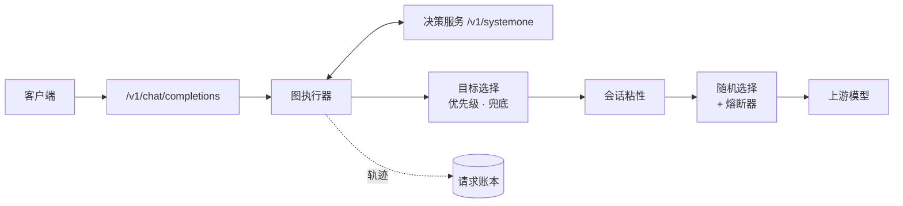
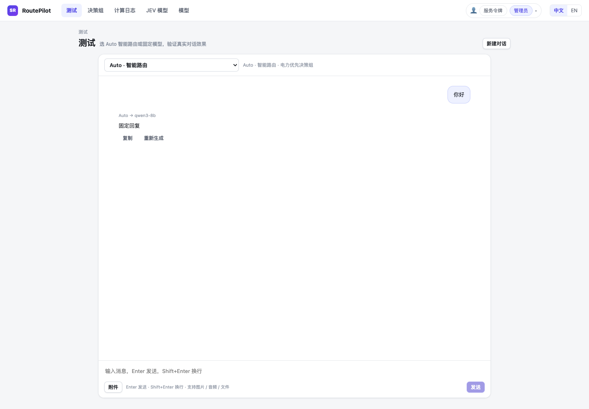
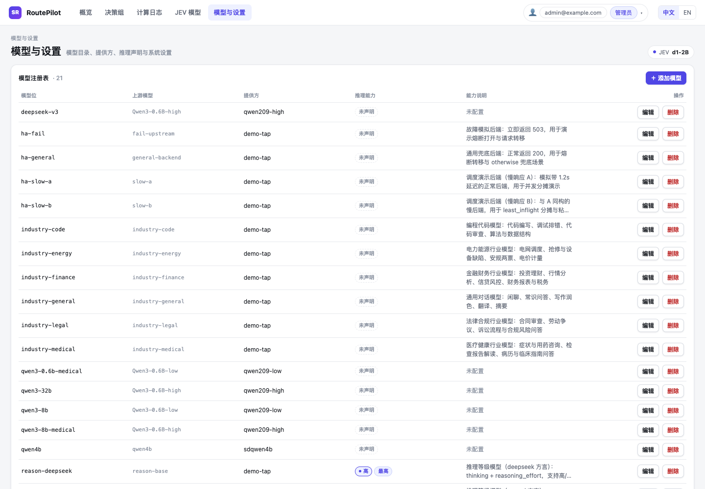

# RoutePilot

**自然语言驱动的智能路由。**

[English](README.md) | 简体中文

RoutePilot 是兼容 OpenAI 协议的路由代理。请求从 `/v1/chat/completions` 进入，由带版本的决策图选择上游模型。决策图在内置控制台中编辑、校验、检查路由与发布。


## 能力

| 分类 | 能力 |
|---|---|
| 入口 | `POST /v1/chat/completions`，支持 JSON 与 SSE；响应头 `x-sr-model` / `x-sr-selection` / `x-sr-tree-id` / `x-sr-graph-selection` / `x-sr-reasoning*` |
| 路由策略 | 可视化决策图：输入条件、决策服务问题、逻辑门、模型目标 |
| 路由集 | 可同时启用多张决策图；公开 `/v1` 只使用唯一默认图，部门映射让管理端检查命中指定的启用图 |
| 决策服务 | `choice` / `noul` / `score` 三类问题，按波次合并调用 `systemone` 兼容服务；画布快照固定该图使用的服务档案 |
| 目标选择 | 已激活目标按优先级竞争；统一兜底目标 `error_fallback` |
| 后端选择 | 会话粘性；多模型目标在可用模型中随机选择；Auto 按图与模型隔离熔断和 inflight；固定模型直连独立 |
| 可移植画布 | 每份已保存的 v4 画布自带生命周期标记、部门与完整非密钥运行配置，单份 JSON 即可在空数据库实例上恢复 |
| 检查路由 | 调用 `/admin/try`，复用同一图执行器与同一轨迹格式，不改变粘性、inflight 与上游模型；可检查当前草稿或已发布路由集（可按部门选图），数据库差异只作为提示展示 |
| 运维 | 请求账本、决策回放、置信度分布、模型/提供方目录、多服务 JEV 目录、时段、审计历史、角色化用户 |
| 控制台 | 中英双语原生 ES Modules，无构建步骤 |

## 请求路由流程



1. 从已发布路由集选图：公开 `/v1` 固定使用默认图，管理端检查可按部门选择一张启用图。
2. 载入该图的不可变快照，评估输入条件（时段、文本关键词）。
3. 激活第一波问题；同一波内的问题合并为一次决策服务调用。
4. 写入数值端口与 `selected` 端口，重新评估下游槽位条件与逻辑门。
5. 逐波重复，直到没有新问题被激活。
6. 选择优先级最高的已激活目标；否则使用 `error_fallback`。
7. 应用会话粘性；没有粘性命中时，在目标的可用模型中随机选一个，向上游转发请求。

`unknown` 不会激活问题或目标；与 `unknown` 比较的数值条件保持 `unknown`。

## 架构

| 层 | 路径 | 职责 |
|---|---|---|
| API | `router/api/` | DTO 解析、异常到 HTTP 映射、上游代理、展示层 |
| 控制面 | `router/control/` | 图与目录的写用例、影响清单与确认后的画布同步、启用校验 |
| 路由领域 | `router/routing/` | 图模型、校验、编译后拓扑、求值器、调度、不可变路由集快照 |
| 决策服务 | `router/jev/` | `systemone` 客户端、服务档案、输入窗口 |
| 上游 | `router/upstream/` | 固定模型目录（`model_id -> Backend`）、代理传输、熔断器与同步 worker |
| 存储 | `router/store/` | SQLite schema/仓储、共享图文件仓储 |
| 控制台 | `router/console/` | 中英双语原生 ES Module 界面 |
| 运行时 | `router/request_logging.py`、`router/maintenance.py` | 账本队列/worker、会话清理 |

边界约束：

- `router/routing/` 与 `router/upstream/` 不导入 FastAPI，也不导入 SQLite；`router/control/` 与 `router/store/` 不导入 `router.api`。
- API 层只做 DTO 解析与异常映射，不直接写控制面状态。账号与会话路由（`/admin/login`、`/admin/logout`、`/admin/users`、`/admin/me`）直接调用 `UserRepo`/`SessionRepo`/`ChangeRepo`。
- `GraphService` 依次完成校验、构造候选路由集、在单写锁内写生命周期文档、复核路由集指纹、发布完整启用集合、记录审计；过期草稿返回 409。
- `ConfigurationService` 在一个应用事务内提交「目录写 + 已确认受影响的画布」：在写锁内重算影响清单、校验每份候选文档、暂存/替换图文件（非默认启用图先写、默认图最后写）、复核路由集指纹、写审计，然后提交。同步集合里含任一启用图时重发布完整启用集合；只同步禁用草稿时不发布；过期确认在任何写入之前返回 409 `graph_conflict`。
- 没有任何画布引用的目录写只写目录行与审计，不会重写画布，也不会重新发布快照。
- `compile_graph()` 对每个已发布路由集里的每张启用图各执行一次；请求路径读取 `snapshot.require_compiled()`，不重建索引，不访问 SQLite。
- 事件循环只把账本行写入有界队列与 20 条环形缓冲；每 2 秒 flush 一次，投影白名单列后经 `asyncio.to_thread` 落库。
- 熔断 worker 启动时载入共享隔离状态，之后每 30 秒在工作线程同步本地变更。

## 控制台



每个页面只有一个 `<script type="module">` 入口，无应用全局变量，无 CommonJS。

| 页面 | 内容 |
|---|---|
| 测试 | 仅管理员可用的模型测试对话：Auto 智能路由（已发布路由集：默认图，或可信部门头选中的启用图）、SSE 流式、内存内多轮历史、图片/文本/音频/文件附件、安全多模态渲染 |
| 决策组 | 画布编辑、多图生命周期（启用/停用、设为默认、默认标记）、图设置里的部门、图设置与运行配置（时区/粘性/兜底、JEV 选择、从数据库刷新运行配置）、检查器、校验、检查路由、导入导出 |
| 计算日志 | 最近决策的模型、目标、候选、波次、JEV 概率、推理档位、决策耗时与可回放轨迹 |
| 决策服务 | 多服务 JEV 目录：服务列表、新建/编辑/删除、逐服务连接测试、提示词、超时和该服务自己的上下文/输入窗口 |
| 模型 | 模型注册表与提供方目录；以“接入模型”从预置目录一次接入提供方与模型。影响已保存画布的编辑/删除会先展示影响清单，确认后才同步。预置弹窗的高级选项只有连接信息与模型位 ID，推理声明、档位、领域与提供方协议属于自定义表单 |
| 用户 | 管理员/只读账号、密码、角色、状态 |

### 常用路径

- 决策组顶栏把编辑动作全部平铺：撤销/重做、自动整理、“保存草稿”、新建、导入、导出，已启用的组还有“停用”，与“检查路由”、主按钮和问题计数并排。新草稿的主按钮显示“保存并启用”；已启用的组显示“已启用”，有未发布修改时显示“保存并更新”。可以同时启用多张图，选择器会标出默认图；非默认的启用图还有“设为默认”。默认图在仍有其它启用图时不能直接“停用”——需先切换默认图。部门在图设置里编辑。检查器中的“应用”只更新本地草稿，不写服务端。
- 图设置（检查器）从数据库 JEV 目录选择服务，并在同一个历史项里应用 **JEV 与其窗口**；“从数据库刷新运行配置”按目录重建草稿的 `backends`/`jev`/`jev_window`/`time_periods`。两者都只改本地草稿，不写服务端。
- 模型页的“接入模型”是默认入口，可从预置目录一次完成提供方与模型接入；模型 ID 自动生成。预置弹窗的高级选项只放连接信息与模型位 ID，手工 ID、推理声明、档位、领域和提供方协议配置在自定义表单的高级选项里。
- “决策服务”页是目录：左侧列出服务，右侧编辑选中的服务（地址、模型、`key_env`、密钥、超时、指令、State 模板、输入/上下文窗口）并测试连接。窗口属于服务本身，因此画布总是成组替换 JEV 与窗口。环境可用 `ROUTER_JEV_URL` / `ROUTER_JEV_MODEL` / `ROUTER_JEV_API_KEY` 创建 `default` 服务，但只发生一次：仅当目录为空、从未用过环境种子、且 URL 与模型都配置时，启动才会播种。首启没有环境、之后补上环境仍会播种一次；删光所有服务后重启绝不会复活。
- 编辑或删除仍被画布引用的模型、提供方或 JEV 服务会进入两步确认；没有被任何画布引用的资源会立即写入。第一次写入返回 409，列出每幅受影响画布（名称、id、启用状态、当前 `document_sha256`、使用位置）；确认后原样带回这些哈希，服务端只同步受影响的画布。仍被 target 引用的模型 / 仍被引用的 JEV 服务删除时必须提供替代项；仍被数据库模型或画布模型引用的提供方不能删除。确认同步成功后，已打开的画布需要重新加载（或使用“从数据库刷新运行配置”）——本地草稿不会被就地更新。

### 模型测试对话

首页（`/console/index.html`）是仅管理员可用的模型测试对话，请求固定走 Auto 并发送到 `/admin/test/chat/completions`；消息元信息根据响应头 `x-sr-model` 显示本次实际命中的模型（`Auto → <模型>`）。

- **Auto 智能路由**：与 `/v1/chat/completions` 一样评估已发布路由集：默认图，或由可选**部门**输入（`x-sr-department`，百分号编码）选中的启用图；决策图、JEV 波次、粘性与随机后端选择全部生效。页面不提供固定模型旁路，测试流量始终经过真实路由；固定模型直连仍只通过 `POST /admin/test/chat/completions` 提供（`x-sr-selection: direct`，经数据库目录解析，没有图响应头）。页面用 `x-sr-model` 响应头显示回复元信息（`Auto → <模型>`）；Auto 回复的响应头还带实际选中的 `x-sr-tree-id` / `x-sr-graph-selection`，但页面不渲染这两个头。
- **流式回复**：回答通过 SSE 逐块返回；停止会中止流并保留已生成内容，复制 / 重试 / 重新生成作用于该条消息。只有上游正常收尾才算完成——提前断流会标记为未完成，提供方错误就地显示在对话里，不会冒充完整回答。
- **多轮历史**：内存中的对话以 wire-format `messages` 重发，并从原始 assistant 消息无损回放（消息级媒体只渲染、绝不回流进历史）；新建对话会中止在途回复、清空对话并轮换会话 id。
- **附件**：文本文件按原文读取并作为 content part 发送；图片、音频等其他文件在浏览器内读成 data URL。预估体积会超出 10 MiB 请求上限的文件在读取前就地拒绝，发送前还会对完整 JSON 请求体（含历史与 Base64）做精确复检。
- **多模态输出**：文本按安全 Markdown 渲染；图片、音频、视频与文件使用原生播放器或下载链接；未知 part 折叠为可检查的 JSON。模型提供的 HTML 只作为文本显示，活动 URL scheme 被丢弃，不会执行。
- **仅内存**：对话与附件只存在于页面中，刷新即清空，服务端不保存聊天历史与上传文件。

### 编辑区与执行区

路由页分为两个区域。

**编辑区** —— 画布、节点库、检查器、校验：

- 从节点库拖拽建节点、平移缩放；自动整理与撤销重做直接放在顶栏。
- 类型化连线；数值输出拖入输入槽位时生成默认条件。
- 每个输入槽位是一个 OR 输入，各自持有边条件。
- 输出拖到空白处会打开兼容节点选择器；点选后在该位置创建节点并自动连线（Esc 取消）。
- 保存与发布合并为顶栏主按钮；顶栏的“保存草稿”仍可只保存不启用。生命周期徽标只显示四种状态：运行中、有未发布修改、未启用、草稿未保存。已保存但未启用的组即使有本地改动也显示“未启用”（未启用优先），“草稿未保存”只用于从未保存的新草稿。主按钮随状态显示“保存并启用”“保存并更新”“已启用”“启用”或“保存中…”。决策组选择器会标出默认图；非默认的启用图显示“设为默认”，默认图在仍有其它启用图时不允许“停用”。
- 图设置里有**部门**映射（逗号或换行分隔）。一个部门只能归属一张启用图；禁用草稿之间允许重复，启用冲突的图会以 `department_conflict` 问题被拒绝。检查器的“应用”只提交到本地草稿；写服务端的动作都在顶栏——主按钮发布（保存，启用时重发布完整路由集），“保存草稿”只保存不启用，“停用”切换启用状态，“设为默认”原子切换默认图。
- 目标卡片显示展示名、模型列表、兜底角色与随机调度提示（多模型目标）。

**执行区** —— 停靠在画布下方：

- 输入框、样例提示词、运行按钮，以及**检查路由**的范围选择：当前草稿，或已发布路由集（可填部门）。路由集试算只显示所选图的结果和原始节点/目标 ID，绝不在当前草稿上回放、涂色或布局；草稿试算保留画布回放。
- 结论：最终目标、模型、候选与优先级、选择原因、波次与调用次数。路由集检查还会报告选中的 `tree_id` 以及选图依据是部门还是默认图。
- 执行轨迹：每波一张命中条件卡片，以及完整请求时间线。

草稿试算按波次高亮命中路径，并可“按波次整理”节点。路由集试算不触碰画布——它描述的是已发布路由集，而不是当前草稿，只以结果面板作为证据。点击轨迹行会把画布定位到对应连线或节点；编辑入口位于画布与检查器。


### 计算日志


展开行按阶段呈现计算过程：输入准备、初始计算、逐轮 JEV、候选与最终选择、模型调度、执行结果。耗时只统计决策阶段（进入路由到选出模型），不含上游生成；上游状态与端到端总耗时留在网关数据面，不进入智能路由的展示口径。`routing_error` 保留失败前的部分过程：调度阶段失败保留调度现场（配置、注册、可用、不可用原因、调度时 inflight）；JEV 波次失败则作废该轮候选并落入 `error_fallback`。缺少调度快照的记录与重启回填的账本行会明确说明缺失项。

SQLite 只保存账本字段，不含请求文本、轨迹、逐轮答案与节点标签。页面从进程内环形缓冲读取最近 20 条实时记录；计算详情为副本本地，不持久化。

## 决策图

### 节点

| 类型 | 用途 | 输入 | 输出 |
|---|---|---|---|
| `start` | 请求入口，恒为真 | — | 布尔 |
| `question` | 决策服务问题：`choice`、`noul`、`score` | 槽位 `in_1..in_n`（OR，任一为 true 即激活；类型由入边源端口决定） | choice：`prob.*`、`selected.*`、`p_top`、`margin`；noul：`yes`、`no`；score：`value` |
| `logic` | 三值逻辑门：`and`、`or` | 槽位 `in_1..in_n`，每槽一条边条件，至少两条 | 布尔 |
| `condition` | 输入条件：时段或文本关键词 | — | 布尔 |
| `target` | 模型目标：模型、推理档位、优先级（多模型随机选择） | 槽位 `in_1..in_n`（OR） | — |

### 条件

条件挂在边上：

```json
{
  "id": "e-cap-strong-and-power",
  "source": "capability",
  "source_port": "prob.strong",
  "target": "and-power",
  "target_port": "in_1",
  "condition": { "op": "gt", "value": 0.65 }
}
```

| 上游输出 | 条件 | 求值 |
|---|---|---|
| 数值 | `gt` / `gte` / `lt` / `lte` / `eq` / `neq` + 有限阈值 | 数值比较；unknown 按 unknown 传播 |
| 布尔 | `null`（等价 `= true`）或 `{ "op": "is", "value": true \| false }` | 布尔期望 |

- 槽位本身不声明类型：合法性只看源端口是数值还是布尔；数值输出可接任意槽位，只要该边带比较条件。
- 一个输出可接入多个槽位，每个槽位保留各自条件。
- AND 门的两个槽位可表达区间，例如 `> 0.3` 与 `< 0.8`。
- 每个输入槽位只接一条边；槽位编号稳定，释放后可复用。
- `and` / `or` 至少两个槽位。问题与目标的槽位为 OR（true 才激活，unknown 不激活）。
- 反向判断使用布尔输出取反，或使用数值比较的反向算子；不提供独立 NOT 节点。

### 执行规则

- 问题按波次执行，一波即一次决策服务调用；同一问题在一次请求里最多执行一次。
- 失败波次不写入任何端口，并清空此前所有波次累积的全部候选，然后进入兜底。
- 目标优先级唯一，数值大者胜出；候选排序的次键是 target id 字典序。
- `error_fallback` 同时处理「正常运行但无激活目标」与「决策调用失败、超时或返回非法答案」。
- 兜底引用必须指向存在的目标。

### 限额

| 项目 | 上限 |
|---|---:|
| 节点 | 200 |
| 连线 | 400 |
| 问题节点 | 32 |
| 问题链深度 | 8 波 |
| 单选问题选项 | 255 |
| 打分条件 | 2–10 个有限数值 |

### 图文档

v4 文档就是完整、可移植的画布：生命周期标记（`enabled`/`default`）、部门映射（`departments`）、图结构加四个必填运行字段。生命周期持久化在每份文档里——不再有 `ROUTER_GRAPH_DIR/current` 指针。新建与复制的文档一律以 `enabled: false, default: false` 保存；导入只替换草稿内容、不改生命周期——作为新组保存时是关闭态，保存到已有组则继承该组已存的生命周期（已启用的组保持启用）。通过生命周期 API 启用的第一张图会自动成为默认图。

```json
{
  "kind": "sr-routing-graph",
  "version": 4,
  "name": "示例画布",
  "departments": [],
  "enabled": false,
  "default": false,
  "timezone": "Asia/Shanghai",
  "sticky": { "enabled": true, "ttl_seconds": 1800 },
  "root": {
    "id": "root",
    "type": "graph",
    "error_fallback": "safe-target",
    "nodes": [
      { "id": "start", "type": "start", "title": "开始" },
      { "id": "safe-target", "type": "target", "priority": 1,
        "models": [ { "model": "qwen3-8b", "reasoning": null } ] }
    ],
    "edges": [
      { "id": "e-start-safe", "source": "start", "source_port": "out",
        "target": "safe-target", "target_port": "in_1", "condition": null }
    ]
  },
  "backends": {
    "providers": [
      { "name": "local", "base_url": "http://127.0.0.1:8000/v1",
        "key_env": "LOCAL_API_KEY", "reasoning_format": "openai" }
    ],
    "models": [
      { "id": "qwen3-8b", "upstream": "qwen3-8b", "provider": "local", "profile": {} }
    ]
  },
  "jev": null,
  "jev_window": { "input_tokens": 1024, "context_tokens": 4096 },
  "time_periods": []
}
```

只接受 `sr-routing-graph` v4。v3/v2 文档、非 v4 的 `kind`、未知节点类型，以及未知的 envelope/节点/边字段，都会在覆盖草稿或已发布快照之前被拒绝；只带部分（或完全不带）四个运行字段的文档同样被拒绝，`default: true` 而 `enabled: false` 也拒绝。`departments` 是硬约束字符串数组：每项去空白后 1–64 码点、不含控制字符、文档内唯一，服务端按码点排序保存；一个部门只能归属一张**启用**图，禁用草稿之间允许重复。解析失败（未知字段、类型错误、缺字段、部门非法）以 `graph_parse_error` 返回；start 数量、端口/槽位、环、可达性、优先级与兜底等结构问题返回各自的 Issue code，不再折叠成解析错误。控制台在导入时执行同一套校验。`jev: null` 在结构上始终合法；含问题节点的图在启用校验时会因 `decision_service_unavailable` 被拒绝。

生命周期规则见[多图路由集](#多图路由集)：有启用图时恰好一张默认图；零启用图为合法空路由集；停用默认图而仍有其它启用图返回 `409 default_graph_required`；部门只在启用图之间唯一。

完整字段表、问题码与执行细节见[决策图规范](docs/决策图规范.md)。

实验版本不提供旧 NOT 图兼容：任何 `logic/operator=not` 都直接拒绝，不自动迁移，也不保证历史 NOT 快照可展示。需要反向判断时，手工改用布尔输出取反或数值补比较，例如 `> 0.65 → NOT` 改为 `<= 0.65`，`>= 0.5 → NOT` 改为 `< 0.5`。

四个运行字段的语义见[自包含画布 JSON](#自包含画布-json)。

`tree_revision` 是 `{departments, timezone, sticky, root}` 加四个运行字段的 canonical JSON 的 SHA-256：节点按 id 排序，边按 `(target, slot, source, source_port)` 排序，部门按码点排序。Python 与控制台产生同一 canonical 形式（部门在两侧都按 Unicode 码点排序，数值都按 Python 的浮点 repr 输出）；控制台用它判定编辑类型，`tree_revision` 由服务端计算。展示变化与生命周期都不影响该值：节点标题、坐标、节点/边数组顺序、边 id，以及 `id`、`name`、`enabled`、`default` 都被排除。列表**顺序**并非全都无关：部门排序后与顺序无关，但问题选项、评分档位、`target.models`、提供方/模型目录与时段数组的顺序都参与该值。会参与该值的还有问题选项的能力说明（choice 问题），以及模型 profile 的能力说明与已声明推理档位——它们改变运行行为。

## 多图路由集

每个决策组都是带 `departments`、`enabled`、`default` 的一份 v4 JSON 文件；磁盘文件是生命周期的唯一来源（没有 `current` 指针）。所有**启用图**组成已发布路由集：

- **快照集**：载入时所有启用图一起校验并编译。任一启用图不可用就跳过整个发布：已有一份成功发布的路由集时它继续服务，`/readyz` 报告 `stale: true` 并给出 `last_load_error`；从未成功发布过则 `/readyz` 未就绪（503）。
- **唯一默认图**：有启用图时恰好一张默认图。通过 API 启用的第一张图自动成为默认图；之后再启用别的图不改变默认图。`POST /admin/trees/{id}/default` 原子切换默认图（旧默认图保持启用但不再是默认）。默认图之外仍有启用图时停用默认图返回 `409 {"detail":{"code":"default_graph_required","tree_id":"…"}}`；停用最后一张启用图后路由集为空——`/readyz` 仍就绪，`/v1` 返回 `503 no_active_tree`。
- **部门**：`departments` 是规范化、排序后的字符串数组（去空白、1–64 码点、无控制字符、文档内唯一）。一个部门只能归属**一张启用图**；禁用草稿之间允许重复，只有真正同时启用时才会以 `422 department_conflict`（带 `department` 与 `tree_ids`）拒绝。部门匹配是精确、大小写敏感的；请求的部门没有命中任何启用图时使用默认图。
- **公开数据面只用默认图**：`POST /v1/chat/completions` 永远使用默认图，出现 `x-sr-department` 头一律 `400 department_header_not_allowed`。部门选图是管理端验证能力：测试对话发送可信的百分号编码 `x-sr-department` 头，检查路由有**实际路由集**范围并可选部门。Auto 路由用 `x-sr-tree-id` 与 `x-sr-graph-selection`（`department` / `default`）报告选中的图；固定模型直连保持 `x-sr-selection: direct` 且没有图响应头。
- **生命周期是服务端状态**：新建与复制的文档一律保存为 `enabled: false, default: false`。导入只替换草稿：作为新组保存是关闭态，保存到已有组则继承该组已存的生命周期。只有专用端点能改生命周期；普通保存可以改 `departments`，但永远写不了 `enabled`/`default`。
- **路由集 revision**：`snapshot_revision` 是 canonical `{default_tree_id, department_tree_ids, 每图 snapshot_revision}` 的 SHA-256；`route_fingerprint` 覆盖启用图 id、默认标记与文档哈希，所以只改草稿永远不会触发重载。两者与 `default_tree_id`、`enabled_tree_ids` 一起暴露在 `graph_status`（`/readyz` 对象与每个决策组列表响应）。

## 模型与推理



决策图引用的模型槽位映射到上游模型 id 与提供方。一个目标可包含多个槽位；有多个可用模型时随机选择一个。**数据库目录**是控制台下拉框与固定模型直连的管理事实源；**每张启用图的画布快照**是 Auto 路由的唯一事实源。

提供方定义 OpenAI 兼容 base URL、API Key 环境变量与推理方言。模型 profile 声明：

- 是否支持推理及默认档位；
- `off`、`on`、`minimal`、`low`、`medium`、`high`、`xhigh`、`max` 的档位到协议拼写映射；
- 能力说明与目录元数据。

推理方言：OpenAI、DeepSeek、Qwen、Qwen chat template、OpenRouter、Z.ai、Together、string-thinking、Ant Ling。请求了不支持的档位时不注入推理，响应头携带 `x-sr-reasoning-warning`。

`GET /admin/models` 返回的 `profile` 为 JSON 对象；数据库以 JSON 文本存储。控制台与管理目录接口永远只读 SQLite——不会投影任何启用图的画布，目录写也不会自行重写任何画布。保存画布时才**选择**模型：所选模型及其提供方被加入快照；快照里已有同 ID 模型时，普通 target 编辑不会覆盖它（差异由检查提示报告，只有显式刷新或确认后的目录同步才会替换）。

旧数据库 profile 仍按兼容规则宽松读取，但响应是脱敏投影：`api_key`、`authorization`、`key_present`、`key_source` 及其大小写/分隔符变体会从 `profile` 中递归剔除。这只是只读投影——合法元数据（`tier`、`domains`、`capability` 等）保留，数据库原行不被改写；图文件与管理写入仍严格拒绝这些字段，而不是清洗后保存。

非 JSON 兼容数值是唯一的例外：管理写入会以 422 拒绝 `NaN` / `Infinity`；若旧行里已经存了这类值，目录读取**不再**容忍——`GET /admin/models` 以及其他回显模型行的响应会 500，需要重新投影该行的确认后目录同步会返回 422。`/admin/try` 的画布与目录差异检查是 JSON 安全的：它在提示参数里把非有限值归一化，检查照常返回，所以检查路由不受影响。升级前请先修好这些行——见[旧 profile 中的非 JSON 兼容数值](#旧-profile-中的非-json-兼容数值)。

删除或更新仍被已保存画布引用的模型/提供方是两步操作：第一次写入返回 409 `impact_confirmation_required`，携带每幅受影响画布与其当前 `document_sha256`；确认后的重试只同步这些画布。被 target 引用的模型删除时必须提供替代模型；被数据库模型或画布模型引用的提供方删除永远被拒绝（`provider_referenced`）——先解除引用。详见[目录影响确认](#目录影响确认)。

提供方 API Key 从不出现在响应中：投影只暴露 `key_present` 与 `key_source`（`stored` / `env` / `none`）。

## 决策服务（JEV）


决策服务提供 `POST /v1/systemone`，常见部署为 NeoHorse 或 vLLM。控制台页面管理的是**服务目录**，不是单一全局配置：

- 列表展示每个服务的 ID、模型与地址；新建、编辑、删除都按服务进行；窗口（`input_tokens` / `context_tokens`）与提示词、超时、`key_env` 和密钥一样属于该服务。
- **测试**调用 `POST /admin/jev/{id}/test`，使用数据库里的服务配置而不是任何图的画布快照；画布自身的 JEV 由检查路由以提示形式报告差异。
- 画布选择一个服务（`jev.id` + `key_env`）并内嵌其完整非密钥档案与窗口。画布在选择、刷新或服务端确认同步时总是成组替换 JEV 与窗口——不存在「两个服务混用」的形态。
- 只有 `key_env`（环境变量名）与服务地址/模型是可移植的。真实 `api_key` 只存在 SQLite 中，仅当服务 `id`、`base_url`、`model` 全部仍匹配时复用；否则在构建快照时读取该服务 `key_env` 指向的环境变量。不存在全局 `ROUTER_JEV_API_KEY` 回退；播种的 `default` 服务恰好把该变量名作为自己的 `key_env`。
- 删除仍被画布引用的服务必须提供替代服务，确认后同步受影响画布的 JEV 档案与窗口；更新被引用的服务同样需要确认并同步。

## 账号与运维

- 邮箱口令登录，scrypt 哈希，不透明 bearer 会话。
- `admin` 可编辑图、模型、提供方、JEV 服务目录与用户；`viewer` 只读。
- 最后一个启用的管理员不能被降级、停用或删除。
- 用户与配置变更写入审计日志。
- 图文件以 SHA-256 内容寻址，用于保存冲突与重载校验；不保留图历史。
- 控制面状态存于 SQLite（WAL）；路由图是共享 JSON 文件；账本写入在工作线程执行。
- 会话粘性与 inflight 计数为进程内状态。

## 图存储与多副本

图不存于 SQLite。每个决策组是 `ROUTER_GRAPH_DIR/graphs/{tree_id}.json` 下的一份 v4 文档；生命周期来自文档自己的 `enabled`/`default` 字段——旧的 `ROUTER_GRAPH_DIR/current` 指针既不读取也不写入。每份文档**必须**自带运行配置（`backends`、`jev`、`jev_window`、`time_periods`），因为已保存画布是 Auto 路由唯一的运行时来源。不存在 `runtime:null` 标记、不存在「保存为旧文档」模式，也没有把配置物化进旧文件的服务端步骤。

- 单写者：管理面 API。其他副本设置 `ROUTER_GRAPH_WRITER=false`，只读挂载目录，路由集指纹变化时每 2 秒轮询重载。
- 副本在替换服务路由集前校验并编译**每一张**启用图；任一启用图非法时保留旧路由集，`/readyz` 报告 `stale: true` 与 `last_load_error`。
- 启停与默认切换就是普通的文档写入：非默认启用图先写、默认图最后写，然后重发布完整启用集合。
- 写入通过临时文件原子替换，权限 `0600`。
- Kubernetes：图文件使用 ReadWriteMany PVC；写者的 SQLite 使用本地存储。
- Docker：把同一 NFS 导出挂载进所有容器。
- 所有读写容器必须使用同一数值 UID；`0600` 文件无法仅靠 GID 或 `fsGroup` 访问。
- 过期保存返回 409 `graph_conflict`；导入只改草稿。
- `/healthz` 为存活探针；`/readyz` 报告路由集就绪状态并暴露 `default_tree_id`、`enabled_tree_ids`、`snapshot_revision` 与 `route_fingerprint`；503 表示未就绪，后续重载失败会保留现有路由集并标记 `"stale": true`。
- schema 会自行升级（见[从旧版快照前安装升级](#从旧版快照前安装升级)）；不再提供 SQLite→图文件的导出脚本——迁移画布靠导出/导入 JSON 文件。

## 从旧版快照前安装升级

对既有部署，有两件变化。

1. **SQLite schema 在首次启动时自动迁移。** schema v5 在一个事务内升级到 v6：旧的单行 `jev_config` 变成 id 为 `default` 的 `jev_services` 服务（已存密钥、端点、模型、提示词与超时保留；窗口被夹到合法范围），随后旧表被删除。升级前请备份 `router.db`（连同 `router.db-wal` / `router.db-shm`）；升级后没有回到旧单配置布局的路径。若 JEV 目录为空且从未用过环境种子，`ROUTER_JEV_URL` + `ROUTER_JEV_MODEL` 会一次性创建该 `default` 服务，`ROUTER_JEV_API_KEY` 作为它的密钥写入；`settings.jev_catalog_seeded` 会记录这次播种，因此之后的任何重启都不会再创建 `default` 服务——即使所有服务都已被删除。
2. **每份已存画布必须已经是完整的 v4 快照。** 严格解析器只接受 `sr-routing-graph` version 4：除四个运行字段外，每份文件还必须带 `departments`、`enabled`、`default`。升级前：

   - 备份 `ROUTER_GRAPH_DIR`（`graphs/*.json`；旧的 `current` 指针不再读取，请先记下当时生效的图再丢弃）；
   - 在**旧版本**上为每个决策组生成完整运行快照：打开每个决策组并保存一次（或对其文档 `PUT /admin/trees/{id}`）。旧版本会把当时有效的运行配置写进文件（版本 3 文档）；
   - 手工把每个 `graphs/*.json` 升级为 v4：`version` 改为 `4`，加入 `"departments": []`，并按旧现实设置 `enabled`/`default`（原活动图为 `true`/`true`，其余为 `false`/`false`）。如果旧实例已无法操作，同时按[自包含画布 JSON](#自包含画布-json)补齐四个运行字段；
   - 结果必须通过[决策图](#决策图)的 v4 规则解析，并与画布实际引用的模型、提供方、JEV 服务和时段一致。

漏改的文件不会被静默修复：启动时记录 `initial graph snapshot is unavailable`，`/readyz` 报告未就绪（或 `stale`），`GET /admin/trees` 返回 503 `graph_storage_error`，`/v1` Auto 路由没有可用路由集（`no_valid_snapshot`），直到文件修好。启动成功后，v3 文件仍然只是非法文件——永远不会被隐式接管或迁移。

### 旧 profile 中的非 JSON 兼容数值

还有一项独立于迁移本身的升级前数据检查。Python 的 JSON 读取器接受 `NaN`、`Infinity` 与 `-Infinity`，因此旧行可能在 `models.profile` 里保存这些值；它们不是合法 JSON，严格的目录响应无法序列化。

症状：

- `GET /admin/models`（以及其他回显模型行的响应）返回 **500** —— 序列化器抛出 `Out of range float values are not JSON compliant`；
- 需要重新投影该行的**确认后**目录同步（例如不改 `profile` 的模型更新）返回 **422**，并点名出问题的路径；
- `POST /admin/try` 不受影响：画布与目录差异检查会在提示 `params` 里归一化非有限值，检查仍返回 200 并给出 `runtime_mismatch` 提示。

在 SQLite 里定位候选行：

```bash
sqlite3 router.db "SELECT id, profile FROM models WHERE json_valid(profile) = 0;"
```

`json_valid(profile) = 0` 同时覆盖文本本身损坏的行（读取时按 `{}` 处理，无害但仍值得重写）与包含裸 `NaN` / `Infinity` 字面量的行（真正会打挂响应的那种）。要精确区分后者，用 Python 的 `json.loads` 解码每个命中行（它默认接受这些字面量），并筛出 `math.isfinite` 为假的值；`jq` 等严格 JSON 解析器则会直接拒绝。

修复这些行：

- 首选：`PUT /admin/models/{id}` 提交修正后的有限 `profile`；若画布引用它，还要带上确认后的 409 影响载荷。该行修好前控制台的模型列表本身也可能报错，不要依赖它来完成修复；
- 最后手段：备份 `router.db` 后直接重写 JSON 文本，例如 `UPDATE models SET profile = '{}' WHERE id = '<model>';`；
- 复核：`SELECT COUNT(*) FROM models WHERE json_valid(profile) = 0;` 必须返回 0。

无需重启：目录在每次请求时都从 SQLite 读取。

## 自包含画布 JSON

每份已保存画布都是可移植、不可变的运行快照：单份文件即可在空数据库实例上恢复一个决策组。v4 文件还自带生命周期标记与部门；四个顶层字段**必填且必须成组出现**：

| 字段 | 内容 |
|---|---|
| `backends` | `providers`（名称、base URL、密钥环境变量名、推理方言）与 `models`（模型 id、上游 id、提供方、profile） |
| `jev` | 所选决策服务档案：`id`、`base_url`、`model`、`key_env`、超时、提示词与状态模板；只有没有问题节点的画布才为 `null` |
| `jev_window` | **同一服务**的 `input_tokens` / `context_tokens` |
| `time_periods` | `periods` 条件引用的时段定义 |

```json
{
  "kind": "sr-routing-graph",
  "version": 4,
  "name": "示例画布",
  "departments": [],
  "enabled": false,
  "default": false,
  "timezone": "Asia/Shanghai",
  "sticky": { "enabled": true, "ttl_seconds": 1800 },
  "root": {
    "id": "root",
    "type": "graph",
    "error_fallback": "qwen3-target",
    "nodes": [
      { "id": "start", "type": "start", "title": "开始" },
      { "id": "qwen3-target", "type": "target", "priority": 1,
        "models": [ { "model": "qwen3-8b", "reasoning": null } ] }
    ],
    "edges": [
      { "id": "e-start-qwen3", "source": "start", "source_port": "out",
        "target": "qwen3-target", "target_port": "in_1", "condition": null }
    ]
  },
  "backends": {
    "providers": [
      {
        "name": "local",
        "base_url": "http://127.0.0.1:8000/v1",
        "key_env": "LOCAL_API_KEY",
        "reasoning_format": "openai"
      }
    ],
    "models": [
      {
        "id": "qwen3-8b",
        "upstream": "qwen3-8b",
        "provider": "local",
        "profile": {
          "capability": "适合简单请求的本地轻量模型。",
          "reasoning": { "format": "qwen-chat-template", "efforts": { "off": null, "on": null }, "default": "on" }
        }
      }
    ]
  },
  "jev": {
    "id": "default",
    "base_url": "http://127.0.0.1:8100",
    "model": "d1-2b",
    "key_env": "ROUTER_JEV_API_KEY",
    "timeout_seconds": 10.0,
    "instructions": "你是一个模型路由器。",
    "state_template": "【待判断的用户请求】\n{request}"
  },
  "jev_window": { "input_tokens": 1024, "context_tokens": 4096 },
  "time_periods": [
    { "name": "白天", "days": [0, 1, 2, 3, 4], "start": "09:00", "end": "18:00" }
  ]
}
```

规则：

- **四个字段永远齐全。** 只带部分字段（或完全不带）的文档在解析、导入、保存、检查时都以 `graph_parse_error` 拒绝；不存在从数据库补齐缺字段的回退，也不存在 `runtime:null` 控制字段或物化步骤。旧文档被拒绝，不会被就地升级。
- **JEV 与窗口是一个整体。** `jev.id` 选择目录服务，`key_env` 说明其密钥如何解析；`jev_window` 属于该服务。选择或同步 JEV 服务时，`jev` 与 `jev_window` 一起替换。原始 `PUT /admin/trees/{id}` 补丁若改变 `jev.id`，必须同时携带新服务的 `jev_window`；否则返回 422，不继承旧服务窗口。
- **不含密钥，且任意层级都拒绝。** 提供方只写 `key_env`（环境变量名），不写 Key；`jev` 不含 `api_key`。密钥与派生的密钥字段（`api_key`、`authorization`、`key_present`、`key_source`）出现在四个字段内部任意位置——包括 `backends.models[*].profile` 下的嵌套对象和数组——都会被拒绝。键名比较忽略大小写与 `-`/`_`（`API-KEY` 等同 `api_key`），但只覆盖这个固定集合，`monkey`、`keychain` 之类正常元数据照旧保留。除此之外 `profile` 仍是自由 JSON 元数据对象：`capability`、`domains`、`tier` 以及后续元数据原样保存。无需鉴权的本地服务可以把 `key_env` 留空。
- **在文件边界校验。** 提供方与模型 id、提供方引用、profile、推理档位声明、JEV 服务档案、窗口与时段都在解析时校验。
- **生命周期必填但普通保存不可写。** `enabled`/`default` 是必填文档字段，但新建/复制一律保存为关闭且非默认，导入只替换草稿（新组保存为关闭态，已有组保持已存生命周期）；启停与设为默认都走专用生命周期端点，普通保存可以改 `departments`，但永远不能改生命周期。`default: true` 必须同时 `enabled: true`。
- **参与行为版本。** 四个运行字段加 `departments` 进入 `tree_revision`（以及控制台 dirty/undo 基线）；`enabled`/`default` 进入路由集指纹与 `snapshot_revision`。画布坐标仍不影响行为。

### 快照来源

只有以下操作会生成或修改画布运行快照：

1. **新建画布** —— 初始快照从当前数据库目录生成。
2. **导入完整 JSON 文档** —— 以文件内快照为准。
3. **在画布中选择模型或 JEV** —— 把所选目录项（非密钥）加入/替换当前草稿；选择 JEV 时档案与窗口原子替换。
4. **图设置里的「从数据库刷新运行配置」**。
5. **确认目录影响清单后** —— 服务端同步受影响的画布。

目录写入本身不会重写画布，也不会重新发布快照。target 编辑遇到快照已有的同 ID 模型不会覆盖其快照项；差异由检查提示报告，只有显式刷新或确认同步才替换。复制决策组保留源组快照与部门，但强制关闭；`POST /admin/try` 携带 `tree_id` 时继承已存画布快照（完整草稿必须自带四字段；既没有 `tree_id` 也没有 `root` 时改为检查已发布路由集）。

### 密钥

JSON 从不保存密钥，环境在构建快照时提供。

| 密钥 | 解析顺序 |
|---|---|
| 提供方 API Key | 仅当数据库提供方的 `name` 与规范化 `base_url` **都匹配**时复用其已存密钥，否则为空；再取 `os.environ[key_env]` |
| 决策服务 Key | 仅当数据库服务的 `id`、`base_url` 与 `model` **都匹配**时复用其已存密钥，否则为空；再取 `os.environ[service.key_env]`。不存在全局 JEV Key 回退；播种的 `default` 服务用 `ROUTER_JEV_API_KEY` 作为自己的 `key_env`。 |

因此端点变化不会把旧密钥静默发往新地址；环境变量密钥不会被写进 SQLite 或 JSON；派生鉴权头只存在于内存快照；任何 JSON 文件、API 响应信封或图响应都不包含真实密钥。

### 目录影响确认

更新或删除模型、提供方、JEV 服务前先扫描全部画布。若仍有引用，第一次写入返回 **409**，`detail.code = "impact_confirmation_required"`：

- `resource`：正在变更的 kind 与 id/name；
- `affected_trees`：每幅受影响画布的 `id`、`name`、`enabled`、当前 `document_sha256` 与 `usage`（target 节点 id、运行时目录、JEV id、提供方模型）；
- 删除时的 `replacements`（非密钥的替代模型/服务候选）。

此状态下不写任何东西——数据库、文件、审计与快照都不变。控制台展示清单；确认后用这些哈希原样构造 `impact_confirmation = {"trees":[{"id","document_sha256"}, …]}` 重试同一请求。若期间画布已变化，服务端返回 409 `graph_conflict` 并报告**当前**哈希，控制台要求重新读取而不是应用过期确认。

确认后由同一个用例原子提交目录行、全部受影响画布与审计行：在单写锁内重算影响清单、校验每份候选文档、暂存所有文件（非默认启用图先写、默认图最后写）、复核路由集指纹后才提交。任一失败都会回滚数据库并恢复所有已替换文件；内存路由集只在事务提交后、且同步集合里含任一启用图时才重发布，只同步禁用草稿时不发布。

更新/删除语义：

- **模型更新** —— 在每幅声明该模型的画布里替换模型项（连同其提供方项）；target 的模型 ID 不变。
- **模型删除** —— 仅存在于运行时目录的模型可直接移除；被 target 引用的模型必须提供替代模型，服务端替换 target 引用、去重模型槽位，并把替代模型（及其提供方）补进快照。
- **提供方更新** —— 在每幅声明该提供方的画布里替换提供方项；模型引用不变。若新推理方言让某模型 profile 非法，整个写入 422 拒绝（零写入）。
- **JEV 更新** —— 同步所有 `runtime.jev.id` 匹配画布的 `jev` + `jev_window`。
- **JEV 删除** —— 凡有画布引用都必须提供替代服务；JEV 与窗口一起替换。
- **提供方删除** —— 永不可绕过：只要还有数据库模型或画布模型引用它，就以 409 `provider_referenced` 拒绝，也不提供隐式替换。需先解除引用。

### 画布与目录差异

`POST /admin/try` 会把画布声明的资源（provider、模型、JEV 服务及其窗口）与数据库目录逐字段比较，把差异或缺失行报告为提示（`code = "runtime_mismatch"`、`level = "hint"`，`params` 同时给出画布值与数据库值）。提示不阻止检查，也不改变执行配置：运行仍严格使用画布快照。数据库里存在但画布未声明的资源不算冲突，也不会产生提示。控制台在检查结果下方渲染这些提示。

### 用一份 JSON 恢复

1. 启动一个空数据库、空图目录的实例。
2. 把 JSON 导入决策组（控制台「决策组」页，或 `POST /admin/trees`）。导入只替换草稿，作为新组保存时一定是关闭态；从顶栏或 `POST /admin/trees/{id}/enable` 启用它——第一张启用的图成为默认图。（导入到已有启用组再保存则保持启用。）若这张图要服务某个部门，在图设置里补部门。
3. 对草稿执行检查路由（`POST /admin/try`），验证图、内嵌模型目录、决策服务、窗口与时段。把检查范围切到**实际路由集**（可填部门）验证选中的是哪张启用图；响应里的 `tree_id` / `graph_selection` 给出证据。
4. 调用 `POST /v1/chat/completions` 走默认图的 Auto 路由，或打开模型测试对话（同样只走 Auto，可填部门）验证端到端回复。
5. 只需为密钥配置环境变量：各提供方的 `key_env`，以及所选 JEV 服务端点需要鉴权时的 `key_env`。

`configs/default_routing_tree.json` 是最小可运行示例：一个 `local` 提供方、两个模型、`default` 决策服务档案与三个时段。它是一份 `enabled: false, default: false, departments: []` 的 v4 文档：通过管理 API（例如 `scripts/apply_default_routing_tree.py`）应用后再启用。管理写路径从不接受载荷里的生命周期：新建与复制的文档一律以 `enabled: false, default: false` 落盘，导入只替换草稿（保存到已有组则继承其已存生命周期）。`configs/production_routing_tree.json` 形状相同、含三个模型；部署前替换示例 base URL 与端点。

`configs/cases/case-*.json` 里的五个演示案例都是完整 v4 文档：带 `kind`/`version`，不含外部 `id`，`enabled: false, default: false, departments: []`，provider 为 `demo-tap`，JEV 服务为 `demo-jev`（窗口 `2048 / 4096`），并内嵌其 target 实际引用的全部模型。`scripts/demo/apply_cases.py` 是它们的部署入口：合并案例文件里的目录、播种多服务 JEV 目录与时段、部署五棵画布（不启用）并跑 dry-run。它绝不绕过影响确认——遇到 409 默认打印受影响画布并停止；`--confirm-sync` 才会用预览里的基线哈希显式重试同一批请求。`graph_conflict` 表示画布在预览后变化，重跑脚本即可。

## 快速开始

```bash
python3.11 -m venv .venv
.venv/bin/pip install -r requirements.txt

# 本地开发：关闭登录
ROUTER_DB=/tmp/routepilot.db \
ROUTER_GRAPH_DIR=/tmp/routepilot-graph \
ROUTER_USER_AUTH=0 \
.venv/bin/python -m router
```

控制台：`http://127.0.0.1:8400/console/`。

```bash
# 带鉴权部署
ROUTER_DB=/var/lib/routepilot/router.db \
ROUTER_GRAPH_DIR=/var/lib/routepilot/graph \
ROUTER_HOST=0.0.0.0 \
ROUTER_PORT=8400 \
ROUTER_ADMIN_EMAIL=admin@example.com \
ROUTER_ADMIN_PASSWORD='change-me-now' \
.venv/bin/python -m router
```

首次对空用户表启动时写入管理员账号。空图目录是合法的空路由集：`/readyz` 就绪，但 `/v1` 返回 503 `no_active_tree`。路由前先新建或导入一份画布，再启用它；第一张启用的图成为服务公开 `/v1` 的默认图。既有部署请先读[从旧版快照前安装升级](#从旧版快照前安装升级)。

## 配置项

| 环境变量 | 默认值 | 说明 |
|---|---|---|
| `ROUTER_DB` | `router.db` | SQLite 控制面数据库 |
| `ROUTER_GRAPH_DIR` | `./routing-graph` | 图文档；生命周期存在每份文档内 |
| `ROUTER_GRAPH_WRITER` | `true` | 是否允许写图；只应有一个写者 |
| `ROUTER_HOST` | `127.0.0.1` | 监听地址 |
| `ROUTER_PORT` | `8400` | 监听端口 |
| `ROUTER_JEV_URL` | 空 | 一次性播种 `default` JEV 服务的 base URL；仅当 JEV 目录为空且从未用过环境种子时，随 `ROUTER_JEV_MODEL` 一起生效 |
| `ROUTER_JEV_MODEL` | 空 | 一次性播种 `default` JEV 服务的模型，与 `ROUTER_JEV_URL` 配对 |
| `ROUTER_JEV_API_KEY` | 空 | 一次性播种的 `default` 服务存储的密钥（其 `key_env` 为 `ROUTER_JEV_API_KEY`）；不是全局回退 |
| `ROUTER_JEV_TIMEOUT` | `10` | 决策服务超时（秒） |
| `ROUTER_SESSION_MAX_ENTRIES` | `10000` | 会话粘性 LRU 容量 |
| `ROUTER_USER_AUTH` | `true` | 控制台登录开关 |
| `ROUTER_ADMIN_EMAIL` | `admin@test.com` | 首次启动的管理员邮箱 |
| `ROUTER_ADMIN_PASSWORD` | 种子口令 | 首次启动的管理员口令 |
| `ROUTER_SESSION_TTL_HOURS` | `168` | 控制台会话有效期 |

## API

完整字段、请求/响应示例与影响确认流程见[后端接口说明](docs/后端接口说明.md)。

- `/v1/*`、`/healthz`、`/readyz` 与 `/console/*` 不需要鉴权；其余 `/admin/*` 需要 `Authorization: Bearer <token>`。
- `POST /admin/login` 是唯一公开的管理面端点：用邮箱与口令换 token；会话默认 168 小时，登出、改密或删用户会吊销会话。
- `viewer` 只能读（`/admin/users*` 也不行）；所有写操作与用户管理需要 `admin`。`ROUTER_USER_AUTH=0` 时完全开放，按服务账号处理。
- 数据面错误是 `{"error":{"message":"<机器码>"}}`；管理面错误是 `{"detail": ...}`，其中图/配置校验失败为 Issue 数组。
- `POST /v1/chat/completions` 忽略请求里的 `model`，始终按启用路由集的默认图路由；请求头 `x-sr-session-id` 参与粘性，出现 `x-sr-department` 头会以 `400 department_header_not_allowed` 拒绝。响应头 `x-sr-model` / `x-sr-selection` / `x-sr-tree-id` / `x-sr-graph-selection` / `x-sr-reasoning*` 说明实际结果。
- `POST /admin/trees` 必须同时携带 `backends`、`jev`、`jev_window`、`time_periods`，并接受 `departments`；新建的组一律是关闭态。`PUT` 是补丁，且必须带当前 `base_document_sha256`，否则 409。生命周期只能由 `POST /admin/trees/{id}/enable`、`/disable`、`/default` 写入；`departments` 还可以走 `PUT /admin/trees/{id}/departments`。

| 方法与路径 | 权限 | 用途 |
|---|---|---|
| `POST /v1/chat/completions` | 公开 | 路由入口；JSON 或 SSE |
| `GET /healthz` / `GET /readyz` | 公开 | 存活探针 / 路由集就绪状态（`graph_status`） |
| `POST /admin/login` / `POST /admin/logout` | 公开 / 登录用户 | 控制台会话 |
| `GET /admin/me`、`POST /admin/me/password` | 登录用户 | 当前用户、修改口令 |
| `GET/POST /admin/trees`、`GET/PUT /admin/trees/{id}` | 读 / admin | 决策组；新建一律关闭 |
| `PUT /admin/trees/{id}/departments` | admin | 单张图的部门映射 |
| `POST /admin/trees/{id}/copy`、`/enable`、`/disable`、`/default` | admin | 复制与多图生命周期（第一张启用图自动默认；默认图切换） |
| `POST /admin/try` | admin | 针对草稿图或实际路由集的检查路由（可选部门） |
| `POST /admin/test/chat/completions` | admin | 模型测试对话；`model=auto` 走路由，其他值固定直连 |
| `GET/POST /admin/models`、`GET/PUT/DELETE /admin/models/{id}` | 读 / admin | 模型注册表；更新/删除先返回 409 影响清单，确认后同步画布 |
| `GET /admin/model-catalog`、`POST /admin/fetch-models` | 读 / admin | 提供方预设、上游模型发现 |
| `GET /admin/providers`、`PUT/DELETE /admin/providers/{name}` | 读 / admin | 提供方；更新先返回 409 影响清单，仍被引用时不可删除 |
| `GET/POST /admin/jev`、`GET/PUT/DELETE /admin/jev/{id}` | 读 / admin | 多服务 JEV 目录（窗口属于各服务） |
| `POST /admin/jev/{id}/test` | admin | 用数据库配置测试单个目录服务 |
| `GET/PUT /admin/time-periods` | 读 / admin | 时段 |
| `GET /admin/requests/recent`、`/requests/stats`、`/requests/{id}/snapshot` | viewer | 实时请求环、logger 统计、请求快照 |
| `GET /admin/overview`、`GET /admin/changes` | viewer | 概览、审计历史 |
| `GET/POST /admin/users`、`PUT/DELETE /admin/users/{id}`、`POST /admin/users/{id}/password` | admin | 用户 |

### 错误

管理面与数据面的错误信封不同，见上。数据面：

| 状态 | 错误 `message` | 含义 |
|---|---|---|
| 400 | `invalid_json` / `body_must_be_object` / `messages_must_be_list` / `invalid_session_id` | 请求体或会话头格式错误 |
| 400 | `department_header_not_allowed` | 公开 `/v1` 请求带了 `x-sr-department` |
| 413 | `request_too_large` | 请求体超过 10 MiB |
| 502 | `upstream_error` | 上游 5xx 或网络失败 |
| 503 | `no_valid_snapshot` | 从未成功装配过路由集 |
| 503 | `no_active_tree` | 空路由集：没有已启用决策组 |
| 503 | `no_default_tree` | 有启用图但缺少默认图 |
| 503 | `no_available_backend` | 所选目标的全部后端不可用 |
| 503 | `routing_failed` / `routing_invariant_violation` | 路由内部失败 |

管理面：

| 状态 | 错误 | 含义 |
|---|---|---|
| 401 / 403 | `unauthorized…` / `forbidden…` | 未登录 / viewer 写操作 |
| 409 | `default_graph_required` | 仍有其它启用图时停用默认图 |
| 409 | `graph_conflict` | 基线或影响清单的文档哈希已过期 |
| 409 | `impact_confirmation_required` | 模型/提供方/JEV 写入影响画布，需确认清单里的文档哈希 |
| 409 | `provider_referenced` | 提供方仍被数据库模型或画布模型引用 |
| 409 | 字符串 `tree <id> already exists` | 图 id 重复（新建/复制）；`detail` 为纯字符串，无 `code` |
| 422 | Issue 数组 | 图/配置校验失败 |
| 503 | `graph_read_only` / `graph_storage_error` | 只读副本 / 共享图存储不可读 |
| 502 | 字符串 | JEV 测试或上游模型发现失败 |

上游 4xx 响应按原状态码与响应体透传；`/admin/test/chat/completions` 另有 `404 unknown_model`、`422 invalid_model` 与 `400 invalid_department`（可信部门头解码失败）。

配置接口：`/admin/models`、`/admin/providers`、`/admin/jev`、`/admin/time-periods`。不存在通用 `/admin/settings` 接口，也不存在独立的 JEV 窗口端点：窗口属于每个 JEV 服务。

## 测试

```bash
.venv/bin/python -m pytest -q
node --test scripts/console_chat_test.mjs
node --test scripts/console_graph_test.mjs scripts/console_draft_test.mjs \
    scripts/console_runtime_test.mjs scripts/graph_contract_test.mjs \
    scripts/console_impact_test.mjs
npm install
npm run check:console
.venv/bin/python scripts/i18n_dead_keys.py
.venv/bin/python scripts/standalone_v4_smoke.py
```

- `pytest` 只收集 `tests/`（`testpaths`），运行为单元与 FastAPI 集成测试，不启动浏览器，也不收集 `experiments/`。
- `node --test` 运行 ES Module 套件：图与 canonical 行为、草稿状态、图设置与影响确认用到的运行配置纯函数、跨运行时契约 fixture（`tests/fixtures/graph_contracts.json`）。
- `npm run check:console` 运行全部 Node 测试套件，并在临时数据库、模拟决策服务与模拟上游上运行 Playwright 验收矩阵。截图默认关闭，`QA_SCREENSHOTS=1` 重新生成。`QA_ONLY=<正则>` 选择用例；单个页面模块可独立运行，例如 `node scripts/console_qa/canvas.mjs`。Chromium 不在默认缓存时设置 `CHROME=/path/to/chrome`。
- `scripts/i18n_dead_keys.py` 报告未被引用的词典键。
- `scripts/standalone_v4_smoke.py` 是真实端到端验收：用临时数据库与图目录，在固定本机端口上启动模拟模型/JEV 服务以及真实 `python -m router` 写者与只读副本进程，验证公开默认图 JSON/SSE 数据面、`/admin/try` 部门选图、跨图同模型熔断隔离、默认图切换、409/503 生命周期边界、stale 恢复与副本路由集一致性；失败时非零退出并清理临时工作区。

实验代码独立运行，不进入默认套件：

```bash
.venv/bin/python -m pytest -q experiments/jev-batch/test_spike_jev_batch.py
.venv/bin/python experiments/jev-batch/spike_jev_batch.py --samples /path/to/samples.jsonl --scenario all --dry-run
```

## 项目结构

```
router/
  api/                 FastAPI 路由、DTO、异常映射、代理装配、展示层
  control/             目录写、影响清单、确认后的画布同步与启用校验
  routing/
    graph/             图模型、校验、条件、编译器、求值器
    service.py         求值 → 调度编排
    scheduling.py      粘性选择、租约获取、粘性写入
    affinity.py        会话粘性 LRU
    scheduler.py       随机模型选择与租约
    snapshot.py        不可变路由集快照装配与编译后拓扑
    route_set.py       路由集不变量：默认图与部门索引
    tree.py            树 envelope 编解码与 revision
    codec.py           严格字段解析助手
  request_logging.py   账本队列/环形缓冲与工作线程写入
  jev/                 决策服务客户端、服务目录 DTO、输入窗口
  upstream/            固定模型目录、代理传输、熔断器 + 同步 worker
  store/               SQLite schema/仓储、图文件仓储
  console/             中英双语原生 ES Module 控制台
configs/               示例决策组；configs/cases/ 为五份可移植演示案例
docs/                  设计与运维记录；后端接口说明.md、决策图规范.md 为对外参考
tests/                 pytest 套件与契约 fixture
scripts/               Node 契约测试、Playwright QA、部署脚本
experiments/jev-batch/ 独立 JEV 批量 spike
assets/routepilot/     README 截图
```
